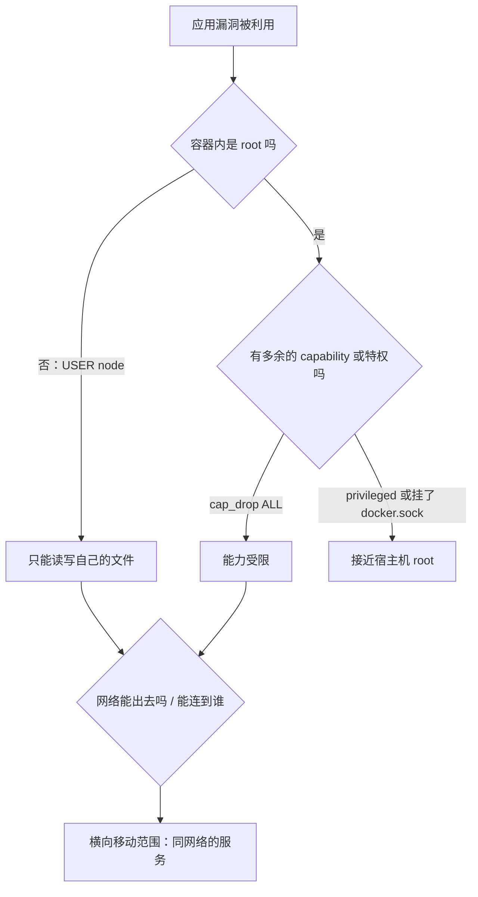

# 容器安全

前面七章在不同地方零散地提到了安全：不进镜像的 `.env`、`USER node`、只绑 `127.0.0.1` 的端口、只读的仓库凭证。这一章把它们收拢成一个完整的视角：容器的安全边界在哪里，攻击者能从哪些地方进来，一个人维护的服务该做到什么程度。最后给出一张可以逐项核对的清单。

## 先认清边界：容器不是沙箱

第 1 章讲过，容器共享宿主机内核，隔离靠的是 namespace 和 cgroup。这意味着：

- 容器的隔离强度**弱于虚拟机**。内核漏洞可能让容器内的进程逃逸到宿主机
- 很多隔离是可以被**配置关掉**的：`--privileged`、挂载 docker.sock、`network_mode: host`、挂载宿主机根目录，每一项都在拆墙
- 容器里默认的 root，和宿主机的 root 是**同一个 UID 0**（除非开启 user namespace 映射），只是被 namespace 和 capability 限制住了

所以容器安全的思路是**纵深防御**：假设应用一定会被攻破，然后让攻破之后能做的事尽量少。



下面按「镜像 → 运行时 → 宿主机 → 供应链」四层来讲。

## 镜像层：不把秘密和多余的东西放进去

### 密钥绝不进镜像

镜像是要推到仓库、拉到各处的分发物。凡是进了镜像的东西，都要假设会被看到：

| 泄露途径 | 例子 | 防法 |
|---|---|---|
| `COPY` 带进了 `.env` | `COPY apps/api apps/api` 而目录下有本地 `.env` | `.dockerignore` 排除 `**/.env*` |
| `ENV` 写了密钥 | `ENV JWT_SECRET=...` | 运行时注入，不在 Dockerfile 里写 |
| `ARG` 传了令牌 | `--build-arg NPM_TOKEN=...` | 用 `--mount=type=secret` |
| 后面的层删掉了 | `COPY key` 然后 `RUN rm key` | 下层仍然保存着它，删除无效 |

如果发现某个已推送的镜像里有密钥，**删镜像不够，必须轮换密钥**：镜像可能已经被拉取或缓存。

### 少即是安全

镜像里每多一个二进制，就多一份可能被利用的东西，也多一份需要打补丁的漏洞：

- 最终阶段不装 curl、git、编译工具链。hatch-counter 用 `node -e` 发请求做健康检查，就是为了不装 curl
- 用多阶段构建去掉源码和开发依赖（第 4 章）
- 对安全要求更高时考虑 distroless：没有 shell，攻击者拿到代码执行权限后连 `sh` 都没有

## 运行时：收紧容器能做的事

### 不用 root 运行

```dockerfile
USER node
```

这是投入最少、收益最大的一项。值得一提的是，hatch-counter 的服务端 Dockerfile 目前**没有** `USER` 指令，容器以 root 运行，这是它可以改进的地方。改的时候要注意，运行时拷进去的文件属主是 root，应用需要写入的目录要用 `COPY --chown=node:node` 或提前创建好并授权。

### 去掉不需要的 capability

Linux 把 root 的特权拆成了几十个 capability（`CAP_NET_ADMIN`、`CAP_SYS_ADMIN` 等），Docker 默认给容器保留了一小部分。一个普通的 Web 服务几乎一个都不需要：

```yaml
services:
  api:
    cap_drop: [ALL]
    security_opt:
      - no-new-privileges:true
```

- `cap_drop: [ALL]` 去掉所有 capability。监听 1024 以下的端口需要 `NET_BIND_SERVICE`，但应用监听 3000 就不需要
- `no-new-privileges` 阻止进程通过 setuid 程序提升权限

Postgres 这类官方镜像的入口脚本启动时需要切换用户、修改数据目录属主，直接 `cap_drop: [ALL]` 可能起不来。对它们要么保持默认，要么逐个加回所需的 capability 并充分测试。

### 只读根文件系统

```yaml
services:
  api:
    read_only: true
    tmpfs:
      - /tmp
```

根文件系统只读后，攻击者无法在容器里写入后门或修改代码。应用确实需要写的地方（临时文件、上传缓存）用 `tmpfs` 或卷单独挂载。开启前要确认应用和依赖不会在运行时往代码目录写东西。

### 资源限制

```yaml
services:
  api:
    deploy:
      resources:
        limits:
          cpus: "1"
          memory: 512M
    pids_limit: 200
```

资源限制既是稳定性措施，也是安全措施：被攻破或有 bug 的容器不能耗尽整台机器的内存、拖垮同机的数据库；`pids_limit` 能挡住 fork 炸弹。

### 永远不要做的几件事

| 配置 | 后果 |
|---|---|
| `privileged: true` | 几乎关闭所有隔离，容器内 root 约等于宿主机 root |
| 挂载 `/var/run/docker.sock` | 容器能调用 Docker API 起一个挂载宿主机根目录的新容器，等于宿主机 root |
| 挂载宿主机 `/` 或 `/etc` | 直接读写宿主机文件 |
| `network_mode: host` | 失去网络隔离，容器能访问宿主机上所有只监听本机的服务 |
| `pid: host` | 能看到并可能干预宿主机所有进程 |

有些工具（某些监控 agent、自动更新容器的工具）要求挂载 docker.sock。用之前要清楚：你是在把宿主机 root 交给这个镜像的作者。

### 运行时的密钥

环境变量是最常用的注入方式，但它并不隐秘：`docker inspect` 能看到，进程崩溃时可能被打进错误报告，子进程会继承。对一个人的单机服务，**环境变量文件 + 严格的文件权限**是务实的选择：

```bash
chmod 600 api.env postgres.env
```

hatch-counter 的 env 文件由一个生成脚本在服务器上产生随机密码，模板（`.env.example`）进 Git，生成结果不进 Git，也不经过本机，部署时的白名单上传脚本根本不包含 `*.env`。

要求更高时可以用 Compose 的 secrets，密钥以文件形式挂到容器的 `/run/secrets/<名字>`，不出现在环境变量里：

```yaml
services:
  api:
    secrets:
      - jwt_secret
    environment:
      JWT_SECRET_FILE: /run/secrets/jwt_secret

secrets:
  jwt_secret:
    file: ./secrets/jwt_secret.txt
```

应用需要支持从文件读取。Postgres 官方镜像支持 `POSTGRES_PASSWORD_FILE` 这种 `_FILE` 后缀的写法。

## 宿主机：守住 Docker 本身

- **docker 组等于 root。** 把用户加进 `docker` 组，等于给了他免密 root。服务器上只给真正需要部署的账号
- **不要把 Docker API 暴露到网络上。** 守护进程默认只监听本地 socket；对外开放 TCP 端口且不加 TLS 认证，是常见的被入侵途径
- **端口和防火墙**：再强调一次，发布的端口会绕过 ufw（第 5 章），用「不发布 / 绑本机 / 云安全组」三层保护
- **及时更新 Docker 和内核**：容器逃逸漏洞大多要靠更新宿主机来修
- **rootless 模式与 user namespace**：Docker 支持以非 root 用户运行守护进程（rootless mode），或者开启 `userns-remap` 把容器里的 root 映射成宿主机上的普通用户。它们能显著缩小逃逸后的影响，但会带来端口、存储驱动、卷权限等方面的限制，适合有余力时再评估

## 供应链：你跑的到底是谁的代码

镜像里的代码大部分不是你写的：基础镜像、系统包、几百个 npm 依赖。

### 只用可信的基础镜像

优先使用 Docker 官方镜像（Docker Hub 上标有官方标识的）或知名厂商发布的镜像。来路不明的第三方镜像可能被植入挖矿程序。

### 扫描漏洞

```bash
# Docker 自带的扫描（需要登录 Docker 账号）
docker scout cves my-api:1.4.0

# 开源工具 Trivy
trivy image my-api:1.4.0
```

扫描结果通常很长，不要被吓到。处理优先级：

1. 先看**高危且有修复版本**的
2. 区分漏洞在基础镜像还是应用依赖里：基础镜像的漏洞，通常重新拉取最新的基础镜像重建就能修
3. 不可达的代码路径里的漏洞可以评估后暂缓

可以把扫描加进 CI，高危漏洞阻断发布。但对一个人的项目，「定期重建镜像以拿到基础镜像的安全更新」往往比复杂的扫描流程更实际。基础镜像 tag 写到 `node:22-alpine` 这一级，每次重建都会拿到最新补丁；用 digest 锁死则需要配合 Renovate 这类工具自动更新。

### 依赖安装

- 用 `--frozen-lockfile`，保证装的就是 lockfile 里审过的版本
- 用 `--ignore-scripts` 或 pnpm 的构建脚本白名单，阻止依赖在安装时执行任意脚本。pnpm 新版本默认不执行依赖的构建脚本，需要显式放行，具体以所用版本文档为准

## 安全检查清单

| 层 | 检查项 | 优先级 |
|---|---|---|
| 镜像 | `.dockerignore` 排除 `.env*` | 必须 |
| 镜像 | Dockerfile 中没有 `ENV` / `ARG` 写密钥 | 必须 |
| 镜像 | 最终阶段有 `USER`，非 root | 必须 |
| 镜像 | 多阶段构建，最终镜像无编译工具、无多余二进制 | 建议 |
| 运行时 | 数据库不发布端口，应用只绑 `127.0.0.1` | 必须 |
| 运行时 | 不用 `privileged`，不挂 docker.sock | 必须 |
| 运行时 | env 文件 `chmod 600`，不进 Git | 必须 |
| 运行时 | 设置内存和进程数限制 | 建议 |
| 运行时 | `cap_drop: [ALL]`、`no-new-privileges` | 建议 |
| 运行时 | `read_only: true` 加 tmpfs | 有余力 |
| 宿主机 | 云安全组只放行 22/80/443 | 必须 |
| 宿主机 | Docker API 不对外暴露，docker 组只给部署账号 | 必须 |
| 宿主机 | 定期更新系统和 Docker | 必须 |
| 供应链 | 只用官方或可信基础镜像，`--frozen-lockfile` | 必须 |
| 供应链 | 定期重建镜像，偶尔扫描漏洞 | 建议 |

让 Claude Code 审查 Dockerfile 和 compose 文件时，可以直接把这张表贴给它，要求逐项给出结论和修改建议。

## 本章要点

- 容器共享内核，隔离弱于虚拟机；安全思路是纵深防御，假设应用会被攻破
- 密钥绝不进镜像；已泄露的密钥必须轮换，删镜像不够
- 以非 root 运行是收益最高的一项；再加 `cap_drop`、`no-new-privileges`、只读根文件系统
- `privileged` 和挂载 docker.sock 都约等于把宿主机 root 交出去
- 运行时密钥用权限严格的 env 文件或 Compose secrets 注入
- docker 组等于 root；Docker API 不对外；发布的端口绕过 ufw
- 只用可信基础镜像，定期重建拿安全补丁，用扫描工具找高危且可修复的漏洞

## 接下来读什么

这本书把一个 Node 服务装进了容器，并用 Compose 在单机上跑了起来。按导读的顺序，接下来可以读：

- 《计算机网络》：DNS、TLS、HTTP 这些「访问不了」时最终要落到的知识
- 《Nginx 与反向代理》：本书一直放在宿主机上的那个 nginx，怎么配 HTTPS、限流和 SSE 代理
- 《部署与 CI/CD》：本书第 6、7 章的发版流程，扩展成零停机发布和完整的流水线
- 《Kubernetes 入门到实战》：当单机 Compose 不够用时，下一步是什么，以及什么时候不该迈这一步
