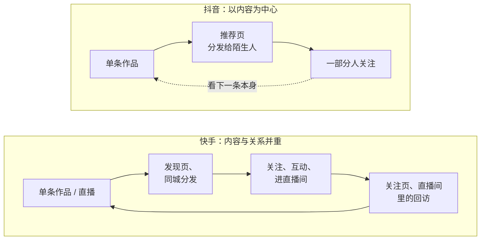

# 两个平台：用户、内容生态与怎么选

抖音和快手常被放在一起说「短视频双雄」，但对创作者来说，它们是两套不同的游戏：抖音更像一个巨大的、以内容为中心的分发机器，单条作品可以在几小时内被推给几百万陌生人，也可以一夜之间归零；快手更像一个以人为中心的社区，粉丝和作者之间的关系更紧，关注页、同城、直播间里的「熟人」流量占的分量更重。

这本书讲的是创作者视角：平台怎么分发、后台怎么看、权限怎么开、违规了怎么办。怎么定位账号、怎么写选题和脚本、怎么拍和剪，见[《账号定位与对标拆解》](../account-positioning/)[《选题与爆款结构》](../topic-and-hooks/)[《短视频脚本与分镜》](../video-script-storyboard/)[《拍摄与剪辑实务》](../shooting-editing/)；直播、投流、带货、商单各有专书，本书只在涉及平台机制时一句话带过。如果你是为了给自己的产品引流而做抖音，先读[《国内私域与内容平台》](../private-domain-cn/)里讲抖音与 B 站的那一章，它讲的是「产品方」的视角；本书讲的是把内容本身当生意的人需要知道的门道。

## 先看规模：数字从哪里来

讨论平台之前先说清楚数字的来源，这件事比数字本身更重要：

> [!WARNING]
> 本表按 2026 年 11 月能查到的最新公开数据整理：快手数字来自快手 2026 年第二季度业绩公告（2026-08-19 发布）原文和 2025 年第四季度及全年业绩公告（2026-03-25 发布，经媒体转述的公告摘录）；抖音数字是第三方估算。快手每季度更新一次，引用前以快手投资者关系网站的最新公告为准。

| 平台 | 指标 | 数字 | 来源与时间 |
|---|---|---|---|
| 快手 | 快手应用平均日活（DAU） | 4.123 亿 | 快手 2026 年第二季度业绩公告（2026-08-19 发布） |
| 快手 | 平均月活（MAU） | 7.973 亿 | 同上 |
| 快手 | 电商 GMV | 2025 年第四季度 5218 亿元，2025 年全年约 1.6 万亿元 | 快手 2025 年第四季度及全年业绩公告（2026-03-25 发布）；2026 年第二季度公告未披露电商 GMV 总额 |
| 抖音 | 月活 | 约 10.29 亿 | QuestMobile《2026 上半年中国移动互联网实力价值榜》（2026-08-04 发布，第三方估算，媒体转述） |
| 抖音 | 视频搜索月活 | 超 5.5 亿 | 字节跳动 2021 年公开表述，**已是旧数据**；截至 2026 年 11 月没有查到更新的官方数字 |

几点说明：

- **快手是上市公司**，每季度公布 DAU、MAU、使用时长、电商 GMV，口径稳定，可以直接引用。上表快手用户数的数据期是 2026 年第二季度。注意快手不是每季都披露电商 GMV 总额，2026 年第二季度公告里就没有这个数，所以表里的 GMV 用的是最近一次披露（2025 年第四季度）。各平台放在一起的对比见[《自媒体与短剧一人公司全景》第 3 章「用户规模」](../media-opc-overview/03-platform-landscape.md#用户规模)
- **抖音属于字节跳动，未上市，不公布官方日活**。网上流传的「抖音日活 7 亿 / 8 亿」多数来源不明。需要引用时，用 QuestMobile、极光这类第三方机构的数据并注明是估算
- 两个平台的体量都已经过了高速增长期。对新创作者的含义是：**流量总盘子不会再自动变大，你拿到的每一份流量都是从别人那里分来的**，内容质量和差异化比几年前更重要

## 两个平台的差异

### 用户

| 维度 | 抖音 | 快手 |
|---|---|---|
| 用户分布 | 覆盖最广，一二线城市和各年龄层都多 | 历史上下沉市场（三线及以下城市、县城、乡镇）用户占比更高，近年在向一二线扩展 |
| 使用习惯 | 「刷」为主，同时搜索习惯很强 | 「刷」+「追」：会追着关注的作者看，常进直播间 |
| 对作者的态度 | 内容好就看，不好就划走，对作者本人的黏性相对弱 | 更容易对作者产生「熟人感」，所谓「老铁」 |
| 消费心智 | 兴趣电商、本地生活团购 | 信任电商：信这个人，所以买他推荐的东西 |

用户分布这一行是行业里的普遍描述，平台自己并不按城市级别公布用户结构，读到具体百分比时要看来源。

### 内容生态

| 维度 | 抖音 | 快手 |
|---|---|---|
| 主信息流 | 单列全屏「推荐」 | 双列「发现」页 + 单列「精选」页并存（具体入口以当前版本为准） |
| 分发重心 | 以单条内容为中心，推荐页占绝大部分流量 | 公开表述强调「普惠」，关注页、同城的分量相对更大 |
| 内容风格 | 制作精良、节奏快、强钩子的内容占优势 | 真实、生活化、有人情味的内容更容易被接受，「土味」不是贬义 |
| 作者成长曲线 | 爆发式：一条爆款可以带来几十万粉丝，但粉丝不一定看你下一条 | 渐进式：涨粉相对慢，但粉丝回访和转化通常更好（行业经验） |
| 主要变现 | 星图商单、带货、团购、直播、知识付费 | 直播带货、磁力聚星商单、快手小店、直播打赏 |

「快手粉丝更值钱」「快手粉丝黏性更高」是行业里反复出现的说法，背后有直播电商数据和大量主播的经验支撑，但没有平台给出过可比较的官方指标，本书把它当作经验看待。

抖音一侧的虚线是说：粉丝看不看下一条，仍取决于下一条本身。

这张图是概括性的对照，不是说抖音没有粉丝回访、快手没有陌生人分发：两个平台都是推荐算法为主，差别在于权重和用户习惯。

## 对创作者意味着什么

### 适合先做抖音的情况

- 内容是**信息密度高、节奏快**的类型：知识科普、技术讲解、测评、职场、财经常识（注意财经类的资质要求，见第 8 章）
- 你有能力把开头做得很强，能接受「大部分作品流量平平、少数作品爆发」的分布
- 变现路径偏向**商单、知识付费、团购**：抖音的星图和本地生活体系更成熟
- 你的内容有**搜索需求**：用户会主动搜「xx 怎么做」「xx 推荐」，抖音的搜索流量值得单独经营（第 5 章）

### 适合先做快手的情况

- 你愿意**持续出镜、和粉丝聊天**，直播是你能接受的形式
- 内容是**生活化、垂直地域、手艺、三农、实体店老板**这类有人情味的题材
- 变现路径偏向**直播带货、长期复购**：快手的「信任电商」更吃人设和关系
- 你不追求一夜爆红，能接受慢慢涨粉

### 两个都做行不行

可以，但要想清楚成本。两个平台的推荐偏好、内容尺度、热门话题都不一样，**同一条视频原样分发，通常有一边效果明显差**。在职副业的现实做法：

1. 选一个主平台，前三个月只在主平台上认真做，每条都看数据、改下一条
2. 另一个平台同步发布原创作品（不是搬运别人，是你自己的作品多平台发），不做专门改编，只当作「顺带的曝光」
3. 三个月后比较两边的数据（第 3 章的复盘表），再决定是否给副平台投入专门精力

多平台分发自己的原创作品不违规；用别人的作品、或者大量账号批量发同质内容，是另一回事，见第 9 章。

## 一个开发者副业的典型时间账

假设你是在职开发者，工作日晚上 1 小时、周末 4 小时可以给内容，每周约 9 小时：

| 事项 | 每周时间 | 说明 |
|---|---|---|
| 选题与脚本 | 2 小时 | 周末集中写 3 条 |
| 拍摄 | 2 小时 | 周末一次拍完 3 条 |
| 剪辑 | 3 小时 | 每条 1 小时左右，熟练后能压缩 |
| 发布与回复评论 | 1 小时 | 工作日每晚 10 分钟 |
| 看数据、复盘 | 1 小时 | 每周固定一次 |

这个节奏下每周 3 条是可持续的上限。很多新人一开始日更，两周后断更，账号反而比稳定周更的差。**平台有没有「断更降权」没有官方说法**，但稳定更新的好处是确定的：你有更多样本可以学习，粉丝也知道什么时候能看到你。

## 用一小时做平台选择

不要凭感觉选平台。花一个晚上，按下面的步骤做一次：

1. **两个平台各刷 30 分钟**：用新装的 App 或退出登录的状态，在搜索框里搜你打算做的领域关键词（比如「Python 教程」「装机」「职场沟通」），看排在前面的作品
2. **各找 5 个同领域账号**：记录粉丝数、近 10 条作品的点赞数中位数、更新频率、是否直播、主要变现方式（主页有没有橱窗、商品、课程）
3. **看评论区**：评论里的人在问什么、说话的方式是什么样的，他们是不是你想服务的人
4. **按下表打分**，每项 1–5 分

| 维度 | 抖音 | 快手 | 说明 |
|---|---|---|---|
| 目标用户浓度 | | | 评论区里是不是你想要的人 |
| 同领域账号的平均表现 | | | 中腰部账号点赞中位数，越高说明需求越大 |
| 竞争强度（反向打分） | | | 头部作品质量越高、越密集，分越低 |
| 内容形式的匹配 | | | 你擅长的形式（口播、录屏、出镜聊天、直播）在这个平台是否主流 |
| 变现路径的匹配 | | | 你想走的变现方式在这个平台是否成熟 |
| 合计 | | | |

分数只是帮你把感觉变成可以比较的东西，差距在 2 分以内时，选你自己更愿意每天打开的那个平台：能坚持比选对更重要。

## 平台规则从哪里看

平台规则变化很快，本书写的规则都标了查阅时间，动手前以下面这些官方入口的最新内容为准：

| 平台 | 入口 | 内容 |
|---|---|---|
| 抖音 | 抖音安全与信任中心（网页 95152.douyin.com，2025 年 3 月上线） | 推荐算法原理说明、社区规范、治理公告、典型案例 |
| 抖音 | App 内「抖音创作者中心」 | 数据中心、创作学习、权限开通、规则说明 |
| 抖音 | App 内「抖音安全中心」 | 账号健康分、违规记录、申诉（路径见第 8 章） |
| 抖音 | 抖音电商学习中心、电商规则中心 | 带货权限、橱窗、保证金规则 |
| 快手 | App 内「创作者中心」/ 网页创作者服务平台 | 数据、任务、权限 |
| 快手 | 快手社区规范、快手安全中心 | 社区规则、违规处理、申诉 |
| 快手 | 快手电商规则中心 | 小店、带货规则 |
| 快手 | 快手投资者关系网站 | 季度业绩、用户规模 |

App 内的入口位置经常随版本调整，书里给出的路径都注明「以实际界面为准」。找不到时，在 App 的搜索框直接搜「创作者中心」「安全中心」，通常能找到官方入口。

## 本章要点

- 快手是上市公司，用户数据以季报为准（2026 年第二季度 DAU 4.123 亿、MAU 7.973 亿）；抖音不公布官方日活，引用第三方数据要注明是估算
- 抖音以单条内容为中心分发，爆发强、粉丝黏性相对弱；快手内容与关系并重，涨粉慢、回访和转化好（后者是行业经验，不是官方指标）
- 信息密度高、有搜索需求、走商单和知识付费的内容先做抖音；愿意出镜聊天、走直播带货和长期复购的先做快手
- 副业创作者选一个主平台做满三个月，另一个平台只同步自己的原创作品
- 规则以抖音安全与信任中心、创作者中心、快手社区规范等官方入口为准，书中规则都标了查阅时间
