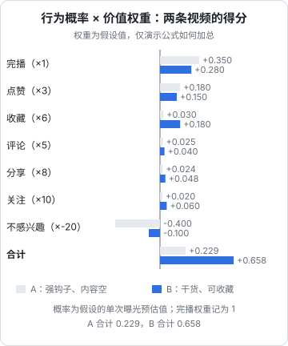
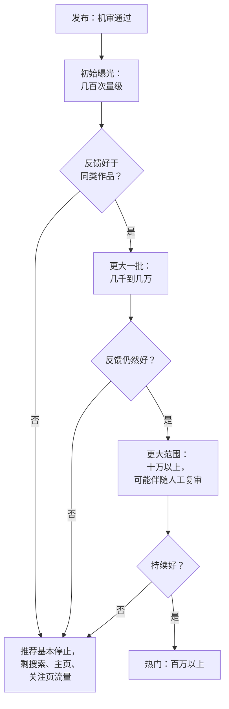

# 推荐机制：官方说了什么，行业怎么说

几乎每个做短视频的人都听过「流量池」「八级流量池」「赛马机制」「标签」「权重」这些词，也几乎每个人都在某个时刻怀疑过「我是不是被限流了」。这一章把推荐机制分成三层来讲：

1. **官方公开说法**：平台自己在官网、发布会、公开报道中说过的话，可以直接作为依据
2. **行业经验**：创作者和 MCN 从大量账号的数据中总结出的规律，有参考价值，但不是规则，也可能过时
3. **流言**：没有来源、无法验证、或者和官方说法直接冲突的说法，本章会点名几个常见的

分清这三层的意义在于：官方说法决定了你优化的方向，行业经验帮你判断数据是否正常，流言只会浪费你的时间，甚至诱导你做违规的事。

## 抖音官方公开过什么

2025 年 3 月 30 日，抖音在 2025 中国网络媒体论坛上宣布上线「抖音安全与信任中心」网站（95152.douyin.com），首次系统公开推荐算法原理、社区规范和治理体系。随后在 4 月的媒体开放日上，抖音的算法和治理负责人又做了更具体的说明。2026 年 1 月发布的《2025 抖音安全与信任年度报告》称，2025 年全年举办了 30 余场面向媒体和学界的算法沟通会。

下面这些是能在官方网站或多家主流媒体（新华网、界面新闻、财联社、虎嗅等，2025 年 3–4 月报道）中对上的说法：

| 官方说法（转述） | 对创作者的含义 |
|---|---|
| 推荐流程包括召回、过滤、排序，核心是学习用户行为；用到协同过滤、双塔召回、Wide&Deep 等模型 | 和主流推荐系统一样，没有神秘配方 |
| 推荐系统已经几乎不依赖给内容和用户「打标签」，而是用神经网络**预估每个用户对每条内容的行为** | 「打标签」「账号标签不精准」这套说法已经不是官方描述的主要机制 |
| 综合「预测用户行为概率」和「行为价值权重」确定推荐优先级，得分高的内容推给用户 | 你要提高的是用户产生有价值行为的概率 |
| 采用多目标建模：完播、评论、点赞、分享、跟拍、对作者的长期消费等；明确提到把收藏率纳入目标 | 不是只看完播率，收藏、关注后持续看你都算 |
| 每次反馈有正负价值，「不感兴趣」是负反馈 | 吸引人点进来但让人反感的内容会被扣分 |
| 强调用户长期价值，而不是平台短期数据 | 标题党、骗完播的手法，长期看会被模型学到 |
| 有多样性打散、多兴趣召回、随机探索、搜索与推荐联动、「不感兴趣」后抑制同类等防止「信息茧房」的措施 | 小众内容也有机会被探索流量推到 |
| 所有发布的内容都会被评估，**流量越高评估次数越多、标准越严** | 越往大流量走，审核越严 |
| 治理是「人工 + 机器」：机器做全量广度评估，人工对复杂、敏感、模糊的情况做深度研判 | 爆款被人工复审是正常流程，不等于被针对 |
| 推荐算法只能预估点赞、转发等行为，内容本身是让用户产生这些行为的关键；网红不是平台「强推」的 | 没有「内部扶持名单」可以走后门 |

### 「概率 × 权重」怎么理解

官方没有公开具体公式和权重。用一个**假设的例子**来理解这个逻辑：对某一位用户，系统预估他看到视频 A、视频 B 时各种行为的概率，每种行为乘以一个价值权重，加起来就是这条视频对这位用户的得分。

图里的概率和权重都是编的，只用来说明加总方式，真实权重不公开，而且会随平台目标调整。但这个例子能说明几件事：

- **强钩子骗来的完播，抵不过「不感兴趣」的扣分**。A 的开头更抓人，完播概率更高，但看完觉得被骗的人点了不感兴趣，总分反而低
- **收藏、关注、分享这类「深度行为」概率小，但权重高**。B 让人想收藏、想关注，即使完播略低，总分也高得多
- **得分是「对每个用户」算的**。同一条视频，对喜欢技术内容的人得分高，对只看搞笑的人得分低。所以「推给对的人」本身就是机制的一部分，你不需要也没办法手动「打标签」

### 快手公开过什么

快手没有像抖音那样上线专门的算法说明网站。能查到的最接近官方口径的是高管公开讲话和招股阶段的报道（2020 年前后）：

- 快手强调「普惠」的分发理念：用基础曝光量和流量爬坡机制，加上对头部视频的「基尼系数」调节，避免流量过度集中
- 快手副总裁余敬中在公开发言中提到，播放量超过 50 万的头部视频只占全网流量的约 30%，约 70% 的流量给了普通人的视频（媒体转述，约 2020 年）
- 有券商研报描述快手新作品先在同城、关注等小范围曝光，达到阈值后逐级扩大，热度到一定程度后反而会降低曝光机会、把机会让给新人

这些是几年前的口径，当前的具体参数没有公开。可以确定的是：快手在理念上比抖音更强调分配的均衡和社交关系，第 7 章会展开。

## 行业经验：流量池与冷启动

### 「流量池」说法

行业里最流行的模型是「流量池」：新作品先推给一小批用户（初始池），根据这批用户的反馈决定是否推入更大的池子，一级一级往上走。

这个模型**不是官方公开的机制**，图中各级的播放量数字也是行业里常见的说法，每家说的都不一样（有「八级流量池」「六级」各种版本）。它和官方说法的关系是：

- 官方说「流量越高评估次数越多、标准越严」，和「越往上越严」一致
- 但官方描述的是对**每个用户**实时预估行为后排序，并没有离散的「池子」。更准确的理解是：系统一开始对这条新内容的预估不确定，先少量试探；有了真实反馈后预估变准，好的内容得分上升，自然被更多人的排序选中

所以「流量池」是一个**够用的心智模型**，用来理解「为什么播放量会卡在某个数」「为什么爆款会突然起来」，但不要把它当成有固定门槛的规则，更不要花钱买所谓「突破 xx 流量池」的服务。

### 冷启动：新作品和新账号

| 现象 | 行业解释 | 可信度 |
|---|---|---|
| 新作品发布后前几个小时的数据最关键 | 初始反馈决定预估是否上调 | 和官方机制一致，较可信 |
| 老作品过几天、几周突然又有流量 | 「复推」：搜索带来新互动、热点相关、被模型重新探索 | 较可信，很多创作者在后台见过 |
| 新账号前几条播放很低，有的卡在 200–500 | 新内容缺少反馈数据，试探量小；也可能是内容本身问题 | 现象常见，数字不可当规则 |
| 「养号」：新号要先刷几天同类视频、点赞评论，才能「打上标签」 | 认为账号行为会影响作品推荐对象 | **存疑**：官方说已不依赖标签；而用工具批量「养号」属于违规（第 9 章） |
| 粉丝多的账号新作品起步更快 | 粉丝会在关注页看到并互动，提供了初始正反馈 | 较可信，但粉丝不爱看的作品照样会冷 |

对新号最实在的建议是：**不用纠结「养号」，用正常方式使用 App，把精力放在前 30 条作品的质量和迭代上**。冷启动怎么规划内容，见[《账号定位与对标拆解》](../account-positioning/)。

### 几个常见流言

| 流言 | 实际情况 |
|---|---|
| 「删除作品会降权」 | 没有官方说法。删除低质作品本身不违规；但频繁大量删除、重发同一条，可能被识别为重复内容 |
| 「改了昵称 / 简介会掉流量」 | 没有官方依据。正常修改资料没问题，频繁改动可能影响用户识别你 |
| 「发布后自己转发到微信群让朋友点赞能助推」 | 朋友不是目标用户，他们的行为可能让模型推给错的人；组织互赞互评属于虚假互动的风险范围 |
| 「某个时段发布有加成」 | 平台没有时段加成。发布时间影响的是你的目标用户此刻是否在线（第 4 章） |
| 「买 DOU+ / 粉条会让自然流量变差」 | 没有官方说法支持；投流的逻辑见[《投流与数据分析》](../paid-traffic/) |
| 「用了某个热门 BGM 必上热门」 | 没有这种机制。BGM 能影响观看体验和二创关联，但不保证流量 |

## 搜索流量和推荐流量是两条路

推荐是「平台替用户挑」，搜索是「用户自己找」。抖音官方提到「搜索与推荐联动」是防信息茧房的手段之一，说明两者在系统里互相影响：用户搜过的内容会影响推荐，推荐里看过的内容也会影响搜索结果。

对创作者，两条路的区别是：

| 维度 | 推荐流量 | 搜索流量 |
|---|---|---|
| 来得快不快 | 快，发布后几小时到几天 | 慢，可能几周后才开始稳定 |
| 持续多久 | 通常几天内衰减 | 只要有人搜、你排得上，可以持续几个月甚至几年 |
| 决定因素 | 预估的互动行为 | 内容与搜索词的相关性、内容质量、用户点击和满意度 |
| 你能做什么 | 做好开头和内容本身 | 选有搜索需求的题、把关键词写进标题文案和口播 |

第 5 章专门讲抖音搜索。

## 把机制翻译成动作

理解机制的目的是指导下一条怎么做：

1. **前 3 秒让对的人留下，让不对的人尽快划走**。官方模型是按用户算分的，让不感兴趣的人在前 2 秒划走，比让他看到一半再点「不感兴趣」好
2. **为一种深度行为设计内容**：要收藏就给清单、步骤、模板；要评论就留一个人人能答的问题；要关注就让人知道「下一条还有」
3. **不要骗**：标题党、假结尾、诱导互动（「点赞过万更新下一集」「不转发倒霉三年」）会带来负反馈，后者还属于平台明确治理的「诱骗、强迫用户互动」
4. **看后台的「同类作品对比」，而不是网上的固定基准**（第 3 章）
5. **爆款之后不要急着变**：下一条用同样的结构换一个选题，验证是选题爆还是结构爆

## 本章要点

- 抖音 2025 年 3 月上线安全与信任中心，公开推荐原理：用神经网络预估每个用户对每条内容的行为，按「行为概率 × 行为价值权重」排序，多目标、长期价值导向，已几乎不依赖打标签
- 「不感兴趣」是负反馈，收藏、关注、分享等深度行为权重高；骗来的完播抵不过反感带来的扣分
- 流量越高评估越多、标准越严，爆款被人工复审是正常流程
- 「流量池」是行业心智模型，不是官方规则，各级播放量数字不能当门槛；「养号」说法存疑，批量养号属于违规
- 快手公开强调「普惠」和基尼系数调节，相关数字多为 2020 年前后的高管口径
- 推荐流量来得快去得快，搜索流量慢但持久，两条路要分别经营
