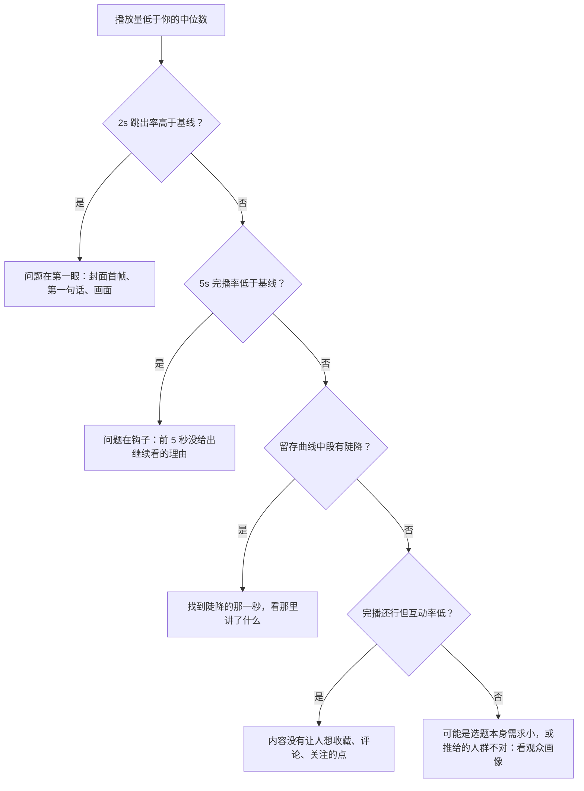
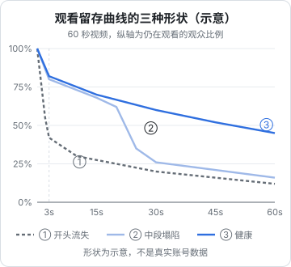

# 核心指标与创作者后台

上一章说推荐系统在预估用户行为。你看不到系统内部的预估值，但能在创作者后台看到这些行为的**实际结果**：多少人看完、多少人在前两秒划走、多少人收藏、有多少流量来自搜索。读懂这些数字，才能知道下一条该改开头、改结构，还是改选题。

这一章讲三件事：后台在哪里、每个指标是什么意思、怎么用它们做诊断和复盘。

## 后台入口

| 平台 | 手机端 | 网页端 |
|---|---|---|
| 抖音 | 「我」→ 右上角菜单（三横线）→「抖音创作者中心」；或「我」页面上的创作者中心卡片 | 抖音创作服务平台（creator.douyin.com），扫码登录 |
| 快手 | 「我」或侧边栏 →「创作者中心」 | 快手创作者服务平台（cp.kuaishou.com），扫码登录 |

以上路径以 2026-11 的版本为准，App 改版后菜单位置可能变化，找不到时在 App 内搜索「创作者中心」。

**建议用网页端看数据**：屏幕大，能同时看多条作品的对比；手机端适合发布后看实时数据。

在抖音创作者中心里，和数据相关的主要是「数据中心」（或「数据分析」）板块，下面一般分为：账号总览、作品数据（每条作品的详细分析）、粉丝画像。快手创作者中心的结构类似。具体板块名称以实际界面为准。

## 每个指标是什么意思

### 抖音作品数据

下面这些指标在抖音创作者中心的单条作品分析中可以看到（名称以实际界面为准，有的指标只在作品发布一段时间后、或播放达到一定量后才显示）：

| 指标 | 含义 | 它反映什么 |
|---|---|---|
| 播放量 | 作品被播放的次数 | 总体分发规模，是结果而不是原因 |
| 完播率 | 看完整条视频的播放占比 | 整体内容是否撑得住 |
| 平均播放时长 | 每次播放平均看了多久 | 和视频时长一起看，比完播率更能比较不同长度的作品 |
| 2s 跳出率 | 播放不到 2 秒就划走的比例 | **开头的第一眼**：封面首帧、第一句话、画面是否让对的人停下 |
| 5s 完播率 | 看过 5 秒的比例 | **开头的钩子**：前 5 秒是否让人想继续看 |
| 点赞、评论、分享、收藏 | 各类互动的次数 | 内容在哪个维度打动了人 |
| 新增粉丝（作品涨粉） | 通过这条作品关注你的人数 | 这条内容是否让人想看「下一条」 |
| 主页访问 | 从作品点进你主页的次数 | 好奇「这个人还做了什么」 |
| 观众留存曲线 | 每一秒还有多少人在看 | **具体在哪一秒流失** |
| 流量来源 | 推荐页、搜索、关注页、个人主页、同城等各占多少 | 流量的结构，第 5 章用来判断搜索流量 |
| 观众画像 | 性别、年龄、地域、兴趣分布 | 推给的人是不是你想要的人 |

### 快手作品数据

快手创作者中心的作品数据也包含播放、完播率、平均播放时长、点赞、评论、分享、收藏、涨粉、观众画像和流量来源等。流量来源里会区分发现页、精选页、关注页、同城、搜索等入口（以实际界面为准）。快手特别值得看的是**关注页和同城的占比**，它反映了你的「关系流量」有多少，第 7 章会讲。

### 自己算的三个比率

后台给的大多是绝对数，建议你在复盘表里自己算三个比率，让不同播放量的作品可以比较：

$$
\text{互动率} = \frac{\text{点赞} + \text{评论} + \text{分享} + \text{收藏}}{\text{播放量}}
$$

$$
\text{收藏率} = \frac{\text{收藏}}{\text{播放量}}, \qquad \text{千次播放涨粉} = \frac{\text{新增粉丝}}{\text{播放量}} \times 1000
$$

- 互动率衡量「看过的人里有多少人愿意动一下手」
- 收藏率对知识、教程、清单类内容最重要：收藏说明「以后还要用」，也是官方明确提到纳入的目标
- 千次播放涨粉衡量「这条内容的人设吸引力」，播放高但千次涨粉低，说明内容好看但人们不觉得需要关注你

## 什么水平算正常

这是新手最常问的问题，也是网上错误信息最多的地方。

**平台没有公开过「完播率多少算好」「互动率多少算好」的官方标准**。网上流传的各种基准值（比如「完播率 30% 以上算优秀」「5 秒视频完播率基准 60%、15 秒 40%、1 分钟以上 20%」）都来自个人创作者或培训机构的经验，彼此口径不一致。它们不可靠的原因很简单：

- 完播率和视频时长强相关：15 秒的视频和 3 分钟的视频不可能用同一个标准
- 不同赛道差异巨大：搞笑、剧情类的互动率和知识类完全不同
- 平台口径会调整：同一个指标名，不同时期的计算方式可能不同

**更可靠的比较对象有两个**：

1. **后台给出的对比**：抖音创作者中心的部分指标旁边会显示与「同类作品」或「你近期作品」的对比（以实际界面为准）。这是平台用真实数据算出来的，比任何网上基准都准
2. **你自己的中位数**：取你最近 10 条作品每个指标的中位数作为基线，新作品和基线比

用中位数而不是平均数，是因为短视频的播放量分布非常偏：一条爆款会把平均数拉高很多，让其他作品看起来都「不达标」。

## 诊断：从指标到原因

拿到一条作品的数据后，按这个顺序看：

### 读留存曲线

留存曲线是最有信息量的一张图，它告诉你观众在哪一秒离开：

| 形状 | 典型原因 | 怎么改 |
|---|---|---|
| ① 开头流失 | 第一句是铺垫、自我介绍、「大家好今天讲」；画面无信息 | 把结论或冲突放到第一句；第一帧就有主体 |
| ② 中段塌陷 | 某一段节奏拖沓、离题、信息重复；或者开头承诺的东西迟迟不给 | 剪掉陡降处前后 5 秒；把答案提前 |
| ③ 健康 | 每隔几秒有新信息，开头承诺在中后段兑现 | 记下这条的结构，复用到下一条 |

留存曲线在结尾处的小幅回升，常常是有人回看或在结尾处评论，不用过度解读。

### 从流量来源看结构

| 现象 | 含义 |
|---|---|
| 推荐页占绝大多数，其他几乎为零 | 正常的新号或泛内容账号 |
| 搜索占比持续上升 | 你的内容开始被人主动找到，值得按第 5 章加强 |
| 关注页占比高，但播放总量小 | 粉丝在看，但新内容没能打动陌生人；检查开头和选题 |
| 个人主页来源占比高 | 有人从一条作品点进主页连看多条，说明主页内容组织得好（合集见第 4 章） |

### 从观众画像看「推给谁了」

如果你做的是面向职场人的效率工具教程，画像却显示大量 18 岁以下用户，说明内容的表现形式（比如过于娱乐化的开头）吸引来的人和你想要的人不一致。这时候数据再好也要警惕：这批粉丝不会为你的变现买单。

## 每周复盘表

每周固定一个时间（比如周日晚上），把本周作品的数据录进一张表。可以用飞书表格、Notion、Excel，或者你自己写个小工具：

| 字段 | 示例 | 说明 |
|---|---|---|
| 发布日期 | 2026-10-28 | |
| 标题 / 选题 | 3 个让 Git 少出错的配置 | |
| 结构类型 | 清单 | 清单、对比、反转、故事等，见[《选题与爆款结构》](../topic-and-hooks/) |
| 时长 | 48s | |
| 播放量（发布后 7 天） | 12,400 | 统一取第 7 天的数，便于比较 |
| 2s 跳出率 | 以后台为准 | 与基线比，记「高 / 平 / 低」 |
| 5s 完播率 | 以后台为准 | 同上 |
| 完播率 / 平均播放时长 | | |
| 互动率 | 4.1% | 自己算 |
| 收藏率 | 1.6% | 自己算 |
| 千次播放涨粉 | 3.2 | 自己算 |
| 搜索流量占比 | 8% | |
| 留存陡降点 | 22s | 看留存曲线 |
| 本条结论 | 开头好、22 秒处讲原理太长 | 一句话 |
| 下一条改什么 | 原理压缩到 5 秒 | 一个动作 |

表里的示例数字是为了说明字段含义，不代表正常水平。

复盘时的几条纪律：

- **一次只改一个变量**：这周改开头，下周再改时长，否则不知道是哪个改动起的作用
- **统一取第 7 天的数**：有的作品前两天平平、后来靠搜索慢慢起来，第 1 天的数会误导你
- **至少积累 10 条再下结论**：单条的波动很大，「这周播放掉了一半」可能只是选题差异

## 数据能不能自动拉取

开发者自然会想写程序自动抓数据。需要知道的边界：

- 抖音开放平台、快手开放平台提供了面向第三方应用的接口，需要以企业主体申请应用并通过审核，用户授权后才能读取其账号的部分数据。能拿到哪些字段、需要什么资质，以开放平台文档为准
- **用爬虫模拟登录、抓取后台页面，或者用非官方工具批量读取数据，违反平台用户协议，账号有被处罚的风险**，也不要把自己的账号授权给来路不明的「数据分析工具」
- 个人副业阶段，每周手动录 3–5 条数据只要 15 分钟，没必要自动化

给创作者做数据工具的产品机会和接口限制，见[《给创作者和短剧团队做工具》](../creator-tools/)。

## 检查清单

每条作品发布 7 天后：

- [ ] 记录 7 天播放量、完播率、平均播放时长、2s 跳出率、5s 完播率
- [ ] 算互动率、收藏率、千次播放涨粉
- [ ] 和自己近 10 条的中位数比较，标出高于和低于基线的指标
- [ ] 看留存曲线，记下最大的陡降点在第几秒
- [ ] 看流量来源，记下搜索占比
- [ ] 看观众画像是否符合预期人群
- [ ] 写一句结论、一个下一条要改的动作

## 本章要点

- 抖音、快手都有手机端和网页端创作者后台，复盘建议用网页端；入口以实际界面为准
- 2s 跳出率看第一眼，5s 完播率看钩子，留存曲线看具体哪一秒流失，流量来源看搜索和关系流量的占比
- 自己算互动率、收藏率、千次播放涨粉，让不同播放量的作品可比
- 平台没有公开指标的「及格线」，网上的基准值口径不一；用后台给出的同类对比和自己近 10 条的中位数作基线
- 每周固定复盘，统一取第 7 天的数据，一次只改一个变量
- 自动拉数据只能走开放平台的授权接口，爬虫和来路不明的工具有封号风险
