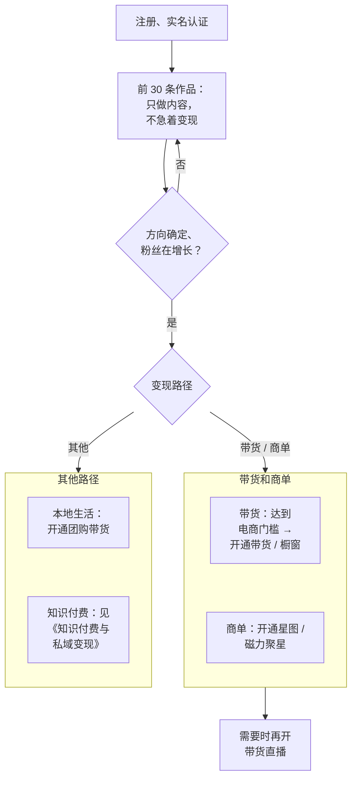

# 账号权限与功能解锁

内容做起来之后，下一步是变现：挂商品、带团购、开直播、接商单。这些功能在两个平台上都不是默认开放的，需要满足条件后申请开通，统称「权限」。

这一章是一份**权限地图**：每个权限是什么、开通条件大致是什么、从哪里申请、开通后要遵守什么。怎么用这些权限赚钱（选品、话术、报价、投流）各有专书：带货与团购见[《带货与选品》](../ecommerce-selling/)，直播见[《直播实战》](../live-streaming/)，商单见[《广告商单与品牌合作》](../brand-deals/)，投流见[《投流与数据分析》](../paid-traffic/)，收入怎么纳税见[《自媒体与短剧合规财税》](../media-compliance/)。

> [!WARNING]
> **权限的开通条件是平台规则里变化最频繁的部分**：粉丝门槛、保证金金额、内容数量要求一两年就会调整一次，网上大量文章还停留在几年前的规则。本章按截至 2026-11 能查到的官方或主流媒体资料整理，有出处的标明了出处和时间，查不到可靠出处的只写「以官方为准」、不给数字；开通前以 App 内开通页面和抖音电商学习中心、快手电商规则中心、巨量星图 / 磁力聚星官方规则为准。

## 开通任何权限之前

几乎所有权限都有几个共同前提：

| 前提 | 说明 |
|---|---|
| 实名认证 | 直播、带货、收益提现都需要。在 App 的设置或创作者中心里完成，用本人身份证 |
| 年龄 | 直播、带货一般要求成年。2022 年中央文明办等四部门《关于规范网络直播打赏 加强未成年人保护的意见》要求平台不得为未满 16 周岁的未成年人提供网络主播账号注册服务，为 16 至 18 周岁的未成年人提供时须征得监护人同意；平台自己的开播、带货规则往往更严，以页面提示为准 |
| 账号状态 | 没有严重违规，抖音的账号健康分（第 8 章）处于正常区间；有违规记录的账号可能被限制开通 |
| 绑定手机号 | 与实名一致 |
| 收款方式 | 收益提现需要绑定本人的银行卡或支付账户；以个体户、公司主体接单的情况见《自媒体与短剧合规财税》 |

**一个身份证能实名多少个账号、同一人开多个带货账号的规则**，以平台实名认证页面和电商规则为准，第 9 章会讲多账号的边界。

## 抖音的权限

### 总览

| 权限 | 是什么 | 开通入口（以实际界面为准） | 条件出处 |
|---|---|---|---|
| 直播 | 开直播、直播打赏 | 首页「+」→「开直播」 | 以开播页面为准 |
| 电商带货（商品橱窗） | 在视频、直播、图文里挂商品，主页展示橱窗 | 创作者中心 →「电商带货」或「商品橱窗」 | 《抖音电商创作者入驻管理规范》，2025-04 修订 |
| 团购带货 | 在视频、直播里挂本地生活团购（餐饮、休闲娱乐等） | 创作者中心 →「团购带货」类入口 | 以抖音生活服务相关规则为准 |
| 星图（商单） | 接品牌通过巨量星图下发的广告任务 | 创作者中心 →「星图」或「我的星图」 | 以巨量星图规则为准 |
| 创作者激励类计划 | 平台不定期推出的流量收益、任务奖励 | 创作者中心的「变现」「任务」类页面 | 以计划规则为准 |
| 企业号 | 企业认证后的经营组件 | 设置 → 账号 → 认证 | 见[《国内私域与内容平台》](../private-domain-cn/) |

### 电商带货：2025 年的分级门槛

> [!WARNING]
> 本节的粉丝分级门槛按 2025-04 修订、2025-04-17 生效的《抖音电商创作者入驻管理规范》及当时的媒体报道整理，可能已再次调整，以抖音电商学习中心的规范原文和创作者中心开通页面为准。

2025 年 4 月，抖音电商修订了《抖音电商创作者入驻管理规范》，把个人创作者的带货权限按粉丝数分级（南方都市报报道，大众日报等转载，2025-04-10；修订自 2025-04-17 起生效）：

| 有效粉丝数 | 可开通的权限 |
|---|---|
| ≥ 200（达到后的次日起） | 直播间带货 |
| ≥ 500 | 视频带货，并可在个人主页和评论区展示橱窗 |
| ≥ 1000 | 图文带货 |

修订前，个人创作者开通直播间带货需要超过 1000 个粉丝，不足 500 粉只能开通橱窗。

截至 2026 年 11 月，本书没有在抖音电商学习中心 / 规则中心查到这份规范的原文页面，也没有查到 2025 年 4 月之后再次调整门槛的报道，上表仍以当时的媒体报道为依据。

需要注意：

- **「有效粉丝」不等于后台显示的粉丝总数**。平台会剔除异常、不活跃等粉丝，具体口径以电商后台显示为准。这也是刷粉没用的原因之一：买来的粉丝通常不算有效粉丝，还会触发处罚
- **保证金**：开通带货需要缴纳作者保证金。据 IT 之家 2026 年 2 月 5 日报道，抖音电商当月调整了作者保证金规则：保证金分基础、浮动、风险三类，开通商品分享功能时缴纳 500 元基础保证金；浮动保证金按近 30 天推广商品的支付 GMV 设定；应缴金额取三者中最高的一个，不叠加；余额低于应缴金额时，收到通知后 3 天内要补足（原来是 7 天），逾期会关闭商品分享功能。网上「调低到 50 元」的说法没有找到出处。这是媒体对规则的转述，本书没有查到规则原文，**以开通页面的实际要求为准**
- 除粉丝外，规范里可能还有实名、信用分、内容原创度等条件，**以抖音电商学习中心或开通页面展示的规范原文为准**
- 开通后，带货行为受抖音电商的一整套规则约束：商品描述不能夸大、不能引导站外交易（2025 年 8 月抖音电商公布过诱导脱离平台交易的典型案例，处置包括中断直播、关闭电商权限），售后责任等。详见《带货与选品》

**开通步骤**（以实际界面为准）：

1. 完成实名认证
2. 打开抖音创作者中心，找到「电商带货」或「商品橱窗」入口
3. 查看页面列出的开通条件，逐项确认满足
4. 阅读并同意相关协议（这一步请自己认真读，协议里有违规处罚和保证金扣除的条款）
5. 按要求缴纳保证金（如有）
6. 开通后，在「选品广场」或「精选联盟」选择商品加入橱窗

### 团购带货

团购带货是在视频或直播里挂本地商家的团购套餐（餐饮、酒店、休闲娱乐等），用户购买后到店核销，达人获得佣金。适合本地探店、本地生活类账号。

- 达人的开通条件（粉丝数、内容要求等）**我没有查到 2026 年的可靠出处**，网上流传的「1 万粉开通探店」是 2021 年前后的旧规则，以开通页面为准
- 团购视频通常需要添加对应门店的 POI 位置（第 4 章）
- 行业报道显示，抖音团购的重心近年从依赖探店达人转向商家账号自营，探店达人的竞争已经很激烈（36 氪等，2022–2024 年报道）。想做本地生活的新人，先想清楚自己的差异化
- 团购的选品和佣金见《带货与选品》

### 直播

- 开播入口：首页「+」→「开直播」，选择直播类型（视频直播、语音直播、手游直播、电脑直播等，以实际界面为准）
- 前提：实名认证、满足年龄要求；普通直播通常没有粉丝数硬门槛，**带货直播**需要上面的电商权限
- 直播有单独的行为规范（着装、言行、打赏、连麦、PK 等），开播前读一遍抖音直播相关的行为规范
- 直播间搭建、话术、排品、场控见《直播实战》

### 星图：接商单

巨量星图是抖音（巨量引擎）官方的达人商业合作平台，品牌在星图上下单，达人接任务、发布视频，平台担保结算。通过星图接的商单，视频会被平台识别为商业内容并自动标注。

- 达人在创作者中心的「星图」或「我的星图」入口开通，开通后有等级（公开资料显示为 Lv1–Lv4，以星图页面为准），等级影响可接任务的类型和平台展示
- 开通的粉丝门槛：网上流传的「1 万粉可开通星图」来自几年前的文章，**2026 年的条件以星图页面为准**
- **私下接广告不走星图**，平台可能把它视为违规的商业推广（具体以平台的商业内容规则为准），而且没有平台担保、容易被拖欠。这是一个重要的规则风险，商单的报价、合同和交付见《广告商单与品牌合作》

### 创作者激励计划

抖音不定期推出各种按播放、按任务给收益的激励计划（历史上有过「中视频伙伴计划」等）。这类计划的名称、条件、收益规则变化很快，有的已经下线。**以创作者中心「变现」或「任务」页面当前展示的计划为准**，不要相信「代开通 xx 计划」的服务。

## 快手的权限

### 总览

| 权限 | 是什么 | 开通入口（以实际界面为准） | 条件出处 |
|---|---|---|---|
| 直播 | 开直播、礼物收益 | 首页「+」→「开直播」 | 以开播页面为准 |
| 快手小店 / 带货 | 自己开店，或分销别人的商品（类似橱窗） | 创作者中心或「我的小店」类入口 | 以快手电商规则中心为准 |
| 磁力聚星 | 快手官方的达人商单平台 | 创作者中心 →「磁力聚星」类入口 | 以磁力聚星规则为准 |
| 本地生活 | 团购、到店相关 | 以实际界面为准 | 以快手本地生活规则为准 |
| 创作者激励 | 平台不定期的流量扶持和收益计划 | 创作者中心 | 以计划规则为准 |

### 快手电商

> [!WARNING]
> 本节保证金政策来自 2024–2025 年的阶段性政策和媒体报道（2026 年 11 月复查时没有找到更新的规则），可能已调整，以快手电商规则中心的最新公告和开店页面为准。

- 快手电商 2025 年 2 月 2 日发布的十条惠商举措里说：扩大「0 元保证金开店」的类目范围；新入驻达人也可以 0 元保证金带货分销商品；对已入驻的商家和达人持续下调基础保证金（扬子晚报 2025-02-03 报道）。截至 2026 年 11 月没有查到之后再调整的报道，**具体类目和金额以快手电商规则中心为准**
- 2024 年下半年快手电商有过达人免缴基础保证金的阶段性政策（2024-07-19 至 2024-12-31，无违规记录的达人适用），2025 年之后是否延续没有查到可靠出处
- 开通带货的粉丝门槛、作品数要求，**我没有查到可靠的官方出处**，网上的说法很多是把抖音的规则套到快手上，不要采信
- 快手电商规模很大：2025 年第四季度电商 GMV 5218 亿元，全年约 1.6 万亿元（快手 2025 年第四季度及全年业绩公告，2026-03-25 发布）。快手带货的特点和打法见第 7 章与《带货与选品》

### 磁力聚星

磁力聚星是快手官方的达人营销平台，前身是「快接单」，2020 年 9 月升级更名（中国证券报等，2020-09）。截至 2024 年第二季度，入驻达人超过 460 万（媒体报道）。

- 入驻条件以磁力聚星官方页面为准，我没有查到 2026 年的可靠门槛
- 和星图一样，通过磁力聚星接单有平台担保和合规标注，私下接单有违规和结算风险

## 一张开通路线图

在职副业创作者常见的权限开通顺序：

几条建议：

- **别为了开权限而追粉丝数**。200 粉、500 粉、1000 粉的门槛很容易达到，真正决定收入的是粉丝是否信任你、是否和你要卖的东西匹配
- **一个账号聚焦一种主要变现方式**。一个知识类账号突然开始卖各种不相关的商品，粉丝会流失，也会影响内容推荐的人群
- **开通前读协议**。权限协议里写着违规后的处罚：扣保证金、关闭权限、限制提现。尤其注意关于站外交易、虚假宣传、售后的条款
- **不要买卖账号、租借权限**。抖音 2025 年 4 月的「恶意营销号」治理规范把「非法买卖账号」列为十类治理对象之一

## 警惕「代开通」服务

在搜索引擎、社交平台上能看到大量「0 粉开橱窗」「代开星图」「秒开直播权限」的服务。常见的情况：

- 用技术手段或违规方式绕过门槛，账号事后被查处，权限收回、保证金扣除
- 要求你提供账号密码或扫码登录，账号被盗用于发布违规内容、诈骗
- 收了钱什么都没做

**平台的权限都是在 App 内自助申请的，不需要也不存在第三方「代开」**。B 站曾公告提醒「付费代认证」是诈骗高发场景（2024-11），抖音、快手同理。

## 检查清单

- [ ] 已完成实名认证，手机号与实名一致
- [ ] 账号无严重违规，健康分正常（第 8 章）
- [ ] 想开的权限的**当前**条件已经在 App 内开通页面确认，没有依赖网上的旧文章
- [ ] 已阅读并理解权限协议中的处罚、保证金和售后条款
- [ ] 想清楚这个权限和账号定位、粉丝人群是否匹配
- [ ] 收款、纳税方式已经想好（见《自媒体与短剧合规财税》）
- [ ] 没有使用任何「代开通」服务，没有把账号交给第三方

## 本章要点

- 权限开通条件变化最频繁，一律以 App 内开通页面和官方规则为准，不要依赖旧文章
- 共同前提：实名认证、成年、账号无严重违规、绑定本人收款方式
- 抖音电商 2025-04-17 起个人创作者按有效粉丝分级：200 粉直播带货、500 粉视频带货和橱窗、1000 粉图文带货；保证金金额说法不一，以页面为准
- 星图、磁力聚星是官方商单平台，有平台担保和商业标注；私下接单有违规和结算风险
- 快手电商扩大了 0 元保证金类目，具体门槛未查到可靠出处
- 不追门槛数字，一个账号聚焦一种主要变现方式；不买卖账号、不用「代开通」服务
