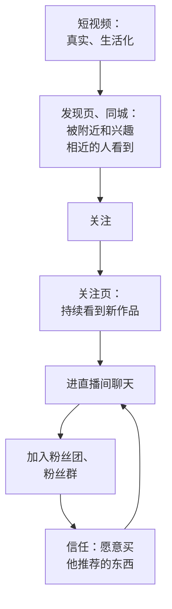

# 快手：老铁生态、私域属性与磁力聚星

前面几章以抖音为主，快手作为对照穿插其中。这一章专门讲快手：为什么同样的内容在快手和抖音的表现会不一样，快手的「老铁」关系怎么形成、怎么经营，快手站内的私域工具有哪些，以及磁力聚星商单和快手电商对创作者意味着什么。

## 快手的基本盘

> [!WARNING]
> 本节按 2026 年 11 月能查到的快手业绩公告整理（2026 年第二季度公告 2026-08-19 发布，已核原文；2025 年第四季度及全年公告 2026-03-25 发布，依据媒体转述的公告摘录），每季度都会更新，以快手投资者关系网站的最新公告为准。

先看官方数据（快手 2026 年第二季度业绩公告，2026-08-19 发布；电商 GMV 这一季没有披露总额，用最近一次披露的 2025 年第四季度数字）：

| 指标 | 数字 |
|---|---|
| 快手应用平均日活 | 4.123 亿（上年同期 4.089 亿） |
| 平均月活 | 7.973 亿（上年同期 7.148 亿） |
| 电商 GMV（单季） | 2025 年第四季度 5218 亿元，同比增长 12.9%；2025 年全年约 1.6 万亿元 |
| 线上营销服务收入 | 206 亿元，同比增长 4.4% |
| 可灵 AI 收入 | 单季超过 8.5 亿元，同比增长超过 200% |
| 日活用户人均日使用时长 | 2026 年第二季度公告未披露；媒体报道 2025 年第四季度约 126 分钟 |

这些数字说明几件事：

- **用户规模稳定，增长放缓**：日活同比增长不到 1%，月活增长更快一些，平台的增量主要来自电商、广告和 AI，而不是新用户
- **用户使用时长很长**：人均每天两个多小时，这为直播和长时间的粉丝关系提供了基础
- **电商是快手的核心**：单季 5000 亿元以上的 GMV，大部分来自直播电商，这决定了快手对「能带货的创作者」的重视
- 快手还是可灵 AI 的母公司，也在做短剧业务。AI 短剧在快手的发行见[《短剧发行、投流与备案》](../drama-distribution/)

## 「老铁」是怎么形成的

「老铁」是东北方言里「关系很铁的朋友」，后来成了快手用户之间、主播和粉丝之间的称呼。它背后是快手几个产品设计和社区特点的叠加：

### 普惠的分发理念

快手公开强调「普惠」：通过基础曝光和流量爬坡，加上对头部视频的基尼系数调节，避免流量过度集中在少数大号（快手高管公开讲话，媒体转述，约 2020 年）。对普通创作者的含义是：**刚开始也能拿到一些曝光，但单条作品的爆发上限相对抖音弱一些**。这是理念层面的说法，当前的具体参数没有公开。

### 双列和单列并存

快手的「发现」页是双列瀑布流，用户看到一屏多个封面，自己选择点哪个；「精选」页是单列全屏，和抖音的推荐页类似。快手在 2020 年前后推出单列模式后，两种形态长期并存（入口和默认形态以当前版本为准）。

双列的含义是：**用户有选择权**。他会挑自己熟悉的主播、感兴趣的封面点进去，而不是被动接受推荐。这让「我认识这个人」在快手上更有价值。

### 关注页和同城

快手的关注页、同城页长期是重要的入口。关注页里的内容来自你关注的人，同城页里的内容来自你附近的人。这两个入口都是「关系」和「地域」驱动的，而不是纯内容驱动。

### 直播的分量

快手的很多头部创作者以直播为主业，短视频更像是给直播间引流的预告和切片。粉丝在直播间里和主播实时聊天、刷礼物、下单，长时间的互动让关系变得更紧。

## 内容打法上的差异

同一个人在两个平台上做内容，经常会发现「抖音的爆款在快手平平，快手的爆款在抖音没人看」。行业里总结的差异（经验，不是平台规则）：

| 维度 | 抖音更吃 | 快手更吃 |
|---|---|---|
| 制作 | 精剪、快节奏、信息密度高 | 真实、少剪辑、像在和朋友说话 |
| 人设 | 专业、有记忆点的角色 | 接地气、可信赖的「自己人」 |
| 语言 | 普通话、网络流行语 | 方言、口语都可以，甚至更受欢迎 |
| 题材 | 知识、测评、剧情、颜值、潮流 | 生活日常、手艺、三农、实体店、家庭、地域特色 |
| 更新 | 稳定周更也可以 | 更新频率和直播频率对关系维持更重要 |
| 与粉丝互动 | 回复评论 | 回复评论、直播里叫出老粉的名字、粉丝群聊天 |

对技术背景的创作者，这意味着：**如果你的内容是信息密度高的知识讲解，抖音通常更合适**。但有几类技术相关内容在快手也有空间：手机维修、电脑装机、家电维修、软件实操教学（面向中老年、小商家），这些内容和快手用户的实际需求更近。

## 快手站内的私域工具

「私域」在快手上有两个层面，一定要分清：

1. **站内私域**：关注关系、粉丝团、粉丝群、直播预告这些平台自己提供的工具。平台鼓励使用
2. **站外导流**：把粉丝引到微信等其他平台。**快手和抖音一样限制站外导流**，以快手社区规范为准

本节只讲站内私域。

| 工具 | 是什么 | 怎么用（以实际界面为准） |
|---|---|---|
| 关注 | 最基础的关系 | 每条作品结尾给出关注的理由（下一条讲什么），而不是喊「点个关注」 |
| 粉丝团 | 直播间的粉丝组织，有等级和标识 | 直播中引导老粉加入；粉丝团等级让老粉有身份感 |
| 粉丝群（站内群聊） | 快手 App 内的群聊 | 在主页或直播间开放入群，用来发直播预告、日常交流 |
| 直播预告 | 提前告诉粉丝什么时候开播 | 在作品、主页、群里发布，固定开播时间 |
| 作品评论区 | 公开的对话场所 | 认真回复，记住常来的老粉 |

站内私域的运营节奏可以参考：

1. **前期**：先用短视频积累第一批关注，每条作品认真回复评论
2. **开始直播**：粉丝有几百人后，尝试固定时间开播，哪怕只有十几个人在线，也是建立关系的开始。直播的具体打法见[《直播实战》](../live-streaming/)
3. **建粉丝群**：直播间常来的人邀请进群，群里发预告、聊日常，不要变成广告群
4. **固定节奏**：每周固定的作品更新 + 固定时间的直播，让老铁养成「到点来看」的习惯

### 衡量关系的指标

在快手创作者中心的数据里（以实际界面为准），除了第 3 章的通用指标，额外关注：

| 指标 | 含义 |
|---|---|
| 关注页流量占比 | 粉丝主动在关注页看你的比例，越高说明关系越紧 |
| 同城流量占比 | 本地内容的触达情况 |
| 粉丝观看占比 | 观看者中粉丝的比例 |
| 直播场观中的粉丝占比、回访 | 有多少老粉反复来看直播 |
| 粉丝团人数、粉丝群活跃 | 核心粉丝的规模 |

这些指标没有统一的「正常值」，和自己过去比，看趋势是否向上。

## 快手的变现路径

| 路径 | 说明 | 详见 |
|---|---|---|
| 直播带货 | 快手的核心变现方式，信任电商 | 《直播实战》[《带货与选品》](../ecommerce-selling/) |
| 快手小店 | 自己开店或分销 | 《带货与选品》 |
| 磁力聚星商单 | 官方达人商单平台 | [《广告商单与品牌合作》](../brand-deals/) |
| 直播打赏 | 粉丝送礼物 | 《直播实战》 |
| 本地生活 | 团购、到店 | 《带货与选品》 |
| 短剧 | 快手有短剧业务，AI 短剧可以在快手发行 | [《微短剧行业全景》](../micro-drama-industry/)《短剧发行、投流与备案》 |

### 磁力聚星

磁力聚星是快手官方的达人营销平台，2020 年 9 月由「快接单」升级而来，截至 2024 年第二季度入驻达人超过 460 万（媒体报道）。品牌在磁力聚星上找达人合作，平台负责撮合、担保和结算。

对创作者需要知道的几点：

- 入驻条件以磁力聚星官方页面为准，**我没有查到 2026 年的可靠门槛**
- 快手的品牌合作往往更看重**带货转化和粉丝信任**，而不只是播放量。粉丝不多但信任度高、转化好的达人也能接到合作（行业经验）
- 和抖音星图一样，**私下接单不走官方平台**有违规风险，也没有结算保障

### 「信任电商」的边界

快手的信任电商是双刃剑：粉丝因为信任你而买东西，一旦你卖了质量差的商品、夸大宣传，失去的不只是一次销售，而是整个关系。快手历史上几次头部主播翻车事件（如卖假货、虚假宣传被处罚）都说明，**快手对带货品质的要求和处罚力度都很大**。

几条底线：

- 只卖自己用过、了解的商品
- 不夸大功效，不用绝对化用语，不承诺做不到的售后
- 不做「家族」「师徒」式的流量互导来卖不明来源的商品（行业里有这类玩法，存在虚假宣传和售后纠纷风险）
- 不把粉丝引到站外交易：既违反平台规则，粉丝出了问题也没有平台保障

## 快手和抖音怎么配合

如果你已经在抖音做出了内容方向，想拓展快手：

1. **先同步原创作品，不做改编**：观察哪类作品在快手表现更好
2. **快手单独回复评论**：快手的评论区更像聊天，回复的价值更大
3. **在快手尝试直播**：快手的直播门槛和氛围对新人更友好（行业经验），可以把它当作练直播的地方
4. **数据分开看**：两个平台的基线分别算，不要用抖音的数据标准评价快手

如果你本来就适合快手（生活化、手艺、本地、愿意直播），可以反过来以快手为主、抖音为辅。

## 检查清单

- [ ] 想清楚自己的内容更适合「信息密度」的抖音，还是「人和关系」的快手
- [ ] 快手作品的封面信息足够在双列里被选中
- [ ] 每条作品的评论都认真回复，记住常来的老粉
- [ ] 粉丝有几百人后，开始尝试固定时间直播
- [ ] 建立站内粉丝群，用来发预告和交流，不做广告群
- [ ] 跟踪关注页占比、粉丝观看占比、直播回访等关系指标
- [ ] 不站外导流，不私下接单，带货只卖了解的商品

## 本章要点

- 快手 2026 年第二季度日活 4.123 亿、月活 7.973 亿，2025 年全年电商 GMV 约 1.6 万亿元；日活增长放缓，电商和直播是核心
- 「老铁」关系来自普惠分发、双列可选、关注页和同城入口、直播长时间互动的叠加
- 快手更吃真实、生活化、可信赖的人设；信息密度高的知识内容通常更适合抖音
- 站内私域工具：关注、粉丝团、粉丝群、直播预告；站外导流同样被限制
- 磁力聚星是官方商单平台，入驻门槛以官方为准；快手品牌合作更看重信任和转化
- 信任电商是双刃剑：只卖了解的商品、不夸大、不站外交易
