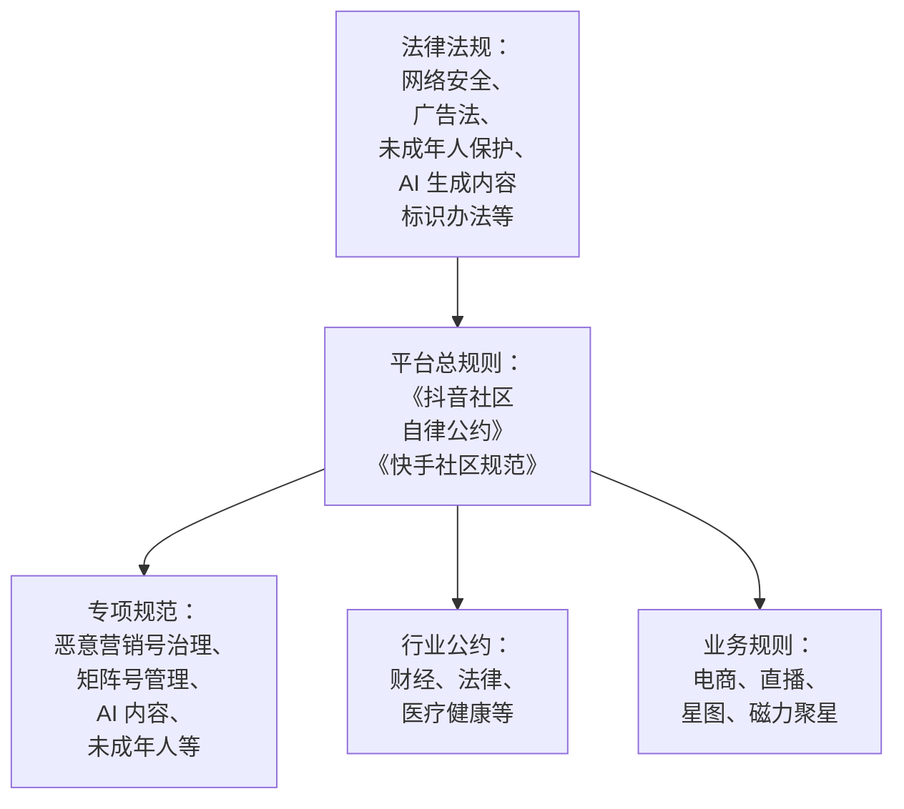

# 违规、限流与申诉

做内容久了，几乎每个人都会遇到：某条作品突然「仅自己可见」、收到一条违规通知、或者播放量连续几天掉到平时的十分之一，开始怀疑自己「被限流了」。这一章讲：规则从哪里来、哪些行为最容易违规、怎么判断是不是真的被处罚了、被处罚后怎么申诉。

[《国内私域与内容平台》](../private-domain-cn/)里讲平台规则与封号风险的那一章，从产品引流的角度讲过导流和广告的法律底线；本章从内容创作者的角度展开抖音、快手的具体规则和处理流程。

## 规则的层次

> [!WARNING]
> 本章引用的法规和平台规范按截至 2026-11 的公开资料整理，各处标了发布日期，规则会持续更新；动手前以抖音安全与信任中心、快手安全中心及各业务规则中心的最新原文为准。



| 层次 | 抖音 | 快手 | 去哪里看 |
|---|---|---|---|
| 总规则 | 《抖音社区自律公约》 | 《快手社区规范》 | 抖音安全与信任中心；快手 App 设置里的规则入口 |
| 专项 | 《「恶意营销号」治理规范》（2025-04-28 发布）、《矩阵号不当行为管理规范》（2023-11）、AI 内容标识相关公告 | 专项规则和治理公告 | 抖音安全与信任中心、站内公告；快手安全中心 |
| 行业公约 | 《抖音社区法律行业公约》（2025-11-24）、《抖音社区财经行业公约（试行）》（2025-12-16）等 | 以快手公告为准 | 同上 |
| 业务规则 | 抖音电商规则中心、直播规范、星图规则 | 快手电商规则中心、直播规范、磁力聚星规则 | 各业务后台 |

## 最常见的违规类型

按创作者「最容易无意中踩到」排序：

| 类型 | 常见形式 | 风险 |
|---|---|---|
| 站外导流 | 画面、字幕、口播、简介、评论、私信里出现微信号、手机号、二维码或谐音、拆字变体 | 高，作品处置 + 账号功能限制 |
| 非原创、搬运 | 搬运他人作品、轻微剪辑后重发、批量混剪别人的素材 | 高，《恶意营销号治理规范》明确列出「频繁发布抄袭搬运内容」 |
| 虚假互动 | 刷量、买粉、互赞群、用工具批量点赞关注 | 高，大小号可能一并处置 |
| 诱导互动 | 「不转发倒霉」「点赞过万更新」、用虚假福利或诅咒诱骗互动 | 中高，2026 年抖音十大案例之一 |
| 专业领域无资质 | 未认证就讲具体的投资建议、医疗诊断、法律意见，或推荐相关服务 | 高，财经、法律已有专门公约 |
| AI 内容问题 | 未声明 AI 生成；AI 仿冒公众人物；AI 生成不实信息 | 高，2026 年十大案例中占两类 |
| 虚假人设、伪造权威 | 假冒医生、律师、专家、「内部人士」身份引流 | 高，2026 年十大案例第一类 |
| 不当蹭热点 | 借灾难、悲剧事件博流量；编造与热点相关的不实信息 | 高 |
| 低俗、擦边 | 低俗着装和动作、擦边标题 | 中高，未成年人可见时更严 |
| 危险行为 | 危险动作、危险驾驶，没有安全提示 | 中 |
| 未成年人相关 | 未成年人出镜不当、让未成年人参与商业推广、暴露未成年人隐私 | 高 |
| 广告违规 | 未标注的商业推广、绝对化用语、虚假宣传 | 中高，涉及《广告法》 |
| 侵权 | 未授权的音乐、影视片段、字体、他人肖像 | 中，被投诉后处置 |

### 2025 年《「恶意营销号」治理规范》的十类行为

抖音 2025 年 4 月 28 日发布的新版治理规范，明确了十类治理行为（IT 之家，2025-04-28）：

1. 频繁发布抄袭搬运内容
2. 工业化生产和批量发布同质化内容
3. 开设矩阵账号违规获利
4. 引流「收徒」，兜售虚假「运营技巧」
5. 黑灰产团伙违法犯罪
6. 非法买卖账号
7. 诱骗、强迫用户互动以不当获利
8. 违法违规导流，实施诈骗
9. 不当蹭热点博取关注
10. 虚假人设不当获利

第 2、3 条和 AI 批量生产、矩阵运营直接相关，第 9 章展开。第 4 条值得做副业的人特别注意：**「教你做抖音月入过万」类的收徒、卖课，本身就是治理对象**，你在学习时也要警惕这类课程。

2026 年 6 月 12 日，抖音公布了该规范实施一年的治理情况：累计处置违规账号 387.4 万个，其中 232 万个账号通过参与合规学习、考试等方式恢复了分值，恶意营销类违规内容占比下降 41.24%；同时公布了十大典型案例，包括伪造权威人设引流、AI 仿冒公众人物虚假营销、规模化生成 AI 主播发布不实信息、用 AI 生成彩票预测引流站外、以虚假福利或诅咒诱骗互动等（IT 之家，2026-06-12）。

### 专业领域：财经、法律、医疗

这几个领域的门槛在 2025 年明显提高了：

- **财经**：2025 年 12 月 16 日发布的《抖音社区财经行业公约（试行）》明确禁止未经认证的账号发布财经专业内容或推荐相关服务，并规定了账号资质、内容管理、营销行为和违规处理
- **法律**：2025 年 11 月 24 日发布的《抖音社区法律行业公约》从账号资质和内容管理两方面明确了法律内容的治理规则
- **医疗健康**：抖音长期对医疗健康类内容有资质认证要求，以安全与信任中心的最新规则为准

对开发者做副业的含义：讲编程、讲工具、讲职场，通常不涉及这些领域；但如果你想讲「程序员怎么理财」「被裁员怎么维权」，要先读对应的行业公约，搞清楚哪些可以讲（个人经历分享）、哪些不能讲（具体投资建议、个案法律意见）。

## 账号健康分（抖音）

> [!WARNING]
> 本节按 2025-04 的媒体报道（健康分 2025 年 5 月下旬试运行）整理，分值规则和查询入口可能已调整，以抖音安全中心页面展示的最新说明为准。

抖音 2025 年随《「恶意营销号」治理规范》推出了账号健康分机制，2025 年 5 月下旬开始试运行（IT 之家，2025-04-28）：

| 项目 | 内容 |
|---|---|
| 初始分 | 100 分，随内容违规情况和账号历史行为动态变化 |
| 扣分 | 力度由违规严重程度和账号历史行为共同决定；公开报道中没有具体扣分数值 |
| 加分 | 一定周期内无违规；参加平台学习考试可免扣或加分；申诉通过后解除处罚并回分 |
| 低分后果 | 按分值区间由高到低逐步加严，包括但不限于减少推荐、限制投稿、限制变现权益 |
| 查询路径 | 抖音 App →「我」→ 右上角三横线 → 更多功能 →「抖音安全中心」（以实际界面为准） |

**建议每个月看一次健康分**，哪怕你没收到任何通知。分数下降时，安全中心通常能看到对应的违规记录。

快手也有对应的账号状态和违规记录查询，入口在 App 的设置或安全中心里，以实际界面为准。

## 「我是不是被限流了」

这是创作者社群里被问得最多的问题，也是「测限流」「解限流」骗局最多的地方。

### 先分清三种情况

| 情况 | 特征 | 怎么确认 |
|---|---|---|
| 正常波动 | 某几条数据差，但没有通知，其他作品正常 | 和自己近 10 条的中位数比，看是否在正常波动范围内 |
| 作品被处置 | 单条作品「仅自己可见」、提示审核不通过、或收到针对该作品的通知 | 看作品状态和站内通知 |
| 账号被处罚 | 收到账号违规通知；健康分下降；某些功能（投稿、直播、私信、带货）被限制 | 看安全中心、违规记录、健康分 |

**平台的处罚一般会有通知**。如果没有任何通知、健康分正常、作品状态正常，播放量下降大概率是内容本身的原因：选题、开头、和近期作品比变差了，或者竞争变激烈了。按第 3 章的方法诊断，而不是去找「限流」的解法。

### 排查步骤

1. **看站内消息**：系统通知里有没有违规、处罚类消息
2. **看安全中心**：健康分是否变化，违规记录里有没有新条目
3. **看作品状态**：在作品管理里看每条作品的可见范围和状态
4. **看功能是否正常**：能否正常发布、开播、私信、挂商品
5. **看数据趋势**：最近 10 条和之前 10 条的中位数比较，是整体下降还是个别作品下降
6. **自查最近的作品**：对照上面的违规类型表，看有没有踩线的地方

以上都正常，就不是限流，是内容问题。

### 不要用的「解法」

- **「测限流」工具、小程序**：需要你授权账号或提供作品链接，无法真正读取平台的内部状态，有的会盗号
- **「解限流」付费服务**：平台的处罚只能通过官方申诉解除，不存在第三方「解封」
- **删除所有作品重新开始**：可能删掉了还在带来搜索流量的作品，也解决不了根本问题
- **注册新号绕过处罚**：抖音的矩阵号管理规范把「违规小号被封后重新注册新账号继续引流」列为违规行为（新华网，2023-11-30）

## 申诉

### 什么时候申诉

- 你确认没有违规，是误判：比如原创作品被判为搬运、正常科普被判为医疗违规
- 违规事实存在，但处罚明显过重，或者已经整改：这种情况申诉成功率低，可以说明情况
- 收到通知中有「申诉」入口。提示「不予复核」的处罚，一般不能申诉

### 申诉入口（以实际界面为准）

| 平台 | 入口 |
|---|---|
| 抖音 | 违规通知消息里的「申诉」按钮；抖音安全中心的违规记录里对应条目；「设置 → 反馈与帮助」中的账号申诉类入口（第三方整理的路径，以实际界面为准） |
| 快手 | 违规通知消息里的申诉入口；设置中的帮助与客服、安全中心 |

申诉的处理时效、可申诉次数没有找到官方统一说明，网上说法不一，以申诉页面的提示为准。

### 准备材料

| 被判的问题 | 可以提供的证据 |
|---|---|
| 非原创、搬运 | 原始素材文件、剪辑工程文件截图、拍摄花絮、首发平台链接和时间、作品的创作过程说明 |
| 侵权（音乐、素材） | 授权书、购买记录、使用的是平台曲库或已获授权的素材库 |
| 专业领域无资质 | 资质证书、认证信息；或说明内容属于个人经验分享，不构成专业建议 |
| AI 相关 | 说明哪些部分是 AI 生成、已添加声明；没有使用 AI 时提供拍摄原片 |
| 导流 | 说明画面中的信息是什么（比如误识别的数字），提供原始素材 |

### 申诉理由怎么写

原则：**事实清楚、证据对应、语气平和、不要长篇大论**。一个示例：

```text
申诉作品：《Git 提交写错了怎么改》（2026-10-28 发布）
处罚原因：非原创内容

申诉理由：
本作品为本人原创。画面为本人电脑屏幕录制和本人出镜口播，脚本由本人撰写。
提供以下材料：
1. 剪辑工程文件截图（含原始录屏素材列表和时间线）
2. 拍摄现场照片
3. 本人在其他平台首发该内容的时间截图（早于本平台发布时间）
画面中的终端命令为公开的 Git 官方命令，并非搬运他人作品。
恳请复核，谢谢。
```

不要做的：情绪化指责平台、威胁「投诉到监管部门」、在申诉里说其他账号也这样做、提交伪造的证据。

### 申诉失败之后

- 仔细读处罚通知和申诉回复，搞清楚到底是哪里被判定违规
- 能参加平台学习考试恢复分值的，按要求参加（抖音 2026 年公布的数据中，232 万账号通过这种方式恢复了分值）
- 调整之后的内容，避免同类问题再次出现
- 永久封禁且不予复核的，接受结果。这时才能体会到「不要把所有资产放在一个平台」的意义：见《国内私域与内容平台》中关于降低单点风险的部分

## 预防比申诉重要

### 发布前的合规自查

第 4 章的发布前检查清单里的「合规」部分，每条都过一遍。另外：

- **建立自己的「风险词表」**：你的赛道里容易被误判的词（比如讲网络安全时的「攻击」「破解」，讲健康时的「治疗」「功效」），写脚本时注意表达方式
- **专业内容加限定**：「以下是我个人的经验，不构成投资建议」这类声明不能让违规内容变合规，但能让个人经验分享的性质更清楚
- **保存原始素材**：每条作品的原始素材和工程文件至少保存半年，被误判搬运时这是最有力的证据

### 账号层面

- 每月查一次健康分和违规记录
- 不让别人代运营你的账号，不把账号借给别人用
- 不在多个设备、多个地点频繁切换登录（可能触发安全风控）
- 不加入互赞互粉群，不用任何自动化工具操作账号

## 检查清单

**收到违规通知后**

- [ ] 截图保存通知内容
- [ ] 在安全中心查看违规记录和健康分变化
- [ ] 对照违规类型表，判断是误判还是确有问题
- [ ] 确有问题：整改相关作品，参加学习考试（如有）
- [ ] 误判：准备证据，按申诉入口提交，理由简洁、证据对应
- [ ] 记录这次事件，更新自己的风险词表和发布前检查清单

**怀疑被限流时**

- [ ] 查站内通知、安全中心、作品状态、功能是否正常
- [ ] 比较最近 10 条和之前 10 条的中位数
- [ ] 都正常：按内容问题诊断，不找第三方「解限流」

## 本章要点

- 规则分层：法律 → 社区自律公约 / 社区规范 → 专项规范和行业公约 → 业务规则，以安全与信任中心等官方原文为准
- 最常踩的线：站外导流、搬运、虚假互动、诱导互动、无资质讲专业内容、AI 未声明或仿冒、虚假人设
- 抖音 2025-04-28 发布《「恶意营销号」治理规范》，列出十类行为，配套账号健康分（初始 100 分，可通过无违规、学习考试、申诉成功恢复）
- 财经、法律领域 2025 年底出台了专门的行业公约，未认证账号不能发布专业内容或推荐服务
- 处罚一般有通知；没有通知、健康分正常时，数据下降多半是内容问题，不要用「测限流」「解限流」服务
- 申诉要事实清楚、证据对应，保存原始素材和工程文件；被封后不要注册新号绕过
