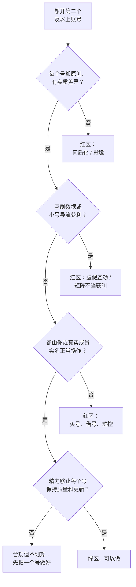

# 多账号与矩阵的合规边界

一个账号做起来之后，很多人会想：再开几个号，是不是收入就能翻几倍？培训课里也常讲「矩阵打法」「一个人管 50 个号」「AI 批量生产铺量」。对开发者来说这尤其有诱惑力：写个脚本、接上 AI，好像就能把内容生产变成流水线。

这一章讲清楚：哪些多账号做法是正常经营，哪些是平台明确打击的，以及中间的灰色地带怎么判断。结论先放在前面：**多账号本身不违规，违规的是「批量、同质、互刷、导流获利、规避处罚」**。

## 规则从哪里来

> [!WARNING]
> 下表按 2023–2026 年的法规通知、平台规范和媒体报道整理（各行标了时间），规则可能已调整，以网信办公告和抖音安全与信任中心、快手安全中心的最新规范原文为准。

| 来源 | 时间 | 和多账号相关的内容 |
|---|---|---|
| 中央网信办《关于加强「自媒体」管理的通知》 | 2023-07 | 媒体报道称，通知要求平台严格执行账号注册数量规定（「一人一号、一企两号」的说法），严禁操纵「自媒体」账号矩阵发布传播违法和不良信息 |
| 抖音《矩阵号不当行为管理规范》 | 2023-11（新华网 2023-11-30 报道） | 打击有组织批量发布低质同质内容的矩阵号、小号违规获粉后导向大号变现、违规小号被封后重注册继续引流；大小号一并处置 |
| 抖音《「恶意营销号」治理规范》 | 2025-04-28 | 十类治理行为中包括「工业化生产和批量发布同质化内容」「开设矩阵账号违规获利」「非法买卖账号」 |
| 抖音短剧版权相关公告 | 2026-03（媒体报道） | 一部短剧 / 漫剧只能通过一个抖音账号发布，多个账号重复发布属于违约，相同或相似素材的重复发布也会被治理 |

「一人一号、一企两号」在具体平台上如何落地（同一实名能认证几个账号、哪些功能按实名计算），以各平台实名认证和业务规则页面为准。

### 抖音矩阵号规范的具体内容

据新华网 2023 年 11 月 30 日的报道，抖音的矩阵号规范打击这些行为：

- 违法违规的矩阵号
- 发布大量低质、同质化内容
- 刷粉、刷赞，在社群和评论区发布不良信息，或用高频点赞等方式获取不当流量和粉丝
- **小号违规获粉后，把粉丝引向大号，由大号变现**
- **违规小号被封后重新注册新账号继续引流**
- 以不当获利为目的的站内外引流

处置方式：违规矩阵涉及的**全部账号（大小号）统一处置**，包括取消投稿权限、取消营利权限、抹除账号粉丝、封禁账号；对看似未直接违规但不当获利的账号，也会限制投稿；情节严重的配合公安机关打击。报道中提到，已有多个百万粉丝以上的不当获利大号被抹除粉丝、取消营利权限并无限期封禁。

「大小号一并处置」是这套规则最关键的一点：**一个小号违规，可能连累你辛苦做起来的主号**。

## 三档：绿区、黄区、红区

| 档位 | 做法 | 说明 |
|---|---|---|
| 绿区：正常经营 | 个人号 + 企业 / 品牌官方号 | 例如你的个人 IP 号和你的产品官方号，内容不同、身份清楚 |
| 绿区 | 不同赛道的独立账号 | 一个讲编程、一个讲摄影，各自原创、各自运营 |
| 绿区 | 团队里每个真人有自己的账号 | 每个账号背后是真实的人在出镜、运营 |
| 绿区 | 多门店各自的账号 | 每个账号对应一个真实门店 |
| 绿区 | 同一份原创内容在抖音、快手等**不同平台**各发一次 | 自己的作品多平台分发 |
| 黄区：要谨慎 | 同一平台上多个账号做相近主题 | 内容必须有实质差异；不能互相刷量；不能用小号导流大号获利 |
| 黄区 | 用 AI 辅助批量生产，多账号发布 | 每条有人工审核和实质创作，按规定标识 AI；避免同质化（见下文） |
| 黄区 | 切片号：把长视频、直播剪成短视频发到另一个号 | 必须是自己的内容或获得授权；切片号本身不能做违规导流 |
| 红区：违规 | 同一内容或轻微改动后在多个账号重复发布 | 「批量发布同质化内容」 |
| 红区 | 搬运、混剪他人作品铺量 | 「频繁发布抄袭搬运内容」 |
| 红区 | 账号之间互相点赞、评论、关注刷数据 | 虚假互动 |
| 红区 | 小号做擦边或低质内容涨粉，再导给大号卖货 | 矩阵号规范明确打击 |
| 红区 | 被封后注册新号继续做同样的事 | 规避处罚 |
| 红区 | 买卖账号、租借账号、用他人身份实名 | 「非法买卖账号」；也涉及身份冒用 |
| 红区 | 群控、云手机、接码平台批量注册和操作账号 | 黑灰产工具，平台重点打击，可能涉及违法 |

## 判断一个做法属于哪一档

## AI 批量生产的边界

这是 2025–2026 年变化最大的地方。AI 让「一个人一天生产 100 条视频」变得可能，平台的治理也针对性地跟上了：

- 「工业化生产和批量发布同质化内容」被列入 2025 年的恶意营销号治理规范
- 2026 年公布的十大案例里，「规模化生成 AI 主播形象发布不实信息」「用 AI 生成彩票赌博预测引流站外」「批量伪造迷信内容引流获利」都是 AI 批量生产的典型
- AI 生成内容必须按《人工智能生成合成内容标识办法》（2025-09-01 施行）和平台规则标识

用 AI 不违规，违规的是「批量、同质、不实、不标识」。合规地用 AI 做多条内容，至少要做到：

| 要求 | 具体做法 |
|---|---|
| 每条有实质差异 | 选题、信息、观点不同，不是换个配音、换个背景的同一条 |
| 有人工审核 | 每条发布前有人看过，核对事实，不发布 AI 编造的信息 |
| 按规定标识 | 发布时添加「内容由 AI 生成」声明 |
| 不仿冒真人 | 不用 AI 生成公众人物、他人的形象和声音 |
| 数量和质量匹配 | 发布量和你能审核的量匹配，而不是能生成多少发多少 |

AI 生产的具体工具和流水线见[《AI 内容生产工具链》](../ai-content-pipeline/)；AI 短剧的发行规则（包括一部剧只能一个账号发布的要求）见[《短剧发行、投流与备案》](../drama-distribution/)。

## 合规地做第二个账号

如果判断下来确实适合开第二个账号，按这个顺序：

1. **主号先稳定**：主号已经有稳定的内容方向和更新节奏，数据基线清楚。主号还没做起来，开第二个号只会两个都做不好
2. **定义差异**：写下第二个号和主号在**目标人群、内容主题、表现形式**上的差异，至少有一项是实质不同的
3. **正常注册**：用本人身份（或团队成员本人）正常注册、实名，不用接码、不买号
4. **正常使用**：在 App 内用「添加账号」等官方方式切换账号（抖音、快手都支持在同一设备上登录多个账号，数量上限以 App 为准），不用群控、改机、云手机等工具
5. **关系公开**：两个账号的关系可以在简介里说明（比如「主号：xxx」），不要伪装成两个互不相关的人互相推荐
6. **不互刷**：不用一个号给另一个号点赞、评论、刷数据
7. **分开复盘**：两个号的数据分别建基线、分别复盘（第 3 章）

### 时间账

在职副业每周大约 9 小时给内容（第 1 章的时间账），一个账号每周 3 条已经用满。开第二个号意味着：

- 要么主号降到每周 2 条，第二个号每周 1–2 条
- 要么投入更多时间，或者找合作者

多数情况下，**把一个账号从每周 3 条做到每周 3 条更好的内容，比开两个号各发 1–2 条的回报高**。矩阵的价值在于覆盖不同人群、分散单点风险，而不是简单地「多一个号多一份流量」。

## 团队和 MCN 场景

如果你和朋友组队，或者签了 MCN：

- 每个账号的实名主体要清楚：谁实名、谁出镜、谁运营、收益归谁，写进协议
- **不要用自己的身份证给别人的账号实名**，也不要用别人的身份证给自己的账号实名：账号违规时责任在实名人身上
- MCN 旗下账号违规，平台的处置可能延伸到 MCN（矩阵号规范中提到「清退所属 MCN 机构」）；签 MCN 前了解对方的合规记录。MCN 合同的注意事项见[《自媒体与短剧合规财税》](../media-compliance/)和[《广告商单与品牌合作》](../brand-deals/)

## 检查清单

开新账号前：

- [ ] 主号已经稳定运营至少三个月，有清楚的数据基线
- [ ] 写下了新账号和主号在人群、主题、形式上的实质差异
- [ ] 新账号由本人或团队成员本人实名，正常方式注册
- [ ] 有足够的时间维持两个账号的质量和更新
- [ ] 不打算让两个账号互刷数据或用小号导流大号获利

用 AI 批量生产时：

- [ ] 每条内容有实质差异，不是换皮重发
- [ ] 每条有人工审核和事实核对
- [ ] 每条按规定添加 AI 生成声明
- [ ] 不仿冒真人形象和声音
- [ ] 短剧、漫剧一部只在一个账号发布

日常：

- [ ] 不使用群控、云手机、接码、改机等工具
- [ ] 不买卖、租借账号
- [ ] 某个账号被处罚后不注册新号绕过

## 本章要点

- 多账号本身不违规，违规的是批量同质、搬运、互刷、小号导流大号获利、规避处罚、买卖账号和群控
- 抖音矩阵号规范（2023-11）对违规矩阵的大小号一并处置，一个小号违规可能连累主号
- 2025 年恶意营销号治理规范把「工业化批量发布同质化内容」「开设矩阵账号违规获利」列为治理对象；2026 年的典型案例里有多类 AI 批量生产
- 用 AI 做多条内容要做到：实质差异、人工审核、按规定标识、不仿冒真人、数量与审核能力匹配
- 开第二个号前先让主号稳定，写清楚差异，本人实名、正常方式操作，公开账号关系
- 对副业创作者，把一个号做好通常比开多个号回报更高
