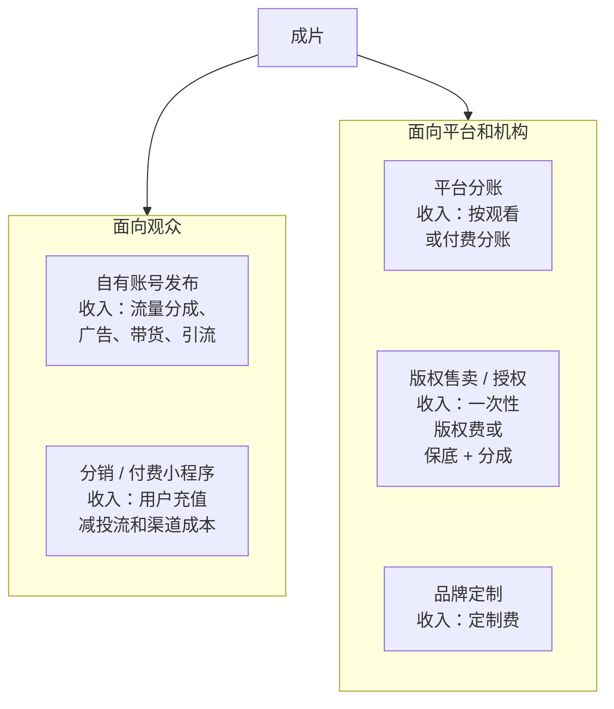
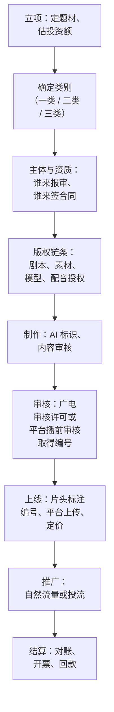

# 发行全景：一部短剧有几条路卖出去

剧本写完、分镜出图、后期合成，一部 AI 短剧终于有了成片。很多技术出身的创作者到这里才发现，**做出来只是一半**：剩下一半是让它合法上线、被人看到、钱真的回到你账上。这一半的规则散落在广电总局的规章、平台的后台说明和行业合同里，没人系统讲过。

这本书讲的就是这一半。

## 这本书讲什么、适合谁、怎么读

**讲什么**：一部短剧从成片到回款的全过程。第 1 章是发行路径全景；第 2–4 章是「准入」：主体资质、广电分类分层审核、AI 短剧的特别要求；第 5–7 章是「上线和赚钱」：平台上线流程、分账结算、投流回收测算；第 8–9 章是「保护自己」：版权和合同；第 10 章讲出海发行。

**适合谁**：在职开发者，已经能用 AI 工具做出短剧或漫剧成片（或者正在学），想知道怎么合规上线、怎么分钱、要不要投流。读者以 AI 短剧 / 漫剧为主，实拍短剧只作为背景对比。

**怎么读**：第 2–4 章建议在**立项之前**读，因为分类分层审核看的是投资额和题材，立项时的选择决定了后面走哪条审核路径。第 5–7 章在找平台、谈分账时读。第 8–9 章在签任何合同之前读。第 10 章想出海时再读。

**不讲什么**：

- **付费、免费、品牌定制、漫剧四种模式的行业格局和数据**：[《微短剧行业全景》](../micro-drama-industry/)
- **剧本、分镜、画面生成、后期制作**：[《短剧编剧》](../drama-scriptwriting/)[《AI 短剧分镜与画面生成》](../ai-drama-storyboard/)[《AI 短剧后期》](../ai-drama-post/)
- **DOU+、千川等通用投流工具的操作**：[《投流与数据分析》](../paid-traffic/)
- **个人收入纳税、MCN 合同等创作者通用财税**：[《自媒体与短剧合规财税》](../media-compliance/)
- **公司注册、ICP 备案、生成式 AI 备案登记**：[《国内合规实务》](../opc-compliance-cn/)

> [!WARNING]
> 本书按截至 2026 年 11 月的政策整理：2026 年 6 月 25 日网络视听司发布 AI 微短剧分类分层标准，7 月 31 日公布《微短剧发展管理办法》（国家广播电视总局令第 16 号，9 月 1 日起施行），之后可能还有新文件和细则；动手前以国家广播电视总局官网和属地省级广电局的最新口径为准。平台分账比例、结算周期属于商业规则，本书只给结构和测算方法，具体数字以平台后台和合同为准。

## 一条贯穿全书的假设场景

为了把规则落到具体操作上，全书用一个假设场景串起来：

- **你**：在职后端工程师，业余和一位做美术的朋友合作，用 AI 工具做漫剧
- **作品**：一部 60 集、每集 1–2 分钟的 AI 漫剧《归墟灯》，东方玄幻题材（一般题材，不涉及特殊题材）
- **成本**：模型和工具订阅、配音、剪辑外包、剧本改编授权，合计约 12 万元
- **目标**：先在国内上线回本，再试试海外短剧平台

这个场景的数字是假设的，用来演示怎么判断、怎么算。每章末尾回到它，看这一步它具体怎么走。

## 发行的五条路

一部短剧变成钱，大致有五条路。它们不互斥，一部剧常常同时走两三条。

### 1. 自有账号发布

在抖音、快手、视频号上开账号，把剧按集发布。收入来自平台的创作者激励、挂载付费合集、广告、或者给别的业务引流。

- **优点**：门槛最低，控制权在自己手里，能直接看到观众反馈
- **缺点**：从零起号很慢；平台对「剧」这种内容形态有专门的上线规则（第 5 章），不是普通短视频那样随手发
- **适合**：第一部作品试水、积累观众和数据

### 2. 平台分账

把剧交给平台，平台上线、推荐，按观看量、会员时长、付费或广告收入给你分钱。典型是免费短剧 App（如红果短剧）、长视频平台的短剧频道（爱奇艺、腾讯视频、优酷）、以及抖音快手的短剧专区。

- **优点**：不用自己投流，平台带流量；结算相对规范
- **缺点**：平台挑剧，新人作品不一定被收；分账规则由平台定，议价能力弱
- **适合**：有一定质量、想稳定拿分账的作品，也是目前 AI 漫剧最主要的出口之一

### 3. 版权售卖与授权

把剧的信息网络传播权卖给（或授权给）发行方、片方、平台，拿一笔版权费，或者「保底 + 分成」。

- **优点**：钱快、风险转移
- **缺点**：价格被压；授权范围写不清楚容易出纠纷（第 8–9 章）
- **适合**：没有发行能力、想专心做内容的团队

### 4. 品牌定制

品牌出钱，请你做一部剧，产品或品牌信息自然植入剧情。钱在开拍前或交付时就拿到。

- **优点**：收入确定，不赌流量
- **缺点**：要有作品履历才接得到；品牌对内容有审核权，周期不可控；涉及广告法要求
- **适合**：已经有代表作的团队。品牌合作的谈判和报价见[《广告商单与品牌合作》](../brand-deals/)

### 5. 分销与付费小程序

这是付费短剧的主流玩法：剧放在微信小程序、抖音小程序或独立 App 里，前几集免费，后面按集付费或充值会员；靠**投流**买量把观众引进来。参与方有版权方（片方）、发行方 / 投流方、小程序运营方，按约定分钱。

- **优点**：爆款收入上限高
- **缺点**：本质是买量生意，投流成本常常吃掉大部分充值；回收周期、素材消耗、渠道费用都要精算（第 7 章）；资金占用大
- **适合**：有资金、懂投放、能承受亏损的团队。**一个在职开发者不建议一上来就自投**

## 五条路怎么选

| 路径 | 前期投入 | 回款速度 | 收入上限 |
|---|---|---|---|
| 自有账号 | 低 | 慢 | 中 |
| 平台分账 | 中（制作成本） | 中（按月结算） | 中 |
| 版权售卖 | 中 | 快 | 低–中 |
| 品牌定制 | 低（对方出钱） | 快 | 中 |
| 付费小程序 + 投流 | 高（投流资金） | 不确定 | 高 |

| 路径 | 需要的能力 | 对新人的友好度 |
|---|---|---|
| 自有账号 | 运营账号 | 高 |
| 平台分账 | 内容质量 | 中 |
| 版权售卖 | 谈判 | 中 |
| 品牌定制 | 作品履历、客户关系 | 低 |
| 付费小程序 + 投流 | 投放、数据、资金 | 低 |

对一个在职、资金有限的开发者，推荐的顺序是：

1. 第一部作品走**平台分账 + 自有账号**，目标是合规上线、拿到第一份对账单、摸清流程
2. 积累两三部作品和数据后，再考虑**版权授权给发行方**或接**品牌定制**
3. **自投付费短剧**放在最后，而且要先用第 7 章的测算表算清楚能亏多少再决定

## 一部剧要过的关

不管走哪条路，一部剧从成片到回款都要过这几关：

注意这张图的顺序：**分类和版权在制作之前**。很多团队做完才发现剧本改编没拿到授权、或者投资额超过了某个档位需要提前报，返工的代价远大于前期花一天理清楚。

## 这本书守的底线

这本书只讲怎么**合规**发行。下面这些不讲，也请不要做：

- 不讲怎么规避审核、绕开备案上线。2026 年 9 月 1 日起施行的《微短剧发展管理办法》明确：未取得相应许可、批准文件或未经播出单位审核标注节目编号的微短剧，不得播出（第 3 章）
- 不讲怎么做虚假、夸大的投流素材。推广信息要与作品内容相匹配，这是办法里的明确要求，平台也在严查
- 不讲借用别人的节目编号、拆分投资额规避分类这类操作，这些都在规章禁止之列

这些不是道德说教，而是实际风险：AI 漫剧在 2026 年经历过一轮集中清理，据媒体报道有大量无合规资质的作品被批量下架（依据为媒体转述，见第 4 章）。被下架意味着前期投入全部归零。

## 《归墟灯》的第一步

回到假设场景。在开始制作之前，你和合作者先做三件事：

1. **估投资额**：模型订阅、配音、外包剪辑、改编授权费合计约 12 万元，远低于 30 万元。按 2026 年 6 月的 AI 微短剧分类分层标准，属于投资额最低一档的一般题材（第 3 章）
2. **定主出口**：先走平台分账，同时在抖音开一个剧集账号
3. **列版权清单**：剧本改编自一部网络小说，需要拿到改编授权；配音用了声音克隆，需要配音演员的书面授权（第 8 章）

这三件事做完，你才知道后面要走哪条审核路径、要准备哪些材料、合同里要写什么。

## 本章要点

- 做出成片只是一半，合规上线、被看到、回款是另一半，也是本书的范围
- 发行有五条路：自有账号、平台分账、版权售卖、品牌定制、付费小程序加投流；常常组合使用
- 在职开发者建议从**平台分账 + 自有账号**起步，自投付费短剧放最后，先算清楚再决定
- 分类（投资额、题材）和版权链条要在**立项时**就理清，它们决定后面的审核路径和合同
- 政策变化快：2026 年 6 月 AI 微短剧分类分层标准、2026 年 9 月 1 日起施行的《微短剧发展管理办法》是当前的主干，以官方最新口径为准
- 不规避审核、不无编号上线、不做虚假推广素材，这些是硬底线，也是实际的经营风险
