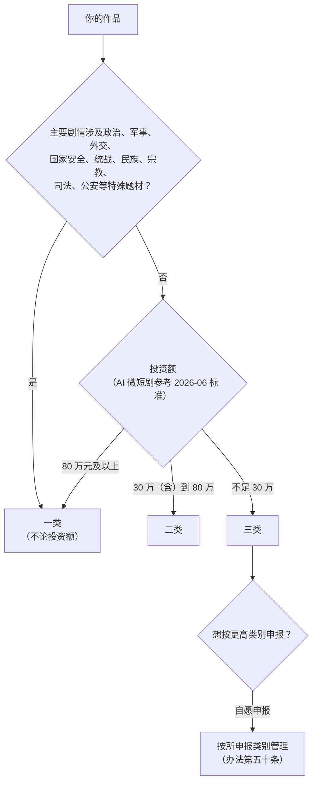
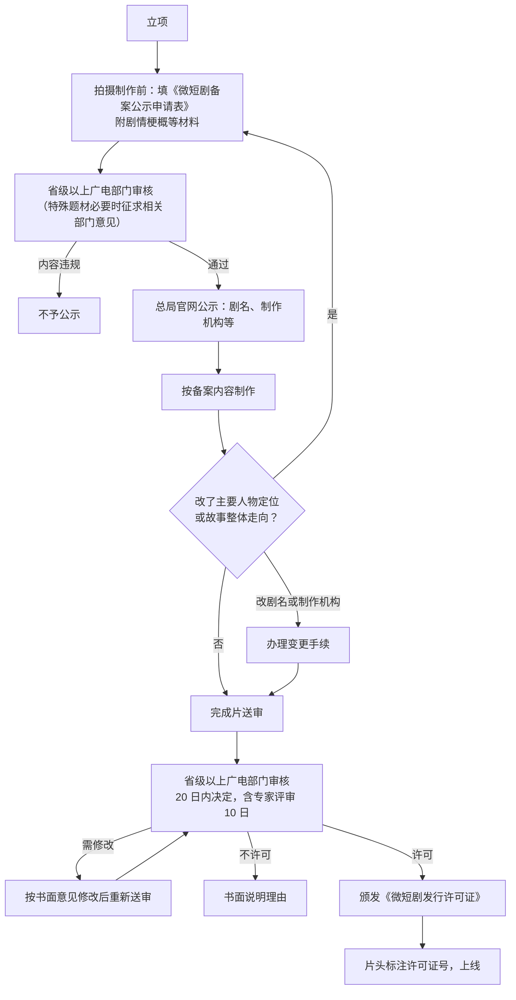
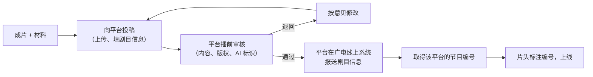

# 广电分类分层审核与备案

这一章是全书最「硬」的部分：一部短剧要拿到什么编号才能上线、由谁审、要多久、要交什么。先说结论：

- 2026 年 9 月 1 日起，微短剧管理的主干是部门规章《微短剧发展管理办法》（国家广播电视总局令第 16 号，2026 年 7 月 27 日局务会审议通过，7 月 31 日公布）
- 作品按投资额和题材分为**一类、二类、三类**，分别由不同层级审核
- AI 微短剧有单独的投资额档位标准（广电总局网络视听司 2026 年 6 月 25 日发布，7 月 1 日起执行）
- 任何一类作品，**没有许可证号、批准文件编号或节目编号都不能上线**

> 本章引用的条文来自国家广电总局官网公布的办法原文（nrta.gov.cn，2026-07-31「国家广播电视总局令第 16 号：《微短剧发展管理办法》」）。分档投资额标准来自新华社等媒体对网络视听司《管理提示》的报道，**依据为媒体转述**，没有查到官网原文。各省的实施细则、系统入口和材料模板以属地省级广电局为准。

## 政策演变：为什么会有三套说法

在网上搜「微短剧备案」，会看到「重点 / 普通 / 其他」和「一类 / 二类 / 三类」两套说法，投资额门槛也有「100 万」和「80 万」两种。它们来自不同时期的文件：

| 时间 | 文件 | 要点 | 出处 |
|---|---|---|---|
| 2024 年 | 广电总局关于微短剧备案的管理提示 | 2024 年 6 月 1 日起未经审核且未备案的微短剧不得上线传播 | 依据为媒体转述 |
| 2025 年 2 月 5 日公开 | 广电总局办公厅《关于进一步统筹发展和安全促进网络微短剧行业健康繁荣发展的通知》 | 「分类分层审核」：重点、普通、其他三类；总投资 100 万元及以上为重点，30 万（含）至 100 万为普通，不足 30 万为其他；所有上线微短剧须持《网络剧片发行许可证》或完成上线报备登记，片头标注编号 | 新华社报道；文号有报道为广电办发〔2024〕35 号，未核对原文 |
| 2026 年 6 月 25 日 | 广电总局网络视听司《管理提示（AI 微短剧分类分层标准）》，7 月 1 日起执行 | AI 微短剧单独定档：80 万元及以上或特殊题材为重点；30 万（含）至 80 万为普通；不足 30 万为其他 | 新华社报道，依据为媒体转述 |
| 2026 年 7 月 31 日公布，9 月 1 日施行 | 《微短剧发展管理办法》（总局令第 16 号） | 部门规章，一类、二类、三类；分类标准由总局制定并适时调整 | 总局官网原文 |

几点理解：

1. **办法是上位规定**。它把类别命名为一类、二类、三类，但没有在条文里写投资额数字，而是「分类标准由国务院广播电视主管部门制定，并可以适时调整」（第五条）
2. 从定义看，一类对应「投资额较大或特殊题材」，二类对应「投资额相对不大的一般题材」，三类对应「投资额较低的一般题材」，和此前的重点、普通、其他一一对应。**本书按这个对应关系讲解，但对应关系和具体数字以总局后续公布的分类标准为准**
3. 对 AI 短剧，目前可参考的数字是 2026 年 6 月的 AI 标准：**80 万、30 万**两条线

## 分清你的作品属于哪一类

几个要点：

- **特殊题材一票定档**。剧情里出现警察办案、法庭审判、军队，哪怕是背景，也可能被认为「主要剧情涉及」。拿不准时，问属地省局或平台审核，不要自己判断
- **投资额要如实**。投资额包括剧本、制作、配音、音乐、后期、授权费等全部制作成本，不含投流费用这一点各方理解基本一致，但你应该保留成本明细，以备说明
- **自愿往上报是允许的**。办法第五十条：不符合一类或二类标准、自愿按该类申报备案和完成片审核的，按相应类别管理。有些平台或品牌合作方会要求作品有省局批准文件，这时可以考虑自愿申报

## 三类作品的审核路径

办法第十七条规定了三种路径：

| | 一类 | 二类 | 三类 |
|---|---|---|---|
| 拍摄前 | **备案公示**：向省级以上广电部门申请，总局统一公示 | 可参照一类备案（「可以参照执行」），以省局细则为准 | 无 |
| 播出前 | 向省级以上广电部门申请内容审核和发行许可 | 向省级以上广电部门申请内容审核 | 播出单位播前审核 |
| 取得 | 《微短剧发行许可证》，总局统一印制 | 省级广电部门的批准文件 | 播出单位标注的节目编号 |
| 时限 | 受理之日起 20 日内作出决定，其中专家评审 10 日（第二十条） | 省局可参照一类，鼓励简化（第二十四条） | 平台自定 |
| 申请人 | 持《广播电视节目制作经营许可证》的制作机构或广播电视播出机构（第十四条） | 以省局细则为准 | 平台按自己的规则要求投稿方 |

### 一类：备案公示 + 审核许可

注意第二十一条：**送审后、取得决定前，不得转向其他主管部门送审**。不能这个省不过就换个省试。

### 二类：省局审核

二类作品是否需要拍摄前备案、走哪个系统、交哪些材料，办法授权省局制定实施细则（第十三条）。实务上：

1. 立项时就打电话问属地省广电局网络视听处（或对应处室）
2. 按省局通知的系统和模板提交
3. 取得批准文件后，片头标注批准文件编号

### 三类：平台播前审核

AI 短剧、漫剧绝大多数落在这一档。流程在平台：

办法第三十三条对播出单位的要求，反过来就是你作为投稿方要配合的：

- 三类作品播前审核，在线上系统报送剧目信息和节目编号
- **非独播的，使用本单位的节目编号，不得使用他人编号**。同一部剧在两个平台播，要分别审核、分别取得编号
- 重新播出三类作品时，要按办法的审核标准重新审核（第三十五条）

## 材料清单

办法原文对一类备案只写了「《微短剧备案公示申请表》和剧情梗概等材料」，审核材料没有逐项列出。下面的清单是**按办法要求和行业常见做法整理**的，用来提前准备；实际提交以省局通知或平台后台要求为准。

### 一类、二类：备案和送审

| 材料 | 备案 | 送审 | 说明 |
|---|---|---|---|
| 备案公示申请表 | ✓ | | 省局模板 |
| 剧情梗概 | ✓ | ✓ | 主要人物、故事走向、结局，送审时与成片一致 |
| 分集梗概 | 视要求 | ✓ | |
| 制作机构营业执照、制作证 | ✓ | ✓ | |
| 主创人员名单 | ✓ | ✓ | 编剧、导演、主要配音演员；聘用境外人员须另行审批（第十九条） |
| 投资额说明 | ✓ | ✓ | 证明所属类别；保留成本明细 |
| 版权证明链 | ✓ | ✓ | 原著授权、剧本著作权、音乐授权等（第 8 章） |
| 完成片 | | ✓ | 按规定格式 |
| 台词本 / 字幕文件 | | ✓ | 与成片一致 |
| AI 使用说明 | 视要求 | 视要求 | 使用了哪些工具、哪些环节，标识方式（第 4 章） |

### 三类：平台投稿

| 材料 | 说明 |
|---|---|
| 主体资质 | 营业执照；个人投稿按平台要求 |
| 成片和分集信息 | 剧名、集数、单集时长、简介、封面、标签 |
| 版权证明 | 原创声明或改编授权书；剧本、音乐、字体、素材的授权文件 |
| 投资额或成本说明 | 部分平台要求，用于确认类别 |
| AI 生成声明 | 是否使用 AI、使用环节，以及成片中的标识位置 |
| 授权平台播出的协议 | 独家或非独家、期限、地域 |

## 片头怎么标

办法第二十七条：微短剧应当在片头醒目位置标注剧名、许可证号、批准文件编号和节目编号，可以单独呈现，也可以与剧情融合呈现；编剧、导演等主创人员署名应当在首集片头或末集片尾醒目位置呈现。

落到操作上：

- **每部作品只标自己类别对应的那个编号**：一类标许可证号，二类标批准文件编号，三类标平台节目编号
- **「醒目」是硬要求**：字号、停留时长、对比度要让人看得清，不要用半透明小字一闪而过
- **多平台分发要做多个版本**：三类作品在两个平台播，片头的节目编号不同，要导出两版成片。建议在剪辑工程里把片头做成独立模板，换编号只改一层
- **AI 标识另算**：AI 生成提示是另一项要求（第三十四条），见第 4 章

## 常见退回原因

办法第二十五、二十六条规定了内容禁止性要求和语言文字规范，平台和省局审核以此为依据。结合行业报道，退回原因集中在：

| 类别 | 典型问题 | 怎么避免 |
|---|---|---|
| 版权溯源 | 未授权改编网文、截取影视画面、用了无授权的音乐或字体 | 每个素材都有授权记录（第 8 章）。据行业媒体报道，2026 年 AI 漫剧备案中超过六成未通过的问题出在版权溯源（依据为媒体转述） |
| AI 标识 | 只在片尾小字写「AI 辅助制作」 | 每集明显位置标识（第 4 章） |
| 内容尺度 | 过度暴力血腥、低俗擦边、宣扬拜金、无底线「虐」 | 按《短剧编剧》中的价值导向要求自查，审核前找没参与制作的人看一遍 |
| 语言文字 | 外文台词、歌词没有中文字幕；用字不规范 | 第二十六条要求外文添加中文字幕，使用规范汉字 |
| 信息不一致 | 剧名、集数、梗概和成片对不上；改了剧名没办变更 | 送审前对一遍材料，改名走变更 |
| 编号问题 | 片头没有编号、编号不醒目、用了别的平台的编号 | 按上一节做 |
| 推广不符 | 推广素材里的情节在正片中不存在 | 第二十八条要求推广信息与作品内容相匹配 |

## 上线前检查表

1. 类别已确认：题材是否特殊、投资额是否有明细支撑
2. 一类：备案已公示；内容与备案一致，变更已办手续
3. 一类 / 二类：已取得许可证或批准文件
4. 三类：已在目标平台审核通过，取得该平台节目编号
5. 片头醒目位置标注了正确的编号（多平台版本已分别导出）
6. 编剧、导演署名在首集片头或末集片尾醒目位置
7. 每集明显位置有 AI 生成提示标识（如使用 AI）
8. 外文台词、歌词有中文字幕
9. 版权证明链完整，原件可随时提供
10. 推广素材只使用正片内容，不夸大不虚构

## 违规的后果

办法第四十四至四十九条规定了法律责任，和创作者直接相关的：

- **擅自播出**未取得许可或节目编号的作品：依照《广播电视管理条例》第五十条处罚
- **偏离备案或许可内容播出、转移送审**：责令改正，警告或通报批评，可以并处十万元以下罚款
- **隐瞒情况或提供虚假材料**：责令改正，警告或通报批评
- 以欺骗、贿赂等不正当手段取得许可的，**撤销许可**

对一个小团队，罚款之外更现实的损失是：作品下架、账号被纳入平台重点管理、合作方终止合同。

## 《归墟灯》的审核路径

- 东方玄幻，没有特殊题材元素；投资约 12 万元，有成本明细 → **三类**
- 目标平台两家：一家免费短剧平台分账，加上自己抖音账号发布。**两边分别投稿审核、分别取得编号**，片头导出两版
- 送审前自查：改编授权书、配音授权、音乐和字体授权齐全；每集片头有 AI 提示标识；片头编号层留空，拿到编号后填入导出

## 本章要点

- 主干规定是《微短剧发展管理办法》（总局令第 16 号，2026 年 9 月 1 日起施行），作品分一类、二类、三类
- 分类看题材和投资额：特殊题材直接一类；AI 微短剧可参考 2026 年 6 月标准，80 万、30 万两条线（媒体转述，以官方为准）
- 一类：拍前备案公示，完成片送省级以上广电部门审核，20 日内决定，取得《微短剧发行许可证》
- 二类：省级广电部门审核，取得批准文件；细则以省局为准
- 三类：播出单位播前审核，取得节目编号；**换平台要重新审核、用新编号，不得借用他人编号**
- 片头醒目位置标注编号，主创署名在首集片头或末集片尾
- 退回原因集中在版权溯源、AI 标识、内容尺度；送审前按检查表逐项过
