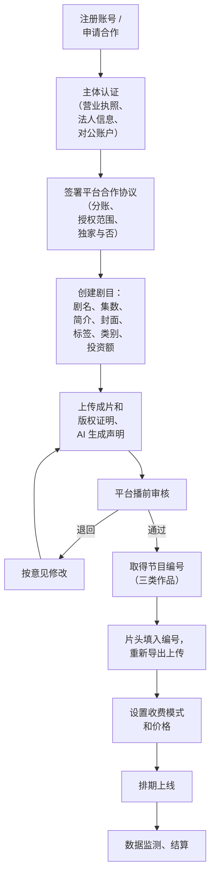
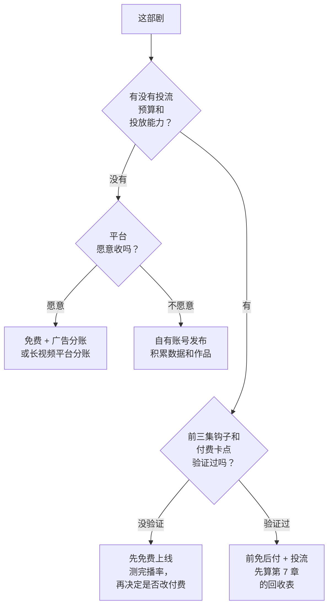

# 上线平台与流程

审核路径想清楚了，下一步是选平台、走入驻和上传流程、决定收费模式。这一章按平台类型讲上线流程和选择方法。

先说一句提醒：**平台的入驻条件、分账比例、审核细则是商业规则，变化很快**，同一个平台一年里可能改好几次。本章只讲各类平台的共性结构和判断方法，具体规则一律以平台官方后台、合作文档和你拿到的合同为准。平台格局和各平台的行业数据见[《微短剧行业全景》](../micro-drama-industry/)。

## 平台的四种类型

| 类型 | 代表 | 观众怎么付费 | 你怎么拿钱 | 对 AI 漫剧的接纳 |
|---|---|---|---|---|
| 免费短剧 App | 红果短剧等 | 不付费，看广告 | 按平台分账规则（通常和观看、广告收入挂钩） | 是主要出口之一 |
| 短视频平台的短剧板块 | 抖音、快手的短剧专区和剧集账号 | 免费观看，或在平台内付费解锁 | 创作者激励、付费分成、广告 | 接纳，但对账号和内容有专门规则 |
| 小程序 / 独立 App 付费短剧 | 微信小程序、抖音小程序上的短剧小程序 | 按集付费、充值、会员 | 和运营方、发行方分成 | 接纳，玩法以投流为主 |
| 长视频平台 | 爱奇艺、腾讯视频、优酷的短剧 / 微短剧频道 | 会员、单片付费、广告 | 平台分账（会员有效观看、付费、广告等） | 有专门的分账剧合作渠道，门槛较高 |

## 通用上线流程

不管哪个平台，流程的骨架都一样：

几个容易卡住的环节：

### 主体认证

> [!WARNING]
> 认证材料按截至 2026 年 11 月各平台的常见要求整理，平台会调整，以各平台片方合作入口 / 规则中心的最新说明为准。

平台分账合作基本要求**企业主体**，个人只能走创作者激励一类的通道。认证时准备：

- 营业执照（经营范围最好包含影视、动漫、网络文化内容相关业务）
- 法定代表人身份证明
- 对公银行账户（用于结算）
- 一般纳税人或小规模纳税人资格（影响开票，第 6 章）

### 剧目信息

剧目信息要和送审材料、成片**完全一致**。常见的退回原因就是剧名、集数、单集时长和成片对不上。建议用一个表管理：

| 字段 | 填法 | 注意 |
|---|---|---|
| 剧名 | 和片头一致 | 改名要同步改片头；一类二类作品改名要办变更 |
| 集数、单集时长 | 和实际上传的一致 | 微短剧定义为单集时长不足 20 分钟（办法第二条） |
| 简介 | 真实反映剧情 | 不要写正片里没有的情节 |
| 封面 | 用正片画面或原创设计 | 不用明星脸、不用其他作品的画面 |
| 标签和类别 | 按平台分类选 | 选错类别会影响推荐，也可能被认为误导 |
| 投资额 | 如实 | 用于确认类别 |
| AI 声明 | 勾选并说明环节 | 和片头标识一致 |

### 节目编号回填

> [!WARNING]
> 编号的标注方式按《微短剧发展管理办法》（2026 年 9 月 1 日起施行）整理，回填流程各平台不同；以国家广播电视总局最新文件和平台后台说明为准。

三类作品的节目编号是审核通过后才有的，而编号要标在片头。所以流程上通常是：**先上传一版供审核，审核通过拿到编号，再导出带编号的成片替换**。具体是平台自动叠加编号还是由你重新导出，各平台做法不同，按平台说明操作。第 3 章建议的「片头编号层单独做模板」在这里省很多事。

## 收费模式怎么选

> [!WARNING]
> 付费告知等要求按总局令第 16 号整理，平台的计费、自动续费和退款规则会调整；以国家广播电视总局最新文件和平台的付费规则为准。

一部剧上线前要决定观众怎么为它付钱。四种常见模式：

| 模式 | 怎么运作 | 收入来源 | 适合的剧 | 风险 |
|---|---|---|---|---|
| 完全免费 + 广告 | 观众免费看，平台插广告 | 平台按规则分账 | 节奏快、能留住人看完的剧；新人作品 | 单部收入不高，依赖平台推荐 |
| 前免后付 | 前若干集免费，之后按集付费或充值 | 观众付费 | 钩子强、付费卡点设计好的剧 | 需要流量把人带进来，通常要投流 |
| 会员 | 观众开平台会员看 | 平台按会员有效观看等指标分账 | 长视频平台的精品剧 | 平台门槛高 |
| 混合 | 看广告解锁，或付费免广告 | 广告 + 付费 | 免费短剧平台的部分剧 | 规则复杂，要算清两边 |

选择的判断标准：

付费卡点放在哪一集、单集定价多少，属于剧本和运营的问题，见[《短剧编剧》](../drama-scriptwriting/)的付费卡点一节。这里只讲和发行相关的两点：

1. **付费信息要明确告知**。办法第四十条要求提供付费内容的，明确告知收费相关信息，依法保护消费者权益。价格、计费方式、自动续费、退款规则都要在付费前清楚展示，不能诱导误充值
2. **算法和运营不得诱导沉迷、过度消费**。这是办法对播出单位的要求，但作为片方，你也不要在剧情和推广里设计「再充一次就能看结局」之类诱导

## 各类平台的上线要点

> [!WARNING]
> 入驻门槛、分账和 iOS 支付规则按 2026 年前后的平台规则整理，变化快；以各平台合作协议、规则中心和小程序平台当期规则为准。

### 免费短剧 App

- **入驻方式**：通常有面向片方的合作入口或招募页面，也可以通过平台认可的发行方代理上架
- **审核**：平台做播前审核并给节目编号；AI 作品要提交 AI 使用说明
- **分账**：和观看量、完播、广告收入等挂钩，规则在合作协议和后台说明里；有的平台对优质或合规完整的作品有分账系数加成（第 6 章）
- **适合新人的原因**：不用自己投流，平台用推荐算法分发；数据和结算相对透明

### 短视频平台的剧集账号

- **账号**：开一个专门发剧的账号，按平台要求做「短剧」类目认证，不要用普通账号零散发
- **上线**：通过平台的短剧上线流程提交，取得审核和编号；普通视频的发布流程不等于剧集上线
- **收入**：平台创作者激励、付费合集、挂载链接等；具体能开通什么看账号等级和平台规则
- **注意**：剪辑片段做推广时，片段也要是正片内容，不能剪成「标题党」

### 付费小程序

- **你通常不是运营方**：小程序的运营方是播出单位，需要相应资质（第 2 章）。你作为片方，把剧授权给运营方或发行方
- **iOS 端支付**：小程序在 iOS 上的虚拟内容支付受平台和苹果规则约束，可用的支付方式和通道费以小程序平台当期规则为准；这直接影响你的分成基数（第 6 章）
- **投流**：付费小程序几乎都靠投流获客，投流方往往就是发行方；分成谈判的核心是**投流成本谁出、回收谁先拿**（第 7、9 章）

### 长视频平台

- **入口**：各平台都有分账剧 / 微短剧合作的官方入口，有招商和评级流程
- **门槛**：通常要求企业主体、成片质量、过往作品；部分平台会要求作品取得省局批准文件或更高层级的许可
- **分账**：按会员有效观看时长、付费、广告等，和作品评级挂钩，具体以平台公布的分账规则为准
- **适合**：有一两部作品数据、想拿稳定分账的团队

## 平台选择评分表

第一部作品，可以用下面的表给候选平台打分（每项 1–5 分），总分高的优先：

| 维度 | 权重 | 平台 A | 平台 B | 平台 C |
|---|---|---|---|---|
| 是否接收 AI 漫剧、对新人是否开放 | 3 | | | |
| 主体要求是否满足 | 3 | | | |
| 是否需要自己投流 | 2 | | | |
| 分账规则是否公开、可验证 | 2 | | | |
| 结算周期和回款速度 | 2 | | | |
| 独家要求（是否限制其他平台） | 1 | | | |
| 后台数据是否够用于复盘 | 1 | | | |

评分前要拿到的资料：平台的合作文档、分账规则说明、合同模板。没有书面规则、只靠商务口头承诺的平台，「分账规则是否公开」一项直接给 1 分。

## 独家还是非独家

平台有时会用更高的分账比例或保底换取独家。考虑点：

| | 独家 | 非独家 |
|---|---|---|
| 收入 | 可能有保底、更高分成 | 多渠道叠加 |
| 工作量 | 只对接一个平台 | 每个平台都要审核、取得编号、导出版本、对账 |
| 风险 | 平台推荐不力，作品就困住了 | 管理复杂，容易出现版本和编号混乱 |
| 合同 | 注意独家期限、地域、是否包括海外 | 注意各平台合同之间不冲突 |

一个人的团队，第一部作品建议**一个主平台 + 自有账号**，避免同时对接太多平台；独家期限不要超过一年，并保留海外权利（第 10 章）。

## 上线日检查表

1. 主体认证、合作协议签署完成，对公账户已绑定
2. 剧目信息与成片、送审材料一致
3. 片头编号是**本平台**的编号
4. 每集 AI 提示标识清晰，元数据保留
5. 付费信息（价格、计费方式、退款）在付费前清楚展示
6. 封面、简介、推广片段都来自正片，不夸大
7. 版权证明文件已上传，原件可随时调取
8. 数据看板和对账字段已确认（第 6 章）

## 《归墟灯》的上线安排

- 主平台：一家免费短剧平台，走片方合作入口，非独家，合同期一年
- 自有账号：抖音剧集账号，前期以剪辑片段引流为主，正片同步走平台短剧上线流程
- 模式：完全免费 + 广告分账。理由是没有投流预算，前三集钩子也没有验证过
- 时间表：投稿后审核约一到两周（以平台实际为准），拿到编号后重新导出上传，整体预留一个月

## 本章要点

- 平台分四类：免费短剧 App、短视频平台剧集板块、付费小程序、长视频平台；规则以平台后台和合同为准
- 通用流程：主体认证 → 签协议 → 创建剧目 → 上传和审核 → 取得编号 → 回填编号 → 定价上线
- 剧目信息必须和成片、送审材料一致；节目编号通常要审核后回填导出
- 收费模式看两件事：有没有投流能力、付费卡点是否验证过；没有就先免费
- 付费信息要明确告知，不诱导沉迷和过度消费
- 第一部作品建议一个主平台加自有账号，非独家或短期独家，保留海外权利
