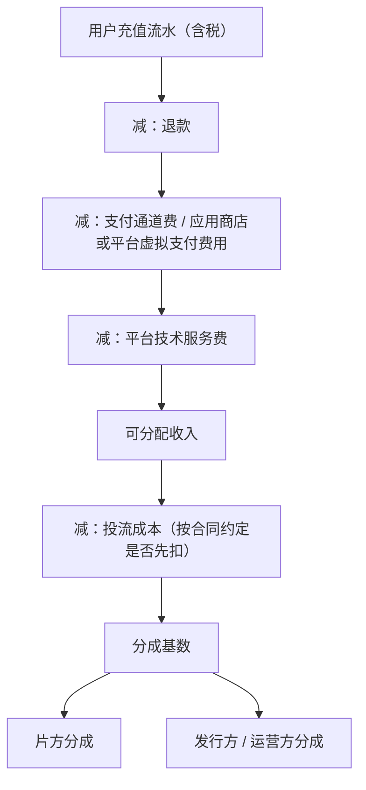

# 分账与结算

平台分账是 AI 短剧最主要的收入来源之一，也是最容易「看不懂」的地方：对账单上一串数字，扣了渠道费、扣了技术服务费、乘了系数，最后到账的和你心里估的差一截。

这一章把常见的分账结构拆成公式，给一张可以直接用的对账表，再讲结算周期、开票和发现对不上时怎么办。

> 各平台的分账比例、单价、系数、结算周期都是商业条款，会随时调整，也会因作品评级、独家与否而不同。本章的公式是**结构**，示例数字全部是**假设**，用来演示怎么算。签约前以平台公开的分账规则和合同条款为准，并把规则文件存档。

## 四种分账结构

| 结构 | 钱从哪来 | 片方收入怎么算 | 常见于 |
|---|---|---|---|
| 广告分账 | 平台在剧集中投放广告的收入 | 按有效观看量、广告收入或单价规则计算 | 免费短剧 App、短视频平台 |
| 会员分账 | 平台会员费 | 按会员有效观看时长或次数 × 单价 | 长视频平台 |
| 付费分账 | 观众充值、按集付费 | 流水扣除各项费用后按比例分 | 付费小程序、平台内付费 |
| 保底 + 分成 | 平台或发行方先付一笔保底 | 分成收入超过保底的部分再分 | 版权授权、独家合作 |

### 广告分账

免费短剧的分账，通常和**有效观看**挂钩。抽象成公式：

$$
\text{片方收入} = \sum_{\text{集}} \text{有效观看量} \times \text{单价} \times \text{系数}
$$

- **有效观看**：平台定义，常见的口径是单集观看达到一定时长或比例才算一次；不同平台差别很大
- **单价**：每次有效观看对应的金额，可能随广告市场浮动，也可能按作品评级分档
- **系数**：对独家、优质、合规完整的作品给加成；行业报道提到部分平台对备案完整的 AI 漫剧提高分账系数（依据为媒体转述）

有的平台不按单价，而是**按广告收入的一定比例**分给片方：

$$
\text{片方收入} = \text{本剧带来的广告收入} \times \text{分成比例}
$$

这种结构下你很难验证「本剧带来的广告收入」，合同里要约定平台提供明细和口径说明。

### 会员分账

长视频平台常见：

$$
\text{片方收入} = \text{会员有效观看时长（或次数）} \times \text{单价} \times \text{评级系数}
$$

有的平台还会在会员分账之外，叠加单片付费分成、广告分成、招商分成。要看清楚每一部分的计算口径，不要只看「单价」一个数字。

### 付费分账

付费小程序和平台内付费短剧，片方拿到的是一条「瀑布」的末端：



写成公式：

$$
\text{分成基数} = (\text{流水} - \text{退款}) \times (1 - f_{\text{通道}} - f_{\text{平台}}) - C_{\text{投流先扣}}
$$

$$
\text{片方收入} = \text{分成基数} \times r_{\text{片方}}
$$

其中 $f_{\text{通道}}$ 是支付或应用商店相关费率，$f_{\text{平台}}$ 是小程序平台或分发平台的技术服务费率，$C_{\text{投流先扣}}$ 是合同约定先从收入里扣回的投流成本（没有约定就是 0），$r_{\text{片方}}$ 是片方分成比例。

**最关键的一项是投流成本怎么处理**。同样写着「片方分成 30%」，按「流水的 30%」和按「扣完投流后的 30%」完全是两回事。付费短剧的投流常常吃掉大部分流水（第 7 章），如果合同约定先扣投流，片方实际拿到的可能接近零。

## 一个付费分账的示例

假设一部剧在付费小程序上线一个月：

| 项目 | 金额或比例 | 说明 |
|---|---|---|
| 充值流水 | 1,000,000 元 | 假设 |
| 退款 | 20,000 元 | 假设 2% |
| 通道和平台费合计 | 10% | 假设，以平台规则为准 |
| 投流成本 | 850,000 元 | 假设 |
| 片方分成比例 | 30% | 假设 |

**方案一：按扣费后流水分成，投流由发行方自担**

- 可分配收入 = (1,000,000 − 20,000) × (1 − 10%) = 882,000 元
- 片方收入 = 882,000 × 30% = 264,600 元
- 发行方得到 617,400 元，减去投流 850,000 元，**亏 232,600 元**

**方案二：先扣投流，再分成**

- 分成基数 = 882,000 − 850,000 = 32,000 元
- 片方收入 = 32,000 × 30% = 9,600 元
- 发行方得到 22,400 元

同一个流水，片方收入差了二十多倍。方案一里发行方是亏的，长期不可持续，所以实务中大量合同用的是方案二或者它的变体。这就是为什么分账合同里**投流成本的处理方式比分成比例更重要**（第 9 章）。

## 一个广告分账的示例

假设《归墟灯》在免费短剧平台上线，平台按有效观看单价分账：

| 项目 | 数值 | 说明 |
|---|---|---|
| 60 集累计有效观看 | 8,000,000 次 | 假设 |
| 单价 | 0.01 元 / 次 | 假设，实际以平台规则为准 |
| 合规完整系数 | 1.1 | 假设 |

片方收入 = 8,000,000 × 0.01 × 1.1 = 88,000 元。

这个数字和制作成本 12 万元比，还差 3.2 万元回本。要回本，要么有效观看达到 120,000 ÷ (0.01 × 1.1) ≈ 1,090 万次，要么叠加自有账号收入或海外授权。**上线前就该做这个倒推**：回本需要多少有效观看？这个量级在目标平台上同类作品里算什么水平？

## 一个保底加分成的示例

版权授权和独家合作里常见「保底 + 分成」：对方先付一笔保底，分成收入先用来抵扣保底，抵完之后的部分再支付给你。

$$
\text{片方总收入} = \max(\text{保底},\ \text{累计分成})
$$

假设发行方给《归墟灯》的报价是保底 6 万元、按可分配收入 25% 分成：

| 可分配收入累计 | 累计分成（25%） | 片方实际总收入 | 说明 |
|---|---|---|---|
| 100,000 | 25,000 | 60,000 | 分成没超过保底，拿保底 |
| 240,000 | 60,000 | 60,000 | 刚好抵完保底 |
| 400,000 | 100,000 | 100,000 | 超出保底 4 万元另付 |

判断一份保底报价划不划算，用第 7 章的回收测算估一下「可分配收入大概能到多少」：如果合理预期在 24 万以下，保底就是你的全部收入，这时应该重点谈保底金额和支付时间，而不是分成比例。另外要确认三点：

- 保底是**签约时付、交付时付，还是上线后付**；上线后付且没有期限的保底，等于没有保底
- 保底**可抵扣但不可退还**，要写进合同
- 分成抵扣保底的口径和本章前面讲的计算基数一致

## 结算周期与回款

| 环节 | 常见做法 | 注意 |
|---|---|---|
| 结算周期 | 按月结算，次月或隔月出对账单 | 看合同写的是「自然月」还是「上线后 N 天」 |
| 对账确认 | 片方在若干工作日内确认，逾期视为确认 | 确认期很短的，要提前排好对账时间 |
| 开票 | 片方按确认金额开票给平台 | 税率按你的纳税人身份和业务类型，见《财务与税务》第 2、3 章 |
| 付款 | 收到发票后若干工作日内付款 | 写明付款期限和逾期责任 |
| 最低结算额 | 部分平台有起付金额 | 小作品可能几个月才达到 |

把这些串起来，一笔分账从产生到到账，常常是**两到三个月**。现金流要按这个节奏规划，见《财务与税务》第 4 章。

## 对账表

每月拿到平台对账单后，用一张表核对。字段如下：

| 字段 | 来源 | 用途 |
|---|---|---|
| 结算月份 | 对账单 | |
| 剧名、平台、节目编号 | 自己的台账 | 多平台时区分 |
| 有效观看 / 流水 | 对账单 | 和后台数据对照 |
| 退款 | 对账单 | |
| 各项扣费 | 对账单 | 按合同费率复算 |
| 系数 / 评级 | 对账单 | 和合同、平台通知对照 |
| 投流扣除 | 对账单或发行方报表 | 付费分账时核对凭证 |
| 应分金额（复算） | 自己按公式算 | |
| 平台结算金额 | 对账单 | |
| 差异 | 复算 − 结算 | |
| 差异说明 | 和平台沟通结果 | |
| 开票日期、到账日期 | 自己记录 | 跟踪回款 |

可以用一个 CSV 或表格模板，每月一行一部剧一个平台：

```text
month,title,platform,program_no,views,gross,refund,fees,coef,ad_deduct,calc_due,settled,diff,note,invoice_date,paid_date
2026-12,归墟灯,平台A,<编号>,8000000,,,,1.1,,88000,86500,1500,有效观看口径差异待确认,,
```

复算的意义是：**你不复算，就不会发现问题**。常见的差异来源：

- 有效观看的口径不同（平台按 30 秒算，你以为按 10 秒）
- 系数没有按合同给（例如独家加成没生效）
- 扣费项目比合同多出一项
- 退款跨月处理
- 投流扣除没有凭证

## 发现对不上怎么办

1. **先看合同和规则文件**，确认自己的复算口径对不对
2. **书面提出**：在确认期内用邮件或平台后台工单提出差异，附复算过程。不要只打电话
3. **要求明细**：要求平台提供分集、分日的数据明细，或计算口径说明
4. **保留确认权**：差异未解决前不要确认对账单；如果合同约定逾期视为确认，就在期限内书面提出异议
5. **合同里预先写好审计条款**：片方有权在一定条件下要求查看计算依据，或委托第三方审计（第 9 章）

## 常见的坑

- **只问分成比例，不问计算基数**：30% 的什么？流水、扣费后、扣投流后，差别巨大
- **没有书面的分账规则**：商务口头说的系数、单价不算数，要写进合同或以平台公开文件为准
- **对账确认期太短，错过了**：逾期视为确认后，再提差异很难
- **多平台作品不分台账**：两个平台、两个编号、两份对账单混在一起，查不清
- **以为分账就是净收入**：分账收入要交税；个人主体和公司主体的税负不同，见《自媒体与短剧合规财税》

## 本章要点

- 四种分账结构：广告分账、会员分账、付费分账、保底加分成；每种都先搞清楚**计算基数和口径**
- 付费分账是一条瀑布：流水 − 退款 − 通道和平台费 − 投流先扣 → 分成基数 × 片方比例
- **投流成本是否先扣**比分成比例更重要，同一流水下片方收入可以差几十倍
- 上线前倒推：回本需要多少有效观看或流水，这个量级是否现实
- 一笔分账到账常常要两到三个月，按这个节奏规划现金流
- 每月复算对账单，书面提出差异，合同里预留审计条款
