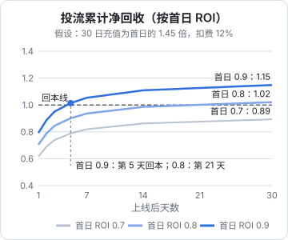
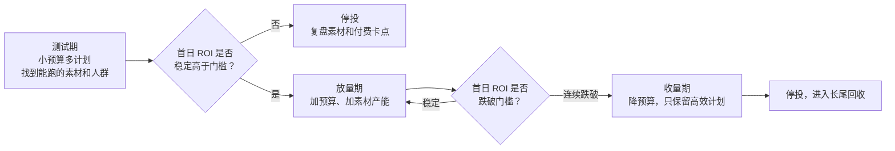

# 投流测算：充值 ROI、回收周期与素材消耗

付费短剧本质上是一门**买量生意**：花钱买流量把观众带进小程序，观众充值，充值减去成本后的余额是利润。行业里流传的「爆款月流水上亿」背后，是同样量级的投流消耗；一部剧赚不赚钱，取决于几个比例之间的细微差距。

这一章讲短剧投流特有的几个指标，给一套可以直接套用的测算表和回收曲线，再讲素材消耗和止损。DOU+、巨量引擎、千川等投放工具的操作和通用 ROI 概念见《投流与数据分析》，这里不重复。

> 本章所有数字都是**假设**，用来演示公式和判断方法。真实的首日 ROI、回收倍数、扣费比例，因题材、平台、时期差别很大；**用你自己或合作方的真实数据替换**后再做决定。

## 短剧投流和普通投流有什么不同

| 维度 | 普通电商投流 | 付费短剧投流 |
|---|---|---|
| 转化 | 一次下单 | 充值可以持续多天：看完免费集充值，追更再充值 |
| 回收 | 当天基本确定 | 首日只回收一部分，之后几天、几周继续回收 |
| 素材 | 产品图、口播 | 剧情片段，消耗极快，需要持续剪新素材 |
| 生命周期 | 产品可以长期卖 | 一部剧的投放窗口通常只有几周 |
| 成本结构 | 投流 + 货品成本 | 投流占流水的大头，加上渠道费、内容成本、分成 |

核心差别是**回收有时间维度**。所以短剧投流不看「当天 ROI」一个数，而是看一条回收曲线。

## 几个核心指标

| 指标 | 定义 | 用途 |
|---|---|---|
| 消耗 $S$ | 某段时间内的投流花费 | |
| 首日充值 $R_1$ | 当天新增用户在当天的充值 | |
| 首日 ROI | $R_1 / S$ | 投放当天判断素材和计划好坏的主指标 |
| 累计充值 $R_t$ | 当天新增用户在 $t$ 天内的累计充值 | |
| 回收倍数 $m_t$ | $R_t / R_1$ | 描述「首日之后还能回收多少」 |
| 累计 ROI | $R_t / S = \text{首日 ROI} \times m_t$ | |
| 扣费率 $f$ | 退款、支付通道、平台技术服务费等合计占流水的比例 | |
| 净回收 | $\text{累计 ROI} \times (1 - f)$ | 大于 1 才算投流本身回本 |

把它们串起来：

$$
\text{净回收}_t = \frac{R_1}{S} \times m_t \times (1 - f)
$$

回本条件是净回收 $\geq 1$，于是**首日 ROI 的回本门槛**是：

$$
\text{首日 ROI}_{\text{回本}} = \frac{1}{m_T \times (1 - f)}
$$

其中 $T$ 是你能接受的回收周期（例如 30 天）。

## 回收曲线示例

假设某类题材的回收倍数如下（来自过往投放数据的拟合，这里是假设值）：

| 天数 | 1 | 2 | 3 | 5 | 7 | 14 | 30 |
|---|---|---|---|---|---|---|---|
| 回收倍数 $m_t$ | 1.00 | 1.12 | 1.20 | 1.28 | 1.33 | 1.40 | 1.45 |

扣费率 $f$ 假设为 12%。代入公式：

- 首日 ROI 回本门槛 = 1 ÷ (1.45 × 0.88) ≈ **0.78**
- 首日 ROI 0.9：第 5 天净回收超过 1，30 天净回收 1.15
- 首日 ROI 0.8：第 21 天勉强回本，30 天净回收 1.02
- 首日 ROI 0.7：30 天净回收 0.89，**亏 11%**



| 首日 ROI | 第 1 天 | 第 3 天 | 第 7 天 | 第 14 天 | 第 30 天 | 回本日 |
|---|---|---|---|---|---|---|
| 0.7 | 0.62 | 0.74 | 0.82 | 0.86 | 0.89 | 30 天内不回本 |
| 0.8 | 0.70 | 0.84 | 0.94 | 0.99 | 1.02 | 第 21 天 |
| 0.9 | 0.79 | 0.95 | 1.05 | 1.11 | 1.15 | 第 5 天 |
| 1.0 | 0.88 | 1.06 | 1.17 | 1.23 | 1.28 | 第 3 天 |

（中间天数按相邻锚点线性插值；表中数字 = 首日 ROI × $m_t$ × 0.88。）

这张表说明了短剧投流的残酷：**首日 ROI 从 0.8 到 0.7，只差 0.1，结果从微利变成亏损**；而 30 天回本意味着这一个月的投流资金全部被占用。

## 加上内容成本和分成：项目级测算

上面只算了投流本身。一部剧的完整账还要加上内容成本和分成。按你的角色分两种情况。

### 情况一：自制自投

你是片方，也自己投流（或雇代投、按服务费结算）。

$$
\text{项目利润} = S \times \left(\text{首日 ROI} \times m_T \times (1-f) - 1\right) - C_{\text{内容}} - C_{\text{代投}}
$$

示例（假设）：内容成本 $C_{\text{内容}}$ = 12 万元，不雇代投，首日 ROI 稳定在 0.85，$m_{30}$ = 1.45，$f$ = 12%：

- 每投 1 元的净贡献 = 0.85 × 1.45 × 0.88 − 1 ≈ **0.085 元**
- 要覆盖 12 万内容成本，总消耗至少 = 120,000 ÷ 0.085 ≈ **142 万元**
- 如果投到 50 万元就停（素材跑不动了），利润 = 500,000 × 0.085 − 120,000 ≈ **−7.8 万元**

结论：在这个假设下，一部 12 万成本的剧要投到一百多万才回本，而且整个过程中首日 ROI 不能掉。**一个在职开发者用自有资金做这件事，风险极高。**

### 情况二：授权给发行方投流

发行方出钱投流，你拿分成。你关心的不是投流 ROI，而是合同里的分成基数（第 6 章）：

| 合同约定 | 你的收入 | 你的风险 |
|---|---|---|
| 版权费买断 | 一次性固定金额 | 爆了也没有额外收入 |
| 保底 + 流水分成 | 保底 + 超出部分 | 分成能否兑现取决于对账透明度 |
| 扣投流后的利润分成 | 投流方回本后才有 | 投流方 ROI 只要在回本线附近，你就几乎拿不到钱 |

用回收曲线可以帮你判断「扣投流后分成」值多少：如果发行方的首日 ROI 在 0.8 左右，30 天净回收 1.02，可分配利润只有消耗的 2%；按 30% 分成，100 万消耗你只能拿到约 6,000 元。这时候一笔确定的保底更有价值。

## 测算表模板

把上面的逻辑做成一张表，每部剧投放前填一遍：

| 输入项 | 符号 | 示例值 | 来源 |
|---|---|---|---|
| 内容成本 | $C_{\text{内容}}$ | 120,000 | 制作台账 |
| 计划总消耗 | $S$ | 500,000 | 资金预算 |
| 预期首日 ROI | $r_1$ | 0.85 | 测试期数据 |
| 30 日回收倍数 | $m_{30}$ | 1.45 | 同题材历史数据 |
| 扣费率 | $f$ | 12% | 平台规则、退款历史 |
| 代投服务费率 | $c$ | 0% | 合同 |
| 广告变现收入（如有） | $A$ | 0 | 免费集插广告的收入 |

| 输出项 | 公式 | 示例结果 |
|---|---|---|
| 首日回本门槛 | $1 / (m_{30}(1-f))$ | 0.78 |
| 每元消耗净贡献 | $r_1 m_{30}(1-f) - 1 - c$ | 0.085 |
| 投流毛利 | $S \times$ 净贡献 | 42,300 |
| 项目利润 | 投流毛利 $+ A - C_{\text{内容}}$ | −77,700 |
| 盈亏平衡消耗 | $C_{\text{内容}} / \text{净贡献}$ | 约 1,418,000 |
| 资金峰值占用 | 约等于前 $T$ 天的消耗 | 视投放节奏 |

用脚本算更方便，下面是一个最小版本：

```python
def project(content_cost, spend, r1, m_t, fee, agency=0.0, ad_income=0.0):
    per_yuan = r1 * m_t * (1 - fee) - 1 - agency
    return {
        "breakeven_r1": round(1 / (m_t * (1 - fee)), 3),
        "net_per_yuan": round(per_yuan, 4),
        "profit": round(spend * per_yuan + ad_income - content_cost),
        "breakeven_spend": round(content_cost / per_yuan) if per_yuan > 0 else None,
    }

print(project(120_000, 500_000, r1=0.85, m_t=1.45, fee=0.12))
# {'breakeven_r1': 0.784, 'net_per_yuan': 0.0846, 'profit': -77700, 'breakeven_spend': 1418440}
```

## 素材消耗

短剧投流的另一个特点是**素材消耗快**：同一条素材跑一两天，点击率和转化就开始下降，需要不断剪新的。素材产能往往比投放预算更早成为瓶颈。

估算素材需求：

$$
\text{在跑素材数} = \frac{\text{日消耗}}{\text{单条素材日均承载消耗}}
$$

$$
\text{每日新素材} = \frac{\text{在跑素材数}}{\text{单条素材平均寿命（天）}}
$$

示例（假设）：日消耗 5 万元，单条素材日均能承载 5,000 元，平均寿命 3 天：

- 在跑素材 = 50,000 ÷ 5,000 = 10 条
- 每日需要新素材 = 10 ÷ 3 ≈ 3.3 条
- 投放 30 天约需 100 条素材

AI 短剧在这里有一个优势：素材从正片剪辑，换开头钩子、换配乐、换字幕的成本比实拍低。但要守住一条线：

> **投流素材必须来自正片，不得虚构正片里没有的情节、不得夸大**。《微短剧发展管理办法》第二十八条要求推广信息与作品内容相匹配；2025 年 2 月的通知要求制作方、投流方、推广平台、播出平台都对推广内容审核把关。用不存在的「名场面」骗点击，换来的是退款、投诉、素材被拒和账号被处罚。

素材合规自查：

1. 每条素材的画面都能在正片中找到对应集数和时间点
2. 字幕和配音没有改写剧情走向
3. 没有使用正片之外的明星、影视画面、未授权音乐
4. AI 提示标识在素材中保留（按平台要求）
5. 落地页的价格、收费方式和小程序实际一致

## 投放节奏和止损

一部剧的投放一般经历三个阶段：



止损规则要在投放**之前**写下来，例如：

| 规则 | 示例阈值（假设） |
|---|---|
| 测试期总预算上限 | 内容成本的 20%，花完仍没有跑出首日 ROI 高于门槛的素材就停 |
| 放量期单日止损 | 当日首日 ROI 低于门槛 × 0.9，次日降预算一半 |
| 连续止损 | 连续 3 天低于门槛，停投 |
| 资金上限 | 本剧累计净亏损超过某个金额，无论数据如何都停 |

规则写死的目的，是防止「再投一天就起来了」的赌徒心态。

## 判断标准：要不要投

| 问题 | 能投 | 别投 |
|---|---|---|
| 有没有同题材的历史回收数据？ | 有，自己的或合作方可验证的 | 只有别人口头说的「行业平均」 |
| 测试期首日 ROI 是否稳定高于门槛？ | 是，且有多条素材支撑 | 只有一两条素材偶尔跑出来 |
| 素材产能能否跟上？ | 能按估算每天产出 | 靠一个人下班后剪 |
| 资金能否承受 30 天占用和最坏情况亏损？ | 能，且不影响生活 | 需要借钱或动用应急资金 |
| 剧本身是否合规、有编号、授权链完整？ | 是 | 任何一项没有 |

对在职开发者的建议很直接：**前几部作品不要自投**。先走免费分账和授权，积累数据和作品；如果想学投流，用很小的测试预算跑一遍完整流程，目的是拿到真实的回收曲线，而不是赚钱。

## 本章要点

- 短剧投流的回收有时间维度，看**回收曲线**而不是当天 ROI
- 核心公式：净回收 = 首日 ROI × 回收倍数 × (1 − 扣费率)；首日回本门槛 = 1 ÷ (回收倍数 × (1 − 扣费率))
- 示例假设下，首日 ROI 0.8 和 0.7 只差 0.1，结果是微利和亏损的区别；回本还意味着资金被占用一个月
- 项目级测算要加内容成本和分成；示例中 12 万成本的剧要投到约 142 万才回本
- 授权给发行方时，「扣投流后分成」在 ROI 接近回本线时几乎拿不到钱，保底更有价值
- 素材消耗快，按日消耗、承载量、寿命估算产能；素材必须来自正片，不得虚构夸大
- 止损规则投放前写死；前几部作品不建议自投
