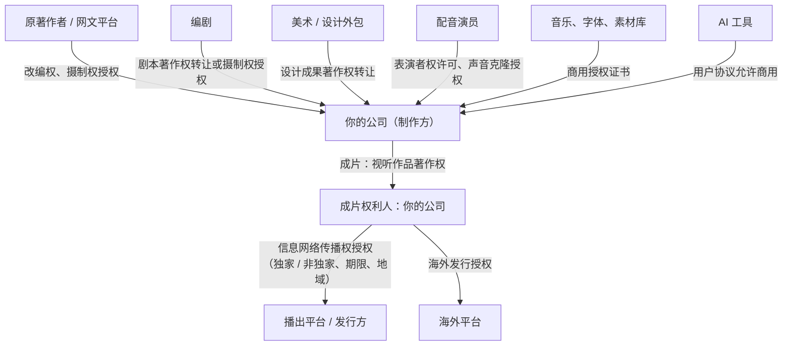
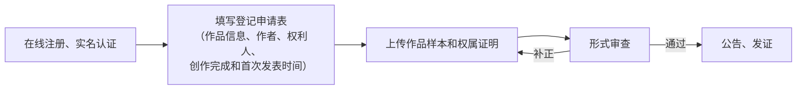
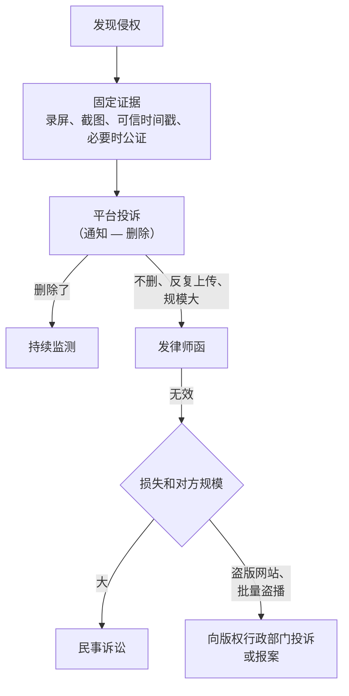

# 版权：登记、授权链条与维权

第 3 章提到，行业报道中 AI 漫剧备案未通过的作品，超过六成问题出在**版权溯源**。版权在短剧发行里有两重身份：它是**准入条件**（平台和审核要看授权链是否完整），也是**你的资产**（能卖、能授权、被盗版时能维权）。

这一章讲三件事：一部 AI 短剧涉及哪些权利、怎么把授权链条理清楚并登记、被盗版了怎么处理。著作权的一般规则和软件著作权登记见[《国内合规实务》第 5 章](../opc-compliance-cn/05-software-copyright.md)；合同里的知识产权条款见[《合同与法律文书》第 6 章](../contracts-legal/06-ip-clauses.md)；声音、肖像、音乐、字体的使用合规在[《自媒体与短剧合规财税》](../media-compliance/)里有更完整的讲解。

> 本章引用的是《著作权法》（2020 年修正，2021 年 6 月 1 日起施行）和《民法典》的条文。登记流程、费用、时限以中国版权保护中心和各省版权局官网公示为准。涉及具体纠纷，请咨询律师。

## 一部 AI 短剧里有哪些权利

| 对象 | 作品类型 | 权利人默认是谁 | 你需要的权利 |
|---|---|---|---|
| 原著小说（改编时） | 文字作品 | 原作者或其授权的平台 | 改编权、摄制权（视听化改编） |
| 剧本 | 文字作品 | 编剧 | 摄制权；若编剧是外人，需要转让或授权 |
| 角色和场景设计 | 美术作品 | 设计者 | 使用、改编权；外包时约定归属 |
| AI 生成的画面 | 视具体情况，见下文 | 有争议 | 工具条款允许商用；保留创作过程证据 |
| 配音 | 表演者权（真人配音时）；声音受人格权保护 | 配音演员 | 表演者权许可；声音克隆的书面授权 |
| 音乐 | 音乐作品、录音制品 | 词曲作者、唱片公司 | 同步授权或商用曲库授权 |
| 字体 | 美术作品（有争议）/ 软件 | 字体厂商 | 商用授权 |
| 成片 | 视听作品 | 见下文 | 你要成为权利人，才能对外授权 |

### 成片归谁

《著作权法》第十七条规定：视听作品中的电影作品、电视剧作品的著作权由制作者享有，但编剧、导演、摄影、作词、作曲等作者享有署名权，并有权按照与制作者签订的合同获得报酬。前款以外的视听作品的著作权归属由当事人约定；没有约定或者约定不明确的，由制作者享有，但作者享有署名权和获得报酬的权利。

微短剧属于电影、电视剧作品还是「其他视听作品」，目前有不同理解。实务上的应对很简单：**在所有合作合同里明确约定成片著作权归制作方（你的公司）**，不依赖默认规则。

### AI 生成内容能不能受保护

AI 生成画面能否构成作品，是目前最不确定的问题。可参考的是北京互联网法院 2023 年审理的一起 AI 文生图著作权案（(2023)京 0491 民初 11279 号，依据为法院公开报道，判决原文未核对）：法院认为，使用者在设计提示词、调整参数、反复选择和修改的过程中投入了智力劳动，体现了个性化表达，生成的图片可以构成作品，著作权归使用者。

这个判决不代表所有 AI 生成内容都受保护，也不是普遍适用的规则。对短剧创作者，可以得出两条实务结论：

1. **你的人的创作投入越多、越有记录，作品越可能受保护**：剧本是人写的、分镜是人设计的、画面经过大量人工选择和修改、剪辑是人做的，整部成片作为视听作品受保护的可能性就大
2. **保留创作过程证据**：提示词、参数、迭代版本、选择和修改记录、剪辑工程文件，按集归档。这既是维权证据，也是版权登记和平台审核时证明原创的材料

## 授权链条

授权链条，就是从最上游的权利人一路到播出平台，每一环都有书面授权：



**任何一环断了，下游的授权都有瑕疵**。最常见的断点：

- 改编网文只跟作者口头说过，没有书面授权；或者作者已经把影视改编权独家授权给了网文平台，作者本人无权再授权
- 编剧是朋友，没签合同，剧本著作权还在编剧手里
- 美术外包没写著作权归属，按默认规则归受托人（《著作权法》第十九条：受委托创作的作品，著作权归属由委托人和受托人通过合同约定；合同未明确约定或者没有订立合同的，著作权属于受托人）
- 音乐用了「免费可商用」网站上的曲子，但网站本身没有权利

### 改编授权书要点

改编网文是 AI 短剧最常见的题材来源，授权书要写清楚：

| 条款 | 写什么 | 坑 |
|---|---|---|
| 授权方身份 | 作者本人还是平台；附权属证明 | 签约作者的影视改编权常常在网文平台手里 |
| 授权权利 | 改编权、摄制权，以及成片的信息网络传播权由被授权方享有 | 只写「改编权」不够，要包括视听化摄制 |
| 作品形式 | 微短剧、AI 漫剧、动态漫等 | 只写「微短剧」，做漫剧可能被认为超范围 |
| 独家与否 | 独家 / 非独家 | 非独家时别人也能做同一部 |
| 期限 | 授权期限、成片发行期限 | 授权到期后已上线的成片能否继续播 |
| 地域 | 中国大陆 / 全球 | 想出海就要全球或明确列出地区 |
| 改编自由度 | 能否改人物、改结局 | |
| 费用 | 一次性、分成或组合 | |
| 署名 | 原著署名方式 | |
| 权利保证 | 授权方保证有权授权，不侵犯第三方权利，否则赔偿 | |

## 著作权登记

著作权自作品完成之日起自动产生，**登记不是取得权利的条件，而是证据**。但在短剧发行里，登记证书有很实际的用处：

- 平台投稿、送审时证明权属，有的平台和发行方直接要求
- 被盗版时，登记证书是权属的初步证明
- 卖版权、做授权时，买方会要求

### 登什么

| 登记对象 | 作品类型 | 申请人 | 时机 |
|---|---|---|---|
| 剧本 | 文字作品 | 剧本著作权人（你的公司，前提是已从编剧处取得） | 剧本定稿后 |
| 主要角色设计 | 美术作品 | 设计成果权利人 | 角色定稿后 |
| 成片 | 视听作品（类电影作品 / 其他视听作品） | 制作方 | 成片完成后、上线前 |

### 流程

作品登记由中国版权保护中心和各省级版权登记机构受理，大致流程：



需要准备的材料：

| 材料 | 说明 |
|---|---|
| 申请表 | 按登记系统填写；创作完成时间、首次发表时间要与事实一致 |
| 申请人身份证明 | 营业执照 |
| 作品样本 | 剧本文本、角色设计图、成片或代表性片段（按系统要求的格式） |
| 权属证明 | 改编授权书、编剧合同、外包合同中的著作权转让条款 |
| 创作说明 | 创作过程、独创性说明；使用了 AI 的，按系统要求如实说明 AI 使用情况和人的创作投入 |

费用和办理时限以登记机构官网公示为准。注意：**登记信息要和送审、投稿材料一致**，剧名、作者、权利人对不上会给自己制造麻烦。

### 登记之外的证据

登记周期较长，在登记证书下来之前，可以先做这些：

- **可信时间戳或区块链存证**：对剧本、设计稿、成片计算哈希并存证，证明在某个时间点你已持有这些文件（存证方法见[《合同与法律文书》第 7 章](../contracts-legal/07-esign-evidence.md)）
- **创作过程归档**：提示词、迭代图、工程文件按日期归档
- **首发记录**：平台上线时间、节目编号，截图存档

## 侵权和盗版怎么处理

短剧上线后被搬运、剪辑、盗播几乎是必然的。处理的升级路径：



### 平台投诉

《民法典》第一千一百九十五条规定了「通知—删除」规则：权利人有权通知网络服务提供者采取删除、屏蔽、断开链接等必要措施，通知应当包括构成侵权的初步证据及权利人的真实身份信息；网络服务提供者接到通知后应当及时转送并采取必要措施。

各平台都有版权投诉入口。一份有效的投诉包括：

1. 权利人身份证明（营业执照）
2. 权属证明（登记证书、授权链文件、首发记录）
3. 侵权内容的链接、截图、录屏
4. 对照说明：侵权内容对应你作品的哪一集、哪个时间段

把这些做成一个**投诉材料包**，作品上线时就准备好，发现侵权当天就能提交。

### 监测

- 在主要平台用剧名、角色名、经典台词定期搜索
- 关注「解说」「混剪」类账号，它们是搬运的高发区
- 规模大了可以委托第三方版权监测服务

### 证据固定

侵权内容随时会被删除，**先固定证据再投诉**：

- 录屏要能看到网址或账号信息、发布时间、播放量
- 用可信时间戳或电子数据存证平台固定
- 准备起诉的，考虑公证处的保全证据公证

### 什么时候起诉

诉讼成本高、周期长，适合：

- 侵权方是有规模的公司、有赔偿能力
- 侵权持续、反复，投诉无效
- 你的作品商业价值高，损失可以举证

起诉前的准备和律师选择见[《合同与法律文书》](../contracts-legal/)第 8、9 章。

## 常见的坑

- **改编权找错了人**：签约作者的影视改编权在网文平台手里，和作者签了也没用；签之前要对方提供权属证明
- **只授权了「微短剧」，做的是漫剧**：作品形式写窄了
- **授权只有中国大陆**：后来想出海，要重新谈
- **外包设计没写著作权转让**：默认归设计师
- **AI 生成的画面撞脸知名角色**：即使是模型生成的，也可能被认为侵权；生成后要做相似性排查
- **登记信息和送审信息不一致**：剧名、权利人、完成时间对不上

## 《归墟灯》的版权档案

```text
guixudeng/rights/
  01-原著改编授权书（网文平台盖章，含漫剧、全球、5 年）.pdf
  02-编剧合同（剧本著作权转让给公司）.pdf
  03-角色设计外包合同（成果著作权转让）.pdf
  04-配音演员授权书（含声音克隆，限本剧及续集）.pdf
  05-音乐授权证书/
  06-字体授权/
  07-AI工具条款存档/
  08-创作过程/（提示词、迭代图、工程文件，按集）
  09-登记证书/（剧本、角色、成片）
  10-时间戳存证/
  11-投诉材料包/
```

上线前，这个目录里的每一项都要齐。平台审核、发行方尽调、维权投诉，用的都是它。

## 本章要点

- 一部 AI 短剧涉及原著、剧本、设计、AI 画面、配音、音乐、字体、成片多项权利，每项都要有书面授权或权属证明
- 成片著作权归属在合同里明确约定给制作方，不依赖默认规则；受托创作默认归受托人
- AI 生成内容能否受保护仍不确定；人的创作投入越多、记录越完整，越有利
- 授权链条任何一环断了，下游都有瑕疵；改编授权要写清权利、形式、地域、期限
- 登记是证据不是条件；剧本、角色、成片都可以登记，登记前先做时间戳存证
- 侵权处理：固定证据 → 平台通知删除 → 律师函 → 行政投诉或诉讼；投诉材料包上线前就准备好
