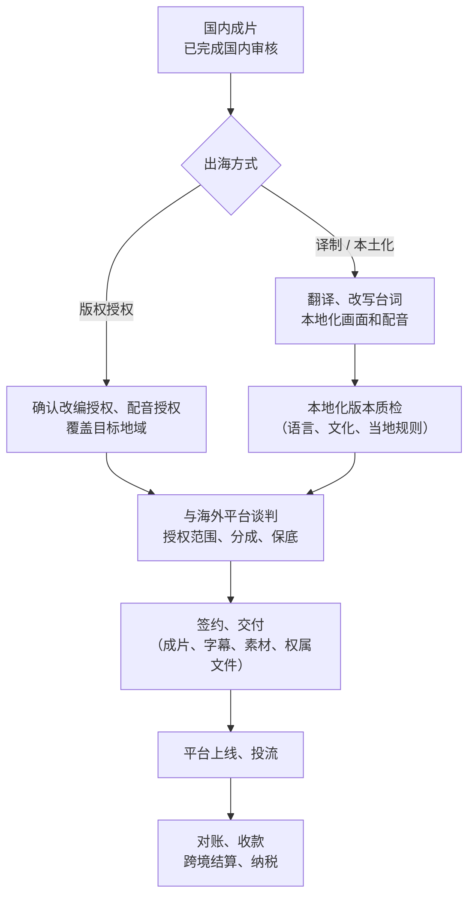

# 出海发行

中国公司做的短剧 App 在海外已经是一个成规模的市场：ReelShort（中文在线旗下）、DramaBox（点众科技旗下）、ShortMax 等平台常年出现在海外应用商店娱乐类榜单上。AI 让「本地化」的成本大幅下降：换一张脸、换一种语言、换一套场景，在实拍时代意味着重拍，在 AI 时代可能只是重新生成。

这一章讲 AI 短剧出海的几种方式、国内规则在出海时还管不管、翻译配音和本地化怎么做、钱怎么收回来。海外主体、收款、税务的通用知识见[《出海实务》](../going-global/)，这里只讲短剧特有的部分。

> [!WARNING]
> 本章按截至 2026 年 11 月的公开信息整理，海外平台的合作模式、分成和收款方式变化快，各国对内容、数据、未成年人的要求也不同；具体以平台合作文档、合同和当地法律为准，平台归属信息来自公开报道，未逐一核对工商信息。

## 先说清楚：国内规则还管不管

> [!WARNING]
> 本节按 2026 年 9 月 1 日起施行的《微短剧发展管理办法》整理，AI 作品是否算「境内拍摄」没有细则，是本书的理解；以国家广播电视总局和属地省级广电局的最新口径为准。

很多人以为「只在海外播，就不用管国内审核」。《微短剧发展管理办法》第五十二条对此有明确规定：**在境内拍摄、用于境外播出的微短剧，适用本办法有关备案公示和审核许可的规定**；中外合作制作、引进境外微短剧，依照总局的其他规定执行。

对 AI 短剧来说，「在境内拍摄」怎么理解（AI 生成算不算拍摄、在境内制作是否等同）没有更细的条文解释，**本书按「在境内制作的作品用于境外播出，同样要满足国内的分类审核要求」来理解**，具体以总局和属地省局的口径为准。行业报道也提到，有国内平台要求面向海外分发的内容，核心画面和剧情须符合国内备案标准（依据为媒体转述）。

此外还有两条相关规定：

- 办法第十九条：聘用境外人员参与微短剧制作，须按规定取得批准。出海作品请外籍配音演员、编剧时要注意
- 办法第八条：国家支持外向型微短剧创作、支持优秀作品境内外同步播出。合规出海是被鼓励的方向

## 出海的三种方式

| 方式 | 做法 | 你的投入 | 收入方式 | 适合 |
|---|---|---|---|---|
| 版权授权给海外平台 | 把国内成片（或专门制作的海外版）授权给海外短剧 App，由对方翻译、上线、投流 | 低 | 版权费、保底 + 分成 | 第一次出海 |
| 译制出海 | 自己做翻译、字幕、配音，交付多语言版本给海外平台或自有频道 | 中 | 更高的授权费或分成 | 有本地化能力 |
| 本土化原创 | 针对目标市场的题材、人物、场景从剧本开始做 | 高 | 授权或自营 | 有海外市场理解和资金 |

AI 短剧的特别之处在于**第二种和第三种之间的边界变模糊了**：用 AI 可以把角色形象换成目标市场观众熟悉的人种和服装，把场景换成当地城市，台词重写而不是直译。成本远低于实拍重拍，但质量要求也更高：生硬的「换皮」观众一眼就能看出来。

## 发行流程

第一步就要检查**上游授权的地域**。第 8 章的改编授权书、配音授权书，如果只写了「中国大陆」，出海前要先补签。

## 翻译、配音与本地化

### 翻译不是直译

短剧的台词短、节奏快、情绪浓，直译的问题特别明显：

| 问题 | 例子 | 处理 |
|---|---|---|
| 文化概念不通 | 「门当户对」「赘婿」「宗门」 | 换成目标市场能理解的设定（如家族、继承人、学院），而不是加注释 |
| 称谓体系不同 | 「大师兄」「夫人」「王爷」 | 统一一套目标语言的称谓表 |
| 节奏和长度 | 中文四字短句译成英文变成长句，字幕读不完 | 按字幕时长重写，而不是逐句对应 |
| 梗和双关 | 谐音梗、网络流行语 | 换成目标语言的等效表达或删除 |
| 题材接受度 | 某些在国内受欢迎的题材在海外不受欢迎或有争议 | 上线前找目标市场的读者看样片 |

AI 翻译可以做初稿，但**终稿要有目标语言的母语者校对**。做一张术语和称谓表，整部剧统一。

### 配音

| 方式 | 成本 | 质量 | 注意 |
|---|---|---|---|
| 只做字幕，保留中文配音 | 低 | 部分市场接受度低 | 适合测试 |
| AI 配音（多语言语音合成） | 低–中 | 取决于工具和调校 | 使用的音色要有商用授权；口型同步要重做 |
| AI 声音克隆原配音演员说外语 | 中 | 保持角色一致性 | **原配音授权要覆盖外语版本和海外地域** |
| 当地真人配音 | 高 | 最好 | 聘用境外人员参与制作的审批要求见办法第十九条 |

配音和口型同步的技术流程见[《AI 短剧后期》](../ai-drama-post/)。

### 画面本地化

- 画面中的中文文字（招牌、文件、手机屏幕）要替换或处理
- 如果做人物形象本地化，**所有新形象同样要做相似性排查**，避免撞脸当地名人
- 在目标市场被认为冒犯的手势、符号、服饰要排查

### 本地规则

> [!WARNING]
> 各国对 AI 标识、年龄分级和数据保护的规定变化很快，以目标市场监管机构、应用商店审核指南和平台内容政策的最新版本为准。

海外平台和各国法律对内容也有要求，常见的有：

- 平台的内容政策和年龄分级
- 应用商店对 App 内容的审核规则（如果是自营 App，见[《出海实务》第 4 章](../going-global/04-app-store-global.md)）
- 部分国家和地区对 AI 生成内容的标识要求
- 涉及用户数据的，隐私和数据保护要求（见[《出海实务》第 5 章](../going-global/05-gdpr-privacy.md)）

## 和海外平台的合同

海外平台的合同多用英文，结构和第 9 章的发行合同类似，额外要注意：

| 条款 | 看什么 |
|---|---|
| Licensed Rights / Territory / Term | 授权的权利、地域、期限；是否独家；是否包括衍生的翻译版本 |
| Localization | 翻译、配音谁做、费用谁出、翻译版本的著作权归谁 |
| Minimum Guarantee（保底）和 Revenue Share（分成） | 分成基数的定义：gross、net，扣除哪些项目（应用商店佣金、投流、税） |
| Reporting & Audit | 报表周期、明细粒度、审计权 |
| Payment | 结算币种、付款周期、汇款方式、手续费谁承担 |
| Withholding Tax | 平台是否代扣预提税，需要你提供什么税务表格 |
| Governing Law / Dispute | 适用法律和争议解决地；境外诉讼成本极高，尽量争取仲裁 |
| Content Warranty | 你对内容合法、权利无瑕疵的保证；赔偿范围和上限 |

**翻译版本的著作权归属**是出海合同里最容易忽略的：如果对方翻译配音，翻译版本可能归对方，合同到期后你想换平台，还得重新做。

## 收款

> [!WARNING]
> 收汇结汇和预提税规则按 2026 年前后的做法整理，以国家外汇管理局、国家税务总局的最新规定和开户银行的要求为准。

海外平台的分成怎么回到你手里，取决于你的主体结构：

| 主体 | 收款方式 | 要注意 |
|---|---|---|
| 境内公司直接签约 | 境外平台向境内公司付外币，通过银行收汇结汇 | 需要能收外汇的对公账户；按服务贸易收汇；保留合同和发票备查 |
| 境外主体签约 | 境外平台付给你的境外公司 | 境外主体的设立和维护成本；利润回境内的路径和税务 |
| 通过国内发行方转授权 | 国内发行方和海外平台签约，你和发行方用人民币结算 | 最省事；但你看不到海外的真实数据，对账依赖发行方 |

第一次出海，**通过国内有海外发行经验的发行方转授权**最省事，也最适合一个在职开发者。等有了海外收入规模，再考虑直接签约和海外主体。

海外主体怎么设、跨境收款渠道、境外预提税和国内纳税，见《出海实务》第 2、3、7 章。

## 出海检查表

1. 作品已完成国内对应类别的审核或平台审核（办法第五十二条）
2. 原著改编、编剧、设计、配音、音乐、字体、AI 工具的授权**覆盖目标地域和外语版本**
3. 翻译终稿经母语者校对，有统一的称谓和术语表
4. 画面中的中文文字已处理，本地化形象做过相似性排查
5. AI 生成标识按目标平台和当地要求保留
6. 合同明确授权范围、翻译版本归属、分成基数、报表、审计、收款和税务
7. 收款主体和渠道已确定，能收外汇
8. 合同、发票、收汇记录归档，便于国内报税和备查

## 《归墟灯》的出海计划

- **时机**：国内上线满三个月、拿到完整的数据和对账单之后
- **方式**：通过国内一家有海外发行经验的发行方，非独家授权给一家海外短剧平台
- **授权检查**：改编授权已含全球；配音演员授权只含中文，外语版本另签补充协议，或改用工具的商用多语言音色
- **本地化**：英文版由发行方负责翻译，合同约定翻译版本的权利在授权期满后归公司所有
- **收款**：人民币与国内发行方结算，合同里要求发行方提供海外平台的报表原件

## 全书回顾

| 章节 | 回答的问题 |
|---|---|
| 第 1 章 发行全景 | 一部短剧有哪几条路变成钱，新人先走哪条 |
| 第 2 章 主体与资质 | 个人、个体户、公司各能做什么；制作方、播出方、推广方的区别 |
| 第 3 章 分类分层审核 | 作品属于哪一类，走哪条审核路径，片头标什么 |
| 第 4 章 AI 特别要求 | AI 标识怎么加，内容审核有没有豁免，声音和工具条款 |
| 第 5 章 上线流程 | 平台怎么选，上线流程，收费模式 |
| 第 6 章 分账结算 | 分账公式，对账表，对不上怎么办 |
| 第 7 章 投流测算 | 回收曲线，首日 ROI 门槛，素材消耗，止损 |
| 第 8 章 版权 | 授权链条，登记，侵权处理 |
| 第 9 章 合同 | 承制、发行、平台分账合同的关键条款 |
| 第 10 章 出海 | 国内规则还管不管，本地化，海外合同和收款 |

如果只记住一件事：**合规不是上线前的最后一道手续，而是立项时就要定下来的设计约束**。题材和投资额决定审核路径，授权链条决定能不能卖、能卖到哪里，合同里的分成基数决定你最后拿到多少。

## 本章要点

- 《微短剧发展管理办法》第五十二条：在境内拍摄、用于境外播出的微短剧，适用备案公示和审核许可的规定；出海不能绕开国内审核
- 出海三种方式：版权授权、译制出海、本土化原创；AI 降低了本地化成本，但要求更高的质量
- 翻译要重写不要直译，母语者校对，统一称谓表；配音授权要覆盖外语和海外地域
- 海外合同重点看授权范围、翻译版本归属、分成基数、报表审计、预提税、争议解决
- 第一次出海建议通过国内发行方转授权；海外主体、收款和税务见《出海实务》
- 全书主线：合规是立项时的设计约束，而不是上线前的手续
