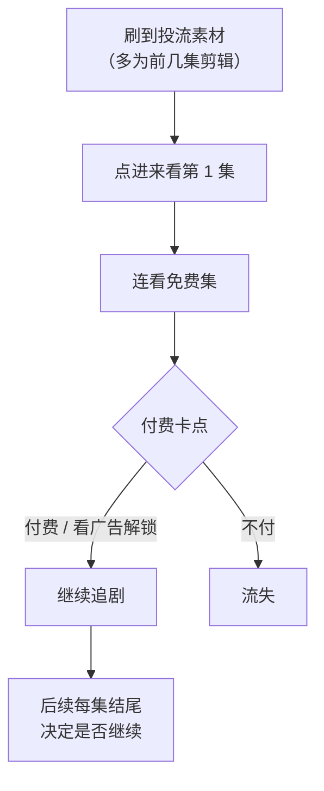
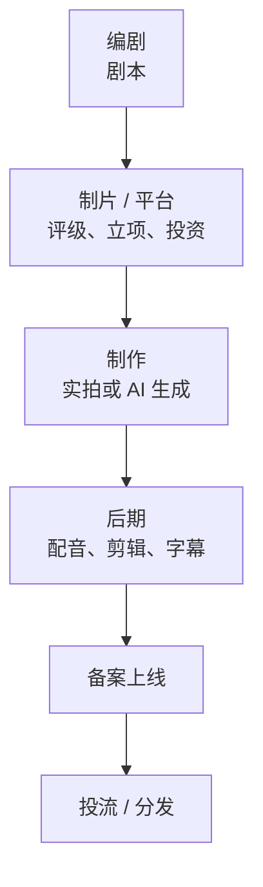

# 短剧是一种什么样的剧

这本书写给没写过剧本的开发者：你想自己做 AI 短剧、漫剧，或者把剧本卖给片方。第一章先把要写的东西认清楚：短剧和长剧、网文差在哪，观众是怎么看短剧的，一部短剧的剧本由哪些文件组成，编剧在整条链上交付什么。后面九章按「题材 → 人物 → 骨架 → 开篇 → 钩子 → 格式 → 版权与交易 → 完整示例」的顺序展开，最后两章是一部原创 AI 漫剧从梗概到前三集剧本的全部材料。

行业模式、平台和分账规则本书只在需要时提一句，系统讲解见[《微短剧行业全景》](../micro-drama-industry/)；剧本变成画面见[《AI 短剧分镜与画面生成》](../ai-drama-storyboard/)；上线备案见[《短剧发行、投流与备案》](../drama-distribution/)。

## 先看定义：多短才算短剧

国家广电总局 2022 年发布的《关于进一步加强网络微短剧管理实施创作提升计划有关工作的通知》把网络微短剧界定为：单集时长从几十秒到 15 分钟左右，有相对明确的主题和主线、较为连续和完整的故事情节的作品（据人民网、新浪等对通知的转述）。

这个定义很宽。日常说的「短剧」主要指其中最常见的一类：**竖屏、单集 1–2 分钟、几十到上百集**的连续剧。媒体报道里常见的描述是单集 1–2 分钟、集数 80–100 集，有的超过 100 集（澎湃新闻、36 氪等 2024 年报道）。漫剧（用 AI 生成画面的动态漫画剧）的单集时长差异更大，有行业文章写到 3–8 分钟一集的（人人都是产品经理，2025），也有和真人短剧一样 1–2 分钟一集的，看平台和制作方。

本书示例按「单集约 2 分钟、全剧 60 集」来写。这是 AI 漫剧里一个常见、也适合新人上手的规格（行业经验）：比 80–100 集的付费真人剧短，一个人写得完；又足够长，能练完整的钩子和卡点设计。

## 三种叙事形式对比

你可能看过很多长剧，也读过很多网文。短剧和它们的差别，决定了你过去积累的「讲故事直觉」哪些能用、哪些要扔掉。

| 维度 | 长剧（电视剧 / 网剧） | 网文（连载小说） | 短剧 / 漫剧 |
|---|---|---|---|
| 单位 | 一集 40–45 分钟 | 一章 2000–4000 字 | 一集 1–2 分钟（漫剧有更长的） |
| 总量 | 20–40 集 | 几十万到几百万字 | 60–100 集，总时长 1.5–3 小时 |
| 观看场景 | 客厅、电脑，主动选择 | 手机，碎片时间 | 手机竖屏，刷到即看，随时划走 |
| 开篇容忍度 | 可以铺垫一两集 | 前三章要抓人 | 前 10 秒抓不住就划走 |
| 一集内的结构 | 多条线交替推进 | 一章推进一小段 | 一个冲突、一次推进、一个钩子 |
| 人物 | 复杂、多面，有成长 | 有大量心理描写 | 标签清楚，靠行动和台词立住 |
| 收入方式 | 版权采购、会员、广告 | 订阅、免费看广告、IP 改编 | 按集付费 / 会员 / 看广告 / 品牌定制 |
| 写作者交付 | 剧本 | 正文 | 剧本 + 梗概 + 人物 + 分集大纲 |

一句话：**短剧的单集像网文的一章，节奏却要比网文快三倍，而且只能用画面和台词，不能用心理描写。**

## 节奏和密度

### 一集只做一件事

长剧一集 45 分钟，可以有三四条线交替。短剧一集 2 分钟，大约 4–8 个镜头组、1–3 场戏，台词 300–600 字（行业经验）。这点篇幅只够干一件事：

1. 开头 5–10 秒承接上一集的钩子（或者直接抛出冲突）
2. 中间推进一步：一次对抗、一次揭露、一次决定
3. 结尾留一个让人想点下一集的钩子

一集里如果出现两个同等分量的事件，通常应该拆成两集。

### 密度：每分钟都要有「变化」

短剧观众的耐心以秒计。行业里常说「一分钟一个反转」「三十秒一个爽点」，这类说法没有统一出处，属于经验口径，但方向是对的：**观众每隔几十秒就要看到局面发生变化**。

「变化」不一定是大反转，可以是：

- 信息变化：一个秘密被说出来、一个身份被揭开
- 关系变化：盟友翻脸、对手示好
- 地位变化：被羞辱的人站起来、得意的人失手
- 处境变化：危机升级、限时开始倒数

写完一集，可以逐段问「这一段过后，局面和上一段相比变了什么」。答不上来的段落就是水分。

### 不能用心理描写

网文可以写「他心里一沉，想起了三年前那个雨夜」。剧本只能写能拍、能生成出来的东西：动作、表情、台词、画面、声音。内心活动要么转成台词（包括内心独白 OS），要么转成动作，要么干脆删掉。第 7 章会讲具体写法。

## 观众是怎么看一部短剧的

写短剧要先知道观众接触一部剧的路径。以付费短剧为例：



这条路径上有三个时刻直接由剧本决定：

| 时刻 | 观众在想什么 | 剧本要做到 |
|---|---|---|
| 刷到素材 | 这是什么剧，值得点吗 | 前几集里有能单独剪出来、15–60 秒就能看懂的冲突段落 |
| 免费集结束 | 值得为后面花钱吗 | 卡点那一集停在最想知道结果的地方 |
| 每集结尾 | 还要看下一集吗 | 每一集都有钩子 |

免费短剧（看广告解锁或平台免费播出）没有付费卡点，但留存逻辑一样：观众每一集结尾都在决定要不要继续，平台按完播、留存来分配流量和分账。付费、免费、品牌定制、漫剧几种模式的收入怎么算，见《微短剧行业全景》。

## 一部短剧的剧本由哪些文件组成

「写剧本」不只是写台词。向平台投稿或者和片方合作，通常要交一套文件：

| 文件 | 篇幅（行业经验） | 用途 |
|---|---|---|
| 一句话故事（logline） | 1–2 句 | 让人 10 秒内判断要不要往下看 |
| 故事梗概 | 500–1500 字 | 讲清整部剧从头到尾发生了什么，包括结局 |
| 人物小传 | 每个主要人物 200–500 字 | 人物的身份、欲望、性格、关系、弧线 |
| 分集大纲 | 每集 1 句到 300 字 | 每一集发生什么、结尾钩子是什么 |
| 剧本正文 | 每集 800–1500 字 | 场景、动作、台词，可以直接拿去拍或生成 |

平台投稿通常不要求一次交完整剧本。抖音集团短剧创作者中心 2026 年 8 月公告的剧本撮合规则是：首次投稿提交 30 集内容，长篇最终完稿不少于 80 集、中短篇不少于 60 集（据 DataEye 短剧观察转载的公告）。各平台要求不同，投稿前看最新的征稿说明。

写作顺序一般是：一句话故事 → 人物 → 梗概 → 分集大纲 → 剧本。前四样定下来之前不要急着写台词，第 4 章会讲为什么。

## 编剧在产业链上的位置



谁会读你的剧本：

- **平台或制片的审稿编辑**：先看一句话故事和梗概，再看前几集。决定评级、给多少保底
- **导演或 AI 制作团队**：逐场拆成分镜，最关心场景和人物是否清楚、能不能做出来
- **投流团队**：会从前几集里剪素材，最关心有没有能单独成立的冲突段落
- **审核**：看内容导向、有没有违规情节（第 2 章）

AI 漫剧团队里，这几个角色可能就是同一个人，也可能就是你。即便如此，按这几种读者的需求去检查剧本也很有用。

## 开发者写短剧的优势和短板

**优势**

- 习惯结构化：分集大纲本质上是一张表，钩子、卡点、情绪曲线都可以用清单和数据管理
- 会用 AI：能用大模型做选题发散、大纲扩写、台词改写，也能自己搭剧本到分镜的流水线（见[《AI 内容生产工具链》](../ai-content-pipeline/)）
- 能做数据复盘：分析热门剧的集数、卡点、评论区反馈

**短板**

- 爱讲设定：开发者容易把世界观、规则、系统讲得很细，而短剧观众只关心「接下来会发生什么」
- 逻辑洁癖：为了让情节完全自洽而加大量解释性台词。短剧可以先抓情绪，逻辑只要「过得去」
- 不熟悉表演：写出来的台词像文档、像产品说明，不像人说的话

## 怎么入门：先拉片

最快的入门办法是拆别人的剧（行业叫「拉片」）。挑同题材的 5–10 部热门剧，每部看前 10 集，填这张表：

```text
剧名：
题材 / 男女频：
总集数：            免费集数：          卡点在第几集：
第 1 集第一句台词：
第 1 集前 10 秒发生了什么：
主角的身份反差（表面是什么 / 实际是什么）：

集号 | 本集核心事件 | 情绪（压 / 扬） | 结尾钩子 | 钩子类型
1    |              |                 |          |
2    |              |                 |          |
...
10   |              |                 |          |

评论区高赞评论在说什么（爽在哪 / 骂在哪）：
我能借鉴的一个结构：
```

拆 5 部以后，你会发现大量相似的骨架：同样位置的身份揭晓、同样节奏的打脸、同样类型的卡点。这些骨架就是后面各章要讲的东西。拉片只学结构，不搬情节和台词，原因见第 8 章。

## 本章要点

- 常说的短剧指竖屏、单集 1–2 分钟、几十到上百集的连续剧；漫剧的单集时长差异更大
- 短剧的单集像网文的一章，节奏要快得多，而且只能用画面和台词，不能用心理描写
- 一集只做一件事：承接钩子、推进一步、留下新钩子；观众每隔几十秒要看到局面变化
- 剧本决定三个时刻：投流素材能不能剪出来、卡点集能不能让人付费、每集结尾能不能留住人
- 一套剧本包括一句话故事、梗概、人物小传、分集大纲、剧本正文，按这个顺序写
- 入门先拉片：拆同题材热门剧的前 10 集，学结构，不搬情节
