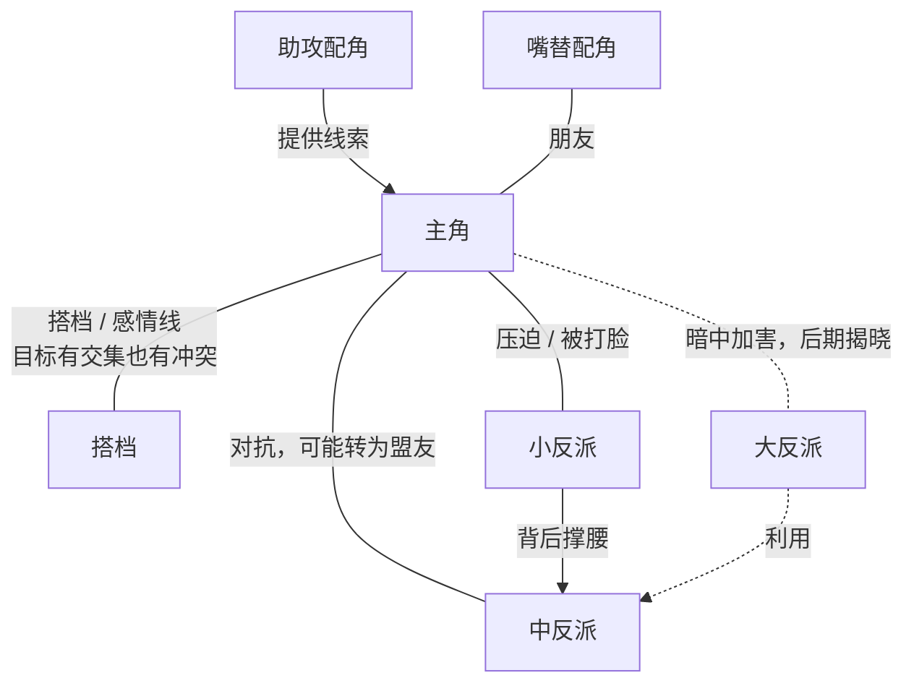

# 人物设定

短剧观众记不住复杂的人物，但会被一个「想要某样东西又得不到」的人牢牢抓住。这一章讲短剧人物怎么设计：主角的欲望和困境、身份反差、反派分层、配角的功能，最后给一份人物小传模板。完整示例的人物设定见第 9 章。

## 短剧人物的特点：标签清楚，欲望强烈

长剧可以花几集让观众慢慢了解一个人。短剧没有这个时间，观众在第 1 集的前 30 秒就要知道：**这个人是谁，他想要什么，什么在挡着他**。

所以短剧人物通常是「标签化」的：废柴少年、被退婚的千金、受气的儿媳、新来的实习生。标签不是缺点，它是观众快速入戏的入口。问题出在只有标签：一个「霸道总裁」如果除了霸道什么都没有，观众看三集就腻了。

好的短剧人物 = **一个清楚的标签 + 一个强烈的欲望 + 一个具体的困境**。

## 主角三问

设计主角时先回答三个问题。答不清楚，后面的情节一定会散。

| 问题 | 说明 | 反例 | 好的答案 |
|---|---|---|---|
| 他想要什么（欲望） | 具体、可见、能在剧中被达成或失去的目标 | 「他想变得更好」 | 「他想进内门，查清父亲为什么被逐出宗门」 |
| 什么挡着他（困境） | 外部阻碍 + 内部弱点 | 「生活很艰难」 | 「杂役不许修炼；一旦暴露能力会被害父亲的人盯上」 |
| 他会怎么做（行动） | 主角主动去争取，不是等事情发生 | 「他等待机会」 | 「他每晚偷偷校对功法，在外门小比上主动报名」 |

### 欲望要分层

主角的欲望最好有两层：

- **外在目标**：剧情要达成的事，观众能看见进度。进内门、拿回公司、赢得比赛、找到凶手
- **内在需求**：主角自己可能都没意识到的东西。被父亲认可、学会信任别人、放下仇恨

外在目标驱动每一集的情节，内在需求让结局有分量。短剧篇幅短，内在需求不用写得很重，但有和没有，观众感受到的差别很大。

### 困境要具体

困境分外部和内部：

- **外部困境**：身份低（杂役、赘婿、实习生）、资源缺（没钱、没靠山）、有强敌、有时限
- **内部困境**：性格弱点（太隐忍、太冲动、不信任人）、心结（过去的创伤、误会）

短剧里外部困境是主力，因为能直接拍出来。内部困境用来制造「主角自己犯错」的情节，让故事不全靠反派推动。

## 身份反差

身份反差是短剧最核心的人物设计手法：**主角表面的身份和真实的价值之间有巨大落差**，剧情就是逐步揭开这个落差的过程。

| 表面身份 | 真实价值 | 揭晓带来的爽点 |
|---|---|---|
| 被退婚的穷小子 | 能力或背景远超众人 | 看轻他的人后悔 |
| 不起眼的保洁阿姨 | 退休的行业专家 | 关键时刻救场 |
| 外门杂役 | 唯一能看出宗门功法错漏的人 | 「你们练了三百年的功法是错的」 |
| 被嫌弃的儿媳 | 自己有事业、有手艺 | 家人重新认识她 |

设计身份反差有三个要点：

1. **反差要大**：表面越低，揭晓越爽。但不要低到失去尊严，主角要有骨气
2. **逐层揭晓**：不要第 1 集就全部揭开。一部 60 集的剧，可以设计 3–4 次揭晓，每次只揭一层，让「后悔的人」一批批出现
3. **真实价值别落到钱和权上**：按第 2 章的红线，揭晓「原来他是首富」这类反差正在被监管点名。落到能力、品格、专业上，同样爽，还更耐看

## 反派

短剧的反派负责制造压力。没有像样的反派，主角的胜利就没有分量。

### 反派要分层

一部 60–80 集的剧，只有一个反派撑不住。常见做法是分三层（行业经验）：

| 层级 | 出场 | 作用 | 结局 |
|---|---|---|---|
| 小反派 | 第 1 集就出现，每 5–10 集换一个 | 提供即时的冲突和打脸 | 很快被打脸、退场或转变 |
| 中反派 | 第一个阶段末尾登场 | 推动中段的主要对抗 | 败落，或者转为盟友 |
| 大反派 | 早期埋伏笔，中后段才露面或身份揭晓 | 主线的终极阻碍，往往和主角的过去有关 | 最终对决败落 |

小反派负责「爽」，大反派负责「悬」。很多剧把大反派藏在主角身边的好人里，中后段揭晓，制造全剧最大的反转。

### 反派要有动机

「他就是坏」撑不过十集。给反派一个他自己认为合理的理由：

- 嫉妒：同样的位置，凭什么是你
- 恐惧：主角的存在威胁到他的秘密
- 利益：他要保住已经得到的东西
- 信念：他真心认为自己是对的

动机越合理，反派越可怕，主角赢的时候越有分量。

### 反派的「蠢」要节制

短剧反派常被吐槽「降智」：明明能一招解决主角，却非要当众羞辱、给主角翻盘机会。适度的傲慢是可以的，傲慢本身就是性格弱点。但如果观众开始骂「反派怎么这么蠢」，主角的胜利也就不值钱了。一个办法是：**让反派的失败来自他的性格弱点，而不是剧情需要**。

## 配角的功能

短剧篇幅有限，每个配角都要有明确的功能。设计配角时先问「删掉他，剧情会少什么」。

| 功能 | 说明 | 例子 |
|---|---|---|
| 助攻 | 在关键时刻帮主角一把，或提供关键信息 | 知道往事的老杂役 |
| 嘴替 | 说出观众心里想说的话，吐槽反派 | 主角的胖室友 |
| 情绪放大器 | 围观者的震惊、后悔，让爽点更爽 | 「这不可能！」的同门 |
| 镜子 | 和主角处境相同但做了不同选择，衬托主角 | 同样被欺负却投靠反派的人 |
| 感情线对象 | 和主角有情感互动，也要有自己的目标 | 有自己秘密要查的搭档 |

感情线对象最容易写成工具人，只为主角服务。给 TA 一个独立的目标，并让这个目标和主角的目标有交集又有冲突，感情线自然就有张力。

## 人物关系图

主要人物定下来以后，画一张关系图，检查每对重要关系是否都有张力。下面是一个通用结构：



检查：

- 有没有两个人物功能重叠？合并
- 有没有人物和其他人都没有关系？删掉或者给他接上线
- 大反派和主角的过去有没有联系？有的话，最终对决会更有分量

## 角色数量：AI 漫剧要格外克制

真人短剧多一个角色就多一个演员的成本。AI 漫剧多一个角色，就要多做一套角色设定图（正面、侧面、表情、服装版本），并且在每个镜头里维持一致。角色越多，返工越多。

经验做法：

- 主要角色（有完整人物小传的）控制在 5–8 个
- 有台词的次要角色控制在 10 个以内，能复用的尽量复用（同一个执事贯穿全剧，而不是每次换一个）
- 无台词的群众用「众弟子」「围观者」概括，不单独设计
- 每个主要角色的造型版本控制在 2–3 套（日常、正式、战斗），换装要有剧情理由

角色一致性怎么做，见[《AI 短剧分镜与画面生成》](../ai-drama-storyboard/)。

## 起名

名字是观众记住角色的第一抓手，在弹幕、评论区被反复提起。几条规则：

- **好记好读**：两三个字，避免生僻字。观众要能在评论区打出来
- **一眼区分**：主要角色名字的首字、字数、读音尽量不同。「林晚」「林婉」同时出现是灾难
- **贴合身份**：古风名字和现代名字分开；反派的名字可以带一点冷硬感，但不要明显到「名字就写着我是坏人」
- **避开真人**：不要和知名人物、真实的企业家、明星同名，避免肖像和名誉纠纷
- **配音友好**：AI 配音会读名字，避免多音字和容易读错的字

## 人物小传模板

每个主要人物写一份小传。投稿时这是必交材料，制作时导演和 AI 制作团队靠它理解人物。

```text
【姓名】            【年龄】       【性别】
【标签】一句话，例如「被判下品灵根的外门杂役」
【表面身份】
【真实身份 / 隐藏能力】（如有）

【外在目标】剧中要达成的事
【内在需求】他自己可能没意识到的东西
【困境】外部：            内部：

【性格】3 个关键词 + 每个词一个能拍出来的行为
  例：隐忍 —— 被人踩住手也不出声，只把东西护在怀里
【口头禅 / 说话方式】
【外形】年龄感、体型、发型、标志性服装或道具（AI 制作需要更细，见第 7 章）

【背景】200 字以内，只写和剧情有关的过去
【与其他角色的关系】逐个列出，写清楚关系的张力在哪
【人物弧线】开场是什么样 → 中段经历什么转变 → 结局变成什么样
【关键场次】第几集发生什么，对这个人物意味着什么
```

写小传的常见问题：

- **背景写成流水账**：从出生写到现在。只写和剧情有关的部分
- **性格只有形容词**：「善良、勇敢、聪明」等于没写。每个词配一个能拍的行为
- **没有弧线**：主角从头到尾一个样。哪怕短剧，主角在结局也要和开场不一样
- **反派没有小传**：反派也要写，而且要写他的动机

## 本章要点

- 短剧人物 = 清楚的标签 + 强烈的欲望 + 具体的困境
- 主角三问：想要什么、什么挡着他、他会怎么做；欲望分外在目标和内在需求
- 身份反差是核心手法：反差要大，逐层揭晓，真实价值落在能力和品格上，不落在钱和权上
- 反派分小、中、大三层，各有动机；反派的失败来自性格弱点，而不是剧情需要
- 每个配角都要有功能，感情线对象要有自己的目标
- AI 漫剧要控制角色数量和造型版本；名字要好记、好区分、避开真人、配音友好
