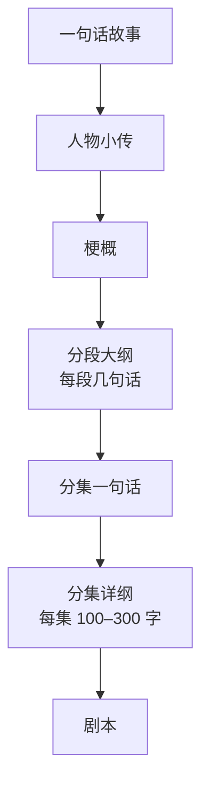
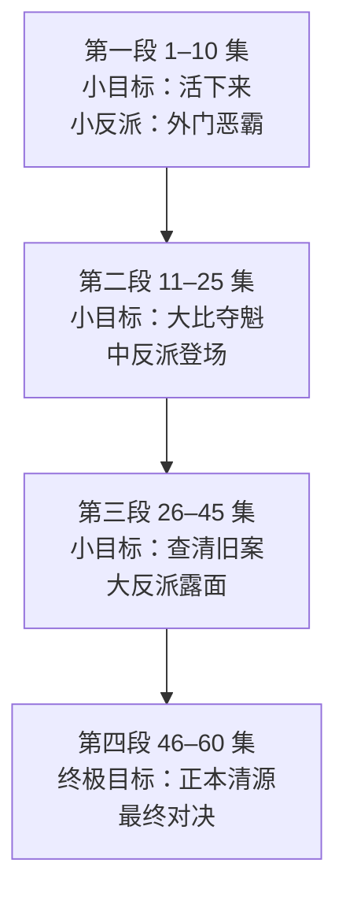

# 故事骨架与分集大纲

题材和人物定了，下一步是把整部剧从头到尾想清楚，再拆到每一集。这一章讲四样东西：一句话故事、故事梗概、整体结构（三幕和多段式）、分集大纲。它们是剧本之前的「设计文档」，也是投稿时编辑最先看的材料。

## 为什么先写大纲再写剧本

新手最常见的做法是有了一个好开头就直接写剧本，写到二十集发现没东西可写，或者发现中间的走向和结局对不上，大面积返工。

对开发者来说可以这样类比：梗概是需求文档，分集大纲是技术方案，剧本是代码。直接写代码当然能写，但项目越大返工越贵。60 集的剧本有 5–9 万字（按每集 800–1500 字估算），一次大返工可能就是几万字。

写作顺序：



每一步都比上一步细。上一步改起来便宜，所以问题要尽量在上游解决。

## 一句话故事

一句话故事（logline）是整部剧最浓缩的表达，用来测试这个故事成不成立，也用在投稿的第一行。

模板：

```text
一个【有标签的主角】，因为【触发事件】，必须【外在目标】，
但【最大的阻碍】，他唯一的武器是【身份反差 / 特殊能力】。
```

例子：

```text
被判下品灵根的外门杂役，在藏经阁发现自己能看见功法里历代传抄的错字，
他要靠改错字一路逆袭进内门，查清父亲十八年前被冤「篡改经书」的真相，
而当年真正篡经的人，正是如今掌管全宗功法的传功长老。
```

检验一句话故事：

- 读完能不能说出主角是谁、想要什么、谁在挡他
- 有没有一个让人好奇的「钩子」（这里是「能看见错字」和「篡经的是传功长老」）
- 换掉主角的名字和职业，故事还成不成立？成立说明外壳不够独特

## 故事梗概

梗概讲清楚整部剧从头到尾发生了什么，**包括结局**。很多新人怕「剧透」不写结局，这是错的：编辑要判断的就是这个故事能不能收得住。

### 梗概的结构

一份 800–1500 字的梗概可以按这个顺序写：

```text
第一段：主角是谁，处境如何，触发事件是什么（对应开篇几集）
第二段：主角的第一个目标，第一个阶段的对抗和结果
第三段：中段的升级——更强的对手、更大的秘密、一次重大转折
第四段：低谷——主角失去最重要的东西，或者被逼到绝境
第五段：反击和高潮——主角怎么翻盘，最终对决
第六段：结局——主角得到了什么，失去了什么，变成了什么样的人
```

### 梗概的写法

- 用现在时、第三人称，平铺直叙
- 只写主线和主要副线，不写每一个小情节
- 写清楚因果：「因为……所以……」，而不是「然后……然后……」
- 不写台词、不写镜头
- 把核心爽点和关键反转写出来，让编辑看到「这里会很爽」

## 整体结构

### 三幕结构

三幕结构是最通用的叙事骨架，短剧同样适用，只是比例要调整：

| 幕 | 内容 | 长剧占比 | 短剧占比（60 集） |
|---|---|---|---|
| 第一幕：建置 | 介绍主角、处境、触发事件，主角决定行动 | 约 25% | 约 15%（前 8–10 集） |
| 第二幕：对抗 | 主角追求目标，阻碍不断升级，中点反转，低谷 | 约 50% | 约 65% |
| 第三幕：解决 | 最终对决，主角达成或失去目标 | 约 25% | 约 20% |

短剧的第一幕要更短。长剧可以花 25% 的篇幅铺垫，短剧观众等不了：**第 1 集就要出触发事件，前 10 集内主角就要做出决定、开始行动**。

### 多段式结构

60 集以上的短剧，单靠三幕撑不住中段，很容易在三四十集「塌」掉。更实用的是**多段式**：把全剧切成 3–5 个段落，每段有自己的小目标、小反派和小高潮，像游戏里的关卡（行业里也叫「单元式」「副本式」）。



每一段都满足：

- **开头**有一个新目标或新威胁
- **中间**有 2–3 次局部爽点
- **结尾**有一个阶段性胜利，同时打开下一段的更大问题

段与段之间的交接点，往往就是全剧情绪最高、最适合放付费卡点或投流素材的地方（第 6 章）。

### 主线与副线

一部短剧通常有一条主线、一两条副线：

| 线 | 作用 | 例子 |
|---|---|---|
| 主线（事业 / 复仇 / 解谜） | 驱动全剧，决定每一段的目标 | 杂役逆袭进内门，查清父亲冤案 |
| 感情线 | 提供情绪调剂和「甜」的段落 | 和守阁弟子从互相怀疑到并肩 |
| 悬念暗线 | 埋伏笔，在中后段揭晓，制造大反转 | 守阁长老为什么失踪 |

几条线的关系：

- **主线不能断**：每一集都应该和主线有关，哪怕只推进一点点
- **副线服务主线**：感情线的每一次推进，最好同时影响主线（她帮他拿到关键证据）
- **暗线有交汇点**：暗线最终要和主线汇合，揭晓时同时推动主线（长老失踪和父亲冤案是同一个人干的）

## 分集大纲

分集大纲是把结构拆到每一集。它有两种粒度：

- **分集一句话**：每集一句话，加结尾钩子。用来看全剧节奏、调整卡点位置
- **分集详纲**：每集 100–300 字，写清本集的场景、冲突、转折和钩子。写剧本时照着写

### 分集大纲模板（表格版）

```text
集号 | 一句话内容 | 本集冲突 | 情绪（压 / 扬 / 悬） | 结尾钩子 | 钩子类型 | 主要场景 | 出场角色
```

各列说明：

| 列 | 说明 |
|---|---|
| 一句话内容 | 本集发生的核心事件，一句话 |
| 本集冲突 | 谁和谁、为什么对抗 |
| 情绪 | 这一集观众的主要情绪：被压着（压）、出了口气（扬）、悬着（悬） |
| 结尾钩子 | 最后一个画面或一句台词 |
| 钩子类型 | 第 6 章的分类：悬念、危机、反转、揭晓前一秒…… |
| 主要场景 | 用于估算制作成本、复用场景 |
| 出场角色 | 用于检查角色是否太多、是否有人消失太久 |

### 一个小示例

下面用一个和完整示例不同的题材演示：都市职场，男频偏全年龄。

```text
一句话故事：被裁员的 35 岁程序员去一家濒临倒闭的老字号点心铺打零工，
用写代码的思路改造了排班、库存和线上点单，帮老铺翻身，
也让当初裁掉他的前上司来求合作。
```

前 6 集一句话大纲：

| 集 | 一句话内容 | 情绪 | 结尾钩子 | 钩子类型 |
|---|---|---|---|---|
| 1 | 程序员老陈在会议室被前上司当众宣布裁员，回家路上看到老字号「招零工」的牌子 | 压 | 店主看完他的简历冷笑：「会写代码？那你会揉面吗？」 | 冲突 |
| 2 | 老陈在后厨笨手笨脚被老师傅嫌弃，却发现店里每天扔掉三成的点心 | 压→悬 | 他盯着报废单：「问题不在面，在数字。」 | 悬念 |
| 3 | 老陈用一晚上做了个订货表，第二天报废减半，老师傅不信是巧合 | 扬 | 店主女儿推门进来：「这个月房租再交不上，就关门。」 | 危机 |
| 4 | 老陈提议做线上预订，店主坚决反对，两人吵翻 | 压 | 老陈被辞退，收拾东西时手机响了——前上司来电 | 悬念 |
| 5 | 前上司想挖老陈回去做外包，开价很低；老陈拒绝，回店里继续说服店主 | 扬 | 店主女儿偷偷把线上预订开了，第一单来了，订了两百份 | 反转 |
| 6 | 两百份订单压垮后厨，老陈连夜重排生产流程 | 悬→扬 | 订单交付成功，客户是一家大公司——正是裁掉他的那家 | 反转 |

注意几点：

- 每一集都有情绪变化，压和扬交替
- 每一集结尾的钩子类型在变，不是一直用同一招
- 第 6 集结尾回扣第 1 集（裁员的公司），形成一个小闭环
- 主线（救活老铺）每集都在推进，副线（和前上司的恩怨）穿插出现

### 分集详纲示例

把上面第 2 集展开成详纲：

```text
第 2 集　报废单
场景：点心铺后厨（日）、店铺后门（日）
角色：老陈、王师傅（老师傅）、店主

老陈第一天上工，和面时把面粉撒了王师傅一身，被骂「读书人干不了这个」。
他被打发去倒垃圾，在后门看到一整筐还没变质的点心被倒掉，愣住。
王师傅说每天都这样，做多了卖不完，做少了怕断货，「凭经验」。
老陈趁午休翻出半年的手写报废单，用手机一张张拍下来。
店主看见了，以为他在偷看账本，要赶他走。
老陈举起手机：「每天扔掉三成，一个月就是一个人的工资。」
店主一愣。老陈盯着报废单：「问题不在面，在数字。」（钩子）
```

详纲要写到这个程度：**谁、在哪、做了什么、局面怎么变、结尾停在哪**。台词只写最关键的一两句，其余留给剧本。

## 用 AI 辅助写大纲

大模型适合做大纲阶段的「体力活」：发散、扩写、检查。下面是一个检查分集大纲节奏的提示词：

```text
你是一位短剧责任编辑。下面是一部 60 集短剧的分集一句话大纲，
每行格式：集号 | 一句话内容 | 情绪 | 结尾钩子 | 钩子类型。

请检查：
1. 连续 3 集以上情绪都是「压」的位置
2. 连续 3 集以上钩子类型相同的位置
3. 超过 5 集没有推进主线的位置
4. 主要角色超过 10 集没有出场的情况
5. 第 10 集（付费卡点）的钩子强度，如果偏弱，给出 2 个改法

只指出问题和位置，不要重写整个大纲。

【大纲】
（粘贴）
```

注意：

- 让模型**检查和提建议**，不要让它从零写整部剧。模型写出来的故事往往是热门套路的平均值，缺少你的新意
- 模型的建议要自己判断。它不知道你的预算、你的 AI 制作能力
- 不要把别人的作品喂给模型让它「改写成新的」，这是洗稿，第 8 章讲版权风险

## 常见问题

| 问题 | 症状 | 办法 |
|---|---|---|
| 中段塌陷 | 30–40 集反复同一种打脸，观众审美疲劳 | 改成多段式，每段换小目标和小反派 |
| 主线断档 | 连续几集都在写感情线或支线 | 每集至少推进主线一小步 |
| 结局仓促 | 前面铺得很大，最后三集草草收场 | 写梗概时先写结局，倒推最后一段需要多少集 |
| 伏笔不回收 | 前面埋的线索后面忘了 | 建一张伏笔表：埋在第几集，在第几集回收 |
| 反派重复 | 每段的反派都是同一种人 | 反派分层，每层动机和手段不同 |

伏笔表可以很简单：

```text
伏笔 | 埋设集 | 回收集 | 回收方式
铜尺 | 1 | 10 | 传功长老认出这把尺子
周伯的跛脚 | 4 | 38 | 当年为救证据被打伤
```

## 本章要点

- 先写设计文档再写剧本：一句话故事 → 人物 → 梗概 → 分段大纲 → 分集一句话 → 分集详纲 → 剧本
- 一句话故事要能说清主角、目标、阻碍和钩子；梗概必须写结局
- 短剧的第一幕要短，前 10 集内主角就要开始行动；60 集以上用多段式，每段有自己的小目标和小高潮
- 主线每集都要推进，副线服务主线，暗线在中后段和主线汇合
- 分集大纲先写一句话版看节奏，再写详纲；检查情绪交替、钩子类型变化、角色出场
- 用 AI 检查大纲、提建议，不要让它从零写，也不要拿别人的作品让它改写
