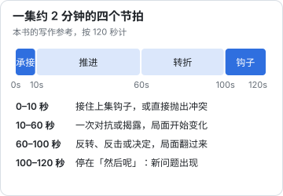
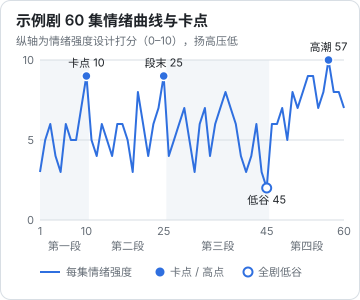

# 钩子与付费卡点

短剧是按集消费的。每一集结束，观众都要做一次选择：看下一集，还是划走。付费短剧还有一个更关键的选择点：免费集看完，要不要付钱。这一章讲单集的节拍、集尾钩子的类型、集首怎么承接、付费卡点放在哪里，以及怎么用情绪曲线管理全剧节奏。

## 单集的四个节拍

第 1 章讲过「一集只做一件事」。把这件事放进约 2 分钟里，可以拆成四个节拍：



这是写作参考，不是公式。有的集推进很短、转折很长，有的集一开场就是转折。但每一集都应该能指出这四个部分各在哪里，尤其是第一个和最后一个。

## 集首承接

上一集的钩子是一个承诺：「下一集告诉你答案」。集首的任务是**兑现这个承诺**，而且要快。

| 承接方式 | 做法 | 例子 |
|---|---|---|
| 直接给答案 | 开场就揭晓上集悬念的结果 | 上集：「谁在里面？」→ 本集第一个画面：举着符灯的少女 |
| 答案 + 新问题 | 给出答案，但答案本身带来新问题 | 「他没有偷学」→ 她为什么要护着他？ |
| 延迟一拍 | 先切到另一条线，几秒后再回来 | 适合双线并进，但不要超过 10–15 秒 |

集首最常见的错误是**重复上一集的结尾**。很多剧会把上一集最后几秒重播一遍，这在剪辑上是惯例（帮观众回忆），但剧本里不要为此写一段重复的戏。剧本从「然后」开始写，要不要回放交给剪辑决定。

另一个错误是**不兑现**：上一集结尾「门后站着一个人」，这一集开场却写别的事，到中段才回来交代。观众会觉得被骗了。

## 集尾钩子的类型

钩子是让观众想看下一集的那个瞬间。常见类型：

| 类型 | 原理 | 例子 |
|---|---|---|
| 悬念 | 抛出一个问题：是谁？是什么？为什么？ | 黑暗中传来一声：「谁在里面？」 |
| 危机 | 主角陷入危险或困境，结果未知 | 执法弟子包围了杂役院 |
| 反转 | 局面突然翻过来，和观众预期相反 | 对手用出了主角自己的招式 |
| 揭晓前一秒 | 真相马上要说出来，停住 | 「这把尺子……你是沈明章什么人？」 |
| 身份暴露 | 主角的秘密被人发现或即将被发现 | 掌门问：「你是沈明章之子？」 |
| 新人物登场 | 一个重要的、带着威胁或秘密的人出现 | 传功长老从观礼台站了起来 |
| 情感 | 关系的关键时刻：表白、误会、离别 | 她说：「你读错的那一句，是我师父最后写给我的话。」 |
| 倒计时 | 设定一个期限 | 七天内找不到证据，逐出山门 |
| 打脸前夜 | 反派得意洋洋，观众知道主角要翻盘 | 「大典上，我要他当着全宗的面认罪。」 |

### 钩子的强度

钩子有强弱。一个粗略的判断：**观众能不能用一句话说出自己想知道什么**。

- 弱：「事情似乎没那么简单。」（想知道什么？说不出来）
- 中：「门后有人。」（想知道是谁）
- 强：「门后站着的，是三年前失踪的师父。」（想知道她为什么在这、这三年发生了什么、接下来会怎样）

强钩子往往同时打开好几个问题，而且和观众已经关心的东西有关。

### 钩子要轮换

连续几集用同一种钩子，观众会麻木。尤其是「危机」型，如果每集结尾主角都陷入危险、下一集开头又轻松化解，观众很快就不再紧张。写分集大纲时在「钩子类型」一列检查：**同一类型不要连续超过两集**。

### 假钩子

假钩子是集尾制造了一个悬念，下一集却发现「其实没什么」：门后的人原来是送饭的，晕倒原来是没吃早饭。偶尔用来调节气氛可以，频繁使用会让观众不再信任你的钩子。

## 付费卡点

付费卡点是免费集和付费集的分界线。观众看到这里，要么付费（或看广告、开会员）继续，要么离开。卡点那一集的结尾，是全剧最需要「强钩子」的地方。

### 卡点放在哪里

卡点位置没有官方规定，各平台、各剧差异很大。公开报道里能看到的情况：

- 以 100 集为例，前 10–15 集免费，之后按每集 0.8–1 元收费（澎湃新闻、36 氪 2024 年报道）
- 一部 69 集的剧前 29 集免费、后 40 集付费，单集解锁 1.4 元（行业媒体报道的单个案例）
- 2025 年以来抖音、快手等平台推出短剧会员，红果等免费平台靠广告分账，按集付费不再是唯一模式（同上来源）

这些说明卡点位置是片方和平台根据投放数据调的，不是编剧一个人定。编剧要做的是：**在大纲里明确设计一个主卡点，再准备一两个备用卡点**，让片方可以根据测试数据前后调整。

经验上，主卡点通常放在：

- 第一段落（第一个小闭环）结束的位置
- 观众已经被「爽」过一两次、对主角有了感情的时候
- 剧情刚刚打开一个更大的问题、答案在后面的时候

本书示例是 60 集，主卡点放在第 10 集，备用卡点放在第 20 集和第 30 集，都是段落交接或段落中点的强钩子位置。

### 卡点集怎么写

卡点那一集要同时做到两件事：

1. **给满足**：这一集要有一个明确的爽点，让观众觉得「这部剧值得」
2. **留最大的问题**：在满足之后，立刻打开一个比之前所有问题都大的问题

也就是说，卡点集的情绪是「扬」到最高，然后在最高点被拉向一个更大的悬念。示例的第 10 集：沈砚在外门小比上打败赵乾（扬），传功长老看到他的铜尺，低声问「你是沈明章什么人？」（揭晓前一秒）。观众刚刚出了一口气，又被一个关于主角身世的问题钩住。

卡点集不要停在一个「虐」的低点。观众在低谷时更容易放弃，而不是付钱等翻盘（行业经验）。

### 免费模式下的「卡点」

免费短剧（看广告解锁或平台免费播出）没有付费墙，但同样有「观众流失」的关键位置。平台按完播率、留存来分配推荐和分账，编剧要做的仍然是：每一段落结束都有强钩子，前 10 集内有一个足够大的问题把观众留下来。分账规则见[《微短剧行业全景》](../micro-drama-industry/)。

## 情绪曲线

把全剧每一集的主要情绪按强度打分，连成一条线，就是情绪曲线。它是检查全剧节奏最直观的工具。

下面是本书完整示例的情绪曲线：每集按 0–10 打分（扬为高、压为低），分数是本书在设计分集大纲时给的，不是观众数据。



从这条曲线能看出几个设计原则：

| 原则 | 曲线上的体现 |
|---|---|
| 压扬交替 | 几乎没有连续三集以上同方向的走势 |
| 段落末尾有高点 | 第 10、25 集都是段落收尾的高点 |
| 低谷在高潮前 | 第 45 集是全剧最低点，紧接着进入最终段落 |
| 越往后起伏越高 | 第四段的平均值明显高于前三段 |

### 压和扬的比例

行业里有「三虐一甜」「三压一扬」之类的说法，没有统一出处，属于经验口径。更实用的理解是：

- **压得太少**：扬就没有力量。打脸之前没受过委屈，打脸就不爽
- **压得太久**：观众憋不住会划走。连续三四集都在受压，就要安排一次小反击
- **扬得太满**：一直赢也会腻。主角每战必胜，观众就不再担心他

示例剧的做法是：每段内部大致两三集压、一集扬，段末一次大扬；全剧在倒数第二段末尾安排一次最深的压（低谷），让最后一段的连续上扬有足够的落差。

### 怎么画自己的情绪曲线

不需要专门的工具。在分集大纲表里加一列「情绪分」，用表格软件画一条折线图就行。检查四件事：

1. 有没有连续三集以上同方向（一直压或一直扬）
2. 段落末尾、卡点集是不是高点
3. 全剧最低点是不是在最终段落之前
4. 后半程的整体水平是不是高于前半程

## 钩子与卡点清单

写完分集大纲后逐项检查：

```text
单集
[ ] 每一集结尾都有钩子，能用一句话说出观众想知道什么
[ ] 每一集开头 10 秒内兑现了上一集的钩子
[ ] 没有为「回放上集结尾」写重复的戏
[ ] 每集至少一次局面变化（信息、关系、地位、处境）

钩子分布
[ ] 同一种钩子类型没有连续超过两集
[ ] 假钩子（悬念最后发现没什么）全剧不超过两三次
[ ] 危机型钩子的化解方式不重复

卡点
[ ] 大纲里标注了主卡点和一两个备用卡点
[ ] 主卡点集有一个明确的爽点
[ ] 主卡点集结尾打开了一个比之前都大的问题
[ ] 卡点集没有停在低谷

情绪曲线
[ ] 没有连续三集以上同方向
[ ] 段落末尾是高点
[ ] 全剧低谷在最终段落之前
[ ] 后半程整体高于前半程
```

## 常见坑

| 坑 | 表现 | 办法 |
|---|---|---|
| 钩子疲劳 | 每集都是「危机」，观众不再紧张 | 轮换钩子类型 |
| 拖延兑现 | 钩子的答案拖到好几集后才给 | 小钩子下一集就兑现，大钩子在本段落内兑现 |
| 卡点太早 | 观众还没爱上主角就要付钱 | 卡点前至少有一两次爽点 |
| 卡点太弱 | 卡点集只是普通的一集 | 卡点集按「满足 + 最大问题」专门设计 |
| 只有钩子没有故事 | 每集结尾都很抓人，但整部剧讲不出一个完整的故事 | 钩子服务主线，回到第 4 章的结构 |
| 钩子越界 | 为了刺激用暴力、擦边画面做钩子 | 按第 2 章的红线检查，用悬念和情感做钩子 |

## 本章要点

- 单集四个节拍：承接、推进、转折、钩子；开头 10 秒兑现上集钩子，结尾停在「然后呢」
- 钩子有悬念、危机、反转、揭晓前一秒、身份暴露、新人物、情感、倒计时、打脸前夜等类型，要轮换，少用假钩子
- 卡点位置由片方和平台按数据调整，编剧在大纲里设计一个主卡点和一两个备用卡点
- 卡点集 = 一个明确的爽点 + 一个比之前都大的问题，不要停在低谷
- 用情绪曲线检查全剧节奏：压扬交替、段末高点、低谷在高潮前、越往后越高
