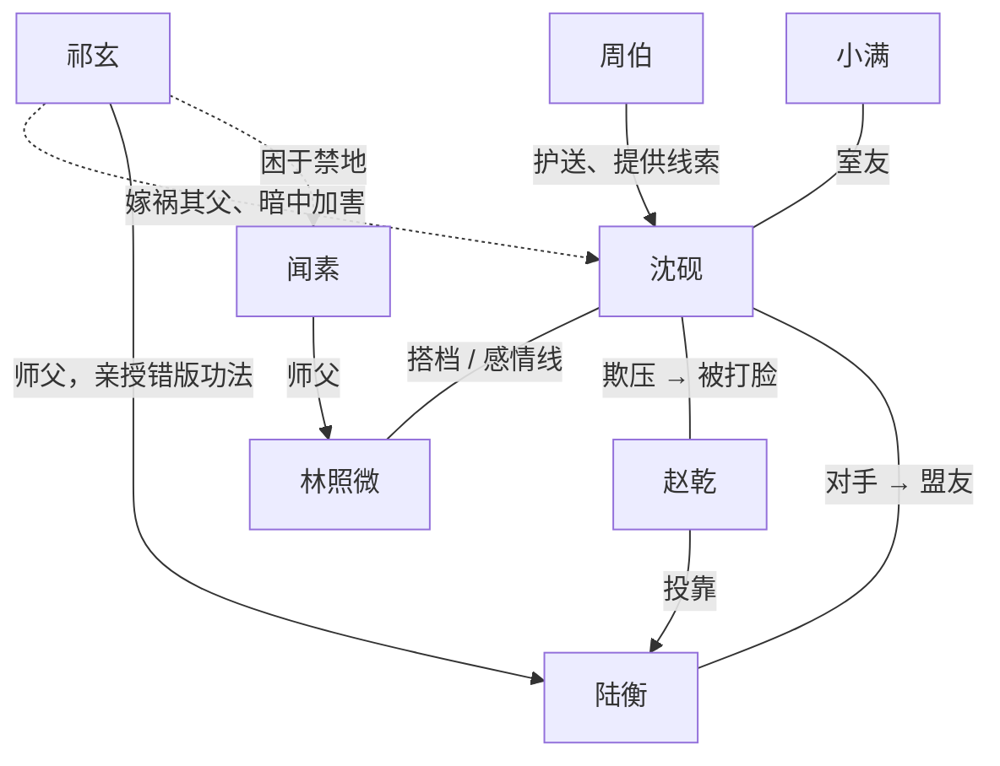

# 完整示例（上）：梗概、人物与分集大纲

前八章讲的方法，这两章用一部原创 AI 漫剧从头到尾走一遍。这一章是剧本之前的全部设计文件：项目信息、一句话故事、梗概、人物小传、角色设定、结构和 60 集分集大纲。下一章先讲卡点与伏笔设计，再给前三集的完整剧本和自检。

这部剧的故事、人物、设定均为本书原创。宗门、人名、功法名都是虚构的，如与现实中的名称雷同，纯属巧合。

## 项目信息

| 项目 | 内容 |
|---|---|
| 剧名 | 藏经阁里改错字 |
| 形式 | AI 漫剧，竖屏，国风 2D 动态漫画风格 |
| 题材 | 古风玄幻 / 废柴逆袭 + 悬疑 |
| 受众 | 男频为主，兼顾全年龄 |
| 集数与时长 | 60 集，单集约 2 分钟 |
| 付费卡点 | 主卡点第 10 集，备用第 20、30 集 |
| 核心爽点 | 被看不起的杂役，凭「看出错字」逐层揭晓价值；以「校勘」而不是以暴力击败反派 |
| 价值导向 | 求真、勤学、知识公开；反派依门规受处置，主角不私刑报复 |

## 一句话故事

```text
被判下品灵根的外门杂役，在藏经阁发现自己能看见功法里历代传抄的错字，
他要靠改错字一路逆袭进内门，查清父亲十八年前被冤「篡改经书」的真相，
而当年真正篡经的人，正是如今掌管全宗功法的传功长老。
```

## 故事梗概

照溪宗曾是一方大宗，三百年来日渐衰落，弟子修炼越来越难。十七岁的沈砚在测灵大典上被判为下品灵根，当众受辱，被罚去藏经阁做杂役。他随身带着亡父留下的一把旧铜尺。当晚擦书时，铜尺碰到《照溪拳谱》，书页上一个错字泛起红光，旁边浮出正确的字。沈砚照改正后的口诀出拳，一拳打灭了阁里的铜灯。

守阁弟子林照微撞见了他。按门规，杂役偷学功法要被逐出山门，她却在外门恶霸赵乾面前替他作保。原来她早就怀疑宗门典籍有问题：她的师父、守阁长老闻素三年前闭关后失踪，留下的最后一句话正是一句被改动过的口诀。两人做了交易：她保他，他帮她找出师父失踪的线索。在藏经阁禁区的封印上，沈砚看见了父亲的落款「沈明章　校」。

沈砚开始暗中校对功法，第一次引气入体。外门小比上，他用改正后的拳法击败赵乾，却引来了传功长老祁玄。祁玄认出了他腰间的铜尺。此后祁玄几次试探，沈砚装作看不出错字，在林照微的帮助下通过藏经考、在外门大比中夺魁。内门首席陆衡练的是祁玄亲授的功法，越练伤越重，沈砚出手相救，两人由敌转友。沈砚也查到父亲当年的罪名：篡改典籍、致三名弟子走火入魔。他开始怀疑父亲当年其实是在「改正」。

进入内门后，沈砚被分进传功堂抄书，发现祁玄主持重抄的新版功法错字更多，一个月后就要发给全宗。三人顺着铜尺上「正本在灯下」的线索，找到被祁玄困在后山禁地三年的闻素长老。闻素道出真相：沈明章临走前把正本交给了一个叫「灯」的孩子——正是沈砚的小名。正本的口诀就刻在铜尺的夹层里。与此同时，祁玄伪造证据，指控沈砚篡改宗门总纲，把他关进地牢，夺走铜尺。

地牢里，看守藏经阁多年的老杂役周伯讲出十八年前的全部经过：祁玄为了掌控宗门，暗中篡改典籍，三名弟子因此走火入魔，他把罪名嫁祸给发现问题的沈明章。沈砚早已把正本背下。林照微、陆衡和外门杂役们设法救出他。宗门大典上，祁玄发布新版功法，沈砚当众提出「以字定是非」：新旧两版逐字对照，杂役们当场按两版运功比较。闻素、周伯、陆衡先后作证。祁玄恼羞成怒强行出手，却因为自己抄漏了正本中的一个字，功法逆行失控落败。掌门依门规革去他的职务，交执法堂处置。沈砚没有报复，反而用正本口诀帮他稳住经脉。

沈明章得以正名。沈砚拒绝接任传功长老，提议公开正本、人人可校，藏经阁向全宗开放。结尾，周伯递来一本旧书：天下各宗的功法，都源自三百年前的同一批抄本。沈砚翻开，第一页的第一个字就泛着红光。

## 人物小传

### 沈砚

```text
【年龄】17　【性别】男
【标签】被判下品灵根的外门杂役
【表面身份】藏经阁扫地杂役，抄书匠的儿子
【真实身份 / 隐藏能力】借父亲的铜尺，能看见典籍里传抄的错字和正确写法

【外在目标】进内门，查清父亲被逐出宗门的真相
【内在需求】证明「较真」不是错，接受自己和父亲一样是个校书人
【困境】外部：杂役不许修炼；能力一旦暴露，会被害父亲的人盯上
　　　　内部：太能忍，习惯一个人扛，不信任别人

【性格】
  隐忍 —— 被踩住手也不出声，只把铜尺护在怀里
  较真 —— 看到错字就忍不住，读错一个字自己会难受
  有底线 —— 打赢了不追打，反派倒下他会伸手
【说话方式】话少，短句，被逼急了才说狠话
【背景】父亲沈明章曾是照溪宗校书弟子，十八年前被逐出山门，
  在山下书坊抄书为生，三年前病逝。沈砚在书坊长大，认字比修炼早。
【人物弧线】一个人扛 → 学会和林照微、陆衡、杂役们一起扛
  → 拒绝独掌功法，把正本交给所有人
```

### 林照微

```text
【年龄】18　【性别】女
【标签】嘴硬心细的守阁弟子
【表面身份】守阁长老闻素的弟子，内门弟子，在宗门里被排挤
【外在目标】找到失踪三年的师父
【内在需求】学会依靠别人，不再一个人硬撑
【困境】外部：师父失踪后无人撑腰；传功堂处处刁难
　　　　内部：不信任任何人，凡事先怀疑
【性格】
  毒舌 —— 帮人之前先损两句
  缜密 —— 能从一页书的指印看出谁翻过
  护短 —— 认定的人谁动都不行
【特长】画符。三年画不成的一道符，沈砚改了一个字就成了
【人物弧线】怀疑沈砚、利用沈砚 → 搭档 → 并肩；与师父团聚
```

### 祁玄

```text
【年龄】约 55　【性别】男
【标签】温和儒雅的传功长老（大反派）
【表面身份】掌管全宗功法传授，德高望重
【真实身份】十八年前篡改典籍、嫁祸沈明章的人
【动机】他认为宗门衰落是因为人人都能修炼正本、各自为政，
  只有一个人掌握正本，宗门才能被「管好」。他真心这么认为
【困境】错版功法让他自己也无法突破，他需要找回正本
【性格】
  城府深 —— 从不当众发火，坏事都让弟子去做
  多疑 —— 每个看得出错字的人他都要试探
  傲慢 —— 认定别人都看不懂他的布局（他的失败也来自这一点）
【结局】大典上功法逆行落败，被掌门依门规革职，交执法堂处置
```

### 陆衡

```text
【年龄】20　【性别】男
【标签】骄傲的内门首席（中反派，后转盟友）
【外在目标】成为宗门最强，不辜负师父祁玄
【困境】练的是师父亲授的错版功法，经脉暗伤越来越重
【性格】骄傲、守规矩、输得起
【人物弧线】看不起沈砚 → 被沈砚所救、发现师父的问题
  → 在大典上作证，选择真相而不是师门
```

### 配角

| 角色 | 年龄 | 功能 | 一句话 |
|---|---|---|---|
| 赵乾 | 19 | 小反派（第一、二段） | 外门弟子头目，欺软怕硬，后投靠陆衡做跟班 |
| 周伯 | 约 65 | 助攻 / 暗线 | 藏经阁老杂役，跛脚，十八年前护送幼年沈砚下山 |
| 小满 | 17 | 嘴替 / 成长 | 沈砚的室友，胖，胆小，后来带着杂役们站出来 |
| 闻素 | 约 50 | 暗线 / 证人 | 守阁长老，林照微的师父，被祁玄困在禁地三年 |
| 掌门 | 约 70 | 权威 / 裁决 | 不偏不倚，前期被祁玄架空 |

主要角色 6 个（沈砚、林照微、祁玄、陆衡、赵乾、周伯），有台词的次要角色控制在 10 个以内，符合第 3 章对 AI 漫剧的建议。

### 人物关系



## 角色与道具设定（AI 制作用）

| ID | 角色 | 外形 | 造型版本 | 音色 |
|---|---|---|---|---|
| A | 沈砚 | 清瘦少年，黑发束马尾，眉眼干净，左眉有一道浅疤 | A1 灰布杂役服；A2 内门青衫；A3 大典白衣 | 少年音，偏低，平静 |
| B | 林照微 | 高挑，黑长发半束，眼尾上挑，神情冷 | B1 守阁弟子墨绿长衫；B2 夜行深色便装 | 清亮女声，语速快 |
| C | 祁玄 | 清瘦，灰白长须，面容温和，手持一卷书 | C1 传功长老紫灰长袍 | 温润中年男声，慢 |
| D | 陆衡 | 高大，剑眉，内门首席银白劲装 | D1 银白劲装；D2 伤后素衣 | 青年男声，干脆 |
| E | 赵乾 | 壮实，方脸，总带着两个跟班 | E1 外门弟子褐色短打 | 粗嗓门 |
| F | 周伯 | 驼背，跛左脚，拄木拐，白发稀疏 | F1 旧杂役服 | 沙哑老年男声 |

| ID | 道具 | 描述 |
|---|---|---|
| P1 | 铜尺 | 一尺长，暗铜色，边缘磨得发亮，正面刻刻度，背面一行小字「正本在灯下」（第 6 集才显现） |
| P2 | 《照溪拳谱》 | 蓝布封皮，书角卷起，纸页泛黄 |
| P3 | 铜灯 | 藏经阁一楼书案上的灯，莲花灯座 |

| ID | 场景 | 描述 |
|---|---|---|
| S01 | 测灵台 | 山门广场上的圆形石台，中央一块半人高的测灵石 |
| S02 | 杂役院 | 低矮的通铺房，院里晾着衣服 |
| S03 | 藏经阁一楼 | 高大书架，一张书案，一盏铜灯 |
| S04 | 藏经阁三楼禁区 | 窄楼梯尽头一扇贴满封条的木门 |
| S05 | 外门演武场 | 石板地，一座擂台 |

第一段（1–10 集）只用到 S01–S05 五个场景，后面的段落再增加传功堂、内门、禁地、地牢、大典广场。场景集中，是控制 AI 漫剧成本的关键。

## 结构

全剧分四段，每段有自己的小目标、对手和段末高点：

| 段 | 集数 | 小目标 | 主要对手 | 段末 |
|---|---|---|---|---|
| 第一段　入阁 | 1–10 | 在藏经阁活下来，弄清自己的能力 | 赵乾 | 小比击败赵乾，祁玄认出铜尺（主卡点） |
| 第二段　大比 | 11–25 | 通过试探，外门大比夺魁进内门 | 祁玄的试探、陆衡 | 进内门，陆衡转变，祁玄宣布重抄功法 |
| 第三段　旧案 | 26–45 | 找到正本，查清父亲冤案，救出闻素 | 祁玄 | 沈砚被诬入狱，铜尺被夺（全剧低谷） |
| 第四段　正本 | 46–60 | 大典上以字定是非 | 祁玄 | 祁玄落败，正名，藏经阁开放 |

主线：沈砚查清父亲冤案。感情线：沈砚与林照微从互相利用到并肩。暗线：闻素失踪（第 3 集埋下，第 36 集与主线汇合）。

## 分集大纲（一句话版）

情绪栏为本书设计时给的强度分（0–10），对应第 6 章的情绪曲线图。

### 第一段　入阁（1–10）

| 集 | 内容 | 结尾钩子 | 分 |
|---|---|---|---|
| 1 | 测灵被判下品，赵乾踩住铜尺；夜里擦书时铜尺让拳谱错字泛红，沈砚照改正口诀一拳打灭铜灯 | 黑暗中有人问：「谁在里面？」 | 3 |
| 2 | 林照微抓住沈砚，要报执法堂；次日赵乾来抢铜尺，沈砚用改正的第三式把他震飞 | 赵乾要告他偷学，林照微：「他没有偷学。」 | 5 |
| 3 | 林照微私下试探，沈砚改一字，她三年画不成的符成了；二人交易，她带他去禁区 | 封印落款「沈明章　校」：「这是我爹的字。」 | 6 |
| 4 | 周伯喝退二人，夜里警告沈砚：十八年前有人因为改一个字被逐出山门 | 周伯：「你爹走的那天，我也在。」 | 4 |
| 5 | 周伯不肯多说；赵乾扣下杂役口粮，逼沈砚当众认错，沈砚不认 | 赵乾：「外门小比，你敢上台吗？」 | 3 |
| 6 | 林照微替他报名小比，条件是校完《照溪诀》前三层；沈砚改完七处错字，第一次引气入体 | 铜尺背面浮出一行小字：「正本在灯下」 | 6 |
| 7 | 小满撞见沈砚修炼，替他望风；赵乾的跟班偷看到了 | 小比抽签，沈砚首轮对手：赵乾 | 5 |
| 8 | 小比开场，内门首席陆衡观礼；赵乾放话输的人滚出宗门 | 赵乾第一拳用的竟是沈砚改正过的第三式 | 5 |
| 9 | 沈砚发现赵乾只偷到第三式，用改正的第五式反击取胜；赵乾指控他偷学禁术 | 传功长老祁玄起身：「把他的拳谱，拿上来。」 | 7 |
| 10 | 祁玄看完拳谱，当众称赞沈砚，目光落在他腰间的铜尺上（**付费卡点**） | 祁玄低声：「这把尺子……你是沈明章什么人？」 | 9 |

### 第二段　大比（11–25）

| 集 | 内容 | 结尾钩子 | 分 |
|---|---|---|---|
| 11 | 沈砚否认认识沈明章，祁玄放他走，暗中派人盯梢 | 当夜，沈砚枕下抄的拳谱被偷 | 5 |
| 12 | 查出偷书的是祁玄弟子；林照微判断祁玄在试探，沈砚决定装作看不出错字 | 祁玄召他去传功堂：「你来读一读。」 | 4 |
| 13 | 祁玄故意加了一处错字，沈砚强忍着照错的读完，过关 | 林照微：「你读错的那句，是我师父最后写给我的话。」 | 6 |
| 14 | 林照微讲师父闻素失踪经过；陆衡来找林照微，冷嘲沈砚 | 陆衡：「外门大比，我在内门等你。」 | 5 |
| 15 | 祁玄改规矩：杂役参赛须先过藏经考，默写功法 | 考题是第四层——整篇都是错的 | 4 |
| 16 | 沈砚默写错版，在一个字上留下只有林照微看得懂的记号，过关 | 祁玄看着卷子上的记号，嘴角一动 | 6 |
| 17 | 沈砚初赛连胜，赵乾转投陆衡 | 陆衡练功时突然吐血，被沈砚看见 | 6 |
| 18 | 沈砚提醒陆衡被当成挑衅，于是塞给他一张纸条：第四层错三字 | 陆衡撕了纸条，却把碎片收进袖子 | 5 |
| 19 | 林照微的符纸被人做了手脚，她被禁赛 | 符纸上有传功堂的印记 | 3 |
| 20 | 沈砚比对笔迹揪出赵乾，赵乾供出祁玄的弟子；林照微复赛（**备用卡点**） | 祁玄弃车保帅，看向沈砚：「你倒是很会看字。」 | 8 |
| 21 | 二人夜谈（感情线）；周伯说起闻素和沈明章曾是同窗 | 书架上掉下十八年前的告示：「罪人沈明章」 | 6 |
| 22 | 沈砚第一次知道父亲的罪名，动摇 | 林照微：「如果你爹真改了字，他是改对了，还是改错了？」 | 4 |
| 23 | 沈砚校完第四层，突破；意识到父亲可能是在「改正」 | 陆衡将以内门首席身份下场「指点」决赛优胜者 | 6 |
| 24 | 沈砚夺得外门第一；陆衡下场，错版功法越打伤越重，沈砚收手 | 陆衡吐血倒地，执法弟子上台拿沈砚 | 7 |
| 25 | 林照微指出陆衡旧伤在先，掌门验伤属实，破格收沈砚进内门；陆衡醒来问「我错在哪」 | 祁玄：「内门功法，以后由传功堂统一重抄。」 | 9 |

### 第三段　旧案（26–45）

| 集 | 内容 | 结尾钩子 | 分 |
|---|---|---|---|
| 26 | 沈砚被分进传功堂抄书，发现新版功法错字更多 | 新版一个月后发给全宗 | 4 |
| 27 | 沈砚、林照微、陆衡暗中结盟，陆衡交代功法是祁玄亲授 | 陆衡：「师父说，正本十八年前就烧了。」 | 5 |
| 28 | 三人推测「灯下」是藏经阁的铜灯，夜探 | 灯座下是空的，只有闻素的一枚发簪 | 6 |
| 29 | 林照微情绪失控；周伯承认发簪是他受闻素所托放的 | 周伯：「她在禁地，被关了三年。」 | 7 |
| 30 | 周伯讲闻素被困的经过（**备用卡点**） | 祁玄的人发现周伯行踪，周伯被抓 | 5 |
| 31 | 沈砚要硬闯救人，林照微阻止，二人第一次争吵 | 三日后执法堂审周伯 | 3 |
| 32 | 沈砚在传功堂查到焚经记录副本，记录本身被改过 | 改动的笔迹和祁玄的批注一模一样 | 6 |
| 33 | 审周伯当天，沈砚当众提出笔迹比对；祁玄反咬他是罪人之子 | 掌门：「你是沈明章之子？」 | 7 |
| 34 | 身份公开，沈砚被孤立；掌门给七天找证据 | 找不到，沈砚和周伯一起逐出山门 | 4 |
| 35 | 三人分工；禁地符阵用的也是错字，沈砚改对一字 | 阵门开了 | 6 |
| 36 | 禁地里找到闻素：正本不在灯下，「灯」是一个人 | 「沈明章把正本交给了一个叫『灯』的孩子。」 | 7 |
| 37 | 沈砚想起父亲叫他小名「阿灯」 | 正本就在他身上——铜尺 | 8 |
| 38 | 铜尺夹层刻着正本口诀，要对着光才看得见；周伯的跛脚是当年护送幼年沈砚下山时被祁玄打伤的 | 钟声响起：祁玄提前召开宗门大典 | 7 |
| 39 | 带闻素出禁地时被截，陆衡出手相助 | 祁玄现身：「徒儿，你也要背叛为师？」 | 6 |
| 40 | 陆衡选择站在沈砚一边，重伤被擒；闻素被救出 | 祁玄宣布陆衡「走火入魔」，要亲自「治疗」 | 4 |
| 41 | 掌门被安排闭关，见不到；林照微独自去执法堂交证据 | 执法长老收下证据，转手交给祁玄的人 | 3 |
| 42 | 林照微被软禁，沈砚只剩小满和周伯 | 小满：「外门三百个杂役，都练过那本错拳谱。」 | 4 |
| 43 | 沈砚教杂役们对照改正，杂役们第一次觉得功法顺畅 | 祁玄下令封锁外门 | 6 |
| 44 | 祁玄伪造「沈砚篡改宗门总纲」的证据 | 执法弟子包围杂役院，拿出「沈砚手迹」 | 3 |
| 45 | 沈砚入狱，铜尺被夺（全剧低谷） | 祁玄对光看到夹层里的正本：「十八年，终于找到了。」 | 2 |

### 第四段　正本（46–60）

| 集 | 内容 | 结尾钩子 | 分 |
|---|---|---|---|
| 46 | 地牢里周伯讲出十八年前的全部真相 | 沈砚：「他拿到的只是尺子。正本，我已经背下来了。」 | 6 |
| 47 | 小满和杂役们给林照微传信，她用符箓脱困 | 她赶到地牢，牢门已被陆衡打开 | 6 |
| 48 | 四人汇合，定下大典计划：当众校勘 | 大典就在明天，掌门出关主持 | 7 |
| 49 | 祁玄用铜尺上的正本修改自己的功法，准备大典服众 | 「让他来。我要他当着全宗的面认罪。」 | 5 |
| 50 | 大典开场，祁玄发布新版功法，宣布沈砚越狱罪加一等 | 沈砚从人群中走出：「第一页就错了三个字。」 | 8 |
| 51 | 祁玄要比武，沈砚提出比校书，新旧两版逐字对照 | 掌门：「以字定是非。」 | 7 |
| 52 | 沈砚逐一指出错字，杂役们当场按两版运功对比 | 祁玄弟子：「口说无凭！正本在哪？」 | 8 |
| 53 | 沈砚背出正本；祁玄亮出铜尺，说沈砚背的是假的 | 闻素现身：「那把尺子，是我亲眼看着沈明章刻的。」 | 9 |
| 54 | 闻素、周伯作证；祁玄反咬闻素与罪人勾结 | 陆衡站出来：「师父，我经脉里的伤，是你亲手教的错字。」 | 9 |
| 55 | 陆衡揭露内情，执法长老反水交出被扣证据 | 祁玄暴起，要强行压服全场 | 7 |
| 56 | 林照微的符阵、陆衡、杂役们一起抵挡；沈砚看出祁玄抄漏了正本一个字 | 祁玄功法逆行，失控 | 8 |
| 57 | 祁玄落败，掌门依门规革职、交执法堂处置；沈砚用正本口诀帮他稳住经脉 | 祁玄：「你为什么救我？」 | 10 |
| 58 | 掌门为沈明章正名立碑，沈砚领回铜尺 | 掌门要任命沈砚为传功长老，沈砚拒绝 | 8 |
| 59 | 沈砚提议公开正本、人人可校，藏经阁开放；林照微与闻素团聚 | 周伯递来一本旧书：天下功法同出一源 | 8 |
| 60 | 尾声：杂役和内门弟子一起校书，小满成了外门教习 | 书页第一个字泛着红光，批注写着「沈明章　校——未完」 | 7 |

## 本章要点

- 设计文件按顺序写：项目信息 → 一句话故事 → 梗概（含结局）→ 人物小传 → 角色与场景设定 → 结构 → 分集大纲 → 卡点与伏笔
- 示例用「废柴逆袭」的老骨架，套「给功法改错字」的新外壳；爽点落在能力和品格上，反派依规受处置
- 四段式结构，每段有自己的小目标和段末高点；主卡点放在第 10 集，即第一段末
- AI 漫剧的设定文件要给角色 ID、造型版本、音色、关键道具和场景；第一段只用五个场景
