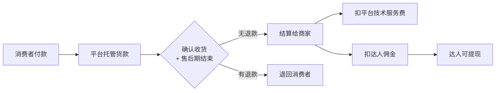
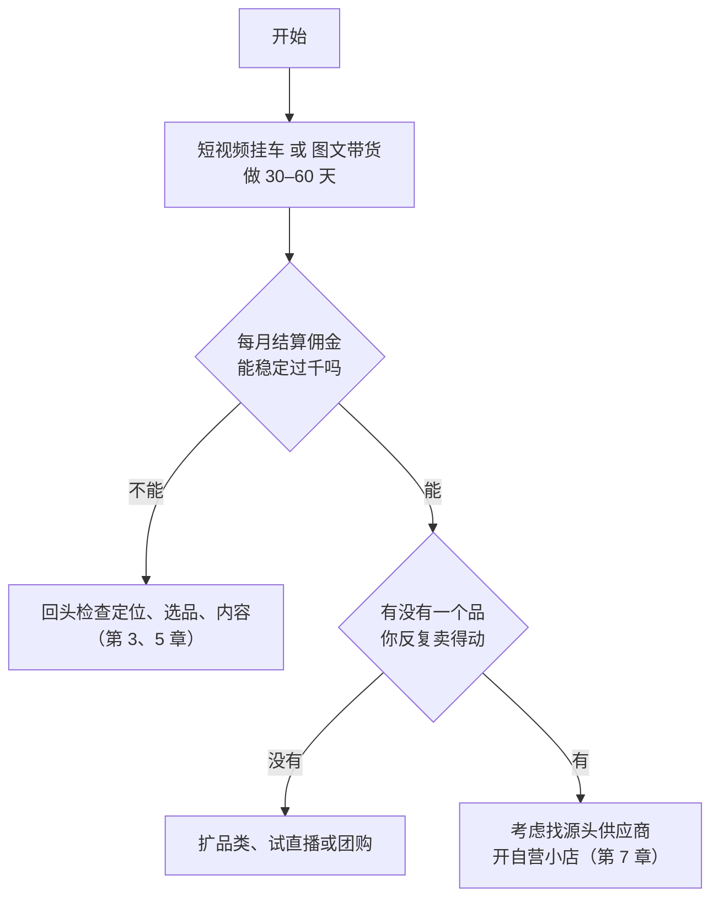

# 内容电商的几种玩法

「带货」两个字背后其实是好几门不同的生意。同样是在抖音上卖东西，有人拍 30 秒视频挂个链接，一个月拿几百块佣金；有人每晚播四小时，团队七八个人；有人在家附近吃饭拍探店，卖的是餐厅的团购券；还有人自己找工厂、自己开店、自己发货。它们的门槛、投入、风险和回款方式差别很大。

本章先把这几种玩法摆在一起，讲清楚各自赚的是什么钱、需要什么、坑在哪里，然后给一个判断表：一个下班才有时间的在职开发者，应该从哪种开始。后面各章再分别展开。

## 先分清两种身份：达人和商家

内容电商里所有玩法，最终都落在两种身份之一：

| | 达人（分销、带货者） | 商家（店主） |
|---|---|---|
| 卖的是谁的货 | 别人的货，挂别人店铺的链接 | 自己店里的货 |
| 赚什么钱 | 佣金：成交额 × 佣金率 | 差价：售价 − 进货价 − 各种费用 |
| 要不要囤货 | 不要 | 自己囤或找一件代发 |
| 发货、售后 | 商家负责（但差评会算到你头上，第 8 章） | 自己负责 |
| 资金占用 | 几乎为零，可能有一笔可退的保证金 | 保证金 + 备货 + 投流垫资 |
| 主体要求 | 个人实名即可开通带货权限（门槛见第 2 章） | 一般需要个体工商户或公司，部分平台有个人店（第 7 章） |
| 上限 | 取决于你的流量和佣金率 | 取决于你的供应链和运营 |

**第一次做，几乎都应该从达人身份开始**：不压货、不管发货、不碰售后系统，先验证「我的内容能不能卖出东西」。等你发现某一类货卖得稳、又觉得佣金被商家拿走太多，再考虑自己开店。这个顺序反过来走，最常见的结局是一屋子卖不掉的货。

## 五种玩法

### 1. 短视频挂车

拍一条短视频，视频左下角挂一个商品链接（俗称「小黄车」），观众点进去下单，你拿佣金。

- **怎么赚**：一条视频可能在发布后的几天到几周里持续带来订单。好处是**内容可以长期生效**，一条「爆款」能吃好几个月
- **需要什么**：开通视频带货权限、会拍会剪、能稳定输出
- **适合谁**：时间碎片化、不能固定时间直播的人。**这是在职开发者最自然的起点**
- **坑**：带货视频和普通内容的流量逻辑不一样，硬广太明显会被限流；同一个商品被几百个达人一起拍，同质化严重

### 2. 直播带货

开直播，一边讲一边卖，观众在直播间下单。

- **怎么赚**：成交集中在直播时段，单场可能比短视频一周卖得都多
- **需要什么**：固定时段、话术、排品、场控，基本要两个人以上配合
- **适合谁**：能稳定每周开播几次、每次两小时以上的人
- **坑**：对时间要求刚性，下班后状态差；冷启动期间在线人数个位数很打击人。直播的具体打法见《直播实战》，本书不展开

### 3. 图文带货

小红书笔记、抖音图文，配上商品链接或商品卡。

- **怎么赚**：用户在刷图文时被种草，点商品卡购买
- **需要什么**：会拍产品图、会写种草文案；不需要出镜、不需要剪视频
- **适合谁**：不想露脸、不会剪辑、但会写东西的人。**对技术人很友好**
- **坑**：图文带货的粉丝门槛有时比视频更高（抖音见第 2 章）；转化周期长，读者会收藏了再买

### 4. 团购与本地生活

拍餐厅、美甲店、健身房、酒店，挂这家店的团购券，用户买券后去店里核销，你按核销金额拿佣金。

- **怎么赚**：佣金率通常比实物电商高，**而且没有退货的物流损耗**（但未核销可以退款）
- **需要什么**：住在城市里、有时间到店拍摄、能接受吃喝玩乐类内容
- **适合谁**：周末有时间出门、所在城市商家多的人
- **坑**：受地域限制，内容只对本地有用；商家质量参差，你推荐的店翻车会砸你的号。第 6 章专门讲

### 5. 自营小店

在抖店、小红书店、微信小店开自己的店，自己找货、定价、发货、售后，再自己拍内容或者找达人带。

- **怎么赚**：拿的是整条差价，毛利空间远大于佣金
- **需要什么**：营业执照（多数情况下）、保证金、货源、客服时间、处理售后的耐心
- **适合谁**：已经验证过某个品能卖、手里有稳定货源的人
- **坑**：一件代发看起来零库存，实际上发货慢、品控差、售后扯皮全是你的事。第 7 章专门讲

## 钱是怎么流动的

不管哪种玩法，一笔订单的钱都是这样走的：

这张图要记住两件事：

1. **钱不是下单就到手**。从下单到能提现，要等发货、物流、确认收货、再加一段售后期，通常以周计。做达人时这只是「到账慢」；做商家时这意味着你要垫付进货款、快递费和投流费，**现金流是自营小店最先出问题的地方**
2. **退款会把佣金一起带走**。订单退了，达人的佣金也没了。所以看佣金时一定要看「结算佣金」，不要看「预估佣金」

## 适合谁：一张自评表

下面这张表按「在职开发者下班做副业」的约束来打分，每项 1–5 分，分越高越适合：

| 维度 | 短视频挂车 | 直播 | 图文带货 | 团购探店 | 自营小店 |
|---|---|---|---|---|---|
| 时间灵活（不需要固定时段） | 5 | 1 | 5 | 3 | 2 |
| 启动资金低 | 5 | 3 | 5 | 4 | 2 |
| 不需要出镜 | 3 | 1 | 5 | 3 | 4 |
| 不用处理售后 | 5 | 5 | 5 | 4 | 1 |
| 收入上限 | 3 | 5 | 2 | 3 | 5 |
| 技术能力能帮上忙 | 4 | 2 | 4 | 3 | 5 |

打分是笔者按一般情况给的参考，你应该按自己的情况改。比如你本来就爱出门吃饭，团购探店的「时间灵活」可以打 4；你家里有人能帮忙发货，自营小店的「不用处理售后」可以往上调。

**推荐路径**：

过千不是什么神奇数字，只是一个信号：你的内容确实能让陌生人掏钱。在这之前，一切关于开店、囤货、招人的想法都可以先放下。

## 带货和账号定位的关系

带货不是一个独立的赛道，它是**账号定位的一种变现方式**。一个讲 Linux 命令的账号去卖面膜，粉丝不会买，平台也不知道该把视频推给谁。

判断一个账号适不适合带货，问三个问题：

1. **你的观众会花钱买实物吗？** 程序员观众会买键盘、显示器、人体工学椅、桌面收纳、咖啡，会不会买零食要看你的内容风格
2. **你的内容能自然地带出商品吗？** 「我的桌面布置」「通勤背包里有什么」天然有商品；「讲解 Raft 共识算法」就很难
3. **你推荐的东西，你自己会用吗？** 推荐自己不用的东西，在评论区很容易被看出来

账号定位怎么做见《账号定位与对标拆解》。本书默认你已经有一个大致方向，接下来讨论的是在这个方向上怎么选货、怎么卖。

## 第一个月可以这样安排

假设你工作日晚上有一两个小时、周末有半天：

| 时间 | 做什么 | 产出 |
|---|---|---|
| 第 1 周 | 开通带货权限；看 5 个对标账号的带货内容；列出 3–5 个自然相关类目 | 权限截图、类目清单（第 2、3 章） |
| 第 2 周 | 在选品广场筛 20 个候选，打分；买或申请 3 个样品 | 打分表（第 3 章） |
| 第 3 周 | 用样品，写试用记录；算每个商品的利润（第 4 章） | 试用记录、测算表 |
| 第 4 周 | 每个商品做 1–2 条内容发出去；记录数据 | 3–6 条带货内容、第一份复盘（第 5 章） |

第一个月的目标不是赚钱，而是**把这条流程完整跑一遍**，知道每一步要花多少时间。更完整的分阶段计划见《自媒体与短剧行动手册》。

## 先说底线

带货是直接拿消费者的钱，平台、市场监管、消费者三方都盯着。下面这些事情无论别人怎么说「大家都这么做」，都不要碰：

- **虚假宣传**：说商品有它没有的功效，编造「原价 999 今天 99」的虚构原价，用「最好」「第一」「国家级」之类的绝对化用语
- **刷单刷评**：自己下单、找人下单、给好评返现。平台能识别，被抓到轻则降权，重则清退
- **假货和来路不明的货**：品牌货要有授权链路，「工厂尾单」「专柜同款」大多就是假货
- **违规品类**：处方药、医疗器械（多数需要资质）、烟草、电子烟、管制刀具等，平台本身就禁止或严格限制
- **特殊品类不看资质**：食品、化妆品、保健食品、儿童用品等需要商家有相应许可和备案，你作为达人带货时也要核对。具体资质和广告用语规则见《自媒体与短剧合规财税》

这些不只是道德问题，也是生意问题：一次虚假宣传处罚或者一次封号，可以抹掉你一年的佣金。

## 本章要点

- 内容电商分两种身份：达人赚佣金、不压货；商家赚差价、要垫资和售后。**先做达人，验证内容能卖货，再考虑开店**
- 五种玩法：短视频挂车、直播、图文带货、团购探店、自营小店。在职开发者最适合从短视频挂车或图文带货开始
- 钱要经过确认收货和售后期才能结算，退款会把佣金一起带走；**看结算佣金，不看预估佣金**
- 带货是账号定位的变现方式，不是独立赛道：观众会不会买实物、内容能否自然带出商品、你自己用不用
- 不碰虚假宣传、刷单、假货、违规品类；特殊品类先核资质
