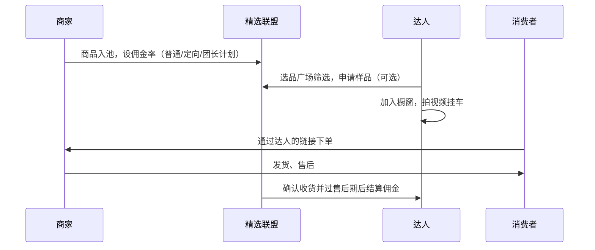
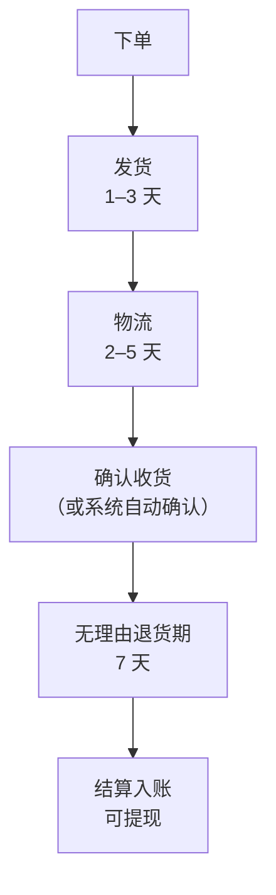

# 橱窗与精选联盟

做达人带货，要先拿到两样东西：一个能挂商品的「位置」，和一个能找到商品的「货架」。在抖音，前者叫商品橱窗（现在 App 里多显示为「电商带货」或「商品橱窗」），后者叫精选联盟；小红书和微信小店也有对应的东西，名字不同（第 9 章对比）。

本章以抖音为主讲清楚：权限怎么开、商品从哪里来、佣金怎么设、钱什么时候到、2026 年有哪些新变化。

> [!WARNING]
> 平台规则变得很快，本章的门槛和费率按 2024-08 至 2026-04 的平台公告和媒体报道整理，各处标了出处和时间；动手前以抖音电商学习中心 / 规则中心和百应后台的当前规则为准。

## 几个名词

- **商品橱窗 / 电商带货**：你账号上的一个商品列表，可以放进你要推广的商品，也是开通视频、直播、图文挂车的入口
- **精选联盟**：抖音电商的商品分销库。商家把商品和佣金率放进去，达人从里面挑货带
- **巨量百应（百应）**：达人和机构的带货工作台（电脑网页端），选品、管橱窗、看数据、看佣金都在这里
- **普通计划 / 定向计划 / 团长计划 / 商单计划**：商家设佣的几种方式：普通计划所有达人可见；定向计划只给指定达人更高佣金；团长计划通过招商团长分发；商单计划是佣金加服务费
- **团长**：帮商家招达人、帮达人找货的中间人，从佣金里分一部分
- **预估佣金 / 结算佣金**：下单时算出的佣金 / 确认收货且过了售后期后真正结给你的佣金

## 开通带货权限

### 抖音的门槛（按公开报道整理）

> [!WARNING]
> 本表按 2024-08 的抖音电商公告、2025-04 修订规范的媒体转述和 2026-02 保证金规则调整的媒体报道整理，均未查到规则原文；可能已调整，以创作者中心开通页面和抖音电商规则中心的规范原文为准。

| 权限 | 门槛 | 出处与时间 |
|---|---|---|
| 开通橱窗 | 个人号开通无粉丝要求；但要在主页展示橱窗或在评论区推荐橱窗，需有效粉丝 ≥ 500 | IT之家 2024-08-05 报道抖音电商公告，自 2024-08-20 起陆续调整 |
| 视频带货 | 有效粉丝 ≥ 500 | 同上 |
| 图文带货 | 有效粉丝 ≥ 1000 | 同上 |
| 直播带货 | 有效粉丝 ≥ 200（此前多报道为 1000） | 多家媒体转述 2025 年 4 月修订的《抖音电商创作者入驻管理规范》，未找到官方原文 |
| 基础要求 | 实名认证、年满 18 周岁、账号无严重违规 | 平台长期要求 |
| 带货保证金 | 开通商品分享时缴 500 元基础保证金；另有按近 30 天推广 GMV 设定的浮动保证金和风险保证金，应缴金额取三者最高、不叠加；余额不足时收到通知后 3 天内补足，逾期关闭商品分享（详见[《抖音与快手》第 6 章](../douyin-kuaishou/06-permissions.md#电商带货2025-年的分级门槛)） | IT 之家 2026-02-05 报道抖音电商当月调整的作者保证金规则，未查到规则原文，以开通页面为准 |

两个容易误解的点：

- **「有效粉丝」不等于主页显示的粉丝数**。按公告解释，有效粉丝指通过持续发布优质内容带来的真实关注，主页数字可能包含其他渠道来源，会比有效粉丝多。买粉、互粉得到的粉丝很可能不算
- **门槛只是能开，不代表能卖**。开通后平台还会看带货口碑分、内容质量、违规记录，这些决定你的挂车视频能拿到多少流量（第 8 章）

### 开通步骤

抖音 App 里的路径会随版本调整，大致流程是：

1. 「我」→ 右上角菜单 →「抖音创作者中心」或「电商带货」
2. 进入「带货权限申请」，按提示完成实名认证、绑定手机号
3. 满足条件的权限会显示为可开通，逐项申请
4. 如有保证金要求，按提示缴纳
5. 开通后，在电脑上登录巨量百应（用抖音扫码），后续选品和数据都在这里看

**建议**：开通后先别急着挂车。用 1–2 周时间在百应里熟悉选品界面、看看同类账号在带什么货，第 3 章会讲怎么系统地选。

## 精选联盟：商品从哪里来

商家把商品加入精选联盟时要设一个佣金率，达人在百应的选品广场里按类目、价格、佣金率、销量、评分筛选，看中了就加入自己的橱窗，然后在视频或直播里挂这个商品。



### 几种合作方式，佣金不一样

| 方式 | 怎么拿到 | 典型情况 |
|---|---|---|
| 普通计划 | 选品广场直接加橱窗 | 佣金率公开，所有达人一样 |
| 定向计划 | 商家指定你，给更高的佣金 | 你有一定数据后，商家主动找你，或你主动联系商家申请 |
| 团长活动 | 通过团长报名 | 团长手里有一批货和更高的佣金，但会从中分成 |
| 商单（佣金 + 服务费） | 商家另付固定坑位费 | 有一定粉丝量后才有，纯坑位费的合作属于广告商单，见[《广告商单与品牌合作》](../brand-deals/) |

刚起步时，**普通计划就够用**。等你某类货卖出一些量，在百应里能看到自己的成交数据，再拿着数据去找商家要定向佣金，比一开始就到处找团长更靠谱。

### 怎么联系商家要定向佣金

商品详情里有商家的联系入口，或者通过商家的抖店客服、官方账号私信。消息可以这样写：

```text
您好，我是抖音账号「xxx」，做 xx 方向的内容，粉丝 xxx，主要是 25–35 岁的程序员和上班族。
最近 30 天在带 xx 类目，结算成交 xxx 单，退货率 xx%。
这款 xx 我自己用了两周，打算做 2–3 条测评视频。
想问一下能否开一个定向计划，佣金 xx%？另外方便的话申请一个样品。
数据截图附后。
```

要点：**给数据，不画饼**；说清你打算怎么推；样品和定向佣金一起谈。

## 2026 年的变化：佣金下限 5%

> [!WARNING]
> 本节按 2026-03 发布、2026-04 起执行的精选联盟新规的媒体报道（北京日报、亿邦动力）整理，未核对官方原文，类目和下限可能已调整，以抖音电商规则中心的公告原文和百应后台为准。

2026 年最大的变化是精选联盟设了最低佣金：

- **发布**：抖音电商 2026-03-04 发布精选联盟新规（北京日报 2026-03-06 报道）
- **内容**：入池商品的挂链佣金下限统一提高到 5%；黄金、二奢、二手 3C 等少数特殊类目下限为 1%
- **生效**：北京日报报道为 2026-04-01 起；亿邦动力（2026-04-03，新浪转载）报道为分批执行，4 月 1 日先覆盖休闲食品、医疗器械及保健用品、水饮冲调、母婴用品、书籍杂志报纸五个一级类目，4 月 15 日扩大到全品类
- **范围**：普通、定向、团长、商单计划都适用，佣金低于下限的商品链接不能挂车；新规前的存量订单不受影响
- **例外路径**：商家自播号、矩阵导购号可以申请「店铺授权账号」或「混合经营账号」权限，维持原有模式

对达人意味着什么：

1. **以前那种「0–1% 佣金 + 高额服务费」的合作基本没了**。平台给出的理由之一是线下结算的服务费缺乏监管、纠纷多，低佣订单的售后问题也更多
2. 对纯佣金带货的小达人影响不大，因为正常的普通计划佣金本来就远高于 5%
3. 选品时看到 5% 的佣金，不一定说明商品差，可能是商家按下限设的。要结合第 3 章的打分来判断

## 佣金怎么算、什么时候到

### 计算

> [!WARNING]
> 「从达人佣金中扣 10% 技术服务费」来自早期资料，未找到 2026 年官方依据；实际扣项和比例以抖音电商规则中心的结算规则和百应「佣金明细」为准。

$$
\text{结算佣金} = \text{实付金额} \times \text{佣金率} - \text{平台服务费等扣项}
$$

- **实付金额**：一般按消费者实际支付的金额算，不含运费；平台补贴、优惠券是否计入以订单页说明为准
- **平台服务费**：一些早期资料称抖音从达人佣金中扣 10% 作为技术服务费。这条比例是否仍适用，**笔者没有找到 2026 年官方依据**，请以百应「佣金明细」里实际扣项为准
- **团长分成**：走团长活动的，团长的服务费会从佣金中扣除，比例在活动页写明

### 结算时间

按抖音电商较早公开的达人佣金结算说明：消费者确认收货，且「7 天无理由退货」期间没有售后纠纷，佣金在退货期满后转入可提现余额；有售后纠纷的，要等纠纷解决之后再结算。这套逻辑和第 1 章的资金流图一致。

所以一笔订单从下单到能提现，大致是：



各段天数是常见范围，不是平台承诺。**月初发的视频，钱往往下个月才看得到**，规划副业现金流时要按这个节奏来。

### 提现与税

佣金在百应或 App 的收入页提现到绑定的账户。平台会按规定代扣代缴个人所得税或要求你以经营主体结算，具体取决于你的身份和收入规模。达人收入怎么纳税、什么时候该注册个体户，见[《自媒体与短剧合规财税》](../media-compliance/)。

## 一份开通后的第一周清单

```text
□ 实名认证、绑定手机号、带货权限逐项开通（记下开通日期）
□ 电脑登录巨量百应，熟悉：选品广场、我的橱窗、数据、佣金明细
□ 看 5 个同领域账号最近 30 天在带什么货（第 3 章「对标选品」）
□ 在选品广场按自己的领域筛 20 个候选商品，填进打分表（第 3 章）
□ 选 3 个分数最高的，申请样品或自己下单
□ 读一遍平台《电商创作者管理规范》和带货口碑分说明，知道哪些行为扣分
□ 确认收款账户和纳税方式
```

## 常见坑

| 坑 | 说明 | 怎么避 |
|---|---|---|
| 交钱开权限 | 有人收费「代开橱窗」「代开 1000 粉」 | 权限只能在官方入口申请，买号、代开都可能违规 |
| 只看佣金率选品 | 50% 佣金的货往往售价虚高、质量差、退货多 | 佣金率只是打分表的一项 |
| 看预估佣金高兴 | 退货一来，结算佣金可能只剩一半 | 至少看一个完整结算周期的数据再判断 |
| 私下转账拿服务费 | 线下结算无保障，2026 年起平台也在收紧 | 坑位费走平台的商单渠道，合同写清（《广告商单与品牌合作》） |
| 挂了不用的货 | 评论区问「你用过吗」答不上来 | 只挂自己真实用过的东西 |

## 本章要点

- 抖音达人带货要先开通橱窗和挂车权限：按 2024-08 公告，视频带货有效粉丝 ≥ 500、图文 ≥ 1000；直播门槛多家报道 2025-04 起降至 200，需后台核实
- 精选联盟是商品库，商家设佣金、达人选货；合作方式有普通、定向、团长、商单计划，起步用普通计划就够
- **2026-04 起精选联盟佣金下限 5%**（特殊类目 1%），低佣 + 服务费的模式基本退出
- 佣金在确认收货且无理由退货期结束后才结算，退货会把佣金带走；从下单到可提现常常要两三周
- 所有门槛、费率、扣项以后台和官方规则中心为准；本章数字都标了来源和时间
