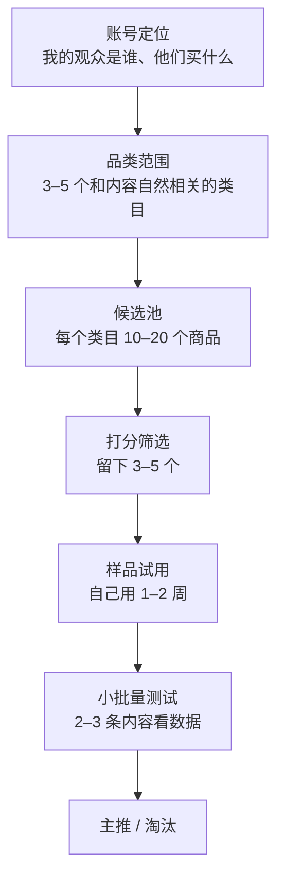

# 选品

带货圈有句话：「七分选品，三分内容」。说得有点绝对，但方向是对的：同一个人拍同样水平的视频，挂对的货和挂错的货，结果可以差十倍。选错货的代价也不只是卖不动：质量差的货会带来差评和退货，拉低你的带货口碑分，下一条视频的流量跟着变少。

本章给一套能照着做的流程：先定选品范围，再用打分表从候选里挑，然后申请样品、自己试用，最后小批量测试。整个过程尽量用数据和表格代替「感觉」。

## 选品的四个层次



大部分新手直接从第三层开始：打开选品广场，按销量排序，挑佣金高的。这样选出来的货和你的观众没关系，卖不动是正常的。

## 第一层：从账号定位出发

先回答：**我的观众是谁，他们日常会花钱买什么？**

以一个「程序员效率与桌面」方向的账号为例：

| 观众画像 | 会买的东西 | 不太会买的东西 |
|---|---|---|
| 25–35 岁、一二线城市、久坐、收入中上、注重效率 | 机械键盘、显示器支架、人体工学椅、降噪耳机、桌面收纳、护眼台灯、咖啡和挂耳、颈椎按摩、效率类书籍 | 低价快消零食、母婴、美妆（除非你的内容就是这个） |

这一步的产出是一张「品类范围」清单：3–5 个和你内容**自然相关**的类目。判断标准是：在不带货的时候，你的内容里会不会出现这类东西？会，就是自然相关。

## 第二层：选品标准

在打分之前，先有几条「一票否决」的硬标准。不满足任何一条，不进候选池：

1. **合规**：类目不在平台禁售或限售范围；食品、化妆品、保健食品、儿童用品、小家电等，商家资质（生产许可、备案、3C 认证等）在商品详情或商家资质页可查。不确定的类目先查[《自媒体与短剧合规财税》](../media-compliance/)
2. **店铺分达标**：商家的店铺体验分不能太低（抖音商品详情页能看到店铺评分）。店铺分低意味着发货慢、售后差，这些都会算到你头上
3. **真货**：品牌货要么是品牌官方店，要么有完整授权；「专柜同款」「大牌平替但用品牌名」「工厂尾单」一律不碰
4. **你自己愿意用**：试用后你不会推荐给朋友的东西，不要推荐给观众

## 第三层：选品打分表

硬标准过了，用打分表在候选之间比较。每项 1–5 分，乘以权重求和，满分 100。

| 维度 | 权重 | 5 分 | 3 分 | 1 分 | 去哪看 |
|---|---|---|---|---|---|
| 与账号匹配度 | 20 | 内容里天然会出现 | 能讲但要找角度 | 硬凑 | 自己判断 |
| 商品质量（试用后） | 15 | 超出预期 | 符合价位 | 有明显问题 | 样品试用 |
| 店铺体验分 | 10 | 高分（如 4.8 以上） | 中等 | 偏低 | 商品详情、店铺页 |
| 商品评价与差评内容 | 10 | 差评少且多为物流问题 | 有质量类差评但不集中 | 差评集中在同一个质量问题 | 商品评价页，重点看差评和追评 |
| 价格带 | 10 | 观众冲动消费的区间 | 需要考虑一下 | 明显超出观众预算 | 自己判断 + 对标数据 |
| 佣金率 | 10 | 明显高于同类均值 | 接近均值 | 接近下限 | 选品广场 |
| 预估退货风险 | 10 | 标品、尺码无关、易用 | 有一定主观性 | 服装尺码类、效果主观类 | 类目经验 + 差评 |
| 可拍性 | 10 | 有明显的前后对比或演示点 | 能拍但普通 | 拍出来看不出区别 | 自己判断 |
| 竞争程度 | 5 | 同领域带的人少 | 一般 | 几百个达人在拍同一个 | 选品广场的带货达人数 |

计算示例（一款 129 元的显示器支架）：

| 维度 | 权重 | 得分 | 加权 |
|---|---|---|---|
| 匹配度 | 20 | 5 | 20 |
| 商品质量 | 15 | 4 | 12 |
| 店铺体验分 | 10 | 4 | 8 |
| 评价 | 10 | 4 | 8 |
| 价格带 | 10 | 4 | 8 |
| 佣金率 | 10 | 3 | 6 |
| 退货风险 | 10 | 4 | 8 |
| 可拍性 | 10 | 5 | 10 |
| 竞争程度 | 5 | 3 | 3 |
| **合计** | 100 | | **83** |

加权分 = 权重 × 得分 ÷ 5。建议：**80 分以上进入样品试用，60–80 分备选，60 分以下不碰**。

权重可以按你的情况调。如果你的账号观众信任度很高、退货率一直很低，可以把「退货风险」权重降一点、「佣金率」提一点；如果你在做图文，「可拍性」换成「可图示性」。关键是**同一批候选用同一套权重**，分数才可比。

### 怎么看差评

差评比好评有用得多。打开商品评价，筛选「差评」「有图」「追评」：

- **差评集中在一个问题**（比如「用了一周就松了」「颜色和图片不一样」）→ 质量问题，直接扣分
- **差评主要是物流、包装**→ 商家服务问题，看店铺分再决定
- **追评说「用了一个月很好」**→ 比当天的好评可信
- 好评里大量雷同句式、无图、同一天集中出现 → 可能有刷评，谨慎

## 看数据的工具

选品要看数据，大致有三类工具，各有用处：

| 类别 | 能看什么 | 举例 |
|---|---|---|
| 平台官方工具 | 商品销量、佣金、带货达人数、你自己的成交和退货数据 | 抖音巨量百应、抖音电商罗盘；小红书的选品中心；微信小店的带货助手 |
| 第三方数据平台 | 跨达人的带货榜单、某个商品被谁带过、某个达人带过什么、类目趋势 | 市面上有多家抖音、小红书数据平台，多数付费，功能和价格经常变 |
| 自己整理的表格 | 你的候选池、打分、样品状态、每条内容的数据 | 飞书多维表格、Notion、Excel，或自己写个小工具（第 10 章） |

几点建议：

- **起步阶段官方工具基本够用**。第三方数据平台按月收费，在你每月佣金还不够付会员费之前，没必要买
- 第三方数据是**估算值**，同一个商品在不同平台上的销量差别可能很大，看趋势和排序，不要把具体数字当真
- 最有价值的数据是**你自己的**：哪条视频带来多少点击、多少成交、多少退货。第 10 章会讲怎么把这些攒起来

### 对标选品

最省力的选品方法是看和你定位相近、但比你大一两个量级的账号在带什么：

1. 找 5 个对标账号（找法见[《账号定位与对标拆解》](../account-positioning/)）
2. 翻看他们最近 30–60 天的带货视频和橱窗
3. 记下：商品、价格、佣金（选品广场能查到）、那条视频的点赞评论、评论区有没有人说「买了」或「退了」
4. 同一个商品被两个以上对标账号反复带，说明它在这个人群里卖得动，进候选池

注意：**看他们带什么，不是照搬他们的视频**。同一个货，换你自己的使用场景和角度来拍。

## 第四层：样品

### 怎么申请

抖音精选联盟的商品，很多支持在百应里直接「申请样品」，商家审核通过后免费寄出，有的要求你在约定时间内发布带货视频，有的需要你达到一定的带货数据。规则在商品的样品申请页写明。

样品申请经常被拒，常见原因：粉丝少、没有带货记录、和商品类目不匹配。解决办法：

- **前几个品自己花钱买**。几十到一两百块，当作学费，同时你也是在验证这个商家的发货和包装
- 有了一些成交记录后，再用第 2 章那段话术申请样品和定向佣金
- 不要为了拿免费样品承诺你做不到的发布数量

### 试用记录表

拿到样品后认真用 1–2 周，边用边记，这些记录直接就是你后面脚本的素材：

```text
商品：xx 显示器支架           价格：129 元     佣金：20%
收到日期：11-05               商家发货速度：下单后 1 天发货，2 天到
包装：纸箱 + 泡沫，无破损
第一印象（开箱 3 分钟内）：比图片上更厚实；说明书只有图没有字
安装：15 分钟，需要自己拧 4 颗螺丝，附带的内六角扳手太短
用了 3 天：显示器抬高后颈椎确实舒服；桌面多出一块空间放键盘
用了 10 天：气弹簧没有下沉；转动时有轻微吱声
缺点（必须写）：扳手太短；吱声；只支持 32 寸以内
适合谁：笔记本外接屏、桌面小
不适合谁：曲面大屏、桌子边缘厚度超过 xx cm
是否推荐：推荐，打分 83
可拍的点：抬高前后对比、桌面空间对比、单手调节演示
```

**缺点一栏必须写**。讲缺点能大幅提升观众对你的信任，也能提前劝退不适合的人，直接降低退货率。

## 小批量测试

每个通过样品试用的商品，先做 2–3 条内容测试，而不是一次铺十条。看三个数：

| 指标 | 含义 | 怎么用 |
|---|---|---|
| 商品点击率 | 看到商品的人里有多少点了 | 低说明内容没讲清楚为什么要买，或商品本身吸引力弱 |
| 点击转化率 | 点进商品页的人里有多少下单 | 低说明价格、详情页、评价有问题，内容和商品页说的不一致 |
| 退货率 | 下单里有多少退了 | 高说明内容和实物有落差，或商品质量问题 |

这些指标在百应的数据页能看到。具体多少算好，不同类目差别很大，**和你自己的历史数据比、和同类目对标比**，不要套用网上的「行业标准」。

决策规则可以简单一点：

- 两三条内容都有成交、退货率不高于你的平均水平 → 主推，多做几个角度
- 有点击没转化 → 看商品页和价格，换一个同类但商品页更好的商家试试
- 没点击 → 先怀疑内容，不急着淘汰商品
- 退货率明显偏高 → 停推，回头看差评和退货原因

## 常见坑

| 坑 | 后果 |
|---|---|
| 什么火带什么，品类跨度很大 | 平台不知道把你推给谁，观众觉得你什么都卖 |
| 只看佣金率 | 高佣低质，退货和差评吃掉佣金，还伤号 |
| 不试用就推 | 评论区追问细节答不上来；实物有问题你不知道 |
| 跟风带爆品 | 几百个人在拍同一个东西，你的视频很难突围 |
| 只推不记录 | 半年后不知道哪个品真正赚钱，每次都从零开始 |
| 带特殊品类不看资质 | 食品、化妆品、保健食品出问题时，带货达人也可能承担责任 |

## 本章要点

- 选品从账号定位开始：先列观众会买的 3–5 个自然相关类目，再在类目里找货
- 四条硬标准一票否决：合规、店铺分、真货、自己愿意用
- 用加权打分表比较候选，80 分以上才进样品试用；权重可调，但同一批候选用同一套
- 差评和追评比好评有用；第三方数据是估算值，看趋势不看绝对数
- 前几个品自己花钱买样品；试用记录表里必须写缺点，它同时是脚本素材和降退货的工具
- 小批量测试看点击率、点击转化率、退货率，和自己的历史比
