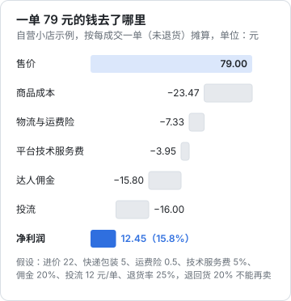
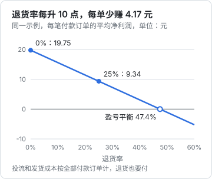

# 利润测算

「这单赚了多少」是个看起来简单、实际很多人答错的问题。达人常犯的错是拿预估佣金当收入；商家常犯的错是拿售价减进价当利润，忘了快递、平台扣点、佣金、投流，尤其是忘了退货。

本章用两个完整例子，一个达人、一个自营小店，把所有扣项一项一项算出来，最后给一张可以直接抄进表格的测算模板。

**本章的费率、退货率都是示例假设，用来说明算法**。真实的技术服务费率按类目不同，要在后台查你所在类目的费率表；退货率要用你自己的数据。

## 先认识所有扣项

> [!WARNING]
> 本节的技术服务费、免佣计划按 2025–2026 年的平台公告和媒体、服务商报道整理，费率按类目不同且经常调整，测算时以各平台商家后台的费率表和规则中心公告为准。

| 扣项 | 谁承担 | 说明 |
|---|---|---|
| 商品成本 | 商家 | 进货价或生产成本，含损耗 |
| 包装、快递 | 商家 | 每单都要付，**退货的那一单也付过了** |
| 运费险 | 商家（或消费者购买） | 很多类目商家默认开通，每单几毛到一两元 |
| 平台技术服务费 | 商家 | 按成交额的百分比收，**按类目不同**。抖音、小红书、微信小店都在 1%–5% 区间内按类目定（见下文出处），且常有阶段性减免 |
| 支付通道费 | 商家 | 有的平台单列，有的包含在技术服务费里 |
| 达人佣金 | 商家付给达人 | 成交额 × 佣金率，抖音精选联盟 2026-04 起下限 5% |
| 平台对佣金的扣项 | 达人 | 部分平台或模式从达人佣金中扣服务费，以佣金明细为准 |
| 团长服务费 | 达人或商家 | 走团长活动时才有 |
| 投流费 | 谁投谁付 | DOU+、随心推、千川、薯条、聚光、视频号加热等。投流本身见[《投流与数据分析》](../paid-traffic/) |
| 退货损耗 | 商家 | 退回的货有一部分不能二次销售；来回运费 |
| 税 | 各自 | 达人的劳务或经营所得、商家的增值税和所得税，见[《自媒体与短剧合规财税》](../media-compliance/) |

关于技术服务费的出处：

- **抖音**：按类目收取，第三方报道常见 2%–5%（个人店相关报道）；2026-01-08 抖音电商发布的扶持政策升级方案中，通过「千川·乘方」产生的订单技术服务费降至 0.6%，免佣范围扩展到全类目并延伸到内容场（环球网、北京日报 2026 年报道）。免佣的适用条件以后台为准
- **小红书**：基础技术服务费按类目，多数在 2%–5%；「百万免佣计划」（2025-09-01 至 2026-08-31，前 100 万支付交易额免佣，只收 0.6% 支付渠道成本）**已于 2026-08-31 到期**，到期后的安排以后台为准（白鲸出海等 2025–2026 报道）
- **微信小店**：标准费率按类目 1%–5%；新商家前 100 万元自营交易额费率低至 1%，有时间窗口（数英 2025-11-04 服务商文章，引用官方费率表）

## 例一：达人带一款 59.9 元的商品

假设：

- 售价 59.9 元，佣金率 20%
- 平台从达人佣金中扣 10% 服务费（**这是假设，用于演示；以你的佣金明细为准**）
- 退货率 30%（退了的订单没有佣金）
- 为这条视频投了 DOU+，摊下来每笔付款订单 4 元

按 100 笔付款订单算：

| 项目 | 计算 | 金额（元） |
|---|---|---|
| 付款成交额（GMV） | 100 × 59.9 | 5990.00 |
| 退货后有效成交额 | 70 × 59.9 | 4193.00 |
| 佣金 | 4193 × 20% | 838.60 |
| 平台扣项 | 838.6 × 10% | −83.86 |
| 结算佣金 | | 754.74 |
| 投流 | 100 × 4 | −400.00 |
| **净收入（税前）** | | **354.74** |

几个观察：

1. 看后台的「预估佣金」会以为是 5990 × 20% = 1198 元，实际到手 354.74 元，**不到三分之一**
2. 每笔付款订单的结算佣金是 7.55 元。只要投流摊到每单超过 7.55 元，这条视频就是在给平台打工
3. 退货率从 30% 降到 15%，结算佣金变成 85 × 59.9 × 20% × 90% = 916.49 元，净收入 516.49 元，**涨了 46%**。所以第 3 章说讲缺点能降退货，是实打实的钱

### 达人的保本公式

$$
\text{每单投流上限} = \text{售价} \times \text{佣金率} \times (1 - \text{平台扣项比例}) \times (1 - \text{退货率})
$$

投之前先算这个数。对于佣金十几块的商品，DOU+ 很容易投亏；投流是不是值得、怎么设出价，见《投流与数据分析》。

## 例二：自营小店卖一款 79 元的商品

这次你是商家，自己有店，找达人带货，同时自己也投流。假设：

| 参数 | 值 |
|---|---|
| 售价 | 79 元 |
| 进价 | 22 元 |
| 快递 + 包装 | 5 元/单（发出的每一单都付） |
| 运费险 | 0.5 元/单 |
| 技术服务费 | 5%（按有效成交额） |
| 达人佣金 | 20%（按有效成交额） |
| 投流 | 每笔付款订单 12 元 |
| 退货率 | 25% |
| 退回的货不能再卖的比例 | 20%（拆封、损坏） |

退回的那部分订单，钱全退，佣金和技术服务费不收，**但快递、运费险、投流已经花了**。

按 100 笔付款订单算：

| 项目 | 计算 | 金额（元） |
|---|---|---|
| 有效成交额 | 75 × 79 | 5925.00 |
| 商品成本 | 75 × 22 + 25 × 20% × 22 | −1760.00 |
| 快递包装与运费险 | 100 × 5.5 | −550.00 |
| 技术服务费 | 5925 × 5% | −296.25 |
| 达人佣金 | 5925 × 20% | −1185.00 |
| 投流 | 100 × 12 | −1200.00 |
| **净利润（税前）** | | **933.75** |

摊到每一笔成交（未退货）的订单上，一单 79 元的钱是这样分掉的：



看这张图要注意：

- 「商品成本 23.47」比进价 22 高，是因为退回的货有 20% 报废，摊进了卖掉的那些
- 「物流 7.33」比 5.5 高，是因为 25 笔退货的快递费也要由 75 笔成交来分担
- 「投流 16」比 12 高，同理
- **毛利率看着有 72%（(79−22)÷79），净利率只有 15.8%**。这就是很多人「卖得越多亏得越多」的原因

### 退货率对利润有多敏感

把退货率当变量，其他不变，每笔付款订单的平均净利润是：

$$
\text{每笔付款订单利润} = 19.75 - 41.65 \times \text{退货率}
$$

推导：100 笔付款订单中，有效订单 $100(1-r)$ 笔，每笔贡献 $79 \times (1 - 5\% - 20\%) - 22 = 37.25$ 元；固定支出是物流 550 + 投流 1200 = 1750 元；报废成本 $100r \times 20\% \times 22 = 440r$。总利润 $= 3725(1-r) - 440r - 1750 = 1975 - 4165r$，再除以 100。



退货率每升 10 个百分点，每单少赚 4.17 元。服装类目退货率高是行业常识，按这个模型，退货率一旦接近一半就不赚钱了。

### 如果不找达人，自己拍

自营小店的内容如果是你自己拍（自播、自己的账号挂车），达人佣金这一项就省了：100 单的利润变成 933.75 + 1185 = 2118.75 元。这也是为什么做了一段时间达人的人会想开店：**同样的流量，自己的店能多拿一层佣金**。代价是第 7、8 章讲的供应链和售后。

## 测算模板

把下面的表格抄进你的电子表格，「输入」行填你的数，「计算」和「结果」行写成公式：

| 类别 | 项目 | 输入 / 公式 |
|---|---|---|
| 输入 | 售价 P | |
| 输入 | 进价 C | |
| 输入 | 快递包装 S（每发一单） | |
| 输入 | 运费险 I（每发一单） | |
| 输入 | 技术服务费率 f | 查后台类目费率表 |
| 输入 | 佣金率 c | |
| 输入 | 每付款单投流 A | |
| 输入 | 退货率 r | 用自己近 30 天数据 |
| 输入 | 退货报废比例 d | |
| 输入 | 预计付款单量 N | |
| 计算 | 有效单量 | N × (1 − r) |
| 计算 | 有效成交额 | N × (1 − r) × P |
| 计算 | 商品成本 | N × (1 − r) × C + N × r × d × C |
| 计算 | 物流与运费险 | N × (S + I) |
| 计算 | 技术服务费 | 有效成交额 × f |
| 计算 | 佣金 | 有效成交额 × c |
| 计算 | 投流 | N × A |
| 结果 | 净利润 | 有效成交额 − 以上各项 |
| 结果 | 每付款单利润 | 净利润 ÷ N |
| 结果 | 盈亏平衡退货率 | 令净利润 = 0 解 r |
| 结果 | 每付款单投流上限 | 令净利润 = 0 解 A |

写成代码也很简单，第 10 章会把它做成一个小工具：

```ts
interface Input {
  price: number; cost: number; ship: number; insurance: number;
  feeRate: number; commissionRate: number; adPerOrder: number;
  returnRate: number; scrapRate: number; orders: number;
}

function profit(i: Input) {
  const kept = i.orders * (1 - i.returnRate);
  const gmv = kept * i.price;
  const goods = kept * i.cost + i.orders * i.returnRate * i.scrapRate * i.cost;
  const logistics = i.orders * (i.ship + i.insurance);
  const fee = gmv * i.feeRate;
  const commission = gmv * i.commissionRate;
  const ads = i.orders * i.adPerOrder;
  const net = gmv - goods - logistics - fee - commission - ads;
  return { gmv, goods, logistics, fee, commission, ads, net, perOrder: net / i.orders };
}

// 本章例二：net = 933.75，perOrder = 9.34
console.log(profit({
  price: 79, cost: 22, ship: 5, insurance: 0.5, feeRate: 0.05, commissionRate: 0.2,
  adPerOrder: 12, returnRate: 0.25, scrapRate: 0.2, orders: 100,
}));
```

## 几个常被忽略的成本

| 成本 | 为什么容易漏 |
|---|---|
| 样品和拍摄道具 | 一次性花的，不记在单笔订单上，但几个月下来不少 |
| 平台优惠券、满减 | 商家自己出的券直接减少实收；平台补贴的部分一般不由商家承担，以活动规则为准 |
| 赠品 | 「买一送一」的那个「一」也有进价和运费 |
| 售后补偿 | 小额退款、补寄、红包安抚（第 8 章），每一笔都是钱 |
| 资金占用 | 货款要两三周后才结算，进货和投流要先垫，如果是借的钱还有利息 |
| 你自己的时间 | 副业最容易被忽略的成本。算一下每小时到手多少，和加班费比一比 |
| 税 | 收入达到一定规模后的税负，见《自媒体与短剧合规财税》 |

## 常见坑

- **只看 ROI 不看退货**：投流后台显示的 ROI 往往按付款成交额算，退货发生在之后，真实 ROI 要打折扣
- **按毛利定价**：79 元的货进价 22，以为利润很厚，加上佣金和投流后只剩 15%
- **用别人的退货率**：你的观众和别人的不同，同一个商品在不同达人那里退货率可以差很多
- **把平台阶段性免佣当常态**：免佣、低费率计划都有期限，比如小红书百万免佣 2026-08-31 已到期。测算时要用到期后的费率
- **不算税**：副业收入同样要纳税，税前利润不等于到手

## 本章要点

- 达人收入 = 有效成交额 × 佣金率 − 平台扣项 − 投流；**预估佣金常常是实际到手的两三倍**
- 达人每单投流上限 = 售价 × 佣金率 × (1 − 扣项比例) × (1 − 退货率)，投之前先算
- 自营小店的扣项：商品成本、快递、运费险、技术服务费、佣金、投流、退货报废、税；**退货订单的快递和投流已经花出去了**
- 示例中毛利率 72%，净利率只有 15.8%；退货率每升 10 个点每单少赚 4.17 元，接近 47% 就不赚钱
- 技术服务费按类目、按平台不同，且常有限期减免；测算要用你类目的正常费率，并标注政策到期日
