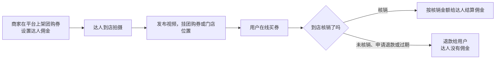

# 团购与本地生活

前面几章讲的都是实物：快递寄出、快递退回。团购是另一种生意：你推荐的是一家餐厅、一家理发店、一间密室、一晚酒店，用户买的是一张券，自己走到店里去用。没有快递、没有库存，但有地域、有核销、有到店体验。

本章讲清楚团购带货的机制（钱是怎么算的）、达人怎么接单、探店内容怎么拍、怎么挑店，以及这条路适合什么样的人。

**本章的平台规则查到的公开资料较少且部分较旧，凡涉及门槛和费率的数字都标了来源和时间，以平台后台为准。**

## 机制：从挂券到核销



和实物带货相比，关键区别在**核销**：

| | 实物带货 | 团购带货 |
|---|---|---|
| 佣金按什么算 | 确认收货且过了退货期的订单 | 到店核销的订单 |
| 用户反悔的方式 | 退货（有物流成本） | 不去用，申请退款或过期退（很多团购券支持「随时退、过期自动退」，以券面规则为准） |
| 佣金到账周期 | 收货 + 售后期 | 取决于用户什么时候去核销，可能几天，也可能几个月后 |
| 损耗 | 退货运费和报废 | 几乎没有，但核销率低就等于白干 |

所以团购达人最关心的数不是成交单量，而是**核销率**：买了券的人里，有多少真去了店里。

## 平台格局

| 平台 | 团购 / 本地生活形态 | 达人能做什么 |
|---|---|---|
| 抖音 | 抖音生活服务：视频和直播挂团购券、门店位置（POI） | 探店视频挂券、直播卖券；有团购带货权限和达人成长体系 |
| 快手 | 本地生活团购 | 类似，规模和覆盖城市不同，见[《抖音与快手》](../douyin-kuaishou/) |
| 小红书 | 本地生活和到店内容一直很强，交易能力在逐步建设 | 探店笔记种草为主，可挂门店和部分团购商品 |
| 美团 / 大众点评 | 传统团购和点评平台 | 以点评内容和达人探店活动为主，交易在美团体系内完成 |
| 视频号 | 有本地生活相关能力，规模较小 | 以私域和本地商家合作为主 |

各平台本地生活的具体规则和开放程度变化很快，**动手前在对应平台的达人后台确认你所在城市是否开放、你的账号是否有团购带货权限**。

## 达人门槛与收入

### 门槛

- 抖音团购带货需要单独的团购带货权限。有报道称，抖音「团购达人成长中心」的申请条件包括粉丝量 ≥ 1000（来源未标日期，**未找到 2026 年官方依据，需后台核实**）
- 普遍要求实名认证、账号无严重违规
- 部分城市或品类可能有额外要求（比如酒旅、医美等特殊行业）

### 收入构成

| 收入 | 说明 |
|---|---|
| 团购佣金 | 商家给团购券设的达人佣金，按核销金额结算；佣金比例由商家设定，通常比实物电商高，但查不到权威的公开平均值 |
| 探店费 / 坑位费 | 商家额外付的拍摄费，属于广告合作，要按商单规范签约和标注，见[《广告商单与品牌合作》](../brand-deals/) |
| 免费体验 | 商家请你免单吃一顿或体验一次，换一条内容 |

对平台抽成的参考：2022 年有报道称抖音生活服务对商家的交易佣金按行业在 2%–8% 不等，这是平台向商家收的，不是给达人的，且已是较早的数据。

### 一笔团购的账

假设一家火锅店上了一张 2 人套餐券，售价 168 元，达人佣金 10%，你的探店视频带来 200 单：

| 项目 | 计算 | 金额（元） |
|---|---|---|
| 售券金额 | 200 × 168 | 33600 |
| 核销率 | 假设 70% | |
| 核销金额 | 140 × 168 | 23520 |
| 达人佣金 | 23520 × 10% | 2352 |
| 平台对佣金的扣项 | 以后台为准 | |

如果核销率只有 40%，佣金就只有 1344 元。**核销率受什么影响**：店离用户远不远、券的有效期多长、用户买的时候是冲动还是真想去、你的视频有没有夸大到店体验。

## 探店内容怎么做

### 结构

| 段落 | 时长 | 要点 |
|---|---|---|
| 钩子 | 0–3 秒 | 最有冲击力的画面：沸腾的锅、上桌那一刻、店内最出片的角落 |
| 基础信息 | 3–10 秒 | 在哪（商圈、地铁站）、人均多少、适合什么场合 |
| 体验过程 | 10–40 秒 | 按真实顺序：进店、点单、上菜、吃 / 体验；拍细节 |
| 真实评价 | 40–50 秒 | 好在哪、一般在哪、要不要排队、停车方便吗 |
| 券的信息 | 最后 5 秒 | 套餐包含什么、券价对比原价省多少、有效期 |

### 探店脚本示例

```text
【店】xx 老火锅（xx 路店） 【券】双人套餐 168 元（门店价 236 元）
【时长】约 45 秒

0–3 秒   特写：红油锅开、毛肚下锅七上八下
         口播：在 xx 地铁站吃到一家老火锅，毛肚是真脆。
3–10 秒  门头 + 店内全景
         口播：离 x 号线 B 口走路三分钟，人均八十多，工作日晚上七点去不用排。
10–35 秒 上菜、涮、吃；切几个菜的特写
         口播：套餐里牛油锅底、毛肚、鸭肠、鲜切牛肉……鸭肠不错，牛肉一般。
35–42 秒 对镜头
         口播：锅底偏辣，不太能吃辣的点鸳鸯；周末晚上要排半小时。
42–45 秒 券的画面
         口播：双人套餐 168，门店点同样的要 236，链接在下面。
```

「牛肉一般」「周末要排队」这种话会让一部分人不买，但买了的人去了不会失望，**核销率和口碑都更好**。

### 拍摄注意

- **先征得店家同意再拍**，尤其是拍到其他顾客时要避开正脸
- 菜品、价格以实际为准；视频里说的价格和券的价格要一致
- 如果是商家付费或免单的，按规则标注合作

## 怎么挑店

推荐一家翻车的店，代价是评论区一片骂声和你的账号信用。挑店可以用一张简化的打分表：

| 维度 | 看什么 |
|---|---|
| 自己去吃 / 体验过 | 最重要。不去就不推 |
| 平台评分和差评 | 点评类平台和抖音门店页的评分；差评集中在卫生、服务、货不对板的谨慎 |
| 证照 | 餐饮店有没有在店内公示营业执照和食品经营许可（证照公示是基本要求） |
| 券的设计 | 套餐是否真实划算；使用限制（节假日不可用、需预约）是否写清楚 |
| 接待能力 | 你一条视频带来几百单，店里接得住吗？排队太久会导致退款和差评 |
| 位置 | 离你的观众远不远；你的粉丝在哪个城市 |

**特殊行业要格外谨慎**：医美、口腔、养生按摩、教育培训等，涉及资质和广告的特别规定，不熟悉就别碰，细节见[《自媒体与短剧合规财税》](../media-compliance/)。

## 和商家谈合作

起步时多数是你在团购带货的选品页里找到已经设了达人佣金的店，直接去拍。做出一些数据后，可以主动找你吃过、觉得好的店谈合作。

### 联系商家的话术

```text
老板您好，我是抖音「xxx」，主要拍 xx 区的吃喝，粉丝 xxx，大部分在本市。
上周来店里吃过一次，觉得 xx 做得很好，想给店里拍一条探店。
想问一下店里有没有上团购？如果方便的话，想挂咱们的券，按核销给佣金就行。
我会按真实体验拍，好的不好的都会说，拍完给您先看一遍事实部分（价格、套餐内容）。
```

要点：

- **说清你的粉丝在哪个城市**，这是本地商家最关心的
- 提出「按核销拿佣金」，不先要拍摄费，降低商家的顾虑
- 说清你会如实拍，**给商家看的是事实部分**（价格、地址、套餐内容），不是让商家审你的评价

### 商家常问的问题

| 问题 | 怎么答 |
|---|---|
| 「要不要钱？」 | 起步阶段按核销佣金合作；如果商家另付拍摄费，按商单签约和标注 |
| 「能不能只说好的？」 | 不能。可以说「我会突出店里最好的几道菜，不推荐的我就不拍」 |
| 「能带来多少单？」 | 不承诺具体单量，给你过去几条探店的核销数据作参考 |
| 「券怎么设？」 | 建议套餐真实划算、使用限制写清楚；不建议设过低的引流券导致到店后加价 |

## 提高核销率

核销率直接决定你的收入，能做的事情有：

1. **内容里讲清楚使用条件**：要不要预约、节假日能不能用、包间是否加收
2. **选离观众近的店**：在视频开头就说清楚商圈和地铁站，让不在附近的人别冲动下单
3. **不夸大体验**：用户到店发现和视频不一样，宁可退券也不去
4. **时效内提醒**：有些平台支持给买券用户发到期提醒，商家开通更好
5. **复盘**：每条探店记录售券数、核销数、核销率，找出哪类店、哪种拍法核销率高

### 探店复盘表

| 字段 | 示例 |
|---|---|
| 店名 / 品类 | xx 老火锅 / 火锅 |
| 商圈 / 距离你的粉丝集中区 | xx 路 / 近 |
| 券价 / 门店价 | 168 / 236 |
| 佣金率 | 10% |
| 发布日期 | 11-08 |
| 播放量 | |
| 售券数 | |
| 核销数（30 天） | |
| 核销率 | |
| 结算佣金 | |
| 用户反馈要点 | 鸭肠好评；排队吐槽 |
| 下次改进 | 视频里提前说周末排队时间 |

## 适合谁

团购探店适合：

- 住在城市、周边商家多
- 周末有时间出门，本来就爱吃爱逛
- 不介意账号内容「本地化」，粉丝主要在同一个城市

不太适合：

- 粉丝分散在全国的知识类、技术类账号（推一家北京的店，广州的粉丝没法买）
- 没有时间到店的人
- 账号定位和吃喝玩乐无关的人

一个折中的做法是**单独开一个本地号**，和主账号分开定位，第 1 章的自评表单独打分。

## 常见坑

| 坑 | 说明 |
|---|---|
| 只看售券金额 | 佣金按核销算，核销率低等于白干 |
| 为了免单夸大体验 | 用户到店落差大，退券、差评、骂你 |
| 推荐自己没去过的店 | 店家给的素材剪一剪就发，被识破后信任崩塌 |
| 不标注合作 | 平台处罚；违反广告相关规定 |
| 一店多券混乱 | 视频里说的套餐和挂的券对不上，用户到店核销不了 |
| 跨城市推店 | 粉丝不在当地，内容有流量没转化 |

## 本章要点

- 团购带货按**核销金额**结算佣金：用户买券、到店核销，没核销的可以退，达人就没有佣金
- 核销率是团购达人的核心指标，受距离、有效期、内容真实度影响
- 抖音团购带货需要单独权限，粉丝门槛等条件以达人后台为准；平台对商家的抽成和给达人的佣金是两回事
- 探店内容五段：钩子、基础信息、真实体验、好坏都说、券的信息；先征得店家同意，商业合作要标注
- 挑店先自己去，看评分、证照、券的设计和接待能力；医美等特殊行业不熟就别碰
- 适合住在城市、爱吃爱逛、粉丝集中在本地的人；技术类账号可以另开本地号
