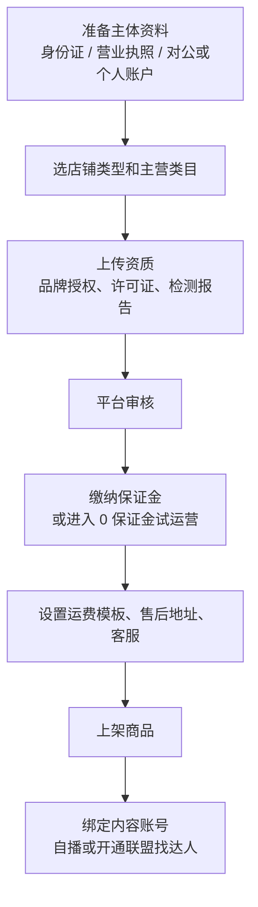

# 自营小店

做了一段时间达人，你可能会发现：自己反复在卖同一类东西，每单佣金 20%，商家拿走剩下的 80%，而发货和售后其实也不复杂。这时候开自己的店就有了意义。

但开店是另一个量级的生意：你要管货源、库存、发货、售后、资金、资质。本章讲清楚三家平台开店的要求（抖店、小红书店、微信小店），货从哪里来，一件代发到底有哪些坑，以及开店前的检查清单。

> [!WARNING]
> 开店门槛和费率变化很快，本章数字均标注来源与时间。笔者没能查到三家平台 2026 年的官方入驻规则原文，表格以 2023–2025 年的媒体和服务商报道为主；入驻前以抖店、小红书商家后台、微信小店后台的入驻规则和类目费率表为准。

## 开店之前：主体选择

| 主体 | 优点 | 缺点 |
|---|---|---|
| 个人（身份证） | 不用注册，最快 | 部分平台不支持或限制多：类目少、商品数有上限、达到一定规模要升级；不能开发票 |
| 个体工商户 | 注册简单、成本低，多数平台按「个体店」入驻 | 无限责任；要记账报税 |
| 公司 | 能开专用发票、品牌授权更容易拿、可以做更多类目 | 注册和维护成本高（记账、年报、税务） |

对于副业起步，**个体工商户是多数人的选择**：门槛低、平台支持好。个体户怎么注册、怎么报税、什么时候该升级成公司，见[《自媒体与短剧合规财税》](../media-compliance/)和[《财务与税务》](../opc-finance/)。

另外注意你的劳动合同和公司制度对兼职经营有没有限制，这一点在开店前就要想清楚。

## 三家平台开店要求

> [!WARNING]
> 下面三张表的保证金和技术服务费是 2024–2026 年的报道数字（部分是征求意见稿或阶段性政策），可能已调整，以各平台商家后台的类目保证金标准和费率表为准。

### 抖店（抖音电商）

- **主体**
  - 情况：企业、个体工商户；个人店自 2023 年起开放，凭身份证实名入驻，试运营期部分类目可开
  - 来源与时间：2023 年媒体报道
- **个人店限制**
  - 情况：试运营期在线商品不超过 100 款；有报道称累计达到一定单量或销售额后需补交营业执照和保证金
  - 来源与时间：第三方报道，需核实
- **保证金**
  - 情况：按类目和主体定。2024 年平台《保证金标准》征求意见稿中，个体工商户服饰内衣、鞋靴、食品饮料、生鲜等类目 2000 元，家居日用、个护清洁 5000 元，酒类、家用电器 10000 元；部分类目有 0 元或低保证金入驻
  - 来源与时间：2024 年第三方转述，**以后台类目页为准**
- **技术服务费**
  - 情况：按类目，常见 2%–5%；2026-01 起「千川·乘方」订单降至 0.6%，免佣扩展到全类目
  - 来源与时间：第 4 章出处
- **特殊类目**
  - 情况：食品、化妆品、母婴、小家电等需对应许可、备案、检测报告、品牌授权
  - 来源与时间：平台长期要求

### 小红书店

- **主体**
  - 情况：个人店（身份证）、个体店、企业店；平台推行「号店一体」
  - 来源与时间：2021 年起，多家报道
- **个人店**
  - 情况：第三方资料称个人店不收开店费，但可售类目受限，保证金在首次提现等节点前缴纳，金额说法不一
  - 来源与时间：2024–2025 第三方，**需核实**
- **保证金**
  - 情况：有 2024 年资料称个体店入驻时可不缴，结算达到浮动保证金节点或提现时再补
  - 来源与时间：2024 问答类资料，需核实
- **技术服务费**
  - 情况：按类目，多数 2%–5%；「百万免佣」2025-09-01 至 2026-08-31 已到期
  - 来源与时间：2025–2026 报道
- **个人售卖**
  - 情况：报道称有内置的「个人售卖」功能，每笔收 0.6%，仍在内测扩量
  - 来源与时间：行业文章，时间未确认

### 微信小店（原视频号小店）

- **名称**
  - 情况：2024-08-25 起视频号小店升级为微信小店，不再接受新的视频号小店申请
  - 来源与时间：IT之家 2024-08-13
- **主体**
  - 情况：服务商文章称需营业执照（企业、个体）；品牌商品需商标证或授权书
  - 来源与时间：数英 2025-11-04
- **保证金**
  - 情况：0 元入驻；符合条件可「0 保证金试运营」，有效支付 GMV 超过 10 万元等条件触发后需缴纳，按类目 1000–50000 元
  - 来源与时间：数英 2025-11-04
- **技术服务费**
  - 情况：标准费率按类目 1%–5%；新商家前 100 万元自营交易额低至 1%（首单后 90 天内、不超过签约后 180 天）
  - 来源与时间：数英 2025-11-04
- **私域优惠**
  - 情况：2025 年初报道称对群聊、朋友圈、公众号等私域场景成交的订单减免技术服务费
  - 来源与时间：财联社 2025

### 开店流程（三家大同小异）



**类目选错会很麻烦**：类目决定了保证金、费率、需要哪些资质，也决定了商品能出现在哪里。开店前先把你要卖的东西在平台类目表里对上号。

## 货从哪里来

| 货源 | 说明 | 适合 |
|---|---|---|
| 源头工厂 / 产业带 | 直接从工厂拿货，价格最低，但起订量高、要自己验货 | 已经确定某个品能卖、想压低成本 |
| 批发平台（如 1688） | 品类全、可小批量拿货，很多支持一件代发 | 起步试品 |
| 品牌经销 / 授权 | 拿品牌的授权卖正品，利润薄但好卖、售后有保障 | 有渠道关系的人 |
| 自有品牌（贴牌 OEM） | 工厂生产、贴你的牌子 | 有稳定销量后做差异化，需要注册商标 |
| 自制 / 手作 | 自己做的东西 | 小红书手作类，量小但独特 |
| 数字商品 | 模板、教程、软件 | 技术人的天然优势，但多数电商平台对虚拟商品有单独规则，知识付费见[《知识付费与私域变现》](../knowledge-products/) |

### 一件代发：看起来零风险，实际很多坑

一件代发是指你在店里上架商品，用户下单后你去供应商那里下单，供应商直接发给用户。你不囤货、不碰货。听起来完美，问题在于：**货不在你手里，但责任全在你身上**。

| 坑 | 后果 |
|---|---|
| 发货慢 | 平台对发货时效有要求，超时会被罚款、扣店铺分。供应商一忙就延迟 |
| 缺货 | 你卖出去了，供应商没货，只能退款，算你缺货违规 |
| 品控差 | 你没见过实物，质量问题全变成你的差评和退货 |
| 包装和面单 | 包裹里夹着供应商的广告卡片，或者面单信息不对 |
| 售后扯皮 | 退货寄回谁那里？损耗谁承担？供应商经常推诿 |
| 价格倒挂 | 供应商自己也在平台上卖，价格比你低 |
| 资质问题 | 特殊类目要求商家有资质，供应商的资质不等于你的 |
| 平台规则 | 部分平台对无货源、铺货式经营有限制，大量铺货可能被判违规 |

如果一定要做一件代发，至少做到：

- **自己先买一单**，看发货速度、包装、实物质量
- 选能提供发货时效承诺、能退回到他那里的供应商，写进协议
- 只做少数几个品，**不铺货**
- 卖起来之后尽快转成自己备一部分库存，或者找能做仓配的供应商

## 供应商评估表

| 维度 | 怎么评 |
|---|---|
| 资质 | 营业执照、生产许可、检测报告、品牌授权链路是否完整 |
| 价格 | 拿货价、起订量、阶梯价、运费 |
| 发货 | 发货时效承诺、日发货能力、大促能否接住 |
| 品控 | 自己买样品看；问次品率怎么处理 |
| 售后 | 退货寄回地址、损耗怎么分担、换货流程 |
| 沟通 | 响应速度、有没有固定对接人 |
| 稳定性 | 合作多久了、有没有其他电商客户、会不会突然断货 |

和供应商的合作最好有书面协议，写清：价格和调价通知期、发货时效和违约责任、质量问题的退换和赔偿、知识产权和资质责任。合同怎么写见[《合同与法律文书》](../contracts-legal/)。

## 开店检查清单

```text
主体与资质
□ 选定主体（个体工商户 / 公司），营业执照经营范围覆盖要卖的品
□ 特殊类目资质齐全（食品经营许可、化妆品备案、3C 认证等），见《自媒体与短剧合规财税》
□ 品牌商品有授权链路，自有品牌商标已注册或在申请
□ 确认劳动合同对兼职经营没有限制

平台
□ 在类目表里确认类目、保证金、技术服务费率（截图存档，注明日期）
□ 了解店铺体验分、发货时效、售后时效要求（第 8 章）
□ 设置运费模板、退货地址、客服时间

货与钱
□ 至少一个品自己验过样品，供应商评估表打过分
□ 第 4 章利润测算算过，盈亏平衡退货率心里有数
□ 准备好至少 1–2 个月的周转资金（货款、投流、保证金、结算周期）

内容
□ 自己的账号能挂自己店的货，或已经想好找哪些达人
□ 商品标题、主图、详情页、尺寸图做好（第 5 章）
```

## 常见坑

| 坑 | 说明 |
|---|---|
| 一开始就开店 | 没验证过内容能卖货，店开了没流量 |
| 铺货 | 上几百个品，每个都不了解，售后接不住 |
| 低估现金流 | 结算周期 + 进货 + 投流，钱卡在路上 |
| 用个人店做大 | 个人店限制多，达到门槛后要补资质；不如一开始就个体户 |
| 不看类目规则 | 上架后被下架，或者保证金比预想的高很多 |
| 迷信「无货源模式」课程 | 卖课的人赚的是你的学费，平台也在打击铺货 |

## 本章要点

- 自营小店拿的是整条差价，但要管货、发货、售后、资质、现金流；先做达人验证，再开店
- 主体多数选个体工商户；三家平台都有个人店或个人售卖的形式，但限制多
- 抖店保证金按类目定、费率常见 2%–5%；微信小店 0 元入驻、可 0 保证金试运营，费率 1%–5%；小红书费率多数 2%–5%，百万免佣已到期。**全部以后台为准**
- 一件代发货不在你手里但责任全在你身上：发货慢、缺货、品控差、售后扯皮都算你的；自己先买一单、不铺货、尽快自己控货
- 和供应商签书面协议，写清价格、时效、质量和资质责任
