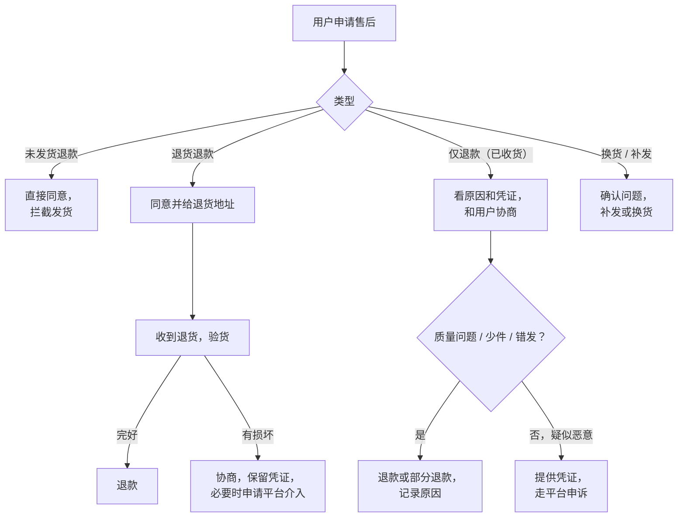

# 售后、品控与口碑分

卖出去只是开始。用户收到货后会退货、会给差评、会投诉，这些事情处理得好不好，不只影响这一单，还通过平台的评分体系影响你以后每一条内容、每一个商品能拿到多少流量。

本章分两个视角：**商家**要处理退货、差评、投诉，维护店铺分；**达人**虽然不管发货，但商品的售后问题会算进你的带货口碑分，你也要管品控、管评论区。最后给一套售后话术模板和品控检查表。

## 规则底座：七日无理由退货

《消费者权益保护法》规定，经营者采用网络等方式销售商品，消费者有权自收到商品之日起七日内退货，且无需说明理由；同时列出了不适用的商品：消费者定作的、鲜活易腐的、在线下载或消费者拆封的音像制品和计算机软件等数字化商品、交付的报纸期刊；除此之外，根据商品性质并经消费者在购买时确认不宜退货的商品，也可以不适用。

几点实务：

- 「不支持七天无理由」必须在**购买前**明示并让消费者确认，不能事后说。平台商品发布时一般有对应的设置项
- 退回的商品应当完好；退回运费按法律规定一般由消费者承担，但经营者和消费者另有约定的按约定。很多商家开通运费险，就是为了让这一步更顺畅
- 平台的售后规则一般**比法律更严**：处理时效、介入条件、判责标准，都以平台规则为准

### 「仅退款」的变化

> [!WARNING]
> 本节按 2025-04 和 2026-01 的媒体报道整理，各平台售后规则可能已再次调整，以所在平台规则中心的现行售后规则为准。

2025 年 4 月，北京商报等媒体报道多家电商平台（报道提及淘宝、抖音、快手、京东、拼多多等）将调整「仅退款」，收到货后的「退款不退货」申请改由商家与消费者协商处理，平台不再直接判退。拼多多同月更新的售后规则中，对已发货商品的仅退款申请给商家 36 小时处理时间。各平台的落地细节不同。

2026-01-08 抖音电商的扶持政策升级方案中，也提到用 AI 前置识别恶意退款和恶意投诉、优化商家申诉通道、上线退货诊断工具（环球网 2026 年报道）。

对商家的意义：恶意退款的保护在加强，但**正常的质量问题退货仍然要痛快处理**，平台对拖延和拒绝合理售后的处罚一点没少。

## 售后流程



### 时效是第一位的

平台对售后有处理时效要求，超时系统可能自动同意，同时影响店铺分。具体时效以平台规则为准。对一个人做副业来说：

- 开启售后消息的手机通知，**每天固定两个时间处理**（比如早上上班前、晚上下班后）
- 未发货退款、明确的质量问题，**直接同意**，不要拖
- 设置自动回复，告诉用户客服时间

## 售后话术模板

话术的原则：**先认同，再解决，不推卸**。不要和用户争论谁对谁错，你的目标是解决问题、让这单的伤害最小。

### 质量问题

```text
您好，非常抱歉给您带来不好的体验。
麻烦您拍一张问题部位的照片发我一下，我这边马上帮您处理。
确认是质量问题的话，您可以选：
1. 退货退款，运费由我们承担
2. 给您补发一个新的，旧的不用寄回
您看哪种方便？
```

### 发错 / 少件

```text
您好，是我们的失误，非常抱歉！
少的 xx 今天就给您补发，单号发出后第一时间告诉您。
给您添麻烦了。
```

### 物流慢

```text
您好，我查了一下，包裹目前在 xx 中转站，物流显示预计 x 号送达。
我已经联系快递催件，有任何更新我会主动告诉您。
如果到 x 号还没收到，您直接找我，给您补发或退款。
```

### 不喜欢 / 不合适（七天无理由）

```text
您好，没问题，您直接在订单里申请退货就行，
商品保持完好、配件齐全寄回就可以，收到后我们尽快退款。
方便的话想问一下是哪里不合适？我们好改进商品描述，谢谢您。
```

最后一句很重要：退货原因是你改进商品页、减少下一次退货的最好数据。

### 疑似恶意退款

```text
您好，看到您申请了仅退款，原因是「商品破损」。
麻烦您发一下破损部位和外包装的照片，方便我们核实和找快递追责。
确认属实的话我们会马上处理。
```

不指责、不定性，只要求凭证。用户拒绝提供或凭证明显不符的，保留聊天记录、发货视频、物流信息，走平台申诉。

## 差评处理

差评是公开的，会被后来的买家看到。处理分两步：

**第一步：私下联系**。先看差评内容：

| 差评类型 | 处理 |
|---|---|
| 质量问题 | 联系用户，按上面的话术处理；问题解决后，用户可能自己追评或修改 |
| 物流 | 道歉，说明情况；记录哪家快递、哪条线路问题多 |
| 期望不符（「和视频说的不一样」） | 回头检查内容和商品页是否夸大，这是最该反思的差评 |
| 恶意差评、同行攻击 | 保留证据，按平台规则申诉 |

**不要做的事**：用红包、返现换用户删差评或改好评。「好评返现」「删差评返现」属于平台明确禁止的行为，被举报会受罚。你可以为了解决问题给补偿，但补偿不能以改评价为条件。

**第二步：公开回复**。商家可以回复评价，后来的买家会看：

```text
您好，非常抱歉这次的体验。已经联系您补发了配件，
同时我们已经把安装说明里扳手长度的问题反馈给工厂，后续批次会更换。
谢谢您的反馈。
```

公开回复写给的是**后来的买家**，让他们看到你在认真处理，而不是和这位用户吵架。

## 评分体系

各平台都有对商家和达人的评分，影响流量、活动报名、带货权限。公开资料对具体算法和权重披露不多，以下是大致框架：

| 平台 | 商家侧 | 达人侧 |
|---|---|---|
| 抖音 | 店铺体验分 / 商家体验分，大致由商品、物流、服务几类体验构成（具体维度和权重以抖店后台为准） | 带货口碑分：根据你带过的商品的评价、售后、投诉等计算，影响带货流量和活动资格（官方算法未公开，以创作者后台为准） |
| 小红书 | 店铺体验类评分 | 买手的带货相关评分和违规记录 |
| 微信小店 | 店铺评分、体验分 | 带货达人的相关考核 |

不管具体怎么算，影响分数的东西是共同的：

- **商品质量**：差评率、品质退货率
- **物流**：发货时效、揽收及时率、物流投诉
- **服务**：客服响应、售后处理时效、纠纷率、平台介入率

**达人要注意**：带货口碑分是根据你带的商品的售后表现算的。商家的问题会变成你的分数，所以第 3 章的选品硬标准里要看店铺分。发现某个商品差评集中，**立即从橱窗下架，并在评论区告知观众**。

## 品控检查表

### 商家：发货前

```text
□ 新批次到货先抽检（按批次大小抽几件到十几件），记录次品率
□ 对照商品详情页核对：颜色、尺寸、配件、说明书
□ 包装能承受快递（易碎品做跌落测试）
□ 高价值或易纠纷商品：打包过程录视频，保存到售后期结束
□ 面单信息正确，包裹里不夹供应商的广告
□ 食品：生产日期、保质期、标签符合要求
```

### 达人：推广期间

```text
□ 每周看一次所推商品的评价，重点看最新差评
□ 每周看一次自己的退货率和带货口碑分
□ 评论区有人反映质量问题，48 小时内回应
□ 商家换了供应商或包装，重新自己买一单验证
□ 发现问题商品：下架 → 评论区说明 → 联系商家 → 必要时停推
```

## 达人：评论区就是你的售后

达人不处理退款，但观众会在你的评论区说「收到是坏的」「客服不理人」。这时候不回应，等于默认；回应得好，反而能加分：

```text
（置顶回复）
收到几位朋友反馈这批支架有异响，我已经联系商家，
商家答复：有问题的可以直接申请换新，运费商家出。
如果客服 24 小时没回，评论区告诉我，我直接帮你找对接人。
这个问题解决之前，我先把链接下了。
```

要点：**说明你做了什么、用户该怎么做、你的态度**。不替商家辩解，也不跟着用户一起骂。商家迟迟不处理的，停止合作，并在后续内容里如实说明。

## 一个人怎么扛住售后

- **控制 SKU 数量**：商品越少，售后越可控
- **把常见问题写进商品页**：尺寸、适用范围、安装方法、注意事项，每一条都能减少一部分咨询和退货
- **准备快捷回复**：上面的话术存成客服工具里的快捷短语
- **自动化**：订单异常提醒、差评提醒、退货原因统计，可以用工具做（第 10 章）
- **算清楚时间成本**：如果售后每天占你两小时以上，要么减品，要么考虑外包客服

## 本章要点

- 七日无理由退货是法律底线，不适用的商品要在购买前明示并让消费者确认；平台规则比法律更严
- 2025 年起多平台调整「仅退款」，收货后的退款不退货改为商家与消费者协商；恶意退款的保护在加强，但正常质量售后要痛快处理
- 售后话术：先认同、再解决、不推卸；恶意退款只要凭证不指责，保留证据走申诉
- 差评先私下解决再公开回复；**不能以返现换删评、改评**
- 商家看店铺体验分，达人看带货口碑分，影响因素都是商品、物流、服务；达人发现问题商品要立即下架并告知观众
- 一个人做：少 SKU、商品页写清常见问题、快捷回复、每天固定时间处理
