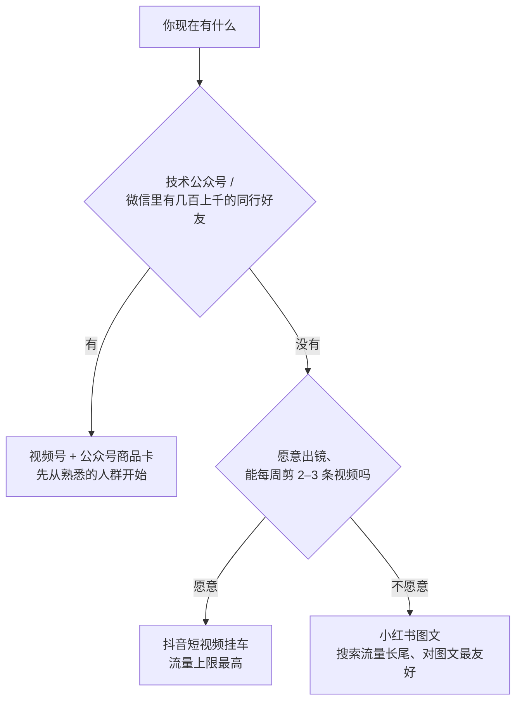

# 小红书与视频号带货

前面几章以抖音为主线，因为它的带货工具最完整、公开资料最多。但对很多开发者来说，小红书和视频号可能更顺手：小红书图文为主，不需要剪视频；视频号背靠微信，你的同事、同学、老客户本来就在里面。

本章讲两个平台带货的机制和打法，以及它们和抖音的关键差异。平台的推荐逻辑、创作者规则本身见《小红书、视频号与 B 站》；抖音和快手的差异见《抖音与快手》。

## 一张表看差异

| | 抖音 | 小红书 | 视频号（微信小店） |
|---|---|---|---|
| 用户为什么来 | 刷着玩，被推荐 | 主动搜索、做攻略、看真实体验 | 社交关系 + 推荐，朋友点赞带来流量 |
| 典型购买路径 | 刷到 → 冲动下单 | 搜索 → 看多篇笔记对比 → 收藏 → 下单 | 朋友转发 / 直播 / 公众号文章 → 下单 |
| 内容形态 | 短视频、直播为主 | 图文笔记为主，视频和直播在加强 | 短视频、直播、公众号文章 |
| 达人带货的叫法 | 达人、精选联盟 | 买手、选品中心 | 带货达人、优选联盟 |
| 内容生命周期 | 短，几天到几周 | 长，搜索流量能持续很久 | 中等，私域转发可以反复激活 |
| 私域能力 | 弱 | 中 | 强：社群、朋友圈、公众号都在微信里 |
| 适合的人 | 能稳定出视频、追求放量 | 会写、会拍照、不想露脸 | 已有微信私域、公众号，或面向熟人圈层 |

## 小红书：买手和笔记带货

### 机制

小红书把带货的个人叫「买手」。商家在后台给商品设佣金放进选品中心，买手从选品池里挑货，在笔记或直播里挂商品链接。平台推行「号店一体」，账号和店铺打通，个人和博主都可以发挂链笔记。

| 项目 | 情况 | 来源与时间 |
|---|---|---|
| 买手基本条件 | 实名认证、年满 18 周岁 | 2023–2024 媒体报道 |
| 选品中心 | 有报道称需粉丝超过 1000 才能在买手中心选品 | 2023–2024 媒体报道，**需核实当前门槛** |
| 直播 | 曾有报道称超过 1000 粉丝可作为买手开直播 | 同上 |
| 商业合作 | 品牌付费的合作走蒲公英平台报备 | 平台长期规则，见《广告商单与品牌合作》 |
| 佣金比例、结算周期 | **未查到公开的权威数据**，以买手后台为准 | |

### 打法要点

1. **搜索是主战场**。小红书用户会搜「显示器支架推荐」「程序员桌面」，你的笔记要出现在这些搜索结果里。标题和正文里自然地写出用户会搜的词
2. **真实感是一切**。小红书用户对「广告味」极其敏感。第 5 章的种草笔记模板里「缺点必写」在这里更重要
3. **合集和对比内容转化好**。「打工人桌面 5 件好物」「三款支架对比，我最后选了这个」，用户本来就是在做比较
4. **长尾流量**。一篇好的笔记几个月后仍然有搜索流量，持续带来订单。选品时要考虑商品的**长期稳定性**：几个月后还在卖、价格没大变、商家还在
5. **商业合作必须报备**。收了品牌的钱发笔记不走蒲公英报备，属于平台重点打击的违规

### 适合什么品

- 颜值高、拍出来好看的东西：桌面、家居、文具、饰品
- 需要做功课的品类：护肤、母婴、数码配件（注意特殊品类资质和用语规范）
- 小众、有调性的品牌和手作

## 视频号：微信生态里的带货

### 机制

2024 年 8 月起，视频号小店升级为微信小店（IT之家 2024-08-13）。商品可以出现在视频号直播和短视频、公众号文章、微信搜索、小程序等场景；商家可以通过「优选联盟」设置推广，吸引带货达人和机构分销（数英 2025-11-04）。

| 项目 | 情况 | 来源与时间 |
|---|---|---|
| 达人带货 | 视频号达人通过优选联盟选品，在直播、短视频中挂商品 | 数英 2025-11-04 |
| 公众号带货 | 实测报道称，公众号通过优选联盟带货需粉丝数大于 100，且一个微信号管理的多个公众号中只能为一个开通；公众号无需绑定小店或视频号 | IT之家实测报道（2024 年），**需核实当前规则** |
| 分享员 | 通过转发商品链接给好友获得佣金的身份；有资料称开通只需缴 100 元橱窗保证金 | B 站文章，可靠性一般，需核实 |
| 送礼物 | 符合条件的商品详情页有「送给朋友」入口 | 数英 2025-11-04 |
| 私域订单优惠 | 群聊、朋友圈、公众号等私域场景成交的订单有技术服务费减免 | 财联社 2025 年初报道 |
| 佣金比例、结算周期 | **未查到公开的权威数据**，以后台为准 | |

### 打法要点

1. **私域是视频号最大的不同**。你的视频被朋友点赞，就会出现在他朋友的「朋友♥了」里。熟人信任带来的转化率，是公域平台很难有的
2. **公众号文章 + 商品卡**。如果你本来就写技术公众号，在文章里插入商品卡是最自然的带货方式：一篇「我的开发环境配置」里插入你用的键盘和显示器
3. **直播转化强、门槛相对低**。视频号直播的观众很多来自微信社交关系，起步人数少但信任度高
4. **复购和社群**。微信里很容易把买家沉淀到社群，做复购和新品通知。私域运营本身见《国内私域与内容平台》和《知识付费与私域变现》
5. **熟人圈要克制**。在朋友圈和群里过度推销，伤的是你的社交关系，而且微信对营销骚扰有处罚

### 适合什么品

- 中高客单、需要信任的东西：好茶、农产品、家乡特产（食品类注意资质）
- 复购型商品：咖啡豆、日用消耗品
- 和你公众号内容强相关的品：书、工具、课程（虚拟商品规则另看）

## 三个平台怎么选

对于一个在职开发者，可以按你**已有的资产**来选：

不必三个都做。**一个平台做到稳定有收入，再把同样的内容改成另一个平台的格式**，比一开始三个平台同时铺效果好得多。内容改编的工作流（一稿多发、图文转视频）可以用 AI 工具加速，见《AI 内容生产工具链》。

## 同一个商品，三个平台怎么写

以第 3 章的显示器支架为例，同一个货、同一份试用记录，在三个平台上的写法差别很大：

| | 抖音短视频 | 小红书图文 | 视频号 / 公众号 |
|---|---|---|---|
| 开头 | 3 秒钩子：「颈椎疼了三年，最后是一个一百多块的东西救了我」 | 封面大字：「小桌面多出半张桌子」，配前后对比图 | 公众号标题：「我的开发桌面，2026 版」 |
| 主体 | 画面演示：安装、拉高、转竖屏 | 五段式正文 + 6–9 张图，信息密度高 | 文章介绍整套桌面，支架是其中一项，插商品卡 |
| 缺点 | 一句话带过两个缺点 | 单独一段列缺点和不适合的人 | 在对比段落里讲清取舍 |
| 引导 | 「链接在左下角」 | 「链接放在笔记里了」 | 商品卡自然出现在对应段落，文末汇总 |
| 时长 / 篇幅 | 40–60 秒 | 400–800 字 | 2000 字以上的长文 |
| 发布后 | 看前 3 天的流量和转化 | 看搜索流量能否持续 | 看文章阅读和转发、商品卡点击 |

改写不是复制粘贴。核心素材（试用记录、照片、视频片段）是共用的，**表达方式要按平台用户的习惯重写**。用一个模板化的流程处理会快很多：先写一份完整的试用报告作为「母稿」，再分别改成三个平台的格式。

### 视频号的熟人圈分寸

在微信里带货，有几条分寸可以参考：

- 朋友圈每周不超过两三条带货内容，其余正常分享生活和工作
- 群里只在别人主动问到相关话题时推荐，不在技术群里发广告
- 推荐时直说「这是带货链接，我有佣金」，熟人更在意坦诚
- 卖给熟人的东西，售后要比卖给陌生人更上心

## 跨平台的注意事项

| 事项 | 说明 |
|---|---|
| 不要互相导流 | 在抖音视频里说「去小红书搜我」、在小红书笔记里留微信号，各平台都会限流甚至处罚 |
| 同一商品价格可能不同 | 各平台的店铺价格、优惠不同，你在不同平台说的价格要和当时挂的链接一致 |
| 规则各不相同 | 合作报备、广告标注、违禁词、特殊类目要求，各平台有自己的规则，分别看 |
| 数据分开记 | 各平台的退货率、转化率会差很多，不要混在一起算 |

## 常见坑

- **把抖音的打法照搬到小红书**：强吆喝、短促的带货节奏，在小红书会显得「广告味」太重
- **视频号只发朋友圈**：一味刷屏，朋友屏蔽你，平台也会判骚扰
- **小红书不报备商单**：收了钱的合作必须走蒲公英
- **公众号带货不看资质**：食品、保健品文章插卡，用语和资质一样要合规
- **三个平台同时开**：精力分散，哪个都做不起来

## 本章要点

- 抖音靠推荐、冲动消费；小红书靠搜索、做功课；视频号靠社交关系和私域
- 小红书买手：实名、18 岁以上，选品中心曾报道需 1000 粉以上；种草要真实、要让笔记被搜到，商单走蒲公英报备
- 视频号（微信小店，2024-08 升级）：优选联盟分销，公众号文章可插商品卡，私域订单有技术服务费减免；熟人圈要克制
- 按已有资产选平台：有公众号和微信同行圈选视频号，愿意出镜选抖音，不想露脸选小红书
- 一个平台做稳再扩，不互相导流，数据分开记
