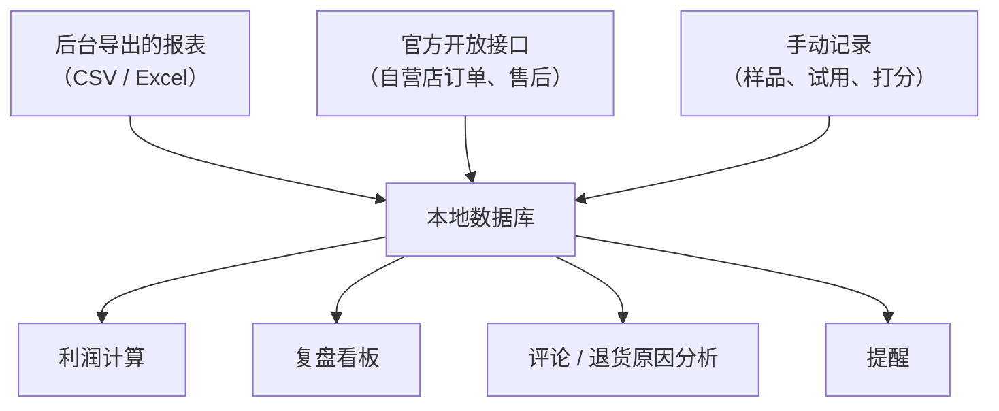

# 技术人能做的效率工具

做带货副业，开发者有一个别人没有的优势：别人在 Excel 里手动复制粘贴的事情，你可以写个脚本。时间是副业最稀缺的资源，省下来的每一个小时都可以用在拍内容和选品上。

本章讲给**自己**用的小工具：选品库、利润计算、数据复盘、评论分析、售后辅助。每个都给出数据结构或关键代码，周末一两天能搭起来。如果你想把这些做成产品卖给其他创作者，那是另一门生意，见[《给创作者和短剧团队做工具》](../creator-tools/)。

## 先划一条线：哪些不能做

在动手之前，先明确边界。下面这些自动化**违反平台规则**，轻则封号，重则涉及违法：

- 爬取平台未公开的数据、绕过登录或反爬机制
- 自动发评论、自动点赞、自动私信、批量关注
- 用程序模拟用户下单、刷单、刷评
- 用多个账号自动发相同内容（矩阵号要按平台规则运营）
- 抓取其他用户的个人信息

可以做的是：**处理你自己的数据**（后台导出的报表、你自己的内容和订单）、**调用平台的官方开放接口**（抖店开放平台、小红书开放平台、微信小店接口等，需要按平台要求申请权限）、**在本地做计算和分析**。



## 工具一：选品库

把第 3 章的打分表和试用记录变成一个小数据库。用 SQLite 就够了：

```sql
CREATE TABLE product (
  id            INTEGER PRIMARY KEY,
  platform      TEXT NOT NULL,          -- douyin / xhs / wechat
  name          TEXT NOT NULL,
  shop          TEXT,
  link          TEXT,                   -- 商品链接，自己粘贴
  price         REAL,
  commission    REAL,                   -- 0.20 表示 20%
  category      TEXT,
  status        TEXT DEFAULT 'candidate', -- candidate / sampling / testing / main / dropped
  created_at    TEXT DEFAULT CURRENT_TIMESTAMP
);

CREATE TABLE score (
  product_id    INTEGER REFERENCES product(id),
  dimension     TEXT,                   -- fit / quality / shop / reviews / price / commission / return_risk / filmable / competition
  weight        INTEGER,
  value         INTEGER CHECK (value BETWEEN 1 AND 5),
  PRIMARY KEY (product_id, dimension)
);

CREATE TABLE trial_note (
  id            INTEGER PRIMARY KEY,
  product_id    INTEGER REFERENCES product(id),
  day           INTEGER,                -- 试用第几天
  note          TEXT,
  is_downside   INTEGER DEFAULT 0       -- 1 表示这条是缺点
);
```

加权总分一条 SQL 就能算：

```sql
SELECT p.name, ROUND(SUM(s.weight * s.value) / 5.0, 1) AS total
FROM product p JOIN score s ON s.product_id = p.id
GROUP BY p.id
ORDER BY total DESC;
```

好处是：半年后你能回答「我试过的 60 个商品里，打分 80 以上的最后卖得怎么样」，这能帮你校准打分表的权重。

## 工具二：利润计算器

第 4 章的 `profit` 函数加两个反解，就是一个够用的计算器：

```ts
// 接第 4 章的 Input 与 profit()

// 盈亏平衡退货率：净利润对退货率是线性的，用两点求零点
function breakEvenReturnRate(i: Input): number {
  const p0 = profit({ ...i, returnRate: 0 }).net;
  const p1 = profit({ ...i, returnRate: 1 }).net;
  return p0 / (p0 - p1);
}

// 每付款单投流上限：同理，净利润对投流也是线性的
function maxAdPerOrder(i: Input): number {
  const base = profit({ ...i, adPerOrder: 0 }).net;
  return base / i.orders;
}

const example: Input = {
  price: 79, cost: 22, ship: 5, insurance: 0.5, feeRate: 0.05, commissionRate: 0.2,
  adPerOrder: 12, returnRate: 0.25, scrapRate: 0.2, orders: 100,
};
console.log(breakEvenReturnRate(example)); // ≈ 0.474
console.log(maxAdPerOrder(example));       // ≈ 21.34
```

做成网页或者小程序，选品时输入售价、进价、佣金，立刻看到盈亏平衡点。把平台费率做成配置项，**每项费率旁边写上来源和查询日期**，政策变了改配置即可。

## 工具三：数据复盘

各平台的达人后台和商家后台一般都支持导出数据报表（具体字段和导出入口以后台为准）。每周导出一次，导入本地数据库，自己算平台看板没给你算的东西。

一个以「内容」为中心的表结构：

```sql
CREATE TABLE content (
  id            INTEGER PRIMARY KEY,
  platform      TEXT,
  title         TEXT,
  published_at  TEXT,
  product_id    INTEGER REFERENCES product(id),
  format        TEXT                    -- video / note / live
);

CREATE TABLE content_daily (
  content_id    INTEGER REFERENCES content(id),
  date          TEXT,
  views         INTEGER,
  product_clicks INTEGER,
  orders        INTEGER,
  gmv           REAL,
  refunds       INTEGER,
  settled_commission REAL,
  ad_spend      REAL,
  PRIMARY KEY (content_id, date)
);
```

每周复盘看这几个数：

```sql
SELECT c.title,
       SUM(d.views)                                AS views,
       1.0 * SUM(d.product_clicks) / SUM(d.views)  AS click_rate,
       1.0 * SUM(d.orders) / SUM(d.product_clicks) AS conv_rate,
       1.0 * SUM(d.refunds) / SUM(d.orders)        AS refund_rate,
       SUM(d.settled_commission) - SUM(d.ad_spend) AS net
FROM content c JOIN content_daily d ON d.content_id = c.id
WHERE d.date >= date('now', '-30 day')
GROUP BY c.id
ORDER BY net DESC;
```

导入时注意：

- 不同平台、不同时期导出的字段名可能不同，**写一个字段映射层**，不要把列名硬编码在分析逻辑里
- 金额字段注意单位（元还是分）和是否含退款
- 预估佣金和结算佣金分开存，复盘只用结算佣金

## 工具四：评论与退货原因分析

评论区和退货原因是最有价值的定性数据，但量一大就看不过来。用大模型做分类很合适：

```text
你是电商客服数据分析助手。下面是某个商品的用户评论或退货原因，每行一条。
请把每条归入以下类别之一，并输出 JSON 数组 [{"id":..., "category":..., "summary":...}]：
- size_fit：尺寸、规格、适配问题
- quality：做工、耐用性、瑕疵
- expectation：和描述或视频不一致
- logistics：物流慢、包装破损
- usage：不会用、安装困难
- question：提问（不是投诉）
- positive：正面评价
- other
summary 用不超过 15 个字概括。不要编造评论里没有的信息。
---
{{评论列表}}
```

然后统计每个类别的占比，按周看趋势：

- `expectation` 占比高 → 你的内容或商品页夸大了，回头改
- `size_fit` 高 → 商品页加尺寸图、内容里加「适合谁不适合谁」
- `usage` 高 → 做一条安装教程，顺便又是一条内容
- `question` 里的高频问题 → 下一条选题

处理用户评论时注意**只传评论文本，不传用户昵称、头像、地址等个人信息**给第三方模型服务。大模型工具链的选择见[《AI 内容生产工具链》](../ai-content-pipeline/)。

## 工具五：售后辅助（自营小店）

如果你开了自营小店，平台的开放接口通常提供订单、售后、商品等能力（需按平台要求申请应用和权限，接口范围以开放平台文档为准）。可以做：

| 功能 | 做法 |
|---|---|
| 售后提醒 | 定时拉取待处理售后单，快到处理时效时推送到你的手机（企业微信、飞书机器人） |
| 发货超时预警 | 已付款未发货超过 N 小时的订单提醒 |
| 差评提醒 | 新的低分评价立即通知 |
| 退货原因周报 | 汇总一周的退货原因，接工具四的分类 |
| 快捷回复建议 | 根据售后类型推荐第 8 章的话术模板，**人确认后再发** |

最后一条要强调：**不要让程序自动回复用户**。自动回复一旦出错（答非所问、承诺了做不到的事），比慢一点回复的伤害大得多。程序负责提醒和起草，人负责发送。

## 工具六：链接与橱窗巡检

挂了很多视频后，最怕的是商品下架、涨价、换了商家你不知道。可以做一个简单的提醒：

- 在选品库里记录每个商品当时的价格、佣金
- 每周在后台的橱窗管理页看一遍状态（达人后台一般会提示失效商品），或者用平台开放的接口查询（如果有）
- 发现变化：更新记录，必要时在视频评论区置顶说明

**不要写爬虫去定时抓商品页**，这既违反平台规则，也很容易触发风控。

## 先做哪个

| 优先级 | 工具 | 理由 |
|---|---|---|
| 1 | 利润计算器 | 半天就能写完，每次选品都用 |
| 2 | 数据复盘 | 从第一周就开始攒数据，越早越值钱 |
| 3 | 选品库 | 候选超过 20 个时就需要 |
| 4 | 评论分析 | 单个商品评论超过几百条时再做 |
| 5 | 售后辅助 | 开了自营小店再做 |

不要一开始就做一个大而全的系统。**先在电子表格里跑通流程，确认这个流程你会每周坚持，再写代码**。很多人花一个月写了个漂亮的看板，然后发现自己根本没坚持复盘。

## 本章要点

- 开发者的优势是把手工活变成脚本，省下的时间用来拍内容和选品
- 边界：只处理自己的数据、只用官方开放接口；不爬取、不自动评论点赞私信、不刷单、不抓他人信息
- 选品库和数据复盘用 SQLite 就够，复盘只用结算佣金，导入层做字段映射
- 用大模型给评论和退货原因分类，按类别找改进点；只传评论文本不传个人信息
- 售后工具负责提醒和起草，发送由人确认
- 先做利润计算器和数据复盘；先用表格跑通流程再写代码；想把工具做成产品见《给创作者和短剧团队做工具》
