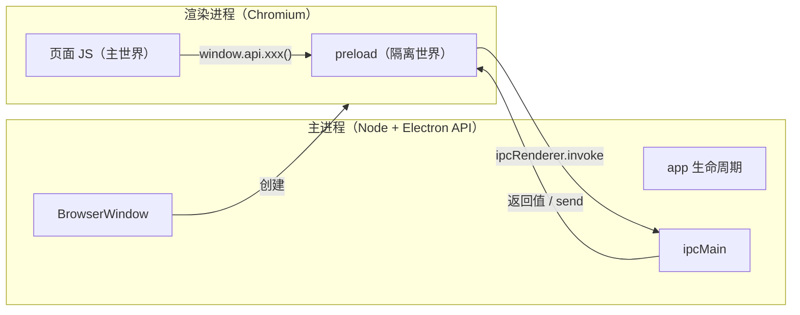
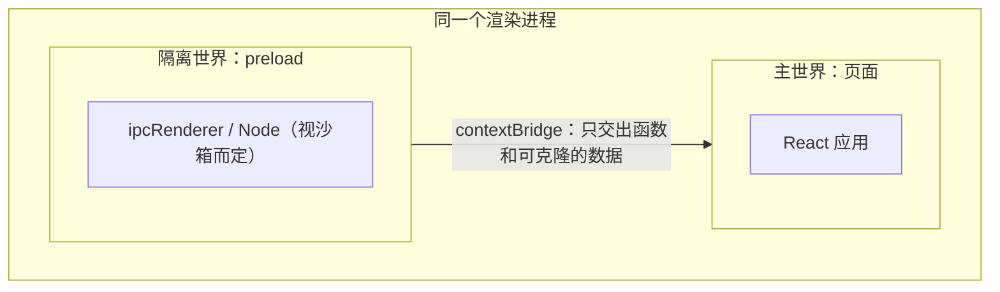
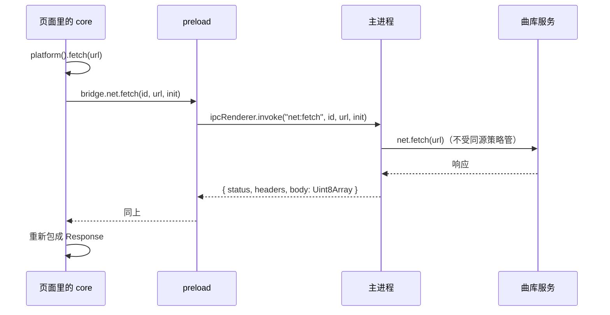

# 主进程、preload 与渲染进程

Electron 应用写起来像网页，跑起来却是好几个进程。很多「明明代码没错却不工作」的问题，根子都在没搞清楚**某段代码到底跑在哪个进程里、那个进程有什么、没什么**。这一章先把进程模型讲透，后面的 IPC、安全、打包都建立在它上面。

## 这本书讲什么、适合谁、怎么读

这本书写给已经会写 React + TypeScript、想把桌面应用做「对」的独立开发者：不是从 `npm init` 教起，而是讲清 Electron 每个设计背后的原因，以及一个人维护时该在哪里省事、在哪里不能省。

贯穿全书的案例是 hatch-recordwall 的桌面端 `apps/desktop`：一个只在 macOS 上用的唱片播放器，electron-vite 工程、三个进程分工明确、请求统一在主进程发、用 ad-hoc 签名出一个本机 `.app`。它的代码量不大（主进程约 500 行、preload 约 170 行），但几乎每一行都对应一个踩过的坑，很适合拿来讲道理。

**版本说明**：案例用的是 Electron 44（`44.5.1`）、electron-vite 5、electron-builder 26。Electron 大约每 8 周一个大版本，API 和安全默认值会变。本书讲到具体 API 时以 Electron 44 为准；动手前请对照官方文档里你所用版本的 Breaking Changes 页面。

建议顺序读。第 1–3 章是心智模型，第 4–5 章是工程和系统集成，第 6–7 章是发布，第 8 章帮你判断下一个项目要不要还用 Electron。

## 为什么是多个进程

Electron 把两样东西缝在一起：**Chromium**（负责显示页面）和 **Node.js**（负责碰操作系统）。Chromium 本来就是多进程架构：浏览器进程管窗口和网络，每个标签页一个渲染进程，渲染进程崩了不影响别的页面，被攻破了也被沙箱关着。

Electron 沿用了这套结构，并给每种进程分配了角色：

| 进程 | 有几个 | 能用什么 | 典型职责 |
|---|---|---|---|
| 主进程（main） | 恰好一个 | 完整的 Node.js + Electron 主进程 API（`app`、`BrowserWindow`、`Tray`、`protocol`、`net`…） | 应用生命周期、开窗口、菜单、系统集成、所有特权操作 |
| 渲染进程（renderer） | 每个窗口（准确说每个 webContents）一个 | 浏览器环境：DOM、`fetch`、Web API；默认**没有** Node | 界面 |
| preload 脚本 | 跑在每个渲染进程里 | 一小部分 Electron API（`contextBridge`、`ipcRenderer`）；是否有 Node 取决于是否开沙箱 | 在页面加载前，把一组受控的函数交给页面 |
| utility 进程 | 按需 | Node.js | 把 CPU 重活或不可信的原生模块从主进程挪出去 |



关键是记住：**主进程只有一个，它挂了整个应用就没了**；渲染进程可以有很多，它们之间互相看不到。

## 主进程：应用的「操作系统那一半」

主进程的入口是 `package.json` 里 `main` 字段指向的文件。它不显示任何东西，只负责：

- 监听 `app` 的生命周期事件（`ready`、`activate`、`before-quit`、`window-all-closed`）
- 创建和管理窗口
- 注册自定义协议、菜单、托盘、全局快捷键
- 执行所有需要特权的操作：读写任意文件、调用钥匙串、发不受同源策略限制的请求

唱片墙的主进程开头有一段注释，把职责列得很清楚：开窗口、`recordwall://` 协议、钥匙串、告诉 preload 东西放哪儿、替渲染进程发请求、一扇不显示的「源站窗」、菜单栏图标。**曲库、目录、播放逻辑这些业务全在渲染进程里，主进程一概不碰**。

这是一个值得模仿的取舍：主进程越薄越好。原因有三：

1. **主进程阻塞会冻住整个应用**。主进程跑着 Electron 的 UI 消息循环，在里面同步读一个大文件、做一次大 JSON 解析，所有窗口都会卡住
2. **主进程崩溃没有兜底**。渲染进程崩了可以监听 `render-process-gone` 重新加载，主进程崩了就是闪退
3. **业务逻辑放在渲染进程里能和其他端共用**。唱片墙的 `packages/core` 手机和桌面共用，它只依赖一个抽象的「平台接口」，而桌面端的平台实现由 preload 提供

## 渲染进程：就是一个浏览器标签页

渲染进程里跑的就是你的 React 应用。它和普通网页几乎一样，包括所有限制：

- 受**同源策略**和 CORS 约束：`fetch` 一个不开 CORS 的接口会直接失败
- 受页面 **CSP** 约束
- 默认没有 `require`、`process`、`fs`

最后一条是很多老教程的雷区。早年的 Electron 默认 `nodeIntegration: true`，页面里可以直接 `require('fs')`，教程里满是这种写法。官方安全文档写明：Node 集成从 Electron 5 起默认关闭，上下文隔离从 Electron 12 起默认开启，沙箱从 Electron 20 起默认开启。今天照着老教程打开 `nodeIntegration`，等于把整台电脑交给页面里的任何一段脚本，第 3 章细讲。

## preload：两个世界之间的那扇门

既然页面不能碰 Node，它怎么读文件、怎么跟主进程说话？答案是 preload 脚本。

preload 在页面任何脚本执行**之前**运行，跑在同一个渲染进程里，但在一个**隔离的 JavaScript 世界**（isolated world）中：它和页面共享同一棵 DOM，却有各自独立的全局对象。页面改 `Array.prototype`、覆盖 `window.fetch`，影响不到 preload；preload 定义的变量，页面也看不到。

两个世界之间唯一的通道是 `contextBridge.exposeInMainWorld`：

```ts
// src/preload/index.ts
import { contextBridge, ipcRenderer } from "electron";

contextBridge.exposeInMainWorld("api", {
  readSettings: () => ipcRenderer.invoke("settings:read"),
});
```

页面里就能调用 `window.api.readSettings()`。注意交出去的是**一个具体的函数**，不是 `ipcRenderer` 本身。为什么不能直接把 `ipcRenderer` 交出去，第 2、3 章会讲。



### 沙箱开不开，决定 preload 能做什么

| 设置 | preload 里有什么 |
|---|---|
| `sandbox: true`（Electron 20 起的默认值） | 只有受限的 `require`：`electron` 的渲染端子集（`contextBridge`、`ipcRenderer`、`webFrame` 等）和少数 Node 模块的 polyfill；**没有 `fs`** |
| `sandbox: false` | 完整的 Node.js：`fs`、`path`、`child_process`… |

开着沙箱时，preload 只能做「转发」：把页面的调用通过 IPC 交给主进程办。关掉沙箱，preload 自己就能读写文件。

唱片墙的主窗口选择了 `sandbox: false`，原因写在代码注释里：core 里有几个小仓库在**被 import 的那一刻**就要同步从磁盘恢复状态，而 IPC 只能异步（`sendSync` 虽然存在但会阻塞渲染进程，不宜大量使用）。所以 preload 用同步 `fs` 实现文件接口。代价是 preload 这一层的攻击面变大了：一旦页面能拿到 preload 里的任意执行能力，就等于拿到了 Node。项目用另外几道防线补偿：页面依然 `contextIsolation: true`、`nodeIntegration: false`，只加载自己打包的代码，CSP 严格，并且 preload 只交出按「区」限定的文件函数（不接受任意路径）。

这是一个典型的「明知有代价、写清理由、加补偿措施」的决策。第 3 章会把它放在安全清单里重新审视。

## 一个请求在三个进程里怎么走

用唱片墙最核心的一条链说明：页面要从曲库拉一份目录 JSON。



为什么绕这么一大圈，而不是在页面里直接 `fetch`？

- 曲库服务有意**不开 CORS**（它只给自家 App 用，不想被任意网页调用）
- 页面的 `fetch` 受同源策略管，直接调会得到一个不解释原因的「Failed to fetch」
- preload 的 `fetch` 也是页面那个 Chromium 的，**同样受同源策略管**，挪到 preload 里没用
- 主进程的 `net.fetch` 走的是 Chromium 网络栈，但不受页面同源策略约束，而且认系统代理

这个结论（「请求在主进程发，不在 preload」）是唱片墙 README 里专门强调、踩过才写下的。它也揭示了一个通用原则：**preload 和页面在同一个进程，享有同样的 Web 限制；真正的特权只在主进程**。

## 几种进程各自适合放什么

| 要做的事 | 放哪儿 | 原因 |
|---|---|---|
| 界面、状态管理、业务规则 | 渲染进程 | 可热更新、可跨端复用、崩了能重载 |
| 跨域请求、带密钥的请求 | 主进程 | 不受同源策略管，密钥不进页面 |
| 读写用户文件 | 主进程（沙箱下）或 preload（关沙箱时） | 页面不该有文件系统 |
| 钥匙串加密（`safeStorage`） | 主进程 | 这个 API 只在主进程可用 |
| 视频转码、大文件哈希 | utility 进程或 Worker | 不能卡主进程的消息循环 |
| 运行第三方不可信脚本 | 单独的隐藏窗口，开沙箱 | 碰不到你的 preload 函数 |

最后一行在唱片墙里有个真实例子：它需要运行 YouTube 下发的脚本来签播放凭证、解签名。这些脚本不放在自己的页面里跑，而是放进主进程开的一扇**不显示的窗口**，`sandbox: true`、没有 preload。这样页面的 CSP 不用为它开 `unsafe-eval`，那些脚本也碰不到 preload 交出去的任何函数。第 5 章会展开。

## 本章要点

- Electron = Chromium + Node.js，沿用 Chromium 的多进程架构：**一个主进程、多个渲染进程**
- 主进程有完整 Node 和全部特权，阻塞或崩溃会拖垮整个应用，所以要**尽量薄**
- 渲染进程就是浏览器标签页，受同源策略、CSP 约束，默认没有 Node
- preload 跑在渲染进程的**隔离世界**里，只能通过 `contextBridge` 交出函数和可克隆数据
- 沙箱（Electron 20 起默认开）决定 preload 有没有 Node；关掉要有理由和补偿措施
- **preload 的 `fetch` 和页面一样受同源策略管**，要绕开 CORS 必须到主进程用 `net.fetch`
- 本书以 Electron 44 为准，API 细节请对照所用版本的官方文档
