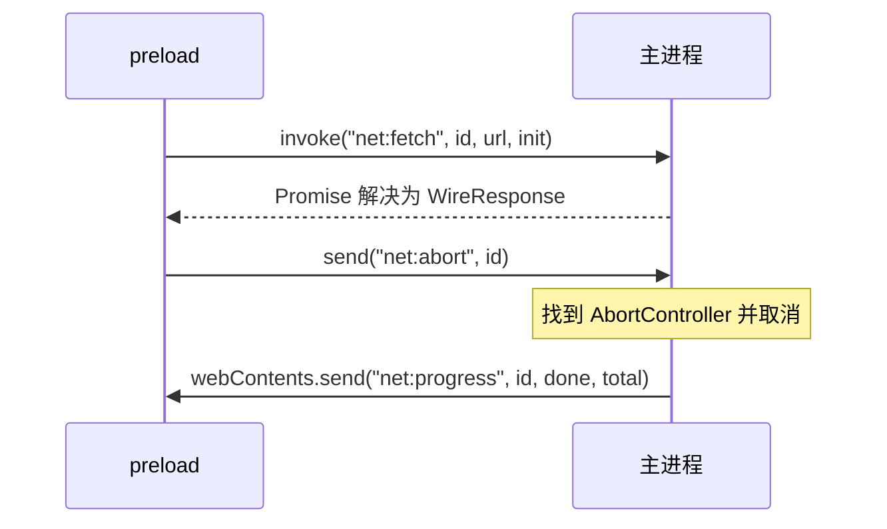

# IPC 设计

上一章说清了「谁能做什么」，这一章讲「怎么让它们说上话」。IPC（进程间通信）是 Electron 应用的骨架：设计得好，主进程是一组小而明确的服务；设计得随意，就会变成一堆字符串频道、到处 `any`、取消不了的请求和永远不解绑的监听器。

## 三种基本模式

Electron 的 IPC 基于**命名频道**，主进程用 `ipcMain`，渲染进程（准确说是 preload）用 `ipcRenderer`。常用的只有三种模式：

| 模式 | 渲染端 | 主进程端 | 适合 |
|---|---|---|---|
| 请求 / 响应 | `ipcRenderer.invoke(ch, ...args)` 返回 Promise | `ipcMain.handle(ch, handler)`，handler 的返回值（可以是 Promise）就是结果 | 读设置、发请求、加解密：绝大多数调用 |
| 单向通知（渲染 → 主） | `ipcRenderer.send(ch, ...args)` | `ipcMain.on(ch, listener)` | 不关心结果：取消请求、更新托盘文字 |
| 推送（主 → 渲染） | `ipcRenderer.on(ch, listener)` | `win.webContents.send(ch, ...args)` | 进度、系统事件、托盘点击 |

还有一个 `ipcRenderer.sendSync` 配 `event.returnValue`，它会**阻塞整个渲染进程**直到主进程回复。官方文档明确不推荐，只在极少数必须同步的启动时刻用。

唱片墙恰好用了一次：preload 一启动就 `ipcRenderer.sendSync("config")` 拿配置（曲库地址、每个「区」在磁盘上的路径）。因为 core 的小仓库在 import 时就要同步读盘，preload 必须在那之前知道路径。整个应用生命周期只调一次，代价可以接受。



## 什么能过桥，什么不能

IPC 的参数和返回值用**结构化克隆**（structured clone）序列化，和 `postMessage` 同一套规则：

| 能过 | 不能过 |
|---|---|
| 原始值、普通对象、数组 | 函数（IPC 层面） |
| `Uint8Array`、`ArrayBuffer`、`Map`、`Set`、`Date` | `Response`、`Headers`、`Request` |
| `Error`（但会丢掉自定义属性） | `AbortSignal`、DOM 节点 |
| | 带原型的类实例（会退化成普通对象） |

`contextBridge` 在此之上多一条：它能把**函数**代理过去（页面调用时实际执行的是 preload 里的函数），但参数和返回值仍然要可克隆。

这直接塑造了接口形状。唱片墙的 core 期望一个 `fetch(url, init): Promise<Response>`，但 `Response` 过不了桥，`AbortSignal` 也过不了。于是在 `src/shared/bridge.ts` 里把网络拆成了「线上格式」：

```ts
// src/shared/bridge.ts（节选）
export interface WireRequest {
  method: string;
  headers: Record<string, string>;
  body?: string | Uint8Array;
}

export interface WireResponse {
  status: number;
  statusText: string;
  headers: Array<[string, string]>;
  body: Uint8Array;
}

export interface Bridge {
  net: {
    fetch(id: number, url: string, init: WireRequest): Promise<WireResponse>;
    abort(id: number): void;
  };
  // ...
}
```

页面那头（`renderer/src/platform.ts`）再把 `WireResponse` 包回一个真正的 `Response` 交给 core。core 完全不知道自己在 Electron 里。

### 一个容易踩的细节：204 不能带 body

把字节包回 `Response` 时，状态码 101、204、205、304 按规范不能有响应体，`new Response(bytes, { status: 204 })` 会直接抛错。唱片墙专门维护了一个 `NULL_BODY` 集合处理这件事。这种「过桥再还原」的地方，是 bug 最爱藏的位置。

### 错误过桥会变形

`ipcMain.handle` 里抛出的错误，到渲染端会变成一个新的 `Error`，message 被包上一层前缀（形如 `Error invoking remote method 'xxx': ...`），自定义字段（比如 `code`）会丢失。如果页面需要区分错误类型，**不要靠抛错传信息**，改成返回一个判别联合：

```ts
type Result<T> = { ok: true; value: T } | { ok: false; code: "not-found" | "denied"; message: string };
```

## 把频道定义集中到一处

字符串频道最大的问题是两端各写各的，拼错一个字母不会报错，只会「没反应」。解决办法是**把桥的形状写成一个共享的 TypeScript 接口**，main、preload、renderer 三方都 import 它。

唱片墙的做法是 `src/shared/bridge.ts` 定义 `Bridge` 接口，preload 写 `const bridge: Bridge = { ... }` 并 `exposeInMainWorld`，渲染端声明 `window.recordwall: Bridge`。preload 少实现一个方法、签名不对，`tsc` 立刻报错。（巧的是 hatch-shelf 也有同样的规矩：RN 与 WebView 之间的消息类型只在 `bridge.ts` 定义。）

主进程那一侧的频道名仍是字符串。如果频道多起来，可以再进一步，用一张「频道 → 签名」的表把两端都约束住：

```ts
// src/shared/ipc.ts
export interface InvokeMap {
  "settings:read": () => Settings;
  "settings:write": (patch: Partial<Settings>) => void;
  "file:open": (filters: string[]) => string | null;
}

// src/main/ipc.ts
import { ipcMain, type IpcMainInvokeEvent } from "electron";
import type { InvokeMap } from "../shared/ipc";

export function handle<K extends keyof InvokeMap>(
  channel: K,
  fn: (e: IpcMainInvokeEvent, ...args: Parameters<InvokeMap[K]>) =>
    ReturnType<InvokeMap[K]> | Promise<ReturnType<InvokeMap[K]>>,
): void {
  ipcMain.handle(channel, (e, ...args) => fn(e, ...(args as Parameters<InvokeMap[K]>)));
}

// src/preload/ipc.ts
import { ipcRenderer } from "electron";
import type { InvokeMap } from "../shared/ipc";

export function invoke<K extends keyof InvokeMap>(
  channel: K,
  ...args: Parameters<InvokeMap[K]>
): Promise<Awaited<ReturnType<InvokeMap[K]>>> {
  return ipcRenderer.invoke(channel, ...args);
}
```

注意类型只是编译期的约定，**主进程收到的参数依然要当作不可信输入校验**（下一章讲为什么）。

## 设计 API：按能力，不按实现

不要把 IPC 做成「远程调用 Node」：

```ts
// 反例：等于把 fs 整个交给了页面
contextBridge.exposeInMainWorld("api", {
  readFile: (p: string) => ipcRenderer.invoke("fs:readFile", p),
  invoke: (ch: string, ...a: unknown[]) => ipcRenderer.invoke(ch, ...a),
});
```

应该按**业务能力**设计，参数尽量是受限的枚举或标识，路径由主进程自己拼。唱片墙的文件接口就是这样：

- 页面只能说「哪个区（`state`、`audio`、`covers`…）里的哪个文件名」
- 主进程的 `fileIn(area, name)` 检查区在白名单里、文件名不含 `/`、不以 `.` 开头，再拼出真实路径
- 页面说不出 `roots` 以外的任何位置

| 好的 IPC 接口 | 差的 IPC 接口 |
|---|---|
| `secrets.get(key)` | `exec(cmd)` |
| `files.write(area, name, data)` | `fs.writeFile(path, data)` |
| `tray.show({ title, by, playing })` | `invoke(anyChannel, ...anyArgs)` |
| 参数是枚举、ID、有限结构 | 参数是路径、URL、代码字符串 |

## 取消与进度：用 ID 关联

`AbortSignal` 过不了桥，取消就得自己做：每个请求带一个 ID，主进程用 `Map<number, AbortController>` 记着，收到 `abort(id)` 时找到对应的控制器。

```ts
// 主进程
const inflight = new Map<number, AbortController>();

ipcMain.handle("net:fetch", async (_e, id: number, url: string, init: WireRequest) => {
  const ctrl = new AbortController();
  inflight.set(id, ctrl);
  try {
    const res = await net.fetch(url, { ...init, signal: ctrl.signal });
    return { status: res.status, statusText: res.statusText,
             headers: [...res.headers.entries()], body: new Uint8Array(await res.arrayBuffer()) };
  } finally {
    inflight.delete(id);
  }
});

ipcMain.on("net:abort", (_e, id: number) => inflight.get(id)?.abort());
```

### ID 由谁发

唱片墙踩过一个坑：页面的普通请求和 preload 发起的下载、上传都要 ID，如果页面和 preload 各自从 1 开始数，到主进程就会撞号，取消一个请求结果取消了另一个下载。最后的规定是：**ID 只由 preload 发**。页面给的 ID 只在 preload 里做一次映射（`Map<页面ID, preload ID>`），用来把页面的取消翻译过去。

推广一下：**凡是跨进程的标识，都要有唯一的发号方**。

### 进度推送要节流

下载时每个数据块到达都 `webContents.send` 一次，会把 IPC 塞满、拖慢渲染进程。唱片墙的做法是在主进程里最多每 200 毫秒报一次，结束时再补报一次最终值。界面上的进度条根本看不出 5 次/秒和 500 次/秒的区别。

## 主进程推送：别忘了解绑

`ipcRenderer.on` 注册的监听器不会自动移除。在 preload 里包一层时，**返回一个取消函数**，让页面能在 React 的 effect cleanup 里解绑：

```ts
// preload
onCommand(listener: (c: TrayCommand) => void): () => void {
  const wrapped = (_e: Electron.IpcRendererEvent, c: TrayCommand) => listener(c);
  ipcRenderer.on("tray:command", wrapped);
  return () => ipcRenderer.removeListener("tray:command", wrapped);
}
```

还有两个细节：

- **别把 `event` 对象透传给页面**。`IpcRendererEvent` 上有 `sender`（就是 `ipcRenderer`），透传出去等于把整个 IPC 交给了页面。上面的写法只传 `c`
- 唱片墙的 `tray.onCommand` 只在应用启动时注册一次、从不解绑，所以没返回取消函数，这在「只注册一次」的前提下没问题；但如果在组件里注册，就必须能解绑，否则热更新几次后同一个命令会触发好几遍

## 大数据和流

IPC 适合小消息。要在进程间搬大块数据：

| 场景 | 做法 |
|---|---|
| 一次性的几 MB 字节 | 直接传 `Uint8Array`，可以接受 |
| 音视频、图片给 `` / `<audio>` | **自定义协议**（第 5 章），让 Chromium 自己按需拉流、支持 Range |
| 持续的双向数据流 | `MessageChannelMain` 建一对 `MessagePort`，把一端转交给渲染进程 |
| 大文件下载 / 上传 | 主进程直接读写磁盘，只通过 IPC 传进度和结果 |

唱片墙下载歌曲时，字节从不经过 IPC：主进程 `net.fetch` 拿到流，管道到 `.part` 文件，完成后改名，渲染进程只收到进度事件和一个 `true`。

## 本章要点

- 三种模式：`invoke`/`handle` 做请求响应（首选），`send`/`on` 做单向通知，`webContents.send` 做推送；`sendSync` 会阻塞渲染进程，尽量不用
- 过桥的数据走结构化克隆：`Response`、`AbortSignal` 过不去，要拆成「线上格式」再在另一头还原
- 抛错过桥会丢信息，需要区分错误时返回判别联合
- 把桥的形状写成**共享 TypeScript 接口**，三个进程都 import
- 按**业务能力**设计 IPC，参数用枚举和 ID，路径由主进程拼
- 跨进程的 ID 要有唯一发号方；进度推送要节流；推送监听要能解绑，别把 `event` 透传给页面
- 大块数据走自定义协议或 `MessagePort`，不走普通 IPC

## 动手练习

1. **抛错过桥会变形**：主进程写 `ipcMain.handle('boom', () => { const e = new Error('not here'); (e as any).code = 'E_NOT_FOUND'; throw e; })`，preload 暴露 `boom: () => ipcRenderer.invoke('boom')`，页面里 `try { await window.api.boom() } catch (e) { console.log(e.message, e.code) }`。

   验证：`message` 带上了 `Error invoking remote method 'boom'` 前缀，`code` 是 `undefined`。

   参考答案：错误过桥时被重新包装，自定义字段丢失。要让页面区分错误类型，改成返回 `{ ok: false, code }` 这样的判别联合。

2. **什么过不了桥**：让一个 handler 分别返回 `{ at: new Date(), bytes: new Uint8Array([1, 2]) }`、`{ fn: () => 1 }` 和一个自定义类的实例 `new Point(1, 2)`，在页面里打印结果和 `instanceof`。

   验证：第一个原样到达（`Date` 和 `Uint8Array` 类型保留）；第二个调用失败，报错说对象无法克隆；第三个到达后是普通对象，属性还在、方法没了。

   参考答案：IPC 走结构化克隆，函数不能克隆，类实例会丢掉原型。这就是 `Response`、`AbortSignal` 要拆成「线上格式」的原因。

3. **监听器泄漏**：preload 暴露一个**不返回取消函数**的 `onTick(cb)`（内部 `ipcRenderer.on('tick', (_e, n) => cb(n))`），主进程每秒 `win.webContents.send('tick', n++)`。在一个 React 组件的 `useEffect` 里注册并 `console.log`，保存文件触发几次热更新。然后按本章写法改成返回取消函数，在 effect cleanup 里调用。

   验证：改之前，每秒打印的行数随热更新次数增加（开发模式下 StrictMode 一开始就是两行）；改之后稳定为每秒一行。

   参考答案：`ipcRenderer.on` 注册的监听不会随组件卸载自动移除，必须由 preload 返回解绑函数，并且只把数据而不是 `event` 交给页面。
