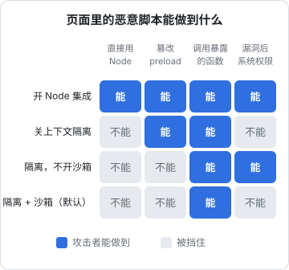

# 安全清单

Electron 的安全问题和网页不是一个量级。网页里的 XSS 最多偷走 cookie；Electron 里的 XSS，如果配置不当，可以直接读你的 SSH 私钥、执行任意命令。这一章把官方安全清单按「为什么」重新组织一遍，然后拿唱片墙逐条对照，包括它**有意没做**和**还可以做得更好**的地方。

## 威胁模型：假设页面会被攻破

讨论 Electron 安全，先接受一个前提：**渲染进程里迟早会跑进不该跑的代码**。来源可能是：

- 你渲染了一段用户内容或远程数据，里面藏着 ``
- 某个 npm 依赖被投毒，打进了你的前端包
- 页面意外导航到了外部网站
- Chromium 本身的漏洞（这就是为什么要及时升级 Electron）

安全配置的目标，是让「页面被攻破」这件事的后果**尽量小**：攻击者只能调用你交出去的那几个函数，而且这些函数自己会校验参数。



图里每一行只改一个开关，其余保持默认。注意第一行：打开 `nodeIntegration` 会顺带关掉该进程的沙箱；第二行关掉隔离后虽然页面拿不到 `require`，却能通过篡改 preload 用到的内置对象，间接拿到 preload 手里的东西。「调用暴露的函数」在任何配置下都挡不住，所以那些函数自己必须校验参数。

## 三个开关：nodeIntegration、contextIsolation、sandbox

| 选项 | 默认值（起始版本） | 作用 |
|---|---|---|
| `nodeIntegration` | `false`（Electron 5 起） | 页面主世界里有没有 `require`、`process` |
| `contextIsolation` | `true`（Electron 12 起） | preload 和页面是否在不同的 JS 世界 |
| `sandbox` | `true`（Electron 20 起） | 渲染进程是否在操作系统级沙箱里，preload 有没有完整 Node |

以上默认值和版本号出自官方安全文档。**最好的配置就是不改默认值**，并且在代码里显式写出来，免得哪天有人「临时」改掉：

```ts
new BrowserWindow({
  webPreferences: {
    preload: path.join(__dirname, "../preload/index.js"),
    contextIsolation: true,
    nodeIntegration: false,
    sandbox: true,
  },
});
```

### 为什么 contextIsolation 这么重要

关掉上下文隔离时，preload 和页面共享同一套全局对象。即使 preload 只交出一个看起来安全的函数，页面也可以先改掉 `Array.prototype.push`、`JSON.parse` 之类的内置方法，等 preload 调用它们时劫持执行流程，进而拿到 preload 手里的 `ipcRenderer` 甚至 Node。隔离之后，两边的内置对象是各自独立的副本，这条路就断了。

### 为什么 sandbox 是最后一道墙

上下文隔离防的是 JavaScript 层面的越权。沙箱防的是更底层的情况：Chromium 渲染器有内存漏洞，攻击者拿到了渲染进程的原生代码执行权。开着沙箱，这个进程在操作系统层面几乎什么都做不了（不能随意读文件、不能起子进程），还得再找一个沙箱逃逸漏洞；关着沙箱，它就拥有和你的应用一样的系统权限。

## 官方清单，按主题归类

Electron 官方安全文档列了 20 条。按「防什么」归成五组更好记：

### 一、限制页面的能力

1. 不对远程内容开启 Node 集成
2. 所有渲染进程开启上下文隔离
3. 开启进程沙箱
4. 不向不可信的网页内容暴露 Electron API
5. 不开启 `experimentalFeatures`，不用 `enableBlinkFeatures`

### 二、限制页面能去哪儿

6. 禁止或限制导航（`will-navigate`）
7. 禁止或限制新窗口（`setWindowOpenHandler`）
8. 不对不可信内容使用 `shell.openExternal`
9. `<webview>` 不开 `allowpopups`，并在 `will-attach-webview` 里校验选项

### 三、限制页面能加载什么

10. 只加载安全内容（HTTPS、WSS）
11. 设置严格的 CSP，例如 `script-src 'self'`
12. 不关闭 `webSecurity`，不开启 `allowRunningInsecureContent`
13. 避免 `file://`，优先用自定义协议

### 四、限制主进程的入口

14. **校验所有 IPC 消息的发送方**
15. 用 `session.setPermissionRequestHandler` 处理权限请求（摄像头、通知、地理位置…）

### 五、限制应用本身被利用

16. 检查并关闭不需要的 **fuses**
17. 使用较新的 Electron 版本

下面挑最容易被忽略的几条展开。

## 校验 IPC 发送方和参数

`ipcMain.handle` 默认会响应**任何**渲染进程的消息，包括你开的隐藏窗口、意外加载了外部页面的窗口、iframe 里的子页面。官方建议用发送方 frame 的 `origin` 对照白名单（而不是 URL，因为 `about:blank`、`blob:` 这类地址说明不了是谁在控制）：

```ts
import { ipcMain, type IpcMainInvokeEvent } from "electron";

const DEV_URL = process.env.ELECTRON_RENDERER_URL;

function trusted(e: IpcMainInvokeEvent): boolean {
  const frame = e.senderFrame;
  if (!frame || frame.parent !== null) return false; // 只认顶层 frame，拒绝 iframe
  if (DEV_URL) return frame.origin === new URL(DEV_URL).origin;
  return frame.url.startsWith("file://"); // 生产环境用 loadFile 加载
}

ipcMain.handle("secrets:get", (e, key: unknown) => {
  if (!trusted(e)) throw new Error("untrusted sender");
  if (typeof key !== "string" || !/^[\w.-]{1,64}$/.test(key)) throw new Error("bad key");
  // ...
});
```

生产环境用 `file://` 加载时 origin 不好区分（这也是官方建议改用自定义协议加载应用页面的原因之一）。改成 `app://` 之类的自定义协议后，就可以严格比较 `frame.origin === "app://bundle"`。

**参数同样要校验**。TypeScript 类型只在编译期存在，主进程收到的永远是 `unknown`。路径要拒绝 `..` 和 `/`，URL 要校验协议和主机，枚举要查白名单。

## 导航、新窗口和外链

页面一旦跳到外部网站，那个网站就继承了你的 preload。两行代码堵上：

```ts
win.webContents.setWindowOpenHandler(({ url }) => {
  if (url.startsWith("https://")) void shell.openExternal(url); // 用系统浏览器打开
  return { action: "deny" };
});
win.webContents.on("will-navigate", (e) => e.preventDefault());
```

`shell.openExternal` 本身也是风险点：它会交给操作系统按协议打开，`file://`、自定义协议、`smb://` 都可能触发意外行为。只放行你预期的协议（通常只有 `https:`），最好再加一个主机白名单。

## CSP

即使不加载远程内容，也要设 CSP，它是 XSS 的第二道防线。最简单的方式是写在 `index.html` 的 `<meta>` 里：

```html
<meta http-equiv="Content-Security-Policy"
      content="default-src 'self'; script-src 'self'; style-src 'self' 'unsafe-inline'; img-src 'self' data:; connect-src 'self'" />
```

要点：

- `script-src` 不放 `'unsafe-eval'`；需要跑 `eval` 的第三方脚本挪到单独的沙箱窗口
- `connect-src` 尽量收紧：如果网络请求都经主进程，页面根本不需要连外网
- 开发时 Vite 的热更新要 `ws://localhost:*` 和内联脚本，可以开发和生产用两套 CSP，或者用 `session.webRequest.onHeadersReceived` 按环境注入响应头

## 权限请求

页面申请摄像头、麦克风、通知、地理位置时，Electron 默认的处理不一定符合你的预期。显式写一个处理函数，只放行确实需要的：

```ts
import { session } from "electron";

app.whenReady().then(() => {
  session.defaultSession.setPermissionRequestHandler((_wc, permission, callback) => {
    callback(permission === "notifications");
  });
});
```

## Fuses：关掉不需要的「后门」

Fuses 是写在 Electron 二进制里的开关，打包时翻转，运行时改不了。几个和安全直接相关的：

| Fuse | 关掉的意义 |
|---|---|
| `RunAsNode` | 关掉后 `ELECTRON_RUN_AS_NODE=1` 不能把你的应用变成一个通用 Node 解释器 |
| `EnableNodeOptionsEnvironmentVariable` | 关掉后不能通过 `NODE_OPTIONS` 注入 `--require` |
| `EnableNodeCliInspectArguments` | 关掉后不能用 `--inspect` 附加调试器执行代码 |
| `EnableEmbeddedAsarIntegrityValidation` / `OnlyLoadAppFromAsar` | 打开后应用只从校验过的 asar 加载代码 |

为什么重要：你的应用签了名、用户信任它、系统可能给它授过权限（如完全磁盘访问、辅助功能）。如果别的程序能用环境变量让它执行任意脚本，就是借你的签名和权限办事。

用 `@electron/fuses` 在 electron-builder 的 `afterPack` 钩子里翻转：

```js
// scripts/fuses.cjs
const path = require("node:path");
const { flipFuses, FuseVersion, FuseV1Options } = require("@electron/fuses");

exports.default = async function afterPack(context) {
  const name = context.packager.appInfo.productFilename;
  await flipFuses(path.join(context.appOutDir, `${name}.app`), {
    version: FuseVersion.V1,
    resetAdHocDarwinSignature: true, // 苹果芯片上翻转后要重做 ad-hoc 签名
    [FuseV1Options.RunAsNode]: false,
    [FuseV1Options.EnableNodeOptionsEnvironmentVariable]: false,
    [FuseV1Options.EnableNodeCliInspectArguments]: false,
  });
};
```

```yaml
# electron-builder.yml
afterPack: scripts/fuses.cjs
```

`resetAdHocDarwinSignature` 这一项来自 `@electron/fuses` 的 README：苹果芯片（arm64）的 macOS 构建，如果翻转后不立即重新签名，要传 `true`，否则应用会因签名校验错误拒绝启动。electron-builder 的 `afterPack` 在签名之前执行，签名步骤会再签一次，写上它也无害。electron-builder 26 还提供了内置的 `electronFuses` 配置项（字段名是小驼峰，如 `runAsNode: false`），可以不写钩子；两种方式选一种。

关掉 `EnableNodeCliInspectArguments` 后，Playwright 这类靠 `--inspect` 连接主进程的测试工具也连不上了，端到端测试的做法见[第 4 章](04-electron-vite.md#用-playwright-做端到端测试)。

完整的 fuse 列表和各自含义随 Electron 版本增加，以 `@electron/fuses` 的文档为准。

## 对照唱片墙：做了什么、为什么没做什么

| 清单项 | 唱片墙的做法 | 评价 |
|---|---|---|
| Node 集成 | 主窗口、源站窗都 `nodeIntegration: false` | 符合 |
| 上下文隔离 | 都开 | 符合 |
| 沙箱 | 源站窗开；**主窗口关**（`sandbox: false`） | 有意偏离：preload 要同步读盘，见第 1 章 |
| 导航 / 新窗口 | `will-navigate` 一律拦，`setWindowOpenHandler` 一律拒 | 符合，且最严 |
| CSP | `default-src 'self'`，媒体只认 `recordwall:`，`connect-src` 只留开发热更新 | 较严；`script-src` 有 `'unsafe-inline'`（为 React 热更新），生产可再收紧 |
| 不可信脚本 | YouTube 的脚本放进单独的沙箱隐藏窗口跑，主页面不开 `unsafe-eval` | 很好的隔离设计 |
| 避免 file:// | 媒体和本地文件走 `recordwall://` 协议，只认白名单里的区；但应用页面本身仍用 `loadFile` | 部分符合 |
| IPC 参数 | 文件类接口按「区 + 文件名」校验 | 符合 |
| IPC 发送方 | **没有校验** `senderFrame` | 可改进 |
| 网络代理 | `net:fetch` 接受页面给的任意 URL | 可改进：等于一个不受 CORS 管的代理 |
| 密钥 | 只读令牌只在主进程的包里；运行时经 preload 交给页面（`config.vault`） | 知情的取舍，见下文 |
| Fuses | 未配置 | 可改进 |

几条「可改进」在这个项目的语境下风险并不高：页面只加载自己打包的代码，不渲染任何远程 HTML，导航和新窗口全部封死，唯一会跑外部脚本的地方被隔离在另一扇窗里。也就是说，「页面被攻破」的前提很难成立。但如果哪天要加一个「显示专辑简介 HTML」的功能，这几条就会立刻变成真问题：

- `net:fetch` 加一个主机白名单（曲库域名、YouTube 的几个接口），其余直接拒
- 每个 handler 先过一遍 `trusted(e)`
- 令牌不再交给页面，改成页面只说「请求曲库的某个路径」，令牌由主进程挂上，正如 `recordwall://vault/` 协议已经做的那样

关于令牌：README 里说「令牌不打进渲染进程的包」，这是真的，环境变量用了 `MAIN_VITE_` 前缀，只内联进主进程产物（打过一份探针令牌 grep 验证过）。但运行时页面仍能从 `window.recordwall.config.vault.readToken` 读到它。「不进包」防的是包被解开后泄露，「不进页面」防的是页面被攻破后泄露，这是两层不同的保护。对一个只读令牌、只给自己用的应用，第一层已经够了；做成产品时应该做到第二层。

## 本章要点

- 先假设页面会被攻破，安全配置的目标是缩小后果
- `nodeIntegration: false`、`contextIsolation: true`、`sandbox: true` 是默认值，**不改并显式写出来**
- 上下文隔离防 JS 层越权（原型污染），沙箱防渲染器漏洞后的系统级越权
- 封死导航和新窗口，`shell.openExternal` 只放行 `https:`
- IPC 要校验**发送方**（`senderFrame.origin`）和**参数**，类型不是校验
- 设严格 CSP，需要 `eval` 的脚本挪到单独的沙箱窗口
- 用 `@electron/fuses` 关掉 `RunAsNode`、`NODE_OPTIONS`、`--inspect` 这些后门
- 偏离清单可以，但要写清理由、评估前提，并知道前提变了要补什么

## 动手练习

1. **封死导航和新窗口**：在第 1 章的练习工程里，先不加任何防护，在页面 Console 里执行 `location.href = 'https://example.com'`，再执行 `window.open('https://example.com')`。然后按本章加上 `setWindowOpenHandler` 和 `will-navigate` 两段，重启后再试。

   验证：加之前，主窗口整页跳到了外部网站（它带着你的 preload），`window.open` 开出一个新的 Electron 窗口；加之后主窗口原地不动，链接在系统浏览器里打开。

   参考答案：跳到外部的页面会继承 preload 交出去的全部函数；导航一律拦掉，外链只交给 `shell.openExternal` 且只放行 `https:`。

2. **权限请求只放行需要的**：按本章加上只允许 `notifications` 的 `setPermissionRequestHandler`，在页面 Console 里执行 `await Notification.requestPermission()` 和 `await navigator.mediaDevices.getUserMedia({ video: true })`。

   验证：第一个返回 `"granted"`；第二个抛出 `NotAllowedError`。

   参考答案：权限处理函数是页面申请系统能力时的唯一入口，显式列白名单，不依赖默认行为。

3. **翻转 fuse 前后对比**：用 `pnpm build && pnpm exec electron-builder --mac --dir` 打出一个未签名的 `.app`，运行 `ELECTRON_RUN_AS_NODE=1 <App>.app/Contents/MacOS/<App> -e "console.log(process.version)"`，并运行 `npx @electron/fuses read --app <App>.app`。再按本章加上 `afterPack: scripts/fuses.cjs` 重打一次，重复两条命令。

   验证：翻转前第一条打印出 Node 版本号（应用被当成了 Node 解释器），`read` 显示 `RunAsNode` 为 Enabled；翻转后不再打印版本号（应用照常启动），`RunAsNode` 为 Disabled。

   参考答案：`RunAsNode` 打开时，任何能设环境变量的程序都能借你的应用执行任意脚本；它是二进制里的开关，只能在打包时翻转。
