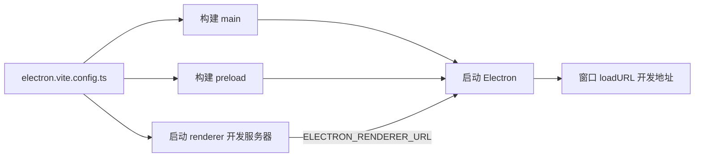

# electron-vite 工程

一个 Electron 应用至少要构建三份东西：跑在 Node 里的主进程、跑在渲染进程隔离世界里的 preload、跑在 Chromium 里的页面。它们的目标环境、模块格式、热更新方式都不一样。这一章讲怎么用 electron-vite 把三份构建收进一份配置，以及唱片墙在工程上踩过、写进注释里的那些坑。

## 为什么需要专门的构建工具

如果只用 Vite，你能得到一个很好的渲染进程开发体验，但主进程和 preload 还得另想办法：用 `tsc` 编译、用 esbuild 打包、写脚本在文件变化时重启 Electron。早年的模板普遍是「Vite + 一堆 npm scripts + nodemon」拼起来的。

electron-vite 把这件事标准化了：

| 产物 | 目标环境 | 开发时 | 构建产物 |
|---|---|---|---|
| main | Electron 内置的 Node | 打包一次，Electron 加载 | `out/main/index.js` |
| preload | 渲染进程（Node 能力取决于沙箱） | 打包一次 | `out/preload/index.js` |
| renderer | Chromium | Vite 开发服务器，HMR | `out/renderer/index.html` + 资源 |

它在开发时做三件事：打包 main 和 preload、启动渲染进程的 Vite 开发服务器、把服务器地址通过环境变量 `ELECTRON_RENDERER_URL` 传给 Electron 并启动它。



> [!WARNING]
> 本章按 electron-vite 5 整理（唱片墙用的是 `electron-vite@5.0.0` 配 `vite@7`），electron-vite 的大版本之间配置项和默认行为有变化；升级前以 electron-vite 官方文档的迁移说明为准。

## 目录约定

electron-vite 默认约定的结构，唱片墙原样采用：

```text
apps/desktop/
├── electron.vite.config.ts
├── electron-builder.yml
├── package.json            # "main": "out/main/index.js"
├── tsconfig.node.json      # main + preload + shared
├── tsconfig.web.json       # renderer + shared
├── resources/icon.png
└── src/
    ├── main/index.ts
    ├── preload/index.ts
    ├── renderer/
    │   ├── index.html
    │   └── src/main.tsx
    └── shared/bridge.ts    # 三方共用的类型
```

`src/shared/` 不是 electron-vite 的约定，是唱片墙自己加的：放桥接口的类型和常量（如协议名 `SCHEME`），主进程、preload、渲染进程都从这里 import。它只能放**纯类型和纯常量**，不能 import `electron` 或 `node:fs`，否则渲染进程那一份会打包失败。

## 最小配置，和一个隐蔽的坑

唱片墙的配置去掉注释后是这样：

```ts
// electron.vite.config.ts
import react from "@vitejs/plugin-react";
import { defineConfig } from "electron-vite";

export default defineConfig(({ mode }) => {
  gate(mode); // 出包闸门，后面讲
  return {
    main: {},
    preload: {},
    renderer: {
      plugins: [react()],
      resolve: { dedupe: ["react", "react-dom"] },
      optimizeDeps: { exclude: ["youtubei.js"] },
      server: { port: 5273, strictPort: true },
    },
  };
});
```

`main: {}` 和 `preload: {}` 看起来什么都没配，能不能删？**不能**。注释里记着踩过的坑：省掉这两个键，electron-vite 只构建渲染进程，`out/main` 和 `out/preload` 悄悄留着上一次的产物。应用照样能启动、看起来一切正常，你却在拿一份旧的主进程做验证。这类「不报错的错」最耗时间，所以要写注释防止后人「清理」掉它。

其余几项：

- `dedupe`：workspace 里 `packages/core` 的 devDependencies 也有一份 React。版本一致时是同一个文件，钉一下防止哪天版本岔开，出现两份 React、hooks 报错
- `optimizeDeps.exclude`：某个依赖内部有循环引用，又被两个入口同时引用，Vite 开发时的依赖预打包拆出的公共块初始化顺序会乱，症状是 `Class extends value undefined`。排除预打包即可。这种问题只在开发时出现，生产构建不受影响
- `strictPort`：这台机器上别的项目常年占着 Vite 默认的 5173，撞了 Vite 会悄悄换端口，而本地的启动配置认的是固定端口。宁可启动失败，也不要悄悄换

## 依赖：为什么一个 dependencies 都没有

唱片墙的 `package.json` 里**所有包都在 devDependencies**，包括 React、`@recordwall/core`。这违反直觉，原因是两个工具都会读 `dependencies`：

1. **electron-vite** 默认把 `dependencies` 里的包当作外部模块，不打进 main / preload，留给运行时的 Node 去 `require`（早期版本需要手动加 `externalizeDepsPlugin`，新版本默认如此）。而 `@recordwall/core` 是 workspace 里的 TS 源码包，不带后缀的导入 Node 不认，主进程一启动就 `ERR_MODULE_NOT_FOUND`
2. **electron-builder** 会把 `dependencies` 连同整棵依赖树复制进 `.app`

既然三份产物都已经把需要的代码打包进去了，运行时根本不需要 `node_modules`，那就全放 devDependencies。打出来的包里只有 `out/` 和 `package.json`。

什么时候不能这么做？**有原生模块时**（如 `better-sqlite3`）。原生模块是编译好的 `.node` 二进制，打包器处理不了，必须留在 `dependencies` 里外部化，并在打包时针对 Electron 的 Node ABI 重编（electron-builder 的 `npmRebuild`，或 `@electron/rebuild`）。唱片墙没有原生模块，所以在 `electron-builder.yml` 里写了 `npmRebuild: false`。

| 情况 | 放哪儿 | 是否外部化 |
|---|---|---|
| 纯 JS 依赖、workspace 源码包 | devDependencies | 否，打进产物 |
| 原生模块 | dependencies | 是，打包时重编 |
| 只有渲染进程用的依赖 | 都可以，渲染进程总是全量打包 | 否 |

## 两份 tsconfig

主进程和渲染进程的类型环境不同：前者有 `node:fs`、`process`，后者有 `window`、`document`。混在一个 tsconfig 里，渲染进程的代码写 `process.env` 也不会报错，到运行时才炸。

```json
// tsconfig.node.json：main + preload + shared
{
  "compilerOptions": {
    "target": "ES2022",
    "lib": ["ES2022", "DOM", "DOM.Iterable"],
    "module": "preserve",
    "moduleResolution": "bundler",
    "strict": true,
    "noEmit": true,
    "types": ["node", "electron-vite/node"]
  },
  "include": ["electron.vite.config.ts", "src/main", "src/preload", "src/shared"]
}
```

```json
// tsconfig.web.json：renderer + shared
{
  "compilerOptions": {
    "target": "ES2022",
    "lib": ["ES2022", "DOM", "DOM.Iterable"],
    "module": "preserve",
    "moduleResolution": "bundler",
    "jsx": "react-jsx",
    "strict": true,
    "noEmit": true,
    "types": ["vite/client"]
  },
  "include": ["src/renderer", "src/shared"]
}
```

node 那份也带 `DOM`，因为 preload 和页面在同一个进程里，也能看到 DOM。`types` 要显式写死：在 pnpm `shamefully-hoist` 的布局下，全仓的 `@types/*` 都被提到根目录，不写死会全部收进来。

类型检查脚本两份都跑：

```json
{
  "scripts": {
    "dev": "electron-vite dev",
    "build": "electron-vite build",
    "typecheck": "tsc --noEmit -p tsconfig.node.json && tsc --noEmit -p tsconfig.web.json"
  }
}
```

## 环境变量：前缀决定进哪个进程

electron-vite 按前缀把 `.env*` 文件里的变量内联到不同产物：

| 前缀 | 注入到 |
|---|---|
| `MAIN_VITE_` | 只有 main |
| `PRELOAD_VITE_` | 只有 preload |
| `RENDERER_VITE_` | 只有 renderer |
| `VITE_` | 全部三个 |

唱片墙的曲库地址和只读令牌用 `MAIN_VITE_` 前缀，**只进主进程那份产物**。如果写成 `VITE_`，渲染进程的 `import.meta.env` 里也会有它，打开 DevTools 就能看到。

类型声明放在 `src/main/env.d.ts`：

```ts
/// <reference types="electron-vite/node" />

interface ImportMetaEnv {
  readonly MAIN_VITE_VAULT_URL?: string;
  readonly MAIN_VITE_VAULT_READ_TOKEN?: string;
}
```

记住：这些变量是**构建时内联**的，不是运行时读的。改了 `.env` 要重新启动 `dev` 或重新构建。

## 出包闸门：用同一份来源校验

正式包必须带令牌，且不能带着一个指向本机的曲库地址（否则装上一打开什么都没有，也不报错）。唱片墙在配置文件里加了一道闸门：

```ts
import { loadEnv } from "electron-vite";

function gate(mode: string): void {
  if (mode !== "production") return;
  const env = loadEnv(mode, process.cwd(), "MAIN_VITE_");
  const wrong: string[] = [];
  if (!env.MAIN_VITE_VAULT_READ_TOKEN?.trim()) wrong.push("缺只读令牌");
  if (env.MAIN_VITE_VAULT_URL !== undefined) wrong.push("正式包不许设曲库地址");
  if (wrong.length) throw new Error(`出不了正式包：\n  ${wrong.join("\n  ")}`);
}
```

关键在 `loadEnv`：它读取的文件名单（`.env`、`.env.local`、`.env.production`、`.env.production.local`，加上 shell 里 export 的变量）和真正内联进包的是**同一份来源**。手机端踩过的坑是闸门自己拼了一份文件名单，和打包工具实际读的对不上，结果令牌配好了被判成没配，而混进来的地址反倒没看见。**校验逻辑必须和被校验的东西读同一份输入**。

## 开发体验

### 主进程改了要重启

渲染进程有 HMR，main 和 preload 没有。默认情况下改了主进程代码要手动重启 `dev`。electron-vite 提供 `--watch`（`-w`）参数，main / preload 变化时自动重新构建并重启 Electron：

```bash
pnpm exec electron-vite dev --watch
```

### 调试

- 渲染进程：窗口里开 DevTools（`win.webContents.openDevTools()`，或菜单快捷键）
- 主进程：`electron-vite dev --inspect`，再用 Chrome 的 `chrome://inspect` 或编辑器附加
- 自动化验证：唱片墙在设了 `RECORDWALL_CDP_PORT` 时追加 `remote-debugging-port` 开关，外部脚本通过 Chrome DevTools Protocol 钻进渲染进程执行表达式、截图。这让编码 agent 也能验证桌面端的改动，而不只是「编译通过」

```ts
const CDP_PORT = process.env.RECORDWALL_CDP_PORT;
if (CDP_PORT) app.commandLine.appendSwitch("remote-debugging-port", CDP_PORT);
```

这个开关必须在 `app.ready` 之前设置，而且只该在开发时用：调试端口开着时，本机任何程序都能控制你的页面。

### 安装 Electron 二进制

> [!WARNING]
> pnpm 是否默认执行安装脚本、放行名单的配置名和位置按截至 2026 年的 pnpm 10 整理（唱片墙仓库仍在 pnpm 9.15，默认会执行安装脚本），以 pnpm 官方文档和发布说明为准。

`electron` 这个 npm 包在 postinstall 阶段下载对应平台的二进制。pnpm 10 起默认不执行依赖的安装脚本，需要显式允许，否则会得到「Electron failed to install correctly」：

```yaml
# pnpm-workspace.yaml（pnpm 10）
onlyBuiltDependencies:
  - electron
```

国内网络下载慢时，可以设 `ELECTRON_MIRROR` 环境变量指向镜像。

## 本章要点

- electron-vite 用一份配置构建 main / preload / renderer 三份产物，开发时通过 `ELECTRON_RENDERER_URL` 把开发服务器交给窗口
- `main: {}`、`preload: {}` 不能省，省了会悄悄用旧产物
- 没有原生模块时，**全部依赖放 devDependencies**：都打进产物，`.app` 里不带 `node_modules`
- 主进程和渲染进程各一份 tsconfig，`types` 写死
- 环境变量按前缀进不同产物，密钥用 `MAIN_VITE_`；它们是构建时内联的
- 出包闸门用 `loadEnv`，和打包读同一份来源
- 主进程改动用 `--watch` 自动重启；CDP 调试端口只在开发时开
