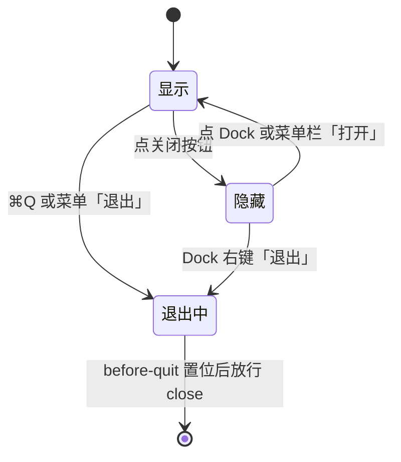
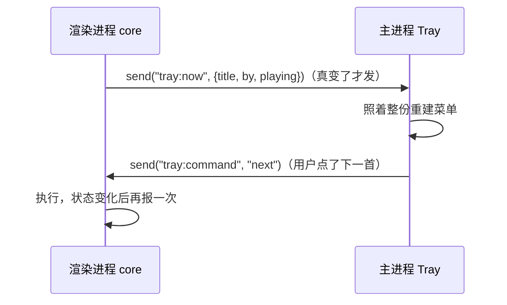

# 原生能力与系统集成

用 Electron 而不是做一个网页，图的就是「像个真正的桌面应用」：菜单栏图标、关窗后继续放歌、钥匙串、文件放在系统规定的位置、媒体键能用。这一章逐个讲唱片墙用到的系统集成，以及每一个背后的取舍；最后补上几个常用但唱片墙没用到的能力。API 以 Electron 44 为准，案例只做 macOS。

## 窗口生命周期：关窗不等于退出

macOS 用户的习惯是：点红色关闭按钮只是关掉窗口，应用还在 Dock 里；⌘Q 才是退出。对音乐播放器来说更进一步：**关窗后歌要接着放**。

难点在于，唱片墙的播放器（core 和 `<audio>`）都在主窗口的渲染进程里，窗口真的销毁了，歌就停了。所以「关窗」必须改成「藏起来」：

```ts
let quitting = false;
app.on("before-quit", () => { quitting = true; });

win.on("close", (e) => {
  if (quitting) return;          // 真退出：放行
  e.preventDefault();            // 否则只是藏起来
  if (win.isFullScreen()) {
    win.once("leave-full-screen", () => win.hide());
    win.setFullScreen(false);    // 全屏时直接藏，会留下一块黑色桌面
  } else {
    win.hide();
  }
});

win.on("closed", () => app.quit());
app.on("activate", () => { win.show(); win.focus(); }); // 点 Dock 图标拿回来
```



几个细节：

- ⌘Q、Dock 右键退出、菜单里 `role: "quit"` 的项，都会先触发 `before-quit`，在那里记一个标志，`close` 处理函数看到标志就放行
- 退出靠主窗口的 `closed` 事件调 `app.quit()`，**不靠 `window-all-closed`**：唱片墙还有一扇不显示的源站窗，它也算一扇窗，靠 `window-all-closed` 的话应用会一直挂着
- `backgroundThrottling: false`：窗口隐藏时 Chromium 默认会节流定时器（降到每秒一次，时间长了更慢）。core 的看门狗和播放状态节拍是按 500ms 调的，被节流后一首放完要等很久才接下一首。代价是隐藏时多耗一点电，对播放器是值得的
- 创建窗口时 `show: false`，等 `ready-to-show` 再显示，并把 `backgroundColor` 设成和页面底色一致，避免开窗瞬间闪白

### 只允许一个实例

大多数桌面应用不希望用户双击两次开出两个进程（两个进程同时写同一份数据会出问题）：

```ts
if (!app.requestSingleInstanceLock()) {
  app.quit();
} else {
  app.on("second-instance", () => { main?.show(); main?.focus(); });
}
```

## 菜单栏图标（Tray）

唱片墙在 macOS 菜单栏放了一个唱片图标，菜单里是正在放的歌名、放 / 暂停、上一首、下一首、打开、退出。

### 模板图

macOS 菜单栏的图标应该是**模板图**（template image）：系统只看 alpha 通道，按菜单栏深浅自动上色。用 `nativeImage` 的 `setTemplateImage(true)`，或者文件名以 `Template` 结尾（如 `trayTemplate.png`、`trayTemplate@2x.png`）。

唱片墙更进一步：不带图片文件，**在主进程里当场画**一张 36×36 的位图（18pt 的 2 倍），按同心圆环计算每个像素的覆盖率作为 alpha，4×4 超采样抗锯齿，再 `nativeImage.createFromBitmap(buf, { width: 36, height: 36, scaleFactor: 2 })`。少一份资源文件，也不用操心路径。

### 状态只有一份

托盘菜单要显示「正在放什么」，但播放状态只在渲染进程的 core 里。正确的做法是**主进程不另记一套**：



主进程只是一个「照着画」的视图，命令也转回 core 执行。这样就不会出现托盘显示「暂停」、界面显示「播放」的不一致。菜单项不多，每次整份 `Menu.buildFromTemplate` 重建，比逐项改 `enabled` / `label` 更不容易出错。

## 自定义协议

``、`<audio src>` 有两个限制：没法给请求挂自定义头（比如 `Authorization`），开发时页面是 `http://localhost`，也读不了 `file://`。唱片墙注册了一个 `recordwall://` 协议解决这两个问题：

- `recordwall://local/<区>/<文件名>`：本机文件
- `recordwall://vault/<键>`：曲库里的对象，令牌由主进程挂上

### 注册：两步，时机不同

```ts
import { protocol, net } from "electron";

// 第一步：必须在 app ready 之前
protocol.registerSchemesAsPrivileged([
  { scheme: "recordwall",
    privileges: { standard: true, secure: true, supportFetchAPI: true, stream: true } },
]);

// 第二步：ready 之后挂处理函数
app.whenReady().then(() => {
  protocol.handle("recordwall", (request) => serve(request));
});
```

`protocol.handle` 接收一个标准的 `Request`、返回 `Response`（Electron 25 引入，取代了旧的 `registerFileProtocol` 等一组 API）。各个特权的含义：

| 特权 | 作用 |
|---|---|
| `standard` | 按标准 URL 解析（有 host、可以用相对路径） |
| `secure` | 被视为安全来源，和 `https:` 同等对待 |
| `supportFetchAPI` | 页面可以 `fetch("recordwall://...")` |
| `stream` | 支持流式响应；`<audio>` 拖进度依赖它，否则会整段读完才开始吐数据 |

### 安全：白名单，而不是「把路径拼上去」

自定义协议很容易变成一个「能读任意文件」的口子。唱片墙的 `serve` 只认两种 host，`local` 下只认 core 定义的那几个区，文件名不能含 `/`、不能以 `.` 开头，其余一律 404：

```ts
if (url.host === "local") {
  const [area, name] = parts;
  const all = roots();
  if (parts.length !== 2 || !area || !name || !(area in all)
      || name.includes("/") || name.startsWith(".")) {
    return new Response("not found", { status: 404 });
  }
  return local(path.join(all[area], name), request.headers.get("range"));
}
```

### Range 要自己处理

`<audio>` 开始播放和每次拖动进度，都会带 `Range: bytes=...` 请求。用 `net.fetch("file://...")` 转发不保证支持这个头，不支持的话每拖一下都从头读，连时长都报不出来。所以唱片墙对本地文件自己解析 Range，返回 `206 Partial Content` 和正确的 `Content-Range`，越界返回 416。`bytes=100-`（从 100 到末尾）和 `bytes=-500`（最后 500 字节）两种写法都要处理。

## 钥匙串：safeStorage

需要在本机保存密码、令牌时，不要明文写文件。`safeStorage` 用操作系统的凭据存储加密（macOS 上是钥匙串，Windows 上是 DPAPI，Linux 上取决于桌面环境的密钥服务），只在主进程可用：

```ts
import { safeStorage } from "electron";

function save(file: string, value: string): void {
  if (!safeStorage.isEncryptionAvailable()) throw new Error("系统加密不可用");
  fs.mkdirSync(path.dirname(file), { recursive: true, mode: 0o700 });
  fs.writeFileSync(file, safeStorage.encryptString(value), { mode: 0o600 });
}

function load(file: string): string | null {
  if (!fs.existsSync(file)) return null;
  return safeStorage.decryptString(fs.readFileSync(file));
}
```

> [!WARNING]
> 上面的同步写法按 Electron 44 整理。按 2026 年 11 月 Electron 官方 Breaking Changes 页面，Electron 45 把 `isEncryptionAvailable`、`encryptString`、`decryptString` 标为弃用，计划在 46 移除，改用 `isAsyncEncryptionAvailable()`、`encryptStringAsync()`、`decryptStringAsync()`（后者返回 `{ result, shouldReEncrypt }`）；用同步方法加密的数据可以用异步方法解密。升级前以所用版本的 `safeStorage` API 文档为准。

唱片墙把发布者的口令这样存在 `Application Support/唱片墙/secrets/` 下，目录 700、文件 600：虽然是密文，也没必要让同一台电脑上的其他用户拿去慢慢试。

注意：macOS 钥匙串按**代码签名**识别应用。签名身份变了（比如从 ad-hoc 换成开发者证书），之前加密的数据可能需要用户重新授权或无法解密。这是第 6 章要强调签名一致性的原因之一。

## 文件放在哪儿

| 数据 | macOS 位置 | 获取方式 |
|---|---|---|
| 长期数据（数据库、设置、下载的歌） | `~/Library/Application Support/<应用名>` | `app.getPath("userData")` |
| 可丢的缓存 | `~/Library/Caches/<应用名>` | Electron 的 `getPath` 没有这一项，自己拼 |
| 日志 | `~/Library/Logs/<应用名>` | `app.getPath("logs")` |
| 用户文档 | `~/Documents` | `app.getPath("documents")` |

唱片墙按「区」分：`state`、`audio`、`covers`、`lyrics` 进 Application Support，`stream`、`up` 等缓存进 Caches。分开的意义是系统或清理工具可以放心清缓存，而不会删掉用户下载的歌。

两个工程细节：

- **开发和正式用不同目录**。唱片墙连的不是正式曲库时，调 `app.setPath("userData", ...)` 改成「唱片墙 开发」。不分开的话，开发时的测试歌、歌单会混进日常用的那个应用里，而且不报错。判断依据是**曲库地址**而不是「是否打过包」，因为验证用的本地包也该用开发那套。`setPath` 必须在 `ready` 之前调用
- **跨卷移动文件**：Caches 和 Application Support 可能不在同一个卷上，`rename` 会报 `EXDEV`，要退化成复制再删除
- 下载先写 `.part`，完成后改名；列目录时忽略 `.part`。断在一半也不会留下一个「看起来在」的半截文件

## 隐藏窗口：运行不可信脚本的沙盒

唱片墙要运行 YouTube 下发的两类脚本（签播放凭证、解取流地址签名）。这些脚本需要 `eval`，而且 Google 的接口只接受来自 youtube.com 的 CORS 请求。解决方案是主进程开一扇**不显示的窗口**：

```ts
const win = new BrowserWindow({
  show: false,
  webPreferences: { sandbox: true, contextIsolation: true, nodeIntegration: false },
});
await win.loadURL(`data:text/html;charset=utf-8,${encodeURIComponent(html)}`, {
  baseURLForDataURL: "https://www.youtube.com/",
});
const token = await win.webContents.executeJavaScript(`window.__mintToken(${JSON.stringify(id)})`);
```

- `baseURLForDataURL` 让这个 `data:` 页面的 origin 是 youtube.com，CORS 能通过
- 没有 preload、开了沙箱：脚本碰不到任何特权
- 主页面的 CSP 不用为此开 `unsafe-eval`
- `executeJavaScript` 返回 Promise，结果要能结构化克隆；外面再套一个超时，防止永远等下去
- 监听 `render-process-gone`，崩了就销毁，下次用时重建

这个模式适用于任何「必须跑、但不信任」的第三方代码。

## 媒体键：Media Session

键盘上的播放 / 上一首 / 下一首键，在 Electron 里最省事的接法是 Web 标准的 **Media Session API**，写在渲染进程里，不需要主进程的 `globalShortcut`：

```ts
navigator.mediaSession.metadata = new MediaMetadata({ title, artist, artwork: [{ src: cover }] });
navigator.mediaSession.setActionHandler("previoustrack", () => core.previous());
// 到队尾且不循环时传 null，把这颗键收起来
navigator.mediaSession.setActionHandler("nexttrack", core.hasNext() ? () => core.next() : null);
```

唱片墙没有接管播放 / 暂停：Chromium 默认会直接暂停 `<audio>`，core 再从「希望在放、实际停了」推断出用户按了暂停，和手机锁屏控制走同一条路径。系统的「正在播放」控制中心也会显示 metadata。

## 唱片墙没用到、但常用的能力

| 能力 | API | 要点 |
|---|---|---|
| 打开 / 保存对话框 | `dialog.showOpenDialog` / `showSaveDialog` | 只在主进程；返回路径后由主进程读写 |
| 拖入文件拿路径 | 页面里 `webUtils.getPathForFile(file)`（经 preload 暴露） | 旧的 `File.path` 已被移除 |
| 系统通知 | 页面里 `new Notification()` 或主进程 `Notification` | macOS 上未签名应用的通知可能不显示 |
| 深链接 `myapp://` | `app.setAsDefaultProtocolClient("myapp")`，macOS 监听 `open-url` | 要在 `Info.plist` 声明，electron-builder 的 `protocols` 配置会写 |
| 应用菜单 | `Menu.setApplicationMenu` | macOS 第一项是应用名菜单；用 `role` 获得系统标准行为（复制、粘贴、退出） |
| 全局快捷键 | `globalShortcut.register` | 退出前 `unregisterAll` |
| 阻止休眠 | `powerSaveBlocker.start("prevent-app-suspension")` | 长任务期间用，结束要 `stop` |
| 在访达中显示 | `shell.showItemInFolder` / `shell.openPath` | 唱片墙设置页「在访达里显示」用后者 |
| 开机启动 | `app.setLoginItemSettings({ openAtLogin: true })` | 尊重用户选择，默认不开 |

这些 API 的平台差异很多（Windows 的托盘点击行为、Linux 的通知实现…），只做一个平台时可以忽略，做多平台时每个都要在目标系统上实测。

## 本章要点

- 播放器类应用「关窗只藏起来」：`close` 里 `preventDefault` + `hide`，`before-quit` 置位后放行；隐藏窗口要关 `backgroundThrottling`
- 有隐藏窗口时，退出靠主窗口的 `closed`，不靠 `window-all-closed`
- 托盘图标用模板图；托盘只是视图，状态只在一处
- 自定义协议：`registerSchemesAsPrivileged` 在 ready 前，`protocol.handle` 在 ready 后；媒体要 `stream` 特权并自己处理 Range；路径必须白名单
- 密钥用 `safeStorage`，它依赖代码签名身份
- 长期数据和缓存分目录；开发和正式分目录
- 不可信脚本放进无 preload、开沙箱的隐藏窗口
- 媒体键优先用 Web 标准的 Media Session

## 动手练习

1. **隐藏窗口里的定时器被节流**：在页面里写 `let last = Date.now(); setInterval(() => { const now = Date.now(); console.log(now - last); last = now; }, 500);`，主进程里加一个托盘或菜单项调用 `win.hide()` / `win.show()`。打开 DevTools（单独窗口模式）后把窗口藏起来一两分钟，再拿回来看日志；然后给窗口加 `backgroundThrottling: false` 重来一次。

   验证：第一次藏起来期间打印的间隔明显大于 500（观察具体数值，常见是 1000 左右，时间长了可能更大）；关掉节流后一直在 500 附近。

   参考答案：Chromium 对隐藏页面的定时器节流，依赖定时器节拍的播放器会因此「一首放完很久才接下一首」，所以要显式关掉，代价是隐藏时多耗一点电。

2. **给自定义协议写 Range 和白名单**：按本章注册一个 `demo://local/<区>/<文件名>` 协议，只认 `audio` 一个区，自己解析 `Range` 返回 206。在页面 Console 里依次执行：`(await fetch('demo://local/audio/a.mp3', { headers: { Range: 'bytes=0-9' } }))` 看 `status` 和 `arrayBuffer()` 长度；把 Range 换成超过文件大小的 `bytes=99999999-`；最后请求 `demo://local/audio/..%2F..%2Fetc%2Fpasswd`。

   验证：第一个是 `206`、长度 `10`，响应头 `Content-Range` 形如 `bytes 0-9/<文件大小>`；第二个是 `416`；第三个是 `404`。

   参考答案：`<audio>` 拖进度靠 Range；文件名先解码再检查是否含 `/`、是否以 `.` 开头，任何不在白名单里的路径一律 404，而不是「把路径拼上去」。

3. **只允许一个实例**：在主进程加上 `requestSingleInstanceLock` 那段，用 `electron-builder --mac --dir` 打出 `.app` 后，在终端连续运行两次 `open -n <App>.app`。

   验证：只剩一个进程（`pgrep -fl <App名>` 看主进程只有一个），第二次打开时第一个实例的窗口被拿到前台。去掉这段再试，会看到两个独立的实例。

   参考答案：拿不到锁的第二个进程直接 `quit`，第一个进程通过 `second-instance` 事件得知有人想打开它；避免两个进程同时写同一份数据。
