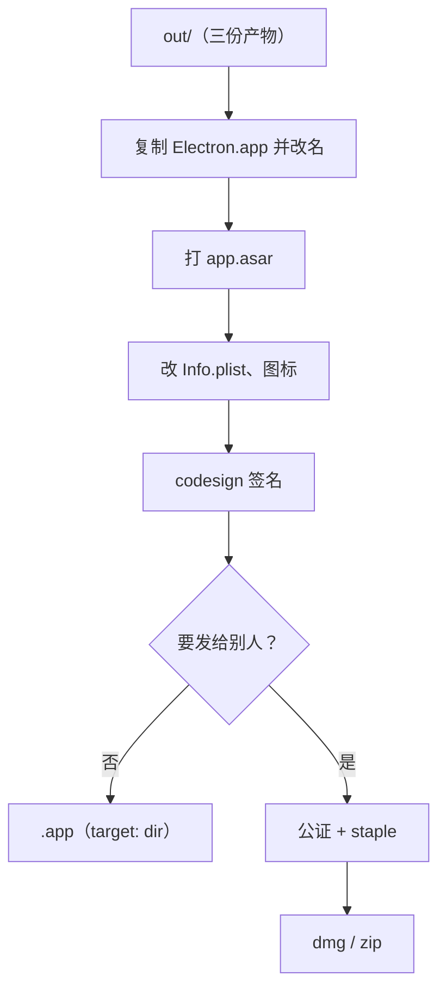
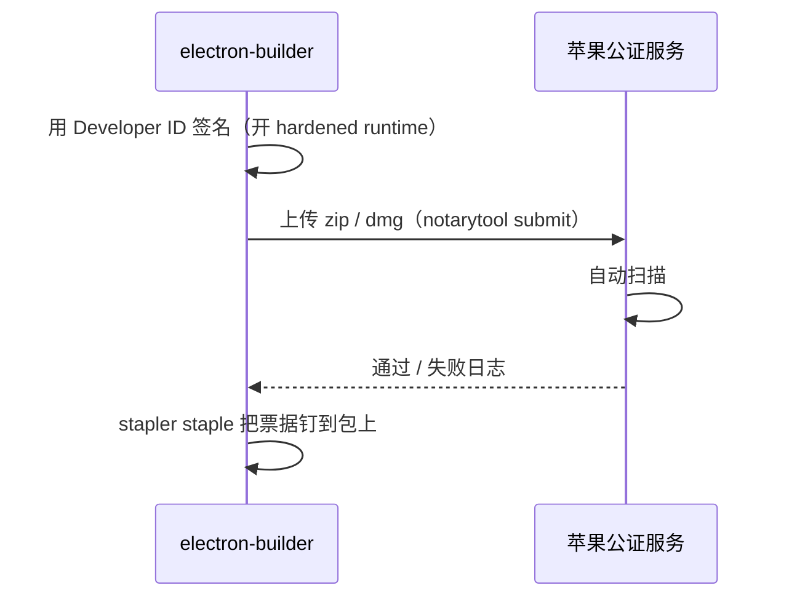

# 打包、签名与公证

`electron-vite build` 产出的只是三份 JS。要变成一个能双击打开、能拖进「应用程序」、能发给别人的 `.app`，还要经过打包、签名，发给别人时还要公证。这一章先讲唱片墙「只给自己用」的最短路径：electron-builder + ad-hoc 签名；再讲发给别人时要补的开发者证书和公证。Windows 和 Linux 只简要提及。

## electron-builder 做了什么

electron-builder 拿到你的构建产物后：

1. 复制一份 Electron 预编译的 `Electron.app`，改名成你的应用名
2. 把你的代码（`out/`、`package.json`）打成 `app.asar` 放进 `Contents/Resources/`
3. 改写 `Info.plist`（应用名、Bundle ID、版本、图标、URL scheme）
4. 生成 `.icns` 图标
5. 签名（以及按配置公证）
6. 按 target 产出 `dir`（只是 `.app` 目录）、`dmg`、`zip`、`pkg` 等



本章以 electron-builder 26 为准（唱片墙用的是 `26.15.3`）。

## 唱片墙的配置

```yaml
# electron-builder.yml
appId: com.hatch.recordwall.desktop
productName: 唱片墙
directories:
  output: release
  buildResources: resources
files:
  - out/**
  - "!out/**/*.map"
npmRebuild: false
electronLanguages: [zh_CN, en]
mac:
  target:
    - target: dir
      arch: arm64
  category: public.app-category.music
  icon: resources/icon.png
  identity: "-"
  hardenedRuntime: false
```

逐项说明：

| 配置 | 为什么 |
|---|---|
| `files: out/**` | 运行时只需要三份产物，不带 `node_modules`（第 4 章：全部依赖在 devDependencies） |
| `!out/**/*.map` | source map 不进包 |
| `npmRebuild: false` | 没有原生模块，别让它去重编 |
| `electronLanguages` | Electron 自带几十种语言的资源，只留用得到的两种，包会小一些 |
| `target: dir`、`arch: arm64` | 只给自己的苹果芯片电脑用，不做 dmg，不做 Intel 版 |
| `identity: "-"` | ad-hoc 签名，下一节讲 |
| `hardenedRuntime: false` | 和 ad-hoc 签名搭配，下一节讲 |

打包命令：

```json
{
  "scripts": {
    "app": "electron-vite build && electron-builder --dir",
    "app:local": "electron-vite build --mode development && electron-builder --dir --config electron-builder.local.yml"
  }
}
```

产物在 `release/mac-arm64/唱片墙.app`，拖进「应用程序」就算装好了。

### 两个包同时装着

`app:local` 打一个连本机曲库的验证包，用来验证整条出包链路。它通过 `extends` 继承主配置，只改两样：

```yaml
# electron-builder.local.yml
extends: ./electron-builder.yml
appId: com.hatch.recordwall.desktop.local
productName: 唱片墙 开发
```

**`appId` 不同**，macOS 才把它们当成两个应用（偏好设置、钥匙串条目、通知权限各算各的）；**`productName` 不同**，两个 `.app` 才能同时放在「应用程序」里。再加上第 5 章讲的按曲库地址分数据目录，开发包和日常包彻底互不干扰。

### 包有多大

每个 Electron 应用都带一整份 Chromium 和 Node，这是它体积的大头。想知道自己的包里都是什么：

```bash
du -sh release/mac-arm64/*.app
du -sh release/mac-arm64/*.app/Contents/Frameworks/*
du -sh release/mac-arm64/*.app/Contents/Resources/app.asar
npx @electron/asar list release/mac-arm64/*.app/Contents/Resources/app.asar | head
```

通常 `Electron Framework.framework` 占绝大部分，`app.asar` 只是零头。如果 asar 意外很大，多半是 `node_modules` 被带进去了，回头检查 `files` 和 `dependencies`。

## macOS 签名：为什么不能不签


### 不签名为什么不行

直觉上「只给自己用，不签名就好」，但 Electron 应用不行：

- 苹果芯片的 Mac 要求所有原生代码至少有一个签名
- 下载下来的 `Electron.app` 本身带着 Electron 官方的签名，签名封住了整个包的内容
- electron-builder 改了 `Info.plist`、塞进了 `app.asar`，这个签名就**坏了**

坏签名比没签名更糟：`codesign --verify` 失败，系统随时可能杀掉进程。`@electron/fuses` 的 README 也写明了同一件事：苹果芯片上改过二进制后不重新签名，应用会因签名校验错误拒绝启动。「系统随时可能杀掉」是按苹果「arm64 原生代码必须签名」的规则推断的，具体表现（启动即被拒，还是加载某个库时才被杀）随系统版本不同。钥匙串（`safeStorage`）也按签名识别应用。唱片墙的配置注释里写的就是这件事。

### ad-hoc 签名

ad-hoc 签名（`identity: "-"`）不需要任何证书，相当于「用这个包的内容哈希签个名」。它让签名重新完整、本机能稳定运行，但：

- 只在这台电脑上算数：别的 Mac 打开时 Gatekeeper 会拦，要到「系统设置 → 隐私与安全性」里手动放行
- 每次重新打包，签名身份（内容哈希）都会变，钥匙串可能重新询问授权
- 不能用于自动更新（第 7 章）

### 为什么关掉 hardened runtime

hardened runtime（强化运行时）是公证的前提，它会限制 JIT、动态加载未签名代码等行为。开了它，所有加载的库都要通过库校验；ad-hoc 签名下 Electron 框架里的几份库过不了，应用起不来（electron-builder 自己也会给出警告）。所以 **ad-hoc 就关 hardened runtime，要公证就开**，二者是成对的选择。

### 验证签名

```bash
# 签名是否完整
codesign --verify --deep --strict --verbose=2 "release/mac-arm64/唱片墙.app"

# 看签名身份（ad-hoc 会显示 Signature=adhoc）
codesign -dv "release/mac-arm64/唱片墙.app"

# Gatekeeper 会怎么判断
spctl --assess --type execute -vv "release/mac-arm64/唱片墙.app"
```

ad-hoc 签名的包在 `spctl` 那一步会被判为 rejected，这是预期的：它本来就不是给 Gatekeeper 看的。

## 发给别人：开发者证书 + 公证

要让别人下载后直接双击打开，需要两样东西：

1. **Developer ID Application 证书**：加入 Apple Developer Program（个人即可，按年付费，价格以苹果官网为准），在开发者后台生成，导入钥匙串
2. **公证**（notarization）：把签好名的包上传给苹果，苹果自动扫描（不是人工审核）后发回一张「票据」，再 **staple**（钉）到包上，用户离线也能验证

公证的流程大致是：



### 配置

> [!WARNING]
> 本节的 `notarize` 配置写法和公证、签名用的环境变量名按 2026 年 11 月 electron-builder 26（对照 `app-builder-lib@26.18.0` 的源码和类型注释、`@electron/notarize` 的 README）整理，这些键名在不同版本间有过调整（早期版本的 `notarize` 是对象而非布尔值；正在预发布的 27 把 `hardenedRuntime`、`entitlements` 挪到了 `mac.sign` 下）；以你所用版本的 electron-builder 官方文档和 changelog 为准。

```yaml
# electron-builder.yml（发布版）
mac:
  target:
    - target: dmg
      arch: [arm64, x64]
    - target: zip          # 自动更新要用 zip
      arch: [arm64, x64]
  hardenedRuntime: true
  notarize: true
  # identity 不写时，electron-builder 自动在钥匙串里找 Developer ID Application 证书
```

公证需要的凭据通过环境变量给，**不要写进配置文件或仓库**。electron-builder 支持两种方式：

| 方式 | 环境变量 |
|---|---|
| App Store Connect API Key（推荐，适合 CI） | `APPLE_API_KEY`（.p8 文件路径）、`APPLE_API_KEY_ID`、`APPLE_API_ISSUER` |
| Apple ID + App 专用密码 | `APPLE_ID`、`APPLE_APP_SPECIFIC_PASSWORD`、`APPLE_TEAM_ID` |
| 钥匙串里存好的 notarytool 凭据（适合本机） | `APPLE_KEYCHAIN_PROFILE`，可选 `APPLE_KEYCHAIN` |

在 26 里，**触发公证的是这些环境变量**，不是 `notarize: true`：检测到任意一组凭据就公证，同一组缺一个变量直接报错；一组都没有时打一条警告、跳过公证；只有显式写 `notarize: false` 才会在有凭据时也跳过。所以配置里的 `notarize: true` 主要是表明意图，CI 上要确认构建日志里出现了 `notarization successful`，而不是只看构建成功。`APPLE_API_KEY` 在 26 里原样交给 `@electron/notarize`，按后者的文档填 `.p8` 文件的绝对路径；electron-builder 文档站上 v26 的公证页写的是 base64 内容，和 26.18 的源码对不上，以你所用版本实测为准。

在 CI 上签名时，证书本身用 `CSC_LINK`（p12 文件的路径或 base64）和 `CSC_KEY_PASSWORD` 提供。

### entitlements

开了 hardened runtime 后，Electron 需要一些权限声明（entitlements），比如允许 V8 的 JIT。electron-builder 自带一份默认的 entitlements 文件，大多数应用够用。如果你的应用要用麦克风、摄像头，还要加对应的 entitlement，并在 `extendInfo` 里写 `NSMicrophoneUsageDescription` 这类说明文字，否则系统会直接拒绝。

### 公证后验证

```bash
xcrun stapler validate "dist/MyApp.app"
spctl --assess --type execute -vv "dist/MyApp.app"   # 应显示 source=Notarized Developer ID
```

## Windows 和 Linux 简述

| 平台 | 签名要求 | 不签名的后果 |
|---|---|---|
| Windows | 代码签名证书（OV / EV），或云签名服务 | SmartScreen 警告「Windows 已保护你的电脑」，用户要点「仍要运行」 |
| Linux | 一般不要求 | AppImage、deb、rpm 各有分发习惯，Snap / Flatpak 商店有自己的签名流程 |

Windows 证书的获取方式、价格和 SmartScreen 信誉规则近几年变化较多，下一节单独讲。

## Windows 代码签名

> [!WARNING]
> 本节按 2026 年 11 月的以下来源整理：Microsoft Learn 的「SmartScreen reputation for Windows app developers」和 Artifact Signing 文档（概览、快速入门、FAQ）、CA/Browser Forum 的 CSC-31 投票公告、`app-builder-lib@26.18.0` 的类型定义和源码。证书规则、Artifact Signing 的开放地区和价格都在变，以微软和你所选证书机构的最新说明为准。

### 这几年变了什么

如果你几年前做过 Windows 签名，下面几条已经不一样了：

| 变化 | 现在的情况 |
|---|---|
| 私钥存放 | CA/Browser Forum 的代码签名基线要求自 2023 年 6 月起，OV 证书的私钥也必须放在硬件里（USB 令牌或云端 HSM），不再发可以随手拷贝的 `.pfx` 文件 |
| EV 证书 | Microsoft Learn 写明：EV 证书**不再**让 SmartScreen 直接放行，只为绕过 SmartScreen 多付 EV 的钱已经不值得 |
| 有效期 | CA/Browser Forum CSC-31 投票通过：2026 年 3 月 1 日起签发的代码签名证书最长 460 天，以前是 39 个月 |
| 托管签名 | 微软的 Trusted Signing 已更名为 **Artifact Signing** 并正式可用（GA），官方说只是改名，功能不变 |

SmartScreen 现在看两样东西：发布者证书的信誉和这个文件哈希的信誉。不管 OV 还是 EV，新证书签出来的新文件一开始都会提示「无法识别的应用」，只是会显示经过验证的发布者名称；下载量多了、没有异常行为，提示才会消失。微软文档说没有固定门槛，可能要几周、几百次来自不同用户的干净安装。**同一个身份持续签名**，信誉才能延续到新版本；不签名的文件每个版本都从零开始。Windows 11 的「智能应用控制」开着时，没签名又没信誉的文件会被直接拦下。

### 选哪种方式

| 方式 | 适合 | 要点 |
|---|---|---|
| Artifact Signing | 符合地区条件的个人或公司 | 按月付费（Learn 文档写的是每月 9.99 美元起），需要付费的 Azure 订阅；微软验证身份后托管证书，私钥不落到你手里，适合 CI；不签发 EV |
| 证书机构的 OV 证书 + 令牌或云 HSM | 不符合 Artifact Signing 地区条件的开发者 | 令牌插在本机签；要在 CI 签，选机构提供的云签名服务，用自定义签名函数接进来 |
| 上架 Microsoft Store | 能接受商店规则的应用 | 商店会用微软的证书重签，用户不会看到 SmartScreen 下载警告 |

Artifact Signing 的地区限制要先看清：按快速入门文档，公共信任证书只对美国、加拿大、欧盟、英国、澳大利亚、新西兰、日本、韩国、新加坡、瑞士、挪威、以色列的**组织**开放，**个人开发者**只限美国和加拿大。名单里没有中国大陆；在国内注册的个人或公司，目前要走证书机构的 OV 证书。身份验证需要 1 到 20 个工作日，资料对不上要重来，签名前留出时间。

### electron-builder 怎么配

electron-builder 26 的 `win` 下有两组互斥的签名配置：`signtoolOptions`（用 Windows 的 signtool 和你自己的证书）和 `azureSignOptions`（Artifact Signing）。

用 Artifact Signing：

```yaml
# electron-builder.yml
win:
  target: nsis
  azureSignOptions:
    publisherName: "Example Studio"            # 和证书上的名称一致
    endpoint: https://eus.codesigning.azure.net # 按账户所在区域
    codeSigningAccountName: example-signing
    certificateProfileName: example-public
```

认证用 Azure 的服务主体，通过环境变量给：`AZURE_TENANT_ID`、`AZURE_CLIENT_ID`、`AZURE_CLIENT_SECRET`，这个服务主体要在 Azure 里分配「Certificate Profile Signer」角色。electron-builder 26.18 在内部用 PowerShell 安装并调用名为 `TrustedSigning` 的模块（`Invoke-TrustedSigning`），配置项也还叫 `azureSignOptions`，改名还没传到这里；通常在 Windows 的 CI 机器上构建。

用证书机构的证书：

```yaml
win:
  target: nsis
  signtoolOptions:
    certificateSubjectName: "Example Studio"   # 证书在本机证书库里时，按名称找
    # certificateSha1: "<指纹>"                # 有多张证书时用指纹精确指定
    # sign: ./scripts/win-sign.cjs             # 机构的云签名服务，用自定义函数调用它的工具
    publisherName: "Example Studio"
```

证书若是 `.pfx` 文件（旧证书或私有信任场景），用环境变量 `CSC_LINK` / `CSC_KEY_PASSWORD`（只给 Windows 时用 `WIN_CSC_LINK` / `WIN_CSC_KEY_PASSWORD`），不要写进配置。

`publisherName` 不只是显示用。electron-updater 在 Windows 上安装更新前，会按它校验新安装包的签名（`verifyUpdateCodeSignature` 默认开启，见[第 7 章](07-auto-update.md#先决条件签名)）。**换证书、换签名方式时发布者名称要保持一致**，否则老用户的自动更新会因校验失败卡住。

签完在 Windows 上验证：

```powershell
signtool verify /pa /v .\release\MyApp-Setup-1.4.0.exe
Get-AuthenticodeSignature .\release\MyApp-Setup-1.4.0.exe | Format-List
```

## 一人公司的建议路径

| 阶段 | 做法 |
|---|---|
| 只给自己用 | ad-hoc + `target: dir`，像唱片墙这样，零成本 |
| 给几个朋友试用 | 还是 ad-hoc，附一句「到隐私与安全性里放行」；或直接上证书 |
| 公开分发、收费 | Developer ID + 公证 + dmg/zip + 自动更新，这时候年费已经是必要成本 |
| 上 Mac App Store | 另一套：`mas` target、App Sandbox、审核，限制多，先想清楚是否值得 |

唱片墙的 README 也写明了这条路径：ad-hoc 只在这台电脑上算数，要发给别人得换开发者证书、再公证，这是计划里还没做的一步。**不为「看起来完整」提前搭发布流水线**，等真需要时再做。

## 本章要点

- electron-builder 复制 Electron.app、塞进 `app.asar`、改 `Info.plist`、签名、产出 target
- `files` 只放构建产物；不同 `appId` + `productName` 让开发包和正式包共存
- Electron 应用**不能不签名**：改过的包会破坏 Electron 自带的签名
- 自用选 ad-hoc（`identity: "-"`）并关 hardened runtime；发布选 Developer ID + hardened runtime + 公证
- 公证凭据走环境变量，推荐 App Store Connect API Key；26 里有凭据就公证，日志里要看到公证成功
- Windows：私钥必须在硬件里，EV 不再让 SmartScreen 直接放行；符合地区条件用 Artifact Signing（`azureSignOptions`），否则用机构的 OV 证书（`signtoolOptions`），发布者名称保持不变
- 用 `codesign --verify`、`spctl --assess`、`stapler validate` 验证每一步
- 证书费用、变量名、平台规则都会变，以官方文档为准

## 动手练习

1. **包里不该有 node_modules**：在练习工程里配上本章的 `files: [out/**, "!out/**/*.map"]` 和 `identity: "-"`、`hardenedRuntime: false`、`target: dir`，打包后运行 `npx @electron/asar list <App>.app/Contents/Resources/app.asar | grep -c node_modules`，并用本章的 `du -sh` 几条命令看体积分布。然后把 `files` 改回默认（删掉这一项）、把 `react` 挪进 `dependencies` 重新打包，再看一次。

   验证：第一次计数为 `0`，`Electron Framework.framework` 占体积的绝大部分；第二次计数大于 `0`，`app.asar` 明显变大。

   参考答案：没有原生模块时，三份产物已经把依赖打进去了，运行时不需要 `node_modules`；asar 意外变大，先查 `files` 和 `dependencies`。

2. **亲手弄坏一个签名**：对上题 ad-hoc 签名的 `.app` 先跑 `codesign --verify --deep --strict --verbose=2 <App>.app`；再复制一份，用 `plutil -replace CFBundleShortVersionString -string 9.9.9 <副本>.app/Contents/Info.plist` 改一个字段后重跑；最后 `codesign --force --deep -s - <副本>.app` 重签再验证。

   验证：第一次显示 `valid on disk` 和 `satisfies its Designated Requirement`；改过之后验证失败，报签名与内容不符；重签后再次通过。`codesign -dv` 能看到 `Signature=adhoc`。

   参考答案：签名封住了整个包的内容，任何改动都会让它失效。这就是 electron-builder 改完 `Info.plist`、塞进 `app.asar` 之后必须重新签名的原因。

3. **给三个场景选签名方案**（分析题）：A. 只在自己的 MacBook 上用的番茄钟；B. 发给五个朋友试用两周的笔记工具，朋友都会按说明操作；C. 要在官网卖、带自动更新的剪贴板工具。每个场景说出签名方式、要不要 hardened runtime、产物 target。

   验证：对照本章「一人公司的建议路径」表格，并说清每个选择的理由。

   参考答案：A 用 ad-hoc + 关 hardened runtime + `dir`；B 仍可 ad-hoc，附上「到隐私与安全性里放行」的说明，嫌麻烦就上证书；C 必须 Developer ID + hardened runtime + 公证，产物 `dmg` 和 `zip`（自动更新要 zip），需要付费的开发者账号。条件翻转点：一旦需要自动更新或面向陌生用户，ad-hoc 就不够了。
