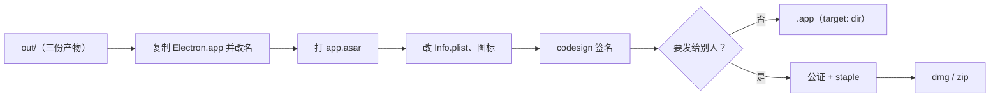
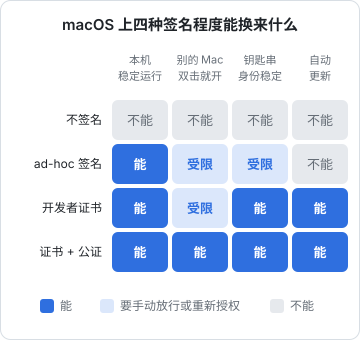
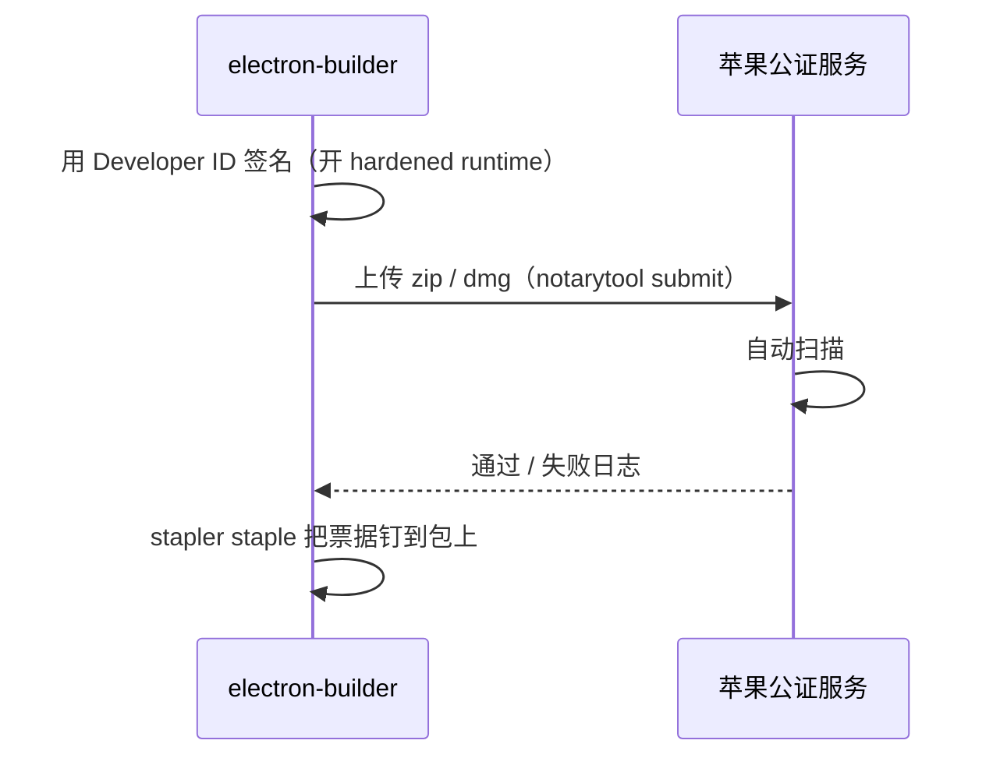

# 打包、签名与公证

`electron-vite build` 产出的只是三份 JS。要变成一个能双击打开、能拖进「应用程序」、能发给别人的 `.app`，还要经过打包、签名，发给别人时还要公证。这一章先讲唱片墙「只给自己用」的最短路径：electron-builder + ad-hoc 签名；再讲发给别人时要补的开发者证书和公证。Windows 和 Linux 只简要提及。

## electron-builder 做了什么

electron-builder 拿到你的构建产物后：

1. 复制一份 Electron 预编译的 `Electron.app`，改名成你的应用名
2. 把你的代码（`out/`、`package.json`）打成 `app.asar` 放进 `Contents/Resources/`
3. 改写 `Info.plist`（应用名、Bundle ID、版本、图标、URL scheme）
4. 生成 `.icns` 图标
5. 签名（以及按配置公证）
6. 按 target 产出 `dir`（只是 `.app` 目录）、`dmg`、`zip`、`pkg` 等



本章以 electron-builder 26 为准（唱片墙用的是 `26.15.3`）。

## 唱片墙的配置

```yaml
# electron-builder.yml
appId: com.hatch.recordwall.desktop
productName: 唱片墙
directories:
  output: release
  buildResources: resources
files:
  - out/**
  - "!out/**/*.map"
npmRebuild: false
electronLanguages: [zh_CN, en]
mac:
  target:
    - target: dir
      arch: arm64
  category: public.app-category.music
  icon: resources/icon.png
  identity: "-"
  hardenedRuntime: false
```

逐项说明：

| 配置 | 为什么 |
|---|---|
| `files: out/**` | 运行时只需要三份产物，不带 `node_modules`（第 4 章：全部依赖在 devDependencies） |
| `!out/**/*.map` | source map 不进包 |
| `npmRebuild: false` | 没有原生模块，别让它去重编 |
| `electronLanguages` | Electron 自带几十种语言的资源，只留用得到的两种，包会小一些 |
| `target: dir`、`arch: arm64` | 只给自己的苹果芯片电脑用，不做 dmg，不做 Intel 版 |
| `identity: "-"` | ad-hoc 签名，下一节讲 |
| `hardenedRuntime: false` | 和 ad-hoc 签名搭配，下一节讲 |

打包命令：

```json
{
  "scripts": {
    "app": "electron-vite build && electron-builder --dir",
    "app:local": "electron-vite build --mode development && electron-builder --dir --config electron-builder.local.yml"
  }
}
```

产物在 `release/mac-arm64/唱片墙.app`，拖进「应用程序」就算装好了。

### 两个包同时装着

`app:local` 打一个连本机曲库的验证包，用来验证整条出包链路。它通过 `extends` 继承主配置，只改两样：

```yaml
# electron-builder.local.yml
extends: ./electron-builder.yml
appId: com.hatch.recordwall.desktop.local
productName: 唱片墙 开发
```

**`appId` 不同**，macOS 才把它们当成两个应用（偏好设置、钥匙串条目、通知权限各算各的）；**`productName` 不同**，两个 `.app` 才能同时放在「应用程序」里。再加上第 5 章讲的按曲库地址分数据目录，开发包和日常包彻底互不干扰。

### 包有多大

每个 Electron 应用都带一整份 Chromium 和 Node，这是它体积的大头。想知道自己的包里都是什么：

```bash
du -sh release/mac-arm64/*.app
du -sh release/mac-arm64/*.app/Contents/Frameworks/*
du -sh release/mac-arm64/*.app/Contents/Resources/app.asar
npx @electron/asar list release/mac-arm64/*.app/Contents/Resources/app.asar | head
```

通常 `Electron Framework.framework` 占绝大部分，`app.asar` 只是零头。如果 asar 意外很大，多半是 `node_modules` 被带进去了，回头检查 `files` 和 `dependencies`。

## macOS 签名：为什么不能不签



### 不签名为什么不行

直觉上「只给自己用，不签名就好」，但 Electron 应用不行：

- 苹果芯片的 Mac 要求所有原生代码至少有一个签名
- 下载下来的 `Electron.app` 本身带着 Electron 官方的签名，签名封住了整个包的内容
- electron-builder 改了 `Info.plist`、塞进了 `app.asar`，这个签名就**坏了**

坏签名比没签名更糟：`codesign --verify` 失败，系统随时可能杀掉进程。钥匙串（`safeStorage`）也按签名识别应用。唱片墙的配置注释里写的就是这件事。

### ad-hoc 签名

ad-hoc 签名（`identity: "-"`）不需要任何证书，相当于「用这个包的内容哈希签个名」。它让签名重新完整、本机能稳定运行，但：

- 只在这台电脑上算数：别的 Mac 打开时 Gatekeeper 会拦，要到「系统设置 → 隐私与安全性」里手动放行
- 每次重新打包，签名身份（内容哈希）都会变，钥匙串可能重新询问授权
- 不能用于自动更新（第 7 章）

### 为什么关掉 hardened runtime

hardened runtime（强化运行时）是公证的前提，它会限制 JIT、动态加载未签名代码等行为。开了它，所有加载的库都要通过库校验；ad-hoc 签名下 Electron 框架里的几份库过不了，应用起不来（electron-builder 自己也会给出警告）。所以 **ad-hoc 就关 hardened runtime，要公证就开**，二者是成对的选择。

### 验证签名

```bash
# 签名是否完整
codesign --verify --deep --strict --verbose=2 "release/mac-arm64/唱片墙.app"

# 看签名身份（ad-hoc 会显示 Signature=adhoc）
codesign -dv "release/mac-arm64/唱片墙.app"

# Gatekeeper 会怎么判断
spctl --assess --type execute -vv "release/mac-arm64/唱片墙.app"
```

ad-hoc 签名的包在 `spctl` 那一步会被判为 rejected，这是预期的：它本来就不是给 Gatekeeper 看的。

## 发给别人：开发者证书 + 公证

要让别人下载后直接双击打开，需要两样东西：

1. **Developer ID Application 证书**：加入 Apple Developer Program（个人即可，按年付费，价格以苹果官网为准），在开发者后台生成，导入钥匙串
2. **公证**（notarization）：把签好名的包上传给苹果，苹果自动扫描（不是人工审核）后发回一张「票据」，再 **staple**（钉）到包上，用户离线也能验证

公证的流程大致是：



### 配置

> [!WARNING]
> 本节的 `notarize` 配置写法和公证、签名用的环境变量名按 electron-builder 26 整理，这些键名在不同版本间有过调整（早期版本的 `notarize` 是对象而非布尔值）；以你所用版本的 electron-builder 官方文档和 changelog 为准。

```yaml
# electron-builder.yml（发布版）
mac:
  target:
    - target: dmg
      arch: [arm64, x64]
    - target: zip          # 自动更新要用 zip
      arch: [arm64, x64]
  hardenedRuntime: true
  notarize: true
  # identity 不写时，electron-builder 自动在钥匙串里找 Developer ID Application 证书
```

公证需要的凭据通过环境变量给，**不要写进配置文件或仓库**。electron-builder 支持两种方式：

| 方式 | 环境变量 |
|---|---|
| App Store Connect API Key（推荐，适合 CI） | `APPLE_API_KEY`（.p8 文件路径）、`APPLE_API_KEY_ID`、`APPLE_API_ISSUER` |
| Apple ID + App 专用密码 | `APPLE_ID`、`APPLE_APP_SPECIFIC_PASSWORD`、`APPLE_TEAM_ID` |

在 CI 上签名时，证书本身用 `CSC_LINK`（p12 文件的路径或 base64）和 `CSC_KEY_PASSWORD` 提供。

### entitlements

开了 hardened runtime 后，Electron 需要一些权限声明（entitlements），比如允许 V8 的 JIT。electron-builder 自带一份默认的 entitlements 文件，大多数应用够用。如果你的应用要用麦克风、摄像头，还要加对应的 entitlement，并在 `extendInfo` 里写 `NSMicrophoneUsageDescription` 这类说明文字，否则系统会直接拒绝。

### 公证后验证

```bash
xcrun stapler validate "dist/MyApp.app"
spctl --assess --type execute -vv "dist/MyApp.app"   # 应显示 source=Notarized Developer ID
```

## Windows 和 Linux 简述

| 平台 | 签名要求 | 不签名的后果 |
|---|---|---|
| Windows | 代码签名证书（OV / EV），或云签名服务 | SmartScreen 警告「Windows 已保护你的电脑」，用户要点「仍要运行」 |
| Linux | 一般不要求 | AppImage、deb、rpm 各有分发习惯，Snap / Flatpak 商店有自己的签名流程 |

Windows 证书的获取方式、价格和 SmartScreen 信誉规则近几年变化较多，做 Windows 版时请查阅最新的官方说明。

## 一人公司的建议路径

| 阶段 | 做法 |
|---|---|
| 只给自己用 | ad-hoc + `target: dir`，像唱片墙这样，零成本 |
| 给几个朋友试用 | 还是 ad-hoc，附一句「到隐私与安全性里放行」；或直接上证书 |
| 公开分发、收费 | Developer ID + 公证 + dmg/zip + 自动更新，这时候年费已经是必要成本 |
| 上 Mac App Store | 另一套：`mas` target、App Sandbox、审核，限制多，先想清楚是否值得 |

唱片墙的 README 也写明了这条路径：ad-hoc 只在这台电脑上算数，要发给别人得换开发者证书、再公证，这是计划里还没做的一步。**不为「看起来完整」提前搭发布流水线**，等真需要时再做。

## 本章要点

- electron-builder 复制 Electron.app、塞进 `app.asar`、改 `Info.plist`、签名、产出 target
- `files` 只放构建产物；不同 `appId` + `productName` 让开发包和正式包共存
- Electron 应用**不能不签名**：改过的包会破坏 Electron 自带的签名
- 自用选 ad-hoc（`identity: "-"`）并关 hardened runtime；发布选 Developer ID + hardened runtime + 公证
- 公证凭据走环境变量，推荐 App Store Connect API Key
- 用 `codesign --verify`、`spctl --assess`、`stapler validate` 验证每一步
- 证书费用、变量名、平台规则都会变，以官方文档为准
