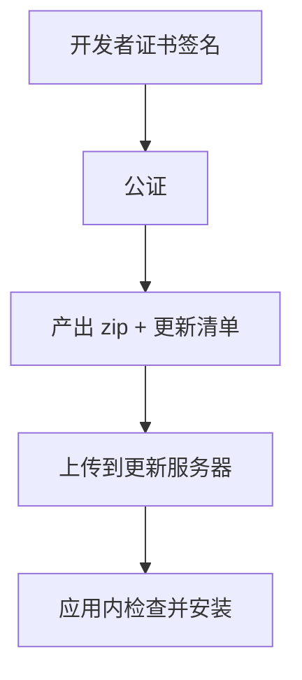

# 自动更新

桌面应用一旦发出去，就脱离了你的控制：用户可能半年不更新，带着一个已知 bug 的版本天天给你发邮件。自动更新解决的就是「新版本怎么到用户手上」。这一章讲两条主流方案、更新的完整流程、怎么把更新文件放在 Cloudflare R2 上，以及唱片墙**为什么没有做**自动更新。

## 先决条件：签名

在 macOS 上，Electron 的更新机制（底层是 Squirrel.Mac）要求应用**用开发者证书签过名**，并且会校验新版本和旧版本的签名身份一致。ad-hoc 签名的应用做不了自动更新。所以顺序是：



没有前一步，后面都无从谈起。Windows 上用 NSIS 安装包时，electron-updater 也会校验新安装包的签名发布者是否和当前一致（配置了签名的前提下）。

## 两条路线

| | 内置 `autoUpdater` | `electron-updater` |
|---|---|---|
| 来源 | Electron 自带 | electron-builder 生态的独立包 |
| 底层 | macOS 用 Squirrel.Mac，Windows 用 Squirrel.Windows | macOS 也借助 Squirrel.Mac 安装，Windows 用 NSIS |
| 服务端 | 需要一个能回答「有没有新版本」的服务 | 只要静态文件托管（GitHub Releases、S3、R2、任意 HTTP） |
| 和打包工具的关系 | 常配 Electron Forge | 和 electron-builder 配套，打包时自动生成更新清单 |
| 省事的托管 | 公开的 GitHub 仓库可以用官方的 update.electronjs.org 服务配 `update-electron-app` | GitHub Releases 或任意静态托管 |

用 electron-builder 打包的话，**选 electron-updater**：打包时它会顺手生成 `latest-mac.yml`、`latest.yml` 这类清单，你把清单和安装包一起上传到任意静态托管就能工作，不需要自己写服务端。

## 更新清单长什么样

electron-builder 打包时（配置了 `publish`）会在输出目录生成清单，大致内容：

```yaml
# latest-mac.yml
version: 1.4.0
files:
  - url: MyApp-1.4.0-arm64-mac.zip
    sha512: <base64>
    size: 104857600
  - url: MyApp-1.4.0-mac.zip
    sha512: <base64>
    size: 108003328
path: MyApp-1.4.0-arm64-mac.zip
sha512: <base64>
releaseDate: '2026-11-02T08:00:00.000Z'
```

应用启动后去拉这个 YAML，比较 `version` 和自己的版本（来自 `package.json` 的 `version`），新了就下载对应的 zip，校验 `sha512`，再交给系统安装。上面的数字只是示意格式，实际由打包生成。

几个相关的产物：

- **zip**：macOS 上更新用的是 zip，不是 dmg。dmg 只给首次安装用，所以 target 要两个都产出
- **blockmap**：配合差分下载，只下载变化的块。Electron 应用每次更新大部分是 Electron 框架本身没变，差分能省不少流量

## 在应用里接入

```bash
pnpm add electron-updater
```

注意：electron-updater 是运行时依赖，必须进 `dependencies`。这和第 4 章「全部放 devDependencies」的策略冲突吗？不冲突：如果把它打进主进程产物也能工作，但它会读 `app-update.yml` 等运行时文件，放 dependencies 让 electron-builder 正常处理更省心。两种做法都可以，选一种并实测。

```ts
// src/main/updater.ts
import { app, dialog, type BrowserWindow } from "electron";
import electronUpdater from "electron-updater";

const { autoUpdater } = electronUpdater;

export function setupUpdater(getWindow: () => BrowserWindow | null, markQuitting: () => void): void {
  if (!app.isPackaged) return; // 开发时不检查

  autoUpdater.autoDownload = true;
  autoUpdater.autoInstallOnAppQuit = true; // 下载好了，用户下次退出时顺便装

  autoUpdater.on("error", (err) => console.error("[updater]", err));
  autoUpdater.on("download-progress", (p) => {
    getWindow()?.webContents.send("update:progress", Math.round(p.percent));
  });
  autoUpdater.on("update-downloaded", async (info) => {
    const win = getWindow();
    const options = {
      type: "info" as const,
      buttons: ["现在重启", "稍后"],
      defaultId: 0,
      message: `新版本 ${info.version} 已下载`,
      detail: "重启后生效；选择稍后会在下次退出时自动安装。",
    };
    const { response } = win ? await dialog.showMessageBox(win, options) : await dialog.showMessageBox(options);
    if (response === 0) {
      markQuitting();               // 关键：绕过「关窗只藏起来」的逻辑
      autoUpdater.quitAndInstall();
    }
  });

  void autoUpdater.checkForUpdates();
  setInterval(() => void autoUpdater.checkForUpdates(), 6 * 60 * 60 * 1000);
}
```

### 和「关窗只藏起来」的冲突

第 5 章里，唱片墙的 `close` 事件会 `preventDefault` 把窗口藏起来，只有 `before-quit` 置了标志才放行。`quitAndInstall` 会关闭所有窗口再退出，如果它被你的 `close` 处理函数拦住，应用就卡在「既没退出也没安装」的状态。所以调用前要先把 `quitting` 设为 `true`（上面的 `markQuitting`）。凡是改写了退出流程的应用，都要专门测一遍「更新并重启」。

### 更新体验的原则

- **不要强制立刻重启**：用户可能正在编辑东西、正在听歌。给「稍后」选项，并在下次退出时自动安装
- 检查频率：启动时一次，之后每几个小时一次，足够了
- 失败要安静：网络不通时记日志，不弹窗打扰
- 在「关于」或设置页显示当前版本和「检查更新」按钮，方便用户和你排查问题

## 把更新放在 Cloudflare R2

对用 Cloudflare 的独立开发者，R2 是很自然的更新托管：静态文件、出口流量计费方式友好（具体以 Cloudflare 官方定价为准）、能绑自定义域名。

配置 electron-builder 的 generic provider：

```yaml
# electron-builder.yml
publish:
  provider: generic
  url: https://updates.example.com/myapp/${os}/${arch}
```

`url` 写的是更新文件所在的公开地址，打包时会写进应用内的 `app-update.yml`。上面的域名只是占位，换成你给 R2 桶绑定的域名。

打包完上传：

```bash
pnpm build && pnpm exec electron-builder --mac --publish never

# 先传安装包，最后传清单：反过来的话，用户可能拿到清单却下不到文件
for f in release/*.zip release/*.dmg release/*.blockmap; do
  pnpm exec wrangler r2 object put "my-updates/myapp/mac/arm64/$(basename "$f")" --file "$f" --remote
done
pnpm exec wrangler r2 object put "my-updates/myapp/mac/arm64/latest-mac.yml" \
  --file release/latest-mac.yml --remote
```

`--publish never` 表示只打包不让 electron-builder 自己上传，上传由你的脚本控制。**清单最后传**是个小但重要的顺序：清单是「开关」，它一出现，所有客户端就开始下载它指向的文件。

几点注意：

- 清单文件不要被 CDN 长时间缓存，否则发版后很久都没人收到更新。给 `latest-mac.yml` 设短缓存或不缓存，安装包可以长缓存（文件名带版本号）
- 更新地址必须是 HTTPS
- 每个架构、每个平台的清单分开放（上面用 `${os}/${arch}` 区分），或者用一份包含多个文件的清单，二选一保持一致

## 灰度、通道与回滚

| 需求 | 做法 |
|---|---|
| 灰度发布 | 在清单里加 `stagingPercentage: 10`，electron-updater 按客户端随机 ID 决定是否更新 |
| 测试通道 | 版本号带预发布标签（如 `1.5.0-beta.1`），客户端设 `autoUpdater.channel = "beta"` 或 `allowPrerelease = true` |
| 回滚 | 自动更新**默认不降级**。发现坏版本时，最快的办法是立刻发一个版本号更高的修复版；或者把清单改回指向旧版本并设 `allowDowngrade`（要提前在客户端代码里打开） |

所以真正的「回滚」是**往前修**。这也说明了为什么灰度有价值：先给 10% 的用户，看崩溃报告，没问题再放开。

## 数据迁移

自动更新让「用户从任意旧版本直接跳到最新版」成为常态。本地数据（SQLite、JSON 设置、文件布局）的格式变了，必须能从任何旧版本迁移上来：

- 本地存储带版本号，启动时按版本号逐级迁移
- 迁移前备份
- **不要改已有数据的位置**。唱片墙的 CLAUDE.md 里有一条类似的规矩（针对手机端的目录表）：改了文件区对应的目录，老用户升级上来，下好的歌和歌单就全找不着了，而且哪儿都不报错

## 唱片墙为什么没有自动更新

唱片墙的 README 写得很直白：只出 arm64，没做 dmg，没做自动更新——给自己用，换一版就是重新打包、再拖进去盖掉。

这是正确的判断：

- 只有一个用户，就是开发者本人，「新版本到用户手上」的成本是一次拖拽
- ad-hoc 签名本来就做不了自动更新，为了它要先买证书、配公证
- 自动更新是一整套要维护的基础设施：托管、清单、发布脚本、灰度、测试退出流程

等哪天要发给朋友、要收费，再按本章的顺序补上：证书 → 公证 → zip + 清单 → R2 → 应用内接入。

## 本章要点

- macOS 自动更新要求开发者证书签名，ad-hoc 不行
- 用 electron-builder 就配 electron-updater：打包生成 `latest-mac.yml`，任意静态托管即可
- macOS 更新用 zip，dmg 只用于首次安装；blockmap 支持差分下载
- 不强制重启；改写过退出流程的应用，`quitAndInstall` 前要放行 `close`
- 托管在 R2 时，**先传安装包、最后传清单**，清单不要长缓存
- 灰度用 `stagingPercentage`，回滚靠发更高版本号的修复版
- 本地数据要能从任意旧版本迁移
- 用户只有自己时，不做自动更新是合理的选择

## 动手练习

真正装上一次更新需要开发者证书（付费账号）；下面三题不需要。

1. **自己核对清单里的哈希**：在练习工程的 `electron-builder.yml` 里加上本章的 `publish`（`provider: generic`，`url` 随便填一个 `https://` 占位地址），mac target 改成 `zip`，运行 `pnpm build && pnpm exec electron-builder --mac zip --publish never`。打开 `release/latest-mac.yml`，再运行 `openssl dgst -sha512 -binary release/<文件名>.zip | base64`。

   验证：`latest-mac.yml` 里有 `version`（等于 `package.json` 的版本）、`files` 和 `sha512`；`openssl` 算出的值和清单里对应文件的 `sha512` 一字不差。另外打出的 `.app/Contents/Resources/app-update.yml` 里能看到你填的 `url`。

   参考答案：客户端下载 zip 后就是这样校验完整性的；清单是「开关」，内容由打包生成，不要手改。

2. **复现「退出被拦住」**：在第 5 章「关窗只藏起来」的练习工程里，加一个菜单项直接调用 `app.quit()`，但**不**经过 `before-quit` 设标志（比如把 `before-quit` 的监听先注释掉）。点这个菜单项，然后 `pgrep -fl Electron`。

   验证：窗口消失了，但进程还在；恢复 `before-quit` 置位后，同一个菜单项能让进程真正退出。

   参考答案：`quitAndInstall` 也是先关所有窗口再退出，`close` 处理函数把它拦成「藏起来」就会卡住。改写过退出流程的应用，调用前要先 `markQuitting()`。

3. **发版事故推演**（分析题）：你的发布脚本先传 `latest-mac.yml`，再传 zip；这次 zip 传到一半网络断了。同时 CDN 对所有文件都缓存 24 小时。说出接下来 24 小时内客户端会遇到什么，以及该怎么改脚本和缓存策略。

   验证：答案要覆盖「清单先到」和「清单被缓存」两个问题。

   参考答案：清单一出现，客户端就去下它指向的 zip，拿到 404 或残缺文件，`sha512` 校验失败，更新报错；修好重传后，CDN 仍给出旧清单或错误响应长达一天。改法：先传安装包、最后传清单；清单设短缓存或不缓存，带版本号的安装包设长缓存。
