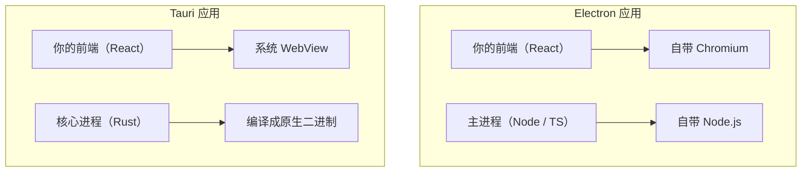
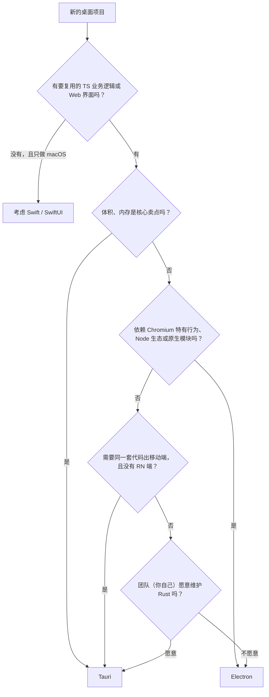

# 与 Tauri 的取舍

前七章讲的都是「怎么把 Electron 用对」。最后一章退一步问：下一个桌面项目，还该用 Electron 吗？最常被拿来比较的是 Tauri。这一章不站队，而是把两者的根本差异讲清楚，再用唱片墙做一次「如果当初用 Tauri 会怎样」的推演，最后给一个决策流程。

## 根本差异：带不带浏览器

所有区别都源于一个设计选择：

- **Electron 自带一整份 Chromium 和 Node.js**。你的应用在每台电脑上跑的都是同一个浏览器引擎、同一个 Node 版本
- **Tauri 不带浏览器**，用操作系统自带的 WebView：macOS / iOS 上是 WKWebView（Safari 的引擎），Windows 上是 WebView2（基于 Chromium 的 Edge 内核），Linux 上是 WebKitGTK。后端用 **Rust** 写

从这一点出发，可以推出几乎所有优缺点。

## 逐项对比

> [!WARNING]
> 表中对 Tauri 的描述（移动端支持、capability 权限模型、官方插件）按 2026 年前后的 Tauri 2.x 整理，Tauri 移动端仍在快速演进；以 Tauri 官方文档和发布说明为准。

| 维度 | Electron | Tauri（2.x） |
|---|---|---|
| 渲染引擎 | 自带 Chromium，各平台一致 | 系统 WebView，各平台不同 |
| 后端语言 | JavaScript / TypeScript（Node） | Rust（也可以通过 sidecar 跑别的程序） |
| 安装包体积 | 大：每个应用都带一份 Chromium | 小：通常比 Electron 小一个数量级 |
| 内存占用 | 较高：Chromium 多进程 | 通常较低，但取决于系统 WebView |
| 渲染一致性 | 高：一套 CSS / API 到处一样 | 要兼顾 Safari、Chromium、WebKitGTK 的差异 |
| 安全模型 | 默认值已加固，但 IPC 暴露什么全靠自觉 | 前端能调用哪些命令、插件，要在 capability 文件里显式授权 |
| 移动端 | 不支持 | 2.x 支持 iOS / Android |
| 生态成熟度 | 很成熟：VS Code、Slack、Figma 桌面端、Obsidian 等大量应用 | 增长快，生态比 Electron 小 |
| 原生能力 | Electron API + 整个 npm 生态 + Node 原生模块 | Tauri 插件 + 整个 Rust crate 生态 |
| 构建 | Node 工具链即可，打包快 | 需要 Rust 工具链，首次编译慢 |
| 签名公证、自动更新 | electron-builder / Forge 成熟方案 | 有官方的打包和 updater 插件 |

关于体积和内存，网上有很多对比数字，但它们高度依赖应用本身、测量方法和系统版本，这里不引用具体数值。想知道自己的应用差多少，最可靠的办法是各写一个最小原型，用 `du -sh` 和活动监视器实测。

### 「系统 WebView」的代价被低估了

Tauri 的体积优势很直观，代价却容易被忽略：**你的前端要在三个不同的浏览器引擎上跑**。

- macOS 上的 WKWebView 跟随系统版本更新，用户系统不升级，你就用不了新的 Web API
- 有些 Chromium 有、Safari 晚很多年才有或行为不同的特性（某些 CSS、媒体格式、`<audio>` 的细节行为）
- Linux 上 WebKitGTK 的版本取决于发行版

对一个只做 macOS、只给自己用的应用，这一条几乎无关紧要；对一个要同时支持 Windows 和 macOS、界面复杂的产品，这意味着要在两个引擎上都测，相当于回到了「兼容 Safari」的年代。

### Rust 是门槛也是优势

对 TypeScript 全栈开发者，Tauri 的后端意味着要写 Rust。好消息是：

- 很多应用的后端逻辑很薄（读写文件、调系统 API），官方插件已经覆盖了大部分
- 编码 agent 写 Rust 的能力不错，借用检查器报错也能帮 agent 自我修正

坏消息是：一旦遇到插件没覆盖的需求、Rust 编译错误、跨平台的原生依赖问题，调试成本明显高于 Node。一人公司的时间很贵，**技术栈的数量本身就是成本**。

## 推演：如果唱片墙用 Tauri

把唱片墙桌面端的几个关键设计逐一放到 Tauri 里看：

| 唱片墙的设计 | Electron 里怎么做 | Tauri 里会怎样 |
|---|---|---|
| 手机和桌面共用 `packages/core`（TS） | core 跑在渲染进程，平台接口由 preload 提供 | core 照样跑在 WebView 里，平台接口改用 Tauri 的 JS API 实现，可行 |
| core 的小仓库在 import 时**同步**读盘 | preload 关沙箱，用同步 `fs` | Tauri 前端调用后端都是异步的，**要改 core 的初始化方式**（先异步加载，再渲染） |
| 曲库不开 CORS，请求在主进程发 | 主进程 `net.fetch` | 用 HTTP 插件从 Rust 端发请求，并在 capability 里限定可访问的域名，可行，安全性反而更好 |
| `recordwall://` 协议给 `<audio>` 流式播放、支持 Range | `protocol.handle` + 自己切 Range | Tauri 也支持自定义 URI scheme，但流式和 Range 要在 Rust 里实现 |
| 隐藏窗口挂在 youtube.com origin 下跑第三方脚本 | `data:` + `baseURLForDataURL` | 需要找等价机制，不确定能否同样干净地实现，要做原型验证 |
| `<audio>` + Media Session | Chromium 行为，和开发时的浏览器一致 | WKWebView 的媒体行为和 Chromium 有差异，core 里按 500ms 节拍调好的阈值可能要重调 |
| 关窗藏起来、托盘、钥匙串 | Electron API | Tauri 都有对应能力（窗口事件、托盘、钥匙串类插件） |

结论：**能做，但要改 core 的初始化方式、重写协议层、重新验证媒体行为，还要多维护一套 Rust 工具链**。而换来的体积优势，对一个只装在自己电脑上的应用毫无意义。至于移动端，唱片墙已经有 Expo 做的手机端，Tauri 的移动支持也用不上。

这正是当初选 Electron 的合理性所在：唱片墙的价值在 `packages/core` 这份跨端共享的 TS 逻辑，桌面端越像「再装一个平台接口」越好，而 Electron 让这件事的摩擦最小。

## 什么时候该选 Tauri

反过来，下面这些情况 Tauri 更合适：

- **体积和内存是卖点**：工具类小应用（菜单栏工具、剪贴板管理、截图工具），用户对「一个小工具占几百 MB」很敏感
- **安全要求高**：capability 机制让「前端能调用什么」成为必须显式声明的白名单，而不是靠自觉
- **想一套代码覆盖桌面和移动**，而且没有现成的 React Native 端
- **后端本来就要用 Rust**：重计算、音视频处理、需要调用 Rust 生态的库
- 界面简单，不依赖 Chromium 特有的行为

## 还有第三个选项：原生

只做 macOS 时，别忘了 Swift + SwiftUI。体积最小、系统集成最深（菜单栏、小组件、快捷指令、App Intents）、没有 WebView 的任何问题。代价是界面要重写、不能复用 Web 技能和 TS 代码。对「一个菜单栏小工具」这种需求，原生可能比 Electron 和 Tauri 都合适，而编码 agent 写 SwiftUI 也已经很顺手。

## 决策流程

对一个 TypeScript 全栈、已经有 Expo 做移动端的一人公司，大多数时候会落在 Electron 上。这不是因为 Electron 更先进，而是因为它让你**只用一门语言、一套工具链**，把精力留给产品本身。

## 全书回顾

| 章 | 一句话 |
|---|---|
| [主进程、preload 与渲染进程](01-process-model.md) | 特权只在主进程，preload 和页面一样受同源策略管 |
| [IPC 设计](02-ipc.md) | 按能力设计接口，类型共享，ID 唯一发号 |
| [安全清单](03-security.md) | 假设页面会被攻破，默认值不改，偏离要写清理由 |
| [electron-vite 工程](04-electron-vite.md) | 一份配置三份产物，依赖全打包，闸门和打包读同一份来源 |
| [原生能力与系统集成](05-native-integration.md) | 关窗只藏、托盘只是视图、协议要白名单 |
| [打包、签名与公证](06-packaging-signing.md) | 不能不签；自用 ad-hoc，发布要证书加公证 |
| [自动更新](07-auto-update.md) | 签名是前提，清单最后传，用户只有自己时可以不做 |

## 本章要点

- Electron 和 Tauri 的根本差异是**带不带浏览器**：自带 Chromium + Node，还是用系统 WebView + Rust
- Tauri 体积小、权限模型更严、支持移动端；代价是多引擎兼容和 Rust 工具链
- Electron 渲染一致、生态成熟、对 TS 全栈开发者摩擦最小；代价是体积和内存
- 体积、内存数字高度依赖场景，用自己的原型实测
- 唱片墙用 Electron 合理：核心价值在跨端共享的 TS 逻辑，体积对自用应用无意义
- 只做 macOS 的小工具，别忘了 SwiftUI 这个选项

## 接下来读什么

桌面端的主进程本质上是一个「本地后端」，下一步可以去读[《NestJS 后端架构》](../nestjs-backend/)，把同样的分层、校验、错误处理思路用到服务端。第 3 章的安全清单只覆盖了 Electron 特有的部分，更完整的认证、授权、密钥管理在[《应用安全》](../app-security/)里。等真要公开发布桌面应用，签名、公证、上传更新文件这些步骤值得做成流水线，那是[《部署与 CI/CD》](../deploy-release/)的内容。
