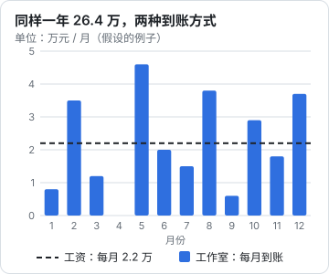

# 没人兜底之后

上班的时候，很多事情有人替你兜着：工资每月 15 号到账，项目出了问题有流程和上级，报销有财务，合同有法务，明年做什么有年度规划。你不一定喜欢这些安排，但它们替你做掉了大量决定。

自己做老板之后，这些安排一夜之间都没了。没人告诉你这个月该做什么，没人帮你检查报价，没人在客户拖款的时候替你出面。所有事情最后都落到一个人身上：你。

这本书讲的就是这件事：**没人兜底之后，怎么做决定**。它不讲时间管理技巧，也不讲怎么注册公司、怎么记账，这些在书架上的其他书里有。它讲的是判断：信息不全时怎么拍板、风险怎么算、钱怎么看、怎么谈、怎么用好专业的人、怎么拒绝、一个人怎么撑得久。

这一章先把员工和老板的几个根本差别摆出来，看看每一条在日常里长什么样。

## 一个贯穿全书的例子

为了让后面的讨论落地，全书会反复用到一个**假设的人物**：

> 林岚，34 岁，在一家消费品公司做了 9 年品牌设计，最后两年是设计主管，税前月薪 2.2 万，一年 13 薪。她辞职后开了一个一人品牌设计工作室，给中小餐饮和消费品牌做标志、包装和门店视觉。

林岚不是程序员，也没学过管理和财务。她的专业能力不差，过去九年里也见过不少供应商、开过不少会。但工作室开起来的头几个月，她发现最难的不是设计本身，而是那些上班时从来不用自己决定的事。

书里其他章节也会出现做 HR、做财务、做运营的例子。这些人物和数字都是为了说明问题虚构的，数字之间是自洽的，但不代表任何行业的真实水平。

## 五个根本差别

先看全貌：

| 维度 | 员工 | 老板 |
|---|---|---|
| 收入 | 确定：每月固定到账 | 波动：有的月份多，有的月份是零 |
| 责任 | 分工：你只对自己那一块负责 | 全包：所有没人管的事都归你 |
| 反馈 | 来自上级：绩效、评语、晋升 | 来自市场：付不付钱、续不续约 |
| 风险 | 公司承担大部分 | 自己承担，没有缓冲层 |
| 时间 | 被安排：会议、排期、截止日 | 自己安排：每一小时怎么用都是选择 |

这五条单独看都不新鲜，人人都知道「自己干收入不稳定」。难的是它们在日常里的样子，往往和想象的不一样。下面逐条看。

## 收入：从确定到波动

### 日常里长什么样

林岚辞职第一年，工作室一共到账 26.4 万，和她上班时一年 12 个月的工资总额差不多（不算第 13 薪和年终）。但钱是这样来的：



总数一样，体验完全不同：

- **4 月份到账是零**。不是因为没干活，而是 3 月交付的两个项目尾款都要等客户走付款流程，5 月才到
- **5 月到账 4.6 万**，看起来很多，但其中 2 万是前两个月的活
- **你很难回答「我现在一个月挣多少」**。按哪个月算都不对

上班时，「月薪」是一个稳定的、可以拿来规划生活的数字：房贷按它算，消费按它定，心情也跟着它走。自己做之后，这个数字不存在了。

### 怎么调整看收入的方式

第一，**用滚动平均代替单月数字**。每个月月底算一次「过去 12 个月的到账总额 ÷ 12」。刚开始不满 12 个月时，就用已有月份的平均，同时心里知道这个数还不稳。林岚第一年年底的滚动月均是 2.2 万，这才是可以拿来规划的数字。

第二，**把收入分成三栏看**，而不是只看银行余额：

| 栏目 | 含义 | 林岚某个月月底的例子 |
|---|---|---|
| 已到账 | 钱已经在账户里 | 1.2 万 |
| 已确认未到账 | 合同签了、活交了，在等付款 | 3.4 万 |
| 在谈 | 有意向但没签 | 5 万左右，估计能成一半 |

只看第一栏会过度焦虑，只看第三栏会过度乐观。三栏一起看，才知道接下来两三个月大概是什么样子。

第三，**接受「进账」不等于「收入」**。到账的钱里有一部分要交税，有一部分要付给外包的插画师和印刷厂，还有一部分要留着撑过下一个淡季。这件事在[第 4 章](04-money-mindset.md)展开。

## 责任：从分工到全包

### 日常里长什么样

在公司里，每个人有自己的岗位职责。设计师出稿，项目经理盯进度，商务谈价格，法务看合同，财务开发票、催款。林岚当设计主管时，这些事她都「见过」，但都不是她的事。

工作室开起来之后，一个普通的项目要经过这些环节：

| 环节 | 上班时谁负责 | 现在谁负责 |
|---|---|---|
| 找到客户、第一次沟通 | 商务、销售 | 林岚 |
| 判断需求、报价 | 商务和主管一起 | 林岚 |
| 合同条款 | 法务 | 林岚（必要时请律师） |
| 设计 | 林岚和组员 | 林岚（部分插画外包） |
| 进度和客户沟通 | 项目经理 | 林岚 |
| 开发票、催尾款 | 财务 | 林岚（记账交给代账） |
| 交付后的售后、改稿 | 设计组 | 林岚 |
| 作品集、宣传 | 市场部 | 林岚 |

这张表里，林岚真正擅长、真正喜欢的只有「设计」那一行。其余七行，过去有别人做，现在都要她来做，或者她来决定交给谁做。

更难的是那些**没有出现在任何表格里的事**：客户群里一句「这个颜色是不是有点怪」该不该回、怎么回；电脑坏了在交付前一天；代账公司说上个月少了一张发票。在公司里，这些事要么有人管，要么可以推一下；现在不管就没人管。

### 一个简单的工具：无主事务清单

建议准备一个清单，专门记录「这件事以前是谁在管」：

```text
无主事务清单（林岚，2026-11）

事务                   以前谁管         现在怎么处理               下次检查
客户尾款跟进           财务             每周一上午过一遍应收        每周
合同模板               法务             请律师审一次，自己复用      每年
电脑和软件订阅         IT 和行政         固定一台备用机，订阅列表   每季度
作品授权和字体版权      法务 + 设计组     项目开始前确认字体来源      每个项目
发票和记账             财务             交给代账，每月 5 号前交资料 每月
```

这份清单的作用不是让你都自己做，而是**让每件事都有一个明确的处理方式**，哪怕处理方式是「交给别人」或「暂时不做，等出问题再说」。最怕的是事情掉在地上，没人发现。

## 反馈：从上级到市场

### 日常里长什么样

上班时，反馈来得频繁而明确：上级说「这版不错」，季度考核给个等级，年底有调薪和晋升。即使反馈不公平，至少你知道别人怎么看你。

市场的反馈不一样，它有三个特点：

- **慢**。一个品牌项目从第一次沟通到客户决定合作，可能要一两个月。你这个月做对的事，三个月后才看到结果
- **沉默**。客户不续约，通常不会告诉你为什么。潜在客户看了你的报价没回复，你不知道是价格太高、作品不对、还是对方项目黄了
- **不解释**。市场只给结果：付钱或者不付钱。它不告诉你哪里做得好、哪里做得不好

林岚头三个月最难受的就是这一点。以前每做完一版稿子，总监都会给意见；现在发出去的报价单，一半石沉大海。她开始怀疑自己的报价、作品、甚至专业能力，但其实她什么都不知道，因为没有任何信息。

### 怎么把市场的沉默变成信息

第一，**自己定几个能观察的数字**，代替上级的评语。比如林岚定了三个：每月新增的有效咨询数、报价后的成交率、老客户再次合作率。这几个数每月记一次，三个月后就能看出趋势。

第二，**主动去问**。客户不会主动告诉你，但你问了，很多人愿意说。项目结束后、没成交时，各问一次：

```text
项目结束后问老客户：
1. 这次合作里，哪一点让你觉得「找对人了」？
2. 有没有哪个环节让你觉得麻烦或者不放心？
3. 如果朋友问你要不要找我，你会怎么介绍我？

没成交时问潜在客户（语气轻松，不追问）：
「理解，谢谢你花时间沟通。方便的话想请教一句：
最后没有合作，主要是预算、时间，还是方案方向不太对？
你的回答对我很有帮助，不回复也完全没关系。」
```

第三句的答案特别有价值：客户怎么向别人介绍你，就是你在市场上真实的定位。

第三，**分清「市场反馈」和「个别人的意见」**。一个客户说贵，是一个数据点；连续五个类似客户都在报价后消失，才是信号。上班时，上级一个人的意见就能决定你的考核；现在没有哪一个人的意见是决定性的，要看的是规律。

## 风险：从公司到自己

### 日常里长什么样

在公司里犯错，代价通常有人分担。设计稿用了没授权的字体，公司法务处理，最多挨一顿批评；项目延期，公司和客户协商；客户不付款，公司去追，你的工资照发。

自己做之后，同样的事情：

- 字体侵权，赔偿是你出
- 项目延期导致客户索赔，合同上签的是你的名字
- 客户不付款，你白干了，还要自己去追
- 生病一个月，这一个月没有收入，也没有病假工资

**你和风险之间，少了一层叫「公司」的缓冲。** 即使你注册了有限公司，很多风险最终还是会落到你个人身上：你的时间、你的存款、你的名声。

### 风险不只是「亏钱」

员工时，大家说的风险通常只有一种：被裁员。做老板之后，风险的种类多了很多：

| 风险类型 | 例子 |
|---|---|
| 收入风险 | 大客户突然不合作；淡季连续两个月没有新单 |
| 回款风险 | 活干完了，尾款拖三个月或者不给 |
| 合同与法律风险 | 版权纠纷、交付标准争议、违约责任 |
| 健康风险 | 生病、受伤，期间没有任何收入 |
| 集中风险 | 一个客户占了一半以上收入；只靠一个平台接单 |
| 名声风险 | 一次交付事故在行业小圈子里传开 |

这些风险不需要都怕，但要知道它们的存在，并且对最严重的那几种提前做准备。怎么判断哪些风险要认真对待、哪些可以接受，是[第 3 章](03-risk-and-downside.md)的内容。

## 时间：从被安排到自己安排

### 日常里长什么样

上班时，你的时间大部分是被安排好的：九点打卡，十点周会，下午评审，周五交稿。你也许觉得被会议和流程浪费了很多时间，但这种安排有一个好处：**你不用决定每一个小时该做什么**。

自己做之后，没有周会，没有排期，没有截止日（除非客户给）。林岚第一个月最常见的一天是这样的：上午回了两个小时消息，中午看了一会儿同行的作品集，下午改了一个客户的稿子，晚上想起来作品集网站还没更新，然后一天就过去了。没有哪件事是错的，但月底回头看，最该做的事（主动联系潜在客户、整理案例）几乎没动。

### 真正的变化：每一个小时都是一个决定

这里不讲具体的时间管理方法。周节奏、季度目标、精力怎么分，在[《一人公司方法论》第 5 章](../opc-playbook/05-energy-rhythm.md)有完整的讲法，可以直接用。

这里只强调一个心态上的变化：**以前是「做完安排给我的事」，现在是「决定什么事值得做」**。

上班时，你做的事是否重要，由上级和流程判断；你只要做好。现在没人判断了，你做的每一件事都在回答一个问题：这件事比其他所有可以做的事都更值得做吗？回消息、改稿、看同行作品、学新软件，每件事单独看都有道理，但它们在抢同一段时间。

这就是后面几章反复出现的主题：**取舍**。怎么做取舍、怎么拒绝，[第 7 章](07-saying-no.md)专门讲。

## 自检：你还在用员工的方式想问题吗

转变不是辞职那天完成的。很多人做了一两年老板，脑子里还是员工的思路。下面是一些常见的对照，可以拿来检查自己：

| 员工式的想法 | 老板式的想法 | 林岚的例子 |
|---|---|---|
| 这个月我做了很多事 | 这个月哪些事带来了收入，或者为以后的收入打了基础 | 回了一百条消息，但没签新单 |
| 等客户确认了再说 | 我来推进：给出选项和截止时间 | 「周四前没收到意见，我按 A 方案往下做」 |
| 这不是我的职责 | 这件事归谁？如果没人，就是我 | 字体授权没人查，就是她查 |
| 报价是对我能力的评价 | 报价是对这份交付在市场上值多少的判断 | 被砍价不再觉得受辱 |
| 有问题找上级 | 有问题先想清楚选项，再找合适的人商量 | 合同拿不准，带着问题清单去问律师 |
| 失败了就是我不行 | 失败了，看看是判断错了、执行错了，还是运气不好 | 丢了一个比稿，先复盘再下结论 |
| 能省则省 | 算清楚：省下的钱和花掉的时间哪个更贵 | 记账交给代账，每月省出 6 小时 |
| 别人请我帮忙，不好意思拒绝 | 每一次「好」都意味着对别的事说「不」 | 亲戚的免费设计排进了两周后 |

不需要每一条都变过来。有些员工式的想法在某些场合是对的，比如「这不是我的职责」在你有了合作伙伴之后反而要坚持。关键是**意识到自己在用哪一种方式想**。

## 不是每个人都要变成老板

写到这里，可能会给人一种感觉：做老板比做员工难很多，员工的思维方式是要被「克服」的。

不是这样。员工和老板是两种不同的位置，各有代价和回报。员工用一部分自主权换来了稳定和分工；老板用稳定和分工换来了自主权和更大的上限，也换来了更大的下限。

这本书不劝任何人辞职。它的用处是：

- 如果你**已经决定自己干**，帮你更快地完成这个转变，少走一些弯路
- 如果你**还在考虑**，帮你提前知道那边是什么样子，用来判断自己是否适合
- 如果你**暂时不打算辞职**，这些方法在工作里也能用，而且在工作里先练，代价低得多（[第 9 章](09-practice-at-work.md)专门讲）

什么时候该辞职、怎么评估，在[《一人公司行动手册》第 6 章](../opc-action-plan/06-stage4-quit.md)有一张评分表；辞职后家人怎么沟通、个人安全垫留多少，在[《过渡期收入与个人保障》](../opc-transition/)里。这本书不重复那些内容。

## 本书怎么读

| 章 | 讲什么 |
|---|---|
| 第 2 章 | 信息不全时怎么拍板：可逆与不可逆、事前验尸、决策日志 |
| 第 3 章 | 风险、概率与下行保护：期望值、方差、不能输的赌局 |
| 第 4 章 | 和钱的新关系：心理账户、花钱买时间、该省和不该省 |
| 第 5 章 | 谈判基本功：替代方案、底线、锚定、交换让步 |
| 第 6 章 | 和专业人士合作：你成了甲方 |
| 第 7 章 | 说「不」与取舍：机会成本、不做清单 |
| 第 8 章 | 一个人的支持系统：能说真话的小圈子、比较焦虑、失败后的归因 |
| 第 9 章 | 把这些方法带回职场先练；全书回顾 |

每章都有可以直接照着填的表格、清单或模板。建议读的时候拿一个具体的、正在纠结的事情来套：一个要不要接的活、一笔要不要花的钱、一个不知道怎么拒绝的请求。

## 本章要点

- 员工和老板有五个根本差别：收入从确定到波动、责任从分工到全包、反馈从上级到市场、风险从公司到自己、时间从被安排到自己安排
- 收入波动时，用 12 个月滚动平均代替单月数字，把收入分成「已到账、已确认未到账、在谈」三栏看
- 用一张「无主事务清单」记下以前由别人管的事，让每件事都有明确的处理方式
- 市场的反馈慢、沉默、不解释；自己定几个能观察的数字，并在项目结束和没成交时主动去问
- 风险少了公司这一层缓冲，种类也比员工时多：收入、回款、合同、健康、集中、名声
- 每一个小时怎么用都是一个决定；做取舍是老板的日常
- 用对照表检查自己还在用员工还是老板的方式想问题；两种位置各有代价，这本书不劝人辞职
