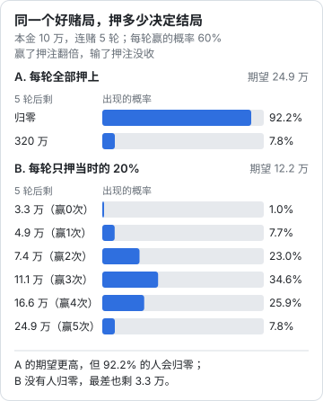

# 风险、概率与下行保护

上班时，大多数人对风险的感受是模糊的：「这个项目有点悬」「今年行情不好」。风险的后果主要由公司承担，个人只需要有个大概的感觉。

自己做老板之后，模糊的感觉不够用了。你要回答的问题变成：这个比稿值不值得投三天？把一半积蓄投进新方向，最坏会怎样？一个客户占了七成收入，危险吗？这些问题都需要把「可能」说成数字，再看清楚最坏的结果你能不能承受。

这一章讲几个基本的工具：概率、期望值、方差，以及一条最重要的原则：不能输的赌局不要上。数学只用到小学的乘法和加法。

## 把「可能」说成数字

### 用自己的历史做参照

「这个客户应该能成」，到底是几成？凭感觉说很难，但如果你有记录，就有参照。

林岚从工作室开张起，就把每一次报价记在一张表里。一年下来：

| 类型 | 次数 | 成交 | 成交率 |
|---|---|---|---|
| 老客户或朋友推荐来的咨询，报价后 | 12 | 7 | 58% |
| 社交平台上主动来问的，报价后 | 20 | 5 | 25% |
| 参加比稿 | 6 | 1 | 17% |

有了这张表，她再遇到一个社交平台上来的询价，心里就知道：不管聊得多投机，大概四个里成一个。这叫**参考类**或**基础比率**：先看同类事情过去的平均结果，再根据这一次的特殊情况往上或往下调。

人最常犯的错是跳过基础比率，只看眼前这一个的特殊之处。「这个客户特别有诚意」「这次的方案我特别有把握」，这些感觉每一次都有，但平均下来，社交平台来的询价仍然只成四分之一。

### 没有历史时怎么办

刚开始做，还没有自己的记录，可以：

- **问做过的人**。同行的比稿中标率、报价成交率大概是多少？问三四个人，取一个大概的范围
- **用区间而不是一个数**。说不出「三成」，至少能说出「一成到五成之间」。区间宽，说明你不确定，这本身就是有用的信息
- **从今天开始记**。哪怕只是一个简单的表格：日期、客户来源、报价、结果。半年后你就有了自己的基础比率

## 期望值

### 一个比稿的例子

期望值是把每种可能的结果乘以它的概率，再加起来：

$$
\text{期望值} = p_1 \times x_1 + p_2 \times x_2 + \cdots
$$

看一个具体的例子（数字为假设）。一个餐饮品牌邀请林岚参加比稿：

- 准备比稿方案需要 5 个工作日，没有比稿费
- 中标后的项目金额 4 万元，需要 20 个工作日完成
- 林岚平时每个工作日的平均到账约 1000 元，这是她把时间用在其他事情上大概能换来的钱

先算每种结果对她意味着什么：

- **比稿的代价**：5 天，按每天 1000 元算，相当于放弃了 5000 元
- **中标的收益**：项目 4 万，但要占用 20 天，这 20 天本来也能挣约 2 万，所以中标真正多出来的是 4 万 − 2 万 = 2 万

如果中标率是 20%：

$$
0.2 \times 20000 - 5000 = -1000 \text{ 元}
$$

如果中标率是 30%：

$$
0.3 \times 20000 - 5000 = 1000 \text{ 元}
$$

盈亏平衡的中标率是 $5000 \div 20000 = 25\%$。林岚过去 6 次比稿只中了 1 次，约 17%，低于 25%。按她自己的历史数据，**这类比稿平均下来是亏的**。

### 这个算法的几个提醒

第一，**期望值对概率很敏感**。中标率从 20% 变成 30%，结果就从亏变成赚。所以前一节讲的基础比率很重要，概率估错了，算得再细也没用。

第二，**机会成本要看实际情况**。上面假设那 5 天本来能挣 5000 元。如果正好是淡季，手上没活，这 5 天的机会成本接近零，比稿就划算得多。同一个比稿，旺季不接、淡季接，可能都是对的。

第三，**有些价值不在这一单里**。比稿能认识一个新的品牌方，即使没中，以后也可能有合作；方案可以改一改放进作品集。这些可以估一个数加进去，但要诚实，不要为了让结果变正而硬加。

林岚最后给自己定了一条规则：**旺季不参加无偿比稿；淡季参加时，只参加入围不超过三家的**。入围家数少，中标率自然高。这条规则后来写进了她的「不做清单」（[第 7 章](07-saying-no.md)）。

## 只看期望值不够

### 同样的期望值，不同的结局

期望值告诉你「平均下来」怎么样，但你不是在平均里生活的。看一个思想实验：

> 你有本金 10 万。有一个赌局，每轮赢的概率是 60%：赢了，押上去的钱翻倍；输了，押上去的钱全部没收。一共可以玩 5 轮。

每一轮的期望都是正的：押 1 块钱，平均拿回 $0.6 \times 2 = 1.2$ 块。这是一个「好赌局」。问题是每一轮押多少。



两种押法的计算：

- **A，每轮全部押上**：只有 5 轮全赢才能留下钱，概率是 $0.6^5 \approx 7.8\%$，那时有 $10 \times 2^5 = 320$ 万；其余 92.2% 的情况，在某一轮输掉之后就归零了。期望值是 $320 \times 0.0778 \approx 24.9$ 万
- **B，每轮只押当时本金的 20%**：每赢一轮，本金变成原来的 1.2 倍；每输一轮，变成 0.8 倍。5 轮里赢 3 次的人最多（34.6%），剩 $10 \times 1.2^3 \times 0.8^2 \approx 11.1$ 万；运气最差 5 轮全输，也还剩 $10 \times 0.8^5 \approx 3.3$ 万。期望值是 $10 \times (0.6 \times 1.2 + 0.4 \times 0.8)^5 \approx 12.2$ 万

A 的期望值是 B 的两倍，但如果你只能玩一次，选 A 的话，十个人里有九个会一无所有。

### 期望值是很多个平行世界的平均

期望值的意思是：如果有一万个你，每个人都玩一次，最后所有人的钱加起来除以一万。但你只有一个，只活在其中一个结果里。

**方差**描述的就是结果有多分散。A 的方差极大：要么 320 万，要么零；B 的结果集中在 7 万到 17 万之间。做决定时，除了看期望值，还要看结果的分布，特别是最差的那一头。

把这个思想实验翻译到经营里：

| 赌局里的做法 | 经营里的样子 |
|---|---|
| 每轮全部押上 | 把全部积蓄投进一个新方向；辞职、租店、囤货同时进行 |
| 每轮押一部分 | 每次只拿出一部分钱和时间去试，试成了再加码 |
| 归零之后不能再玩 | 积蓄花光、背了债，连回头和重来的机会都没了 |

这里只是用一个简化的例子说明「下注大小」这个道理，不是投资建议。现实里的概率和赔率都不会这么清楚，这反而让控制下注大小更重要。

## 不能输的赌局不要上

### 归零是不可逆的

上一节最重要的结论不是 B 比 A 好，而是：**任何可能让你归零的赌局，期望值再高也不要上**。

原因是归零之后就没有「下一轮」了。经营是一个反复下注的过程：今年这个方向不成，明年换一个；这个客户没谈下来，下周还有别的。只要还在场上，你就有机会从错误里学习、等到运气变好。一旦归零，所有后面的机会都没了。

上一章讲的单向门里，最需要警惕的就是那种「走过去就再也回不来」的门。

### 哪些事可能让你归零

对一个人做事来说，常见的有：

- **借高息的钱投入经营**：网贷、信用卡套现、民间借贷。生意不顺时，利息会比收入涨得快
- **用唯一的住房做抵押**
- **动用应急金**：应急金是给生病、家人急用准备的，不是给生意的
- **为别人的债务做担保**：朋友的公司借款，你签了个人担保，他还不上就是你还
- **签个人承担无限责任或高额违约金的条款**：比如给客户的赔偿上限写成「全部损失」，或者签了和业绩挂钩的对赌
- **透支健康**：连续几个月每天睡五小时赶项目。身体垮了，比任何生意损失都难恢复

### 下行保护清单

做一个偏单向的决定之前，过一遍这张清单：

```text
下行保护清单

[ ] 最坏的情况具体是什么？写下来，包括金额
[ ] 最坏的情况发生了，我的生活会怎样？房贷还得上吗？家人受影响吗？
[ ] 最坏的情况发生之后，我还能继续做下去，或者回去上班吗？
[ ] 这件事会不会动用应急金、借高息的钱、或者让我承担个人无限责任？
[ ] 有没有办法把最坏情况的损失封顶？（分阶段投入、合同写赔偿上限、买保险）
[ ] 如果把投入减半，还能拿到大部分我想知道的信息吗？
```

前三条有任何一条的答案是「承受不了」，就不要做，或者改到能承受为止。

### 公司不一定能替你挡住

很多人以为注册了有限公司，最坏情况就只是公司没了。这不完全对。

> [!WARNING]
> 以下关于有限责任的说法按 2024 年 7 月 1 日起施行的《公司法》整理，具体条文和适用以国家法律法规数据库（flk.npc.gov.cn）的最新文本为准，遇到实际纠纷请咨询律师。

一人有限公司的股东，如果不能证明公司财产独立于自己的财产，要对公司债务承担连带责任；你以个人名义签的担保、借款，也和公司是否有限责任无关。所以「有限责任」只有在公私分开、不用个人身份兜底的情况下才真正起作用。怎么把钱分开，见[《财务与税务》第 5 章](../opc-finance/05-separate-money.md#法律有限责任可能失效)。

## 把大赌拆成小实验

### 思路

既然不能一次押上全部，那想做一件大事怎么办？答案是：**把一个大赌拆成一串小实验**，每个实验的成本可控，结果能告诉你下一步要不要加码。

这和上一章「用 5300 元买到原本要 17.6 万才能知道的信息」是同一个道理。

| 想做的大事 | 一次押上的做法 | 拆成小实验 |
|---|---|---|
| 开设计培训课 | 租教室、做全套课程、投广告招生 | 先办一次 8 人的周末小班，看报名速度和学员反馈 |
| 转型做包装设计 | 改作品集、换定位、推掉品牌项目 | 先接一两个包装项目，看自己喜不喜欢、能报多少钱 |
| 做自有文创产品 | 一次生产 2000 件 | 先打样，小批量 100 件预售，卖完再追加 |
| 开实体店 | 签三年租约、装修 | 先在市集摆摊或做快闪，测试客流和客单价 |
| 雇第一个员工 | 签一年劳动合同 | 先找兼职或外包合作三个月，看工作量是否稳定 |

### 实验卡片

每个小实验开始前写一张卡片：

```text
实验：周末设计小班（第 1 期）

想验证的问题：有没有人愿意付 1200 元学一个周末的品牌设计基础
做法：在作品集账号和朋友圈发招生，8 人满班，借联合办公的会议室
成本上限：会议室 1600 元 + 物料 400 元 + 准备时间 4 天
截止时间：开课前 2 周
成功标准：截止前报满 6 人以上
如果成功：办第 2 期，人数和价格都上调一点
如果失败：问 3 个没报名的潜在学员原因，决定改还是放
```

「成功标准」和「截止时间」必须在开始前写好，否则实验结束时你会忍不住重新解释结果。验证一个生意方向的完整方法，见[《一人公司方法论》第 3 章](../opc-playbook/03-fast-validation.md)。

小实验还有一个好处：它让大部分决定都变成双向门。单向门的决定，经过两三轮小实验，往往会发现要么不必做，要么可以用更小的代价做。

## 尾部风险

### 发生概率低，但后果很重

前面讲的期望值，算的是常见情况。还有一类风险：一年里发生的概率可能只有百分之几，但一旦发生，后果非常严重。这类风险叫**尾部风险**，因为它们在结果分布的最尾端。

尾部风险很容易被忽略，原因很简单：大多数时候它不发生。你可能连续三年都没出过事，于是觉得这件事不存在。

对一个人做事来说，常见的尾部风险：

| 风险 | 例子 | 可以做的准备 |
|---|---|---|
| 最大的客户突然停止合作 | 对方换了负责人、预算砍了、被收购 | 给单一客户的收入占比定一个上限；留够几个月的开支 |
| 生病或受伤 | 住院一个月，期间没有收入 | 社保医保不断；配置商业保险 |
| 渠道突然断掉 | 唯一接单的平台账号被限流或封禁 | 至少两个获客渠道；把客户的联系方式留在自己手里 |
| 法律纠纷 | 被客户起诉交付不合格；字体或图片被告侵权 | 合同写清验收标准和赔偿上限；素材来源留档 |
| 设备和数据丢失 | 电脑被偷，项目源文件没有备份 | 自动云备份 + 一块本地硬盘 |

商业保险怎么配，见[《过渡期收入与个人保障》第 7 章](../opc-transition/07-commercial-insurance.md)；合同条款见[《合同与法律文书》](../contracts-legal/)。

### 一个容易被忽视的数字：客户集中度

林岚接下那个连锁茶饮的大单之后，在项目期间，这一个客户占了她八成的收入。这就是客户集中度过高。

计算很简单：

$$
\text{最大客户占比} = \frac{\text{最大客户过去 12 个月的到账}}{\text{过去 12 个月的总到账}}
$$

占比越高，这个客户对你的影响就越大：不只是它走了你会少一大块收入，还包括你在和它谈判时没有底气、它提出不合理要求时很难拒绝。

没有一个放之四海皆准的上限。很多做服务的人会给自己定一条线，比如单一客户不超过四成，超过时主动去开发其他客户，或者多留几个月的储备。林岚的做法是：大单期间，每周固定留半天维护老客户和潜在客户；项目一结束，她就把最大客户占比降回了三成左右。

## 一页风险清单

把这一章的内容放在一起，建议每个季度花一个小时更新一份自己的风险清单：

```text
风险清单（林岚，2026 年第 4 季度）

基础数字
- 最大客户占比（过去 12 个月）：____%
- 可用储备能覆盖几个月的个人和工作室开支：____ 个月
- 获客渠道数量，及最大渠道占新客户比例：____ 个，____%

正在进行的「赌局」
- 事情：______
  投入上限：______
  最坏情况：______
  能否承受：____

尾部风险检查
[ ] 社保、医保正常缴纳
[ ] 商业保险在保障期内
[ ] 项目文件有异地备份，上次恢复测试：______
[ ] 正在执行的合同都有验收标准和赔偿上限
[ ] 没有为任何人做个人担保，没有高息借款

这个季度要处理的一件事：______________________
```

这份清单不需要每条都做到满分。它的作用是让你每个季度都看一眼「最坏的情况」，而不是等它发生了才第一次想到。

## 什么时候止损

风险管理的最后一环是止损：一个方向做了一段时间，结果一直不好，什么时候停？

这个问题在[《一人公司方法论》第 6 章](../opc-playbook/06-when-to-quit.md#在开始时写好止损线)有完整的讨论，核心是在开始时就写好止损线；个人存款跌到多少该回去上班，见[《过渡期收入与个人保障》第 4 章](../opc-transition/04-safety-net-runway.md#第三步定止损线)。这里只补一句和本章有关的：**止损线本身就是一种下行保护**，它把一个可能无限延长的赌局，变成了一个损失有上限的赌局。

## 本章要点

- 把「可能」说成数字：先看同类事情的基础比率，再按这一次的特殊情况调整；没有历史就用区间，并从今天开始记录
- 期望值是各种结果乘以概率再相加；算出盈亏平衡的概率，和自己的历史数据比，就知道一类机会值不值
- 期望值对概率很敏感，机会成本要看实际忙闲
- 只看期望值不够，还要看结果的分布：期望高、但可能归零的选项，只能玩一次时往往是错的
- 不能输的赌局不要上：高息借款、抵押唯一住房、动用应急金、个人担保、无上限的赔偿、透支健康
- 有限责任只在公私分开、没有个人兜底时才真正起作用
- 把大赌拆成小实验，每个实验写好成本上限、截止时间和成功标准
- 尾部风险发生概率低但后果重；关注客户集中度，每季度更新一页风险清单
- 止损线把无限延长的赌局变成损失有上限的赌局
