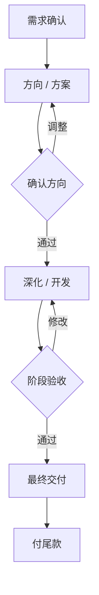

# 和专业人士合作

上班时，很多人当过乙方，或者至少跟乙方打过交道。设计师抱怨甲方「改来改去」「说不清要什么」「最后用回第一稿」，市场部抱怨供应商「拖进度」「做出来不是想要的」。这些抱怨大多有道理，但站在一边的时候，很难看清另一边的问题出在哪里。

做了老板，你会频繁地变成甲方：请律师看合同、请代账记账、请设计师做标志、请人搭网站、请顾问理思路。一个人做事，不可能样样都会，**能不能用好别人的专业能力，直接决定了你能做多大的事**。

这一章讲作为甲方怎么找人、怎么判断水平、怎么提需求、怎么验收、怎么付费，以及甲方自己要做好的几件事。律师和代账在其他书里有专门的章节，这里只讲通用的方法，具体的会给出链接。

## 你买的是什么

请专业人士之前，先弄清楚你买的是什么。大致有两类：

| 类型 | 典型 | 你买的是 | 怎么判断好坏 |
|---|---|---|---|
| 判断类 | 律师、会计和代账、顾问 | 他们的判断，以及他们为这个判断承担的专业责任 | 看他们能不能问出你没想到的问题，给出具体、可操作的意见 |
| 执行类 | 设计师、外包开发、插画、剪辑、摄影 | 一个具体的交付物 | 看交付物是否达到事先约定的标准 |

这个区分很重要，因为两类的用法不同：

- **判断类**：你要把情况讲清楚，然后听他的。花钱请了律师又不听律师的意见，等于白花。但最后的决定仍然是你做，律师告诉你风险，要不要冒这个风险是你的事
- **执行类**：你要把要什么讲清楚，然后检查交付物。过程中给对方专业的空间，不要把设计师当成「替你操作软件的手」

很多甲方的问题，就是把两类弄反了：对律师的意见挑挑拣拣只听想听的，对设计师的每一个像素指手画脚。

## 怎么找

### 来源的可靠程度

找专业人士的渠道，按可靠程度大致排序：

1. **信任的人推荐**：特别是「用过、满意、而且合作过不止一次」的推荐
2. **看作品或案例找到的**：你看到一个喜欢的网站、一份写得很清楚的合同解读文章，顺着找到作者
3. **专业平台和社群**：平台上有评价，但评价可以经营；社群里能看到人怎么回答问题
4. **广告和主动推销**：不一定差，但你知道的信息最少

### 怎么问推荐

问人推荐时，问法会影响你得到的信息质量。不要只问「你认识好的律师吗」，而是：

```text
「我想找一个能帮我审设计服务合同的律师，主要是版权归属和付款条款。
你有没有自己用过、而且觉得好的？
他好在哪里？有没有什么让你不太满意的地方？
你们合作过几次？大概是什么价位？」
```

「有没有不满意的地方」这一问很有用。推荐人一般不会主动说缺点，但你问了，往往会说出很实际的信息：「人很专业，就是回复慢，急事得打电话。」

## 怎么判断水平

### 三个方法

**看过去的作品，并问他负责了哪一部分。** 作品集里的东西，可能是团队做的，他只负责了其中一小块。直接问：「这个项目里你具体做了什么？遇到了什么问题，怎么解决的？」能说出具体细节的人，通常是真做过的。

**听他问你什么问题。** 这是判断专业人士最好的方法之一。好的专业人士在报价之前，会先问很多问题，而且问到点子上。一个好的设计师会问你的客户是谁、竞争对手长什么样、这个标志要用在哪些地方；一个不好的会直接问「你喜欢什么颜色」「预算多少」。

**先做一个小单。** 不确定的时候，先给一个小而完整的任务：一个小页面、一张插画、一份合同的单次咨询。小单的成本低，但能看出很多东西：沟通方式、是否守时、交付质量、遇到问题时的态度。

### 提问模板

不同的专业人士，第一次接触时可以问的问题：

| 对象 | 可以问 | 听什么 |
|---|---|---|
| 律师 | 你处理过类似的事吗？这类事最常见的风险是什么？你建议我准备什么材料？ | 能不能说出具体的风险点，而不是「都有可能」 |
| 代账 | 有没有服务过和我同类的客户？每月需要我提供什么？申报完会不会给我回执？ | 有没有清晰的流程，愿不愿意解释 |
| 设计师 | 你的工作流程是什么样的？包含几轮修改？最终交付哪些文件？ | 流程是否清楚，有没有先理解需求的步骤 |
| 外包开发 | 你会用什么方式做？做完之后我自己能不能修改内容？以后谁来维护？ | 是否考虑了你的长期使用，而不只是交付那一刻 |
| 顾问 | 你会怎么帮我？结束时我会得到什么？你帮过的人后来怎么样了？ | 是否能说清楚具体的产出，而不是只讲理念 |

### 几个危险信号

- **什么都能做**。一个人说自己设计、开发、营销、法务都很擅长，多半哪一样都不够专业
- **保证结果**。律师保证你一定胜诉，顾问保证你三个月收入翻倍。专业的人知道哪些事情不在自己的控制之内
- **不问需求就报价**。还没弄清楚要做什么，就给了一个数字，说明这个数字和你的事情没什么关系
- **价格远低于其他人**。可能是新人在积累作品，这没问题，但要搞清楚原因
- **不愿意写下来**。范围、价格、时间都只肯口头说，出了问题就没有依据

## 怎么提需求

### 甲方最常见的问题

乙方抱怨最多的，就是甲方「说不清要什么」。这往往不是甲方故意的，而是甲方自己也没想清楚，指望乙方做出来之后「看到了就知道了」。这样的结果是反复修改、双方都累，最后谁都不满意。

想清楚再开口，是甲方最重要的工作。

### 需求说明模板

不管请的是谁，都可以用下面这个结构写一份一页纸的需求说明：

```text
需求说明

1. 背景：我是谁，在做什么，为什么需要这件事
2. 目标：做完之后，希望达到什么效果（尽量能观察、能衡量）
3. 对象：这个东西给谁看、给谁用
4. 范围：要做哪些，明确不做哪些
5. 参考：喜欢的例子和不喜欢的例子，各说一句为什么
6. 约束：必须遵守的东西（品牌规范、技术限制、法律要求）
7. 预算和时间：大致预算范围，什么时候要
8. 交付物：最后我要拿到什么文件、什么格式
9. 验收：怎么算完成，谁说了算
10. 对接：我这边谁负责沟通，多久能给反馈
```

### 一个例子

林岚要做一个新的作品集网站。她会做设计，但不会写代码，于是找了一位做网站的自由职业者。她写的需求说明（节选）：

```text
1. 背景：我是一人品牌设计工作室，客户主要是中小餐饮和消费品牌。
   现在的作品集放在一个模板网站上，没法按行业分类，也不能放长案例。

2. 目标：潜在客户能在 3 分钟内找到和他同行业的案例，并找到联系我的方式。
   上线后 3 个月，从网站来的咨询每月至少 3 个。

3. 对象：餐饮和消费品牌的老板、市场负责人，多数用手机看。

4. 范围：
   要做：首页、案例列表（按行业筛选）、案例详情页模板、关于我、联系方式
   不做：博客、在线支付、多语言

5. 参考：喜欢 A 网站的案例详情页（大图、文字少）；
   不喜欢 B 网站的首页（动画太多、加载慢）

6. 约束：视觉设计稿由我提供；我需要能自己添加和修改案例，不用每次找你

7. 预算和时间：预算 1.5 万到 2 万；2 月底前上线

8. 交付物：上线的网站；后台的使用说明；域名和服务器账号在我名下

9. 验收：在三款主流手机上显示正常；我能独立添加一个新案例；
   首页在普通 4G 网络下 3 秒内打开

10. 对接：我本人对接，工作日 24 小时内回复
```

注意第 6 条和第 8 条。「我要能自己改」「账号在我名下」，这些是不懂技术的甲方最容易忘记、事后最麻烦的事。网站做好了，但每改一个字都要找开发者，或者服务器账号在对方手里，等于你的网站不完全属于你。

### 讲问题，不讲方案

对执行类的专业人士，特别是创意类的工作，**描述你要解决的问题和目标，而不是直接给出你想要的方案**。

- 不说「标志用红色」，而是说「希望顾客在街上远远看到就觉得热闹、有烟火气」
- 不说「这个按钮放大一点」，而是说「测试时有两个朋友没找到联系方式」

你请他们，就是因为他们知道怎么解决这类问题。你给出了方案，就把他们的专业能力限制在了你的水平上。

林岚自己做设计时最怕的就是客户说「把标志放大一点，颜色再亮一点」。当了甲方之后，她提醒自己不要这样对别人。

## 怎么验收

### 标准要在开始前定

验收标准如果到交付时才讨论，双方一定会有分歧：你觉得「还不够好」，对方觉得「已经做完了」。所以需求说明里的第 9 条要在开始前就和对方确认。

好的验收标准是**能检查的**：「手机上显示正常」可以检查，「感觉高级」很难检查。创意类的工作不可能完全量化，但至少可以约定流程：几轮方向、几轮修改、每一轮在什么时候确认。

### 分阶段

稍大一点的工作，分阶段交付、分阶段确认：



每个阶段确认之后，就不再推翻。这样，问题在最早、最便宜的阶段就暴露出来了。如果在开发快结束时才说「方向不对」，对方的工作就白做了，你也要为此付出更多的时间和钱。外包合同里分阶段验收和付款的条款怎么写，见[《合同与法律文书》第 4 章](../contracts-legal/04-outsourcing-dev.md#分阶段验收和付款)。

### 怎么给反馈

给反馈是甲方的核心技能，几条原则：

- **一次给全**。收集齐自己（和其他决策人）的意见，一次性发过去，不要今天说一点、明天又想起一点
- **分清必须改的和建议**。「联系方式必须在首屏看到」是必须改的；「这个蓝色我个人觉得深了点」是建议。标清楚，对方才知道优先级
- **具体**。不说「感觉不对」，而说「案例图片在手机上太小，看不清菜品」
- **说好的部分**。告诉对方哪些地方是对的，下一轮不要改掉

林岚的反馈格式：

```text
第 2 轮反馈（作品集网站，2027-01-20）

保留：
- 案例列表的筛选方式很好用
- 详情页的大图排版

必须改：
1. 手机上首页的联系按钮在第三屏，需要在第一屏能看到
2. 案例详情页在我的旧手机上加载要 6 秒，超过约定的 3 秒

建议（你来判断）：
3. 关于我页面的字号可以再大一点
4. 页脚的灰色有点浅
```

### 交付物要齐全

验收时除了看成品，还要确认拿到了所有应该拿的东西。常见的遗漏：

- 设计：源文件、所有尺寸和格式的导出文件、字体和图片的授权说明
- 网站和软件：账号和密码、代码或后台的访问权限、使用说明、域名和服务器在谁名下
- 法律文件：最终版本的电子文件，以及律师的修改说明
- 所有工作：知识产权归属在合同里写清楚，特别是设计和开发

## 怎么付费

### 几种计费方式

| 方式 | 适合 | 对甲方的风险 | 怎么控制 |
|---|---|---|---|
| 按项目固定价 | 范围清楚的工作：一套标志、一个网站 | 范围不清时，对方会压缩工作量或者频繁加价 | 范围和交付物写清楚，变更另外计价 |
| 按小时或按天 | 范围不确定的工作：咨询、修改、维护 | 总价不确定 | 设定上限：「不超过 10 小时，超过前先告诉我」 |
| 月度或年度服务 | 持续性的工作：代账、法律顾问、网站维护 | 付了钱但用不上 | 写清每月包含的服务量 |
| 按结果 | 少数场景：销售佣金、部分营销服务 | 结果的定义容易有争议 | 结果要可衡量，并约定统计口径 |

### 付款的节奏

- **不要一次付全款**。除非是很小的金额，或者是标准化的服务（比如代账的月费）
- **按阶段付**。常见的是预付一部分、阶段验收后再付一部分、最终交付后付尾款
- **按时付**。约定的付款时间到了就付，不要拖。你当乙方时最恨的就是甲方拖款，现在别成为那样的甲方。按时付款的甲方，在对方排期紧张时会优先得到照顾
- **要发票或收据**，并核对开票信息和你的主体一致。这关系到你的成本能不能入账，具体见[《财务与税务》第 3 章](../opc-finance/03-invoices.md)

## 几类专业人士的要点

### 律师

什么情况一定要找律师、怎么找、怎么花小钱用好律师，[《合同与法律文书》第 9 章](../contracts-legal/09-when-to-hire-lawyer.md)讲得很完整。这里只补一个甲方视角的提醒：**去见律师之前，先把事情写成一页纸**：发生了什么、时间线、你想要什么结果、你最担心什么、相关的合同和聊天记录。律师大多按时间收费，你准备得越清楚，花的钱越少，得到的意见也越有针对性。

### 会计和代账

代账是一人公司最常见的长期合作方。怎么选、合同里写什么、每月怎么协作，见[《财务与税务》第 6 章](../opc-finance/06-tools-and-bookkeeper.md#怎么选)。甲方视角的提醒：**代账替你做账，但不替你承担责任**。申报出了问题，最后承担后果的是你的公司。所以每月至少要看一眼报表和申报回执，有看不懂的地方就问。

### 设计师

如果你请设计师做标志、包装、海报：

- 给需求说明时，重点讲你的客户是谁、你想让客户产生什么感觉，而不是你个人喜欢什么
- 确认包含几个初始方向、几轮修改，超出后怎么收费
- 确认最终交付的文件格式和授权：标志的源文件、各种尺寸、字体是否可以商用
- 尊重第一轮「方向确认」这个环节，在这个阶段多花时间，后面会省很多时间

### 外包

请人开发网站、小程序，或者做视频剪辑、文案、翻译这类执行工作：

- 「做完之后我自己能维护吗？」是最重要的问题之一，特别是对不懂技术的甲方
- 账号、域名、服务器、代码仓库一律放在你名下，你给对方授权，而不是对方注册了再「交给你」
- 外包合同的条款，从发活方的角度怎么审，见[《合同与法律文书》第 4 章](../contracts-legal/04-outsourcing-dev.md)

### 顾问

「顾问」是最难判断的一类。有真正有经验、能帮你理清问题的人，也有把通用道理包装成课程卖的人。

- **带着具体的问题去**。不是「帮我看看我的生意」，而是「我在考虑是先做包装设计还是先做品牌全案，这是我的数据，你会怎么判断」
- **按次或按小时付费，先付一次**。好的顾问一次谈话就能让你看到价值；需要你先买一个几万元的长期套餐才肯开始的，要谨慎
- **看他问的问题**，和前面说的一样。好的顾问会问很多你没想过的问题，而不是一上来就给你答案
- **结束时要有具体的产出**：一份书面的建议、几个可以马上做的动作

## 甲方要做好的几件事

最后，把这一章的内容浓缩成一张清单。你当乙方时希望遇到的甲方，现在就是你要成为的甲方：

```text
好甲方清单

开始前
[ ] 想清楚了要解决什么问题，写成一页需求说明
[ ] 验收标准和修改次数事先约定
[ ] 预算和时间是真实的，没有故意压低
[ ] 账号、文件、知识产权的归属写清楚

过程中
[ ] 只有一个对接人，或者内部意见先统一再给对方
[ ] 按约定的时间给反馈，不让对方等
[ ] 反馈一次给全，分清必须改的和建议
[ ] 讲问题和目标，给对方专业判断的空间
[ ] 范围有变化时，主动提出按变更处理，不默认「顺便做了」

结束时
[ ] 按约定的时间付款
[ ] 拿齐了所有交付物和授权
[ ] 合作满意的话，给对方一个书面评价或推荐
```

最后一条值得一提。对自由职业者和小团队来说，客户的推荐是最重要的获客渠道。你给一个满意的合作方写一段评价、推荐给朋友，几乎没有成本，但对方会记住。下次你有急事找他，他会优先安排你。

### 留一份合作方名册

合作过的人，记在一张表里：

| 合作方 | 做什么 | 价格参考 | 优点 | 要注意的 | 下次还找吗 |
|---|---|---|---|---|---|
| 插画师小周 | 包装插画 | 一张主图 3000 元左右 | 风格稳定，守时 | 修改超过两轮会慢 | 找 |
| 某印刷厂 | 包装打样和印刷 | 打样约 300 元一次 | 色彩准，加急配合 | 周末不接单 | 找 |
| 网站开发者 | 作品集网站 | 1.8 万 | 沟通清楚，交付文档全 | — | 找 |

这张表会成为你最重要的资产之一：一个人做事，能调动多少可靠的外部力量，很大程度上决定了你能接多大的活。

## 本章要点

- 专业人士分判断类和执行类：判断类要讲清情况再听意见，执行类要讲清要什么再检查交付
- 找人优先靠信任的人推荐，问推荐时要问「有没有不满意的地方」
- 判断水平看三件事：他具体做过什么、他问你什么问题、先做一个小单的表现；警惕什么都能做、保证结果、不问就报价、不肯写下来
- 用一页纸的需求说明讲清背景、目标、范围、参考、约束、预算、交付物、验收和对接人；不懂技术的甲方尤其要写清「我能自己改」「账号在我名下」
- 对执行类工作讲问题和目标，不直接给方案
- 验收标准在开始前定，分阶段确认；反馈一次给全，分清必须改的和建议
- 付费按阶段、按时，要发票；按小时计费时设上限
- 律师见前先写一页纸，代账不替你承担责任，外包的账号和代码放在你名下，顾问带着具体问题去、先付一次
- 当一个你做乙方时希望遇到的甲方；留一份合作方名册
