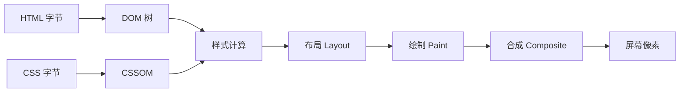
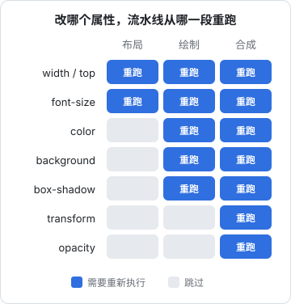

# 浏览器渲染流水线

## 这本书讲什么

前端这个行当有两张面孔。一张是**浏览器**：HTML、CSS、JavaScript 最后怎么变成屏幕上的像素，哪些写法会让页面卡、闪、跳，浏览器替你挡了哪些安全问题。另一张是**工程**：Vite 怎么把几百个模块打成十几个文件，pnpm workspace 怎么让几个 app 共用一份代码，Tailwind、Radix、ESLint、测试工具各管哪一段。

这本书两边各讲一半，前三章和最后一章讲浏览器，中间六章讲工程。贯穿全书的案例是 hatch-counter（掌柜眼）的网页端 `apps/web`：Vite 8 + React 19 + Tailwind 4 + Radix（经 shadcn 生成），放在一个 pnpm 9 的 workspace 里，全仓一份 ESLint 10 扁平配置和 Prettier 3。它是一个真实在跑的产品，配置文件里的每条注释几乎都对应一次踩坑，比任何教程里的示例项目都更能说明「为什么这么配」。

**适合谁**：已经能用 React + Vite + Tailwind 写出页面，但对「样式为什么被覆盖」「首屏为什么慢」「这行配置删了会怎样」心里没底的开发者。不讲 HTML、CSS、JS 的语法入门。

**怎么读**：

| 你的问题 | 先读 |
|---|---|
| 页面卡顿、动画掉帧 | 本章、[Web Vitals 与性能](03-web-vitals.md) |
| 样式被莫名其妙覆盖、z-index 不生效 | [CSS 布局与层叠](02-css-layout-cascade.md) |
| 搭一个新项目的工具链 | 第 4–9 章按顺序读 |
| 上线前做安全检查 | [CORS / CSP 与前端安全](10-cors-csp.md) |

版本敏感的配置都写明了版本（以 2026 年 11 月 hatch-counter 锁定的版本为准）。前端工具更新很快，照着抄之前先看一眼官方文档的迁移指南。

## 从字节到像素

浏览器拿到一份 HTML 之后，要经过一条固定的流水线才能把它画到屏幕上。理解这条流水线，是理解几乎所有前端性能问题的前提：**每一种卡顿，都是某一段流水线被迫重跑了太多次，或者某一段跑得太久**。



| 阶段 | 做什么 | 产物 |
|---|---|---|
| 解析 | HTML 解析成 DOM，CSS 解析成 CSSOM | 两棵树 |
| 样式计算（Style） | 给每个元素算出最终生效的每一条 CSS 属性 | 计算后样式 |
| 布局（Layout，也叫 Reflow） | 算出每个盒子的位置和尺寸 | 布局树 |
| 绘制（Paint） | 把盒子变成「画什么、按什么顺序画」的指令列表，再光栅化成位图 | 一块块图层的位图 |
| 合成（Composite） | 把图层按顺序、带上变换和透明度叠成最终画面 | 一帧 |

### 解析：脚本为什么会挡住页面

HTML 解析器从上往下读。遇到 `<link rel="stylesheet">`，它会去下载 CSS，但不停下解析；遇到普通的 `<script>`（没有 `defer`、`async`、`type="module"`），它**必须停下来**：脚本可能会 `document.write`，也可能读取前面元素的样式，所以浏览器要先下载、执行完脚本才能继续。

| 写法 | 下载时阻塞解析吗 | 何时执行 |
|---|---|---|
| `<script src>` | 阻塞 | 下载完立刻执行 |
| `<script defer src>` | 不阻塞 | DOM 解析完后，按书写顺序 |
| `<script async src>` | 不阻塞 | 下载完立刻执行，顺序不定 |
| `<script type="module" src>` | 不阻塞 | 默认等同 defer |

Vite 产出的入口就是一个 `<script type="module">`，所以天然不挡解析。

hatch-counter 的 `index.html` 里还有两段**故意写成阻塞**的内联脚本，放在 `<head>` 里、主包之前：

- 一段测浏览器够不够新（测 `CSS.supports("color", "color-mix(in srgb, red, blue)")`），够不着就整页换成「浏览器太旧」的提示
- 一段在第一帧之前读 `localStorage` 里的主题，给 `<html>` 挂上 `dark` 类

第二段就是阻塞脚本的正当用途：如果等 React 起来再挂深色主题，用户每次打开都会先看到一帧白底再变黑。**需要在第一帧之前生效的东西，只能放在阻塞位置**，而且要短。

### CSS 也会阻塞渲染

CSS 不挡解析，但挡**渲染**：浏览器在 CSSOM 建好之前不会画第一帧，否则会先画出无样式的页面再闪一下（FOUC）。所以 CSS 是关键路径上的资源，体积和数量都直接影响首屏时间。这也是 Tailwind 这类「只生成用到的类」的方案在性能上站得住的原因之一，第 6 章再展开。

## 样式计算与布局

### 样式计算

样式计算回答的问题是：这个元素的 `color` 到底是多少？答案取决于层叠、继承和选择器匹配（第 2 章细讲）。它的成本和**受影响的元素数 × 规则复杂度**成正比。改一个挂在 `<html>` 上的类（比如切换 `.dark`），整棵树的样式都要重算，但这只发生一次，没问题；问题出在每帧都重算。

### 布局

布局是最贵的阶段之一，因为它是**全局的**：一个元素宽度变了，它的兄弟、父元素、父元素的兄弟都可能跟着变。会触发布局的改动包括：

- 几何属性：`width`、`height`、`padding`、`margin`、`top`、`left`、`font-size`
- 内容变化：插入删除节点、改文字
- 窗口尺寸变化

### 强制同步布局

浏览器默认会**攒着**这些改动，等到下一帧统一算一次布局。但如果你改了样式之后马上读几何信息，浏览器为了给你正确的值，只能当场把布局算完。这叫**强制同步布局**（forced synchronous layout）。放在循环里就是**布局抖动**（layout thrashing）：

```ts
// 坏：每一轮先写后读，每一轮都强制算一次布局
for (const el of rows) {
  el.style.height = `${el.offsetWidth / 2}px`;
}

// 好：先把要读的一次读完，再统一写
const widths = rows.map((el) => el.offsetWidth);
rows.forEach((el, i) => {
  el.style.height = `${widths[i] / 2}px`;
});
```

会触发强制布局的读操作很多：`offsetWidth`、`offsetTop`、`clientHeight`、`scrollTop`、`getBoundingClientRect()`、`getComputedStyle()` 等。React 组件里在 `useLayoutEffect` 里读尺寸是常见场景，读一次没问题，别在一次渲染里交替读写几十次。

hatch-counter 的 `ScrollBox` 组件每次渲染后都要量一遍滚动行程，项目文档里特别强调「量出来没变必须原样返回」：如果量完总是 `setState` 一个新对象，就会触发重渲染 → 再量 → 再 setState 的死循环，React 直接报最大更新深度错误。这是布局读取和 React 状态互相驱动时的典型陷阱。

## 绘制与合成

### 图层

现代浏览器不会把整个页面画成一张位图，而是拆成若干**图层**（layer），每层单独光栅化，最后交给 GPU 叠起来。会被提升为独立图层的情况包括：有 `transform` 动画或 `will-change: transform`、`<video>`、`<canvas>`、`position: fixed` 的某些情况等。

图层的好处是：**只改变换和透明度时，不用重新绘制位图，只需要重新合成**。合成通常跑在独立的合成线程上，主线程被 JavaScript 占住时它也能继续出帧。

### 改哪个属性，跑到哪一段

这是本章最实用的一张图：改不同的属性，流水线从不同的位置开始重跑。



所以做动画的第一原则是：**能用 `transform` 和 `opacity` 做的，就不要用 `top` / `left` / `width` / `height`**。

```css
/* 坏：每帧都触发布局 */
.drawer { transition: left 200ms; }
.drawer[data-open] { left: 0; }

/* 好：只触发合成 */
.drawer { transition: transform 200ms; transform: translateX(-100%); }
.drawer[data-open] { transform: translateX(0); }
```

hatch-counter 里「最好的一天」那个格子有一道扫过的斜光动画，注释里写着「只动 transform，不碰布局」，并且在 `prefers-reduced-motion: reduce` 下关掉，这两点就是动画的标准做法。

### will-change 不是越多越好

`will-change: transform` 会提前把元素提升为图层，但每个图层都要占显存。给几百个列表项都加上，反而会让合成变慢、移动设备上内存吃紧。只给**确实要动、且动之前就能预知**的少数元素加。

## 一帧里发生了什么

屏幕通常每秒刷新 60 次（高刷屏 120 次），一帧大约 16.7ms（或 8.3ms）。浏览器在一帧里要做的事大致是：


主线程只有一条，JavaScript、样式、布局、绘制都在上面排队。一个跑了 200ms 的 JavaScript 任务，意味着这 200ms 里点击没反应、动画冻住，这就是第 3 章要讲的 INP 指标在度量的东西。超过 50ms 的任务被称为**长任务**（long task）。

几个实用的推论：

- 视觉更新放进 `requestAnimationFrame`，它保证在下一次绘制前执行，不会白算
- 大块计算要么拆小（每一小块之间让出主线程），要么挪到 Web Worker
- 把 `setTimeout(fn, 0)` 当作「让出主线程」的手段可以用，但新代码可以优先看 `scheduler.yield()`（较新的 API，用前查浏览器支持情况）

## 用 DevTools 看流水线

光知道原理不够，要能在真实页面上看到。Chrome DevTools 里最有用的几处：

| 面板 | 看什么 |
|---|---|
| Performance → 录制 | 主线程火焰图：紫色是样式和布局，绿色是绘制，黄色是脚本；红色三角标记长任务 |
| Rendering → Paint flashing | 每次重绘的区域闪绿，找「不该重绘却在重绘」的区域 |
| Rendering → Layout Shift Regions | 布局偏移闪蓝，配合第 3 章的 CLS 用 |
| Layers | 当前有哪些图层、为什么被提升 |

一个排查流程：

1. Performance 面板里开启 CPU 降速（4× 或 6×），模拟店里的老电脑
2. 录制一段卡顿的操作
3. 找红色三角的长任务，展开看是脚本、样式还是布局
4. 如果是布局，看底部 Summary 里有没有「Forced reflow」警告，它会指出是哪一行代码读了几何属性

开发机上的 M 系列芯片会掩盖几乎所有性能问题。hatch-counter 照 1024 宽、老电脑来排版，并把构建目标钉在 Chrome 111，都是因为真实用户的机器和开发机差得很远。**降速录制应该成为习惯**。

## 本章要点

- 渲染流水线：解析 → 样式计算 → 布局 → 绘制 → 合成；卡顿就是某段重跑太多或跑太久
- 普通 `<script>` 阻塞解析，CSS 阻塞渲染；只有必须在第一帧前生效的东西（如主题）才该放在阻塞位置
- 先写后读几何属性会强制同步布局，循环里就是布局抖动：读写分批
- 动画只用 `transform` 和 `opacity`，它们只触发合成；`will-change` 克制使用
- 主线程只有一条，超过 50ms 的任务就是长任务，会直接拖慢交互响应
- 在 DevTools 里开 CPU 降速录制，开发机的性能会掩盖用户的真实体验
