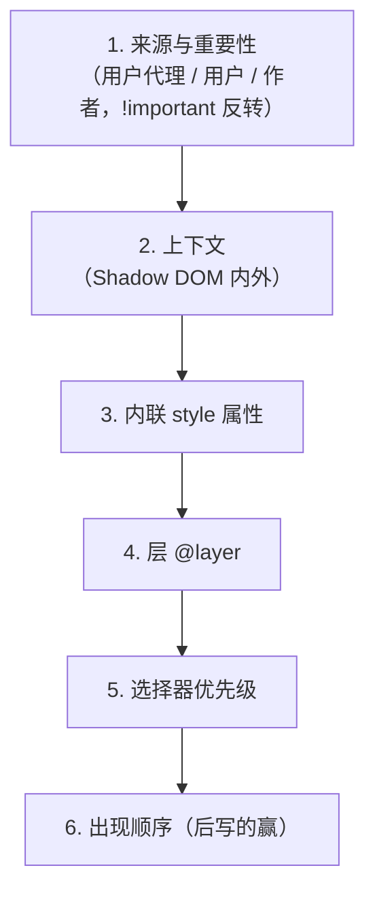

# CSS 布局与层叠

CSS 最让人困惑的两件事，一是「我写的样式为什么没生效」，二是「这个元素为什么跑到那儿去了」。前者是**层叠**的问题，后者是**布局**的问题。用 Tailwind 之后这两类问题并没有消失，只是换了个样子：`className` 里同时写了 `p-2` 和 `p-4` 谁赢？自己写的一段 CSS 为什么压得过 Tailwind 的工具类？弹层为什么被父元素裁掉？本章把这些背后的规则讲清楚。

## 层叠：谁说了算

同一个元素的同一个属性，可能被好几条规则同时设置。浏览器按一个固定的顺序决定谁赢，这个过程就叫**层叠**（cascade）。从高到低依次比较，前一级分出胜负就不再往下看：



大多数人只记得第 5、6 两条，但现代 CSS 里**第 4 条（层）经常比优先级更关键**，而 Tailwind 4 正是建立在层之上的。

### 优先级

选择器优先级按 (ID 数, 类/属性/伪类数, 元素/伪元素数) 三元组比较：

| 选择器 | 优先级 |
|---|---|
| `p` | (0, 0, 1) |
| `.card` | (0, 1, 0) |
| `.card p` | (0, 1, 1) |
| `[data-state="open"]` | (0, 1, 0) |
| `#app .card` | (1, 1, 0) |
| `:where(.card)` | (0, 0, 0)，`:where()` 永远是零 |
| `:is(.card, #app)` | 取参数里最高的，(1, 0, 0) |

Tailwind 的工具类基本都是单个类，优先级 (0, 1, 0)。所以两个工具类冲突时，**谁赢取决于它们在生成的 CSS 里的先后，而不是你在 `className` 里写的先后**。`className="p-4 p-2"` 和 `className="p-2 p-4"` 效果一样，都看 Tailwind 把哪个排在后面。这就是 `tailwind-merge` 存在的理由，第 7 章会讲 hatch-counter 的 `cn()` 函数。

### 层 @layer

`@layer` 让你把样式分成有名字的层，并显式规定层的先后：

```css
@layer reset, base, components, utilities;

@layer components {
  .btn { padding: 8px 16px; }
}
@layer utilities {
  .p-0 { padding: 0; }
}
```

规则是：**后声明的层赢，不管选择器优先级**。`utilities` 层里一个 (0, 1, 0) 的 `.p-0`，能压过 `components` 层里 (1, 2, 0) 的选择器。层把「谁该赢」从选择器写法里解放出来，变成了架构上的约定。

还有一条容易踩的规则：**没有放进任何层的样式，比所有层都优先**（对普通声明而言；`!important` 的顺序反过来）。

Tailwind 4 生成的 CSS 放在 `theme`、`base`、`components`、`utilities` 几个层里。于是在 hatch-counter 的 `src/index.css` 里，`@import "tailwindcss"` 之后直接写的 `.best-day { overflow: hidden; }` 这类规则不在任何层里，它会压过工具类 `overflow-visible`。这通常正是你想要的（手写的特例比通用工具类优先），但如果你想写一个「可以被工具类覆盖的默认样式」，就要把它放进 `@layer components` 或用 Tailwind 4 的 `@utility` 指令。

| 想要的效果 | 写在哪 |
|---|---|
| 全局元素默认样式，如 `::placeholder` 颜色 | `@layer base`，或直接写（不会和工具类冲突时） |
| 组件默认样式，允许 `className` 覆盖 | `@layer components` |
| 自定义一个新工具类，支持 `hover:` 等变体 | `@utility` |
| 必须压过所有工具类的特例 | 不放进层 |

### 继承与 CSS 变量

`color`、`font-*`、`line-height` 等文字相关属性默认继承，`margin`、`border`、`background` 等盒模型属性不继承。CSS 自定义属性（`--xxx`）**全部继承**，这是主题切换能工作的基础：hatch-counter 在 `:root` 上定义一套 `--background`、`--primary`，在 `.dark` 上重定义同名变量，`.dark` 下面的所有元素自动拿到深色的值。

它的注释里还点出一个妙用：`.dark` / `.light` 是**作用域**而不是全局开关，挂在某个容器上就只换那一块。主题设置页里在浅色页面中预览一块深色界面，靠的就是变量的继承。

## 盒模型与格式化上下文

### box-sizing

默认的 `content-box` 下，`width` 只算内容区，加上 `padding` 和 `border` 后实际更宽。几乎所有现代项目都在 reset 里改成 `border-box`，Tailwind 的 Preflight 也是如此。

### 块格式化上下文

**块格式化上下文**（BFC）是一个独立的布局区域，里面的元素不会影响外面。创建 BFC 的方式包括 `display: flow-root`、`overflow` 非 `visible`、flex / grid 子项等。它解释了几个经典现象：

- 父元素包不住浮动子元素：给父元素建 BFC（`display: flow-root`）
- 上下相邻块的 `margin` 合并成一个：BFC 之间不合并；flex 和 grid 容器里的子项也不合并

如今几乎不用浮动布局，外边距合并是最常遇到的那个。很多团队干脆约定「只用 `gap` 和 `padding` 留空，不用 `margin`」，在 flex / grid 里 `gap` 天然没有合并问题。

## Flexbox 和 Grid

### 怎么选

| 场景 | 用 |
|---|---|
| 一行或一列，内容决定尺寸（工具栏、按钮组、表单行） | Flex |
| 二维对齐，行和列都要对齐（卡片网格、仪表盘、表单标签列） | Grid |
| 页面骨架：页头 + 可滚动内容 + 页脚 | Flex 纵向，或 Grid `grid-template-rows: auto 1fr auto` |

### flex 子项为什么不肯缩小

一个高频坑：flex 子项里有长文本或可滚动区域，结果它把整个容器撑破，不肯缩。原因是 flex 子项的 `min-width`（纵向时是 `min-height`）默认是 `auto`，即「不小于内容的最小尺寸」。

```html
<!-- 页面根节点纵向铺满，中间那块可滚动 -->
<div class="flex h-full flex-col">
  <header class="shrink-0">页头</header>
  <!-- 没有 min-h-0 的话，这一块会被内容撑高，滚动永远不出现 -->
  <main class="min-h-0 overflow-auto">内容</main>
</div>
```

hatch-counter 的界面约定里有一条「每一页按页面高度铺满，滚的只有内容那一块」，它的 `ScrollBox` 就是靠 `min-h-0` 加默认的 `flex-shrink` 实现的：内容少时按内容高度，内容多时才压到剩余高度开始滚。文档里特别写了 `ScrollBox` 不写 `flex-1`，否则七行的清单也会被撑成一个大空框。这是对 flex 收缩规则吃得很透的写法。

`truncate`（单行省略号）在 flex 子项里不生效，原因相同，也是给子项加 `min-w-0`。

### Grid 的几个关键写法

```css
/* 自适应列数：每列至少 200px，放得下几列放几列 */
.cards { display: grid; grid-template-columns: repeat(auto-fill, minmax(200px, 1fr)); gap: 16px; }

/* 1fr 也有最小内容的问题，用 minmax(0, 1fr) 让它真正可以缩 */
.layout { display: grid; grid-template-columns: 220px minmax(0, 1fr); }
```

`subgrid` 让子元素的网格对齐父网格的轨道，适合「每张卡片的标题、正文、按钮各自对齐」这种需求，主流浏览器都已支持，但如果你像 hatch-counter 一样要照顾较老的 Chrome，用前先查兼容版本。

## 容器查询

媒体查询问的是「视口有多宽」，容器查询问的是「我所在的容器有多宽」。对组件来说后者才是对的问题：同一张卡片放在侧栏里和放在主区域里，可用宽度完全不同。

```css
.content { container-type: inline-size; }

@container (min-width: 48rem) {
  .stats { grid-template-columns: repeat(4, 1fr); }
}
```

Tailwind 4 把容器查询做进了核心：父元素加 `@container`，子元素用 `@lg:`、`@max-4xl:` 这样的变体。

hatch-counter 的界面约定明确规定**页面排版用 `@container` 断点，不用视口断点**，理由很具体：左边有 230px 的侧栏，视口断点会把侧栏算进去，判断偏宽。内容区那一层是容器查询的上下文；弹窗是 portal 到 `body` 下的，够不着内容区，所以 `DialogContent` 自己挂了 `@container`。它还扩展了一档 `--container-8xl: 100rem`，注释里记了一个坑：写成任意值 `@[1600px]` 的话，这种带方括号的断点在生成的 CSS 里排在 `@5xl` 前面，同一个属性两边都写时会被 `@5xl` 压住，而且不报错。这又是「工具类冲突看生成顺序」的一个实例。

## 定位与层叠上下文

### z-index 为什么不生效

`z-index` 只在同一个**层叠上下文**（stacking context）里比较。一个元素一旦创建了层叠上下文，它的所有子元素就被「封装」在里面，子元素的 `z-index: 9999` 也出不了父元素这一层。

创建层叠上下文的常见情况：

- `position` 非 `static` 且 `z-index` 不是 `auto`
- `position: fixed` 或 `sticky`
- `opacity` 小于 1
- `transform`、`filter`、`backdrop-filter` 不是 `none`
- `isolation: isolate`
- flex / grid 子项且 `z-index` 不是 `auto`

hatch-counter 的侧栏和名字卡用了毛玻璃（`--glass` 配 `backdrop-filter`），这就创建了层叠上下文。如果在侧栏里直接渲染一个下拉菜单，它会被困在侧栏的上下文里，可能被主内容盖住。

### Portal 是根本解法

所以 Radix 的 Dialog、Popover、DropdownMenu、Tooltip 都默认通过 **Portal** 把浮层渲染到 `document.body` 下面，彻底跳出所有祖先的层叠上下文和 `overflow: hidden` 裁剪。第 7 章会再讲到它。

同理，`overflow: hidden` 会裁掉子元素超出的部分，`position: absolute` 的弹层也逃不掉（除非定位参照的祖先在裁剪容器之外）。看到「弹层被裁了一半」，先往上找 `overflow`。

### fixed 不一定相对视口

`position: fixed` 通常相对视口定位，但如果某个祖先有 `transform`、`filter` 或 `will-change: transform`，fixed 元素就改为相对**那个祖先**定位。弹窗里的 fixed 元素「莫名其妙跟着走」，多半是这个原因：Radix Dialog 的居中写法就用了 `translate-x-[-50%]`。

## 新特性与兼容性线

近几年 CSS 加了很多过去要靠 JavaScript 或预处理器才能做到的能力：

| 特性 | 用途 |
|---|---|
| `:has()` | 父选择器：`label:has(input:checked)` |
| 原生嵌套 | `.card { &:hover { } }` |
| `color-mix()` | 在 CSS 里混色：`color-mix(in oklab, var(--card) 86%, white)` |
| `oklch()` | 感知均匀的色彩空间，调亮度不偏色 |
| `@property` | 给自定义属性声明类型，使其可动画 |
| 层 `@layer` | 见上文 |

用这些特性之前要先定**兼容性线**。hatch-counter 的线是 Chrome / Edge 111，来源是 Tailwind 4 本身：Tailwind 4 依赖层、`@property`、`color-mix()` 这些特性，官方给出的最低版本是 Safari 16.4、Chrome 111、Firefox 128。够不着时不是「部分样式不对」，而是大面积塌掉。所以它的做法是：`index.html` 里测 `color-mix()`，测不过就整页换成提示，而不是让用户面对一个乱掉的界面；构建目标也钉在 `chrome111`，第 4 章细讲。

## 本章要点

- 层叠按 来源与重要性 → 内联 → 层 → 优先级 → 顺序 依次比较；Tailwind 4 建立在 `@layer` 之上
- 未分层的样式压过所有层；想让工具类能覆盖的默认样式，放进 `@layer components` 或用 `@utility`
- 两个工具类冲突时看生成的 CSS 顺序，不看 `className` 里的顺序
- CSS 变量全部继承，主题可以作用于局部容器
- flex 子项默认 `min-width: auto`，滚动区和省略号不生效时加 `min-w-0` / `min-h-0`
- 组件响应式用容器查询；有固定侧栏的应用尤其不该用视口断点
- `z-index` 只在同一层叠上下文里比较；`transform`、`opacity`、`backdrop-filter` 都会创建新上下文，浮层用 Portal 逃出去
- 先定浏览器兼容性线，再决定能用哪些新特性
