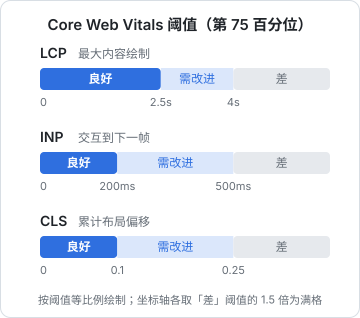
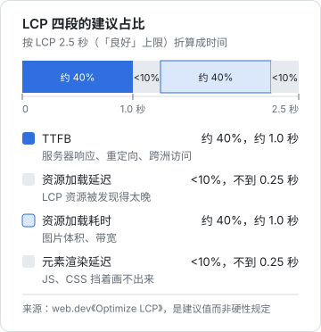
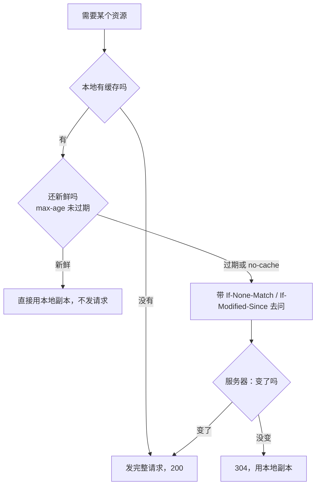
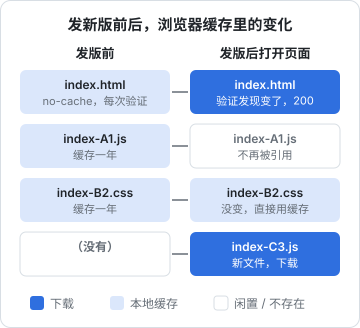

# Web Vitals 与性能

「页面快不快」是一个很模糊的问题。用户说「慢」，可能是白屏太久，可能是点了按钮没反应，也可能是正要点的时候按钮跳走了。**Core Web Vitals** 把这三种体验各用一个可测量的指标表示出来：LCP、INP、CLS。本章讲清这三个指标在量什么、怎么优化，以及和首屏速度关系最大的一件事：浏览器缓存。服务端怎么发缓存头，[《Nginx 与反向代理》](../nginx-gateway/)已经讲过；这里站在浏览器一侧，讲它收到这些头之后做了什么。

## 三个核心指标

> [!WARNING]
> 本节的指标定义和阈值按 2026 年 11 月 web.dev 的《Web Vitals》《LCP》《INP》《CLS》各篇与 2024 年 3 月的公告「INP 取代 FID」整理（INP 于 2024 年 3 月 12 日正式取代 FID）。Google 会调整核心指标和阈值，以 web.dev 最新说明为准。

| 指标 | 全称 | 量的是 | 用户感受 |
|---|---|---|---|
| LCP | Largest Contentful Paint | 视口内最大的图片或文字块画出来的时间 | 「主要内容出来了没有」 |
| INP | Interaction to Next Paint | 一次点击、按键到下一帧画出来的延迟，取整个访问过程中较差的那一次 | 「点了有没有反应」 |
| CLS | Cumulative Layout Shift | 页面元素意外移动的累计程度 | 「东西有没有乱跳」 |

INP 在 2024 年 3 月取代了旧的 FID 成为核心指标。FID 只量第一次交互的输入延迟，INP 量的是整个访问期间的交互，且包含事件处理和渲染的时间，更接近真实体验。



判定时取的是**所有访问的第 75 百分位**：也就是说，要 75% 的访问都落在「良好」区间里，这个页面才算达标。只看自己电脑上的一次测量没有意义。

### 实验室数据和现场数据

| | 实验室数据（Lab） | 现场数据（Field / RUM） |
|---|---|---|
| 来源 | Lighthouse、DevTools，在固定条件下跑一次 | 真实用户的浏览器上报 |
| 优点 | 可复现，适合定位问题 | 反映真实设备和网络 |
| 缺点 | 不代表用户；量不出 INP（没有真实交互） | 需要采集和汇总 |

对于 hatch-counter 这种登录后才能用的后台应用，搜索引擎的排名信号无关紧要，Web Vitals 的价值在于给「店主觉得卡」一个可以量化的抓手。采集现场数据可以用 Google 维护的 `web-vitals` 库，几行代码就能拿到三个指标，再上报到自己的服务端：

```ts
import { onCLS, onINP, onLCP, type Metric } from "web-vitals";

function report(metric: Metric) {
  // sendBeacon 在页面关闭时也能发出去
  const body = JSON.stringify({ name: metric.name, value: metric.value, rating: metric.rating });
  navigator.sendBeacon("/v1/reports/vitals", new Blob([body], { type: "application/json" }));
}

onLCP(report);
onINP(report);
onCLS(report);
```

注意 `Blob` 的类型要显式写成 `application/json`。hatch-counter 在「浏览器太旧」的上报里专门踩过这个坑：`sendBeacon` 直接传字符串时 Content-Type 是 `text/plain`，只解析 JSON 的服务端拿到的是空 body。（上面的 `/v1/reports/vitals` 是示意路径，hatch-counter 本身并没有这条接口。）

## LCP：主要内容要快

LCP 可以按先后拆成四段：TTFB（服务器首字节）、资源加载延迟（多久才开始下载 LCP 资源）、资源加载耗时、元素渲染延迟（下载完到画出来）。web.dev 给过一个建议占比：两段「真在干活」的 TTFB 和加载耗时各占约 40%，两段「在等」的延迟各不超过 10%。哪段明显超出这个比例，就先优化哪段：



这个比例是 web.dev《Optimize LCP》里的经验值，原文也说是指引而不是硬性规定。实际排查时在 DevTools 的 Performance 面板里点开 LCP，就能看到四段各自的耗时。

| 段 | 常见原因 | 办法 |
|---|---|---|
| TTFB 长 | 服务端慢、没有缓存、跨洲访问 | 服务端优化、CDN（属于后端和运维） |
| 加载延迟长 | LCP 图片藏在 JS 里才发现，或被懒加载了 | 首屏图片写在 HTML 里，加 `fetchpriority="high"`，别加 `loading="lazy"` |
| 加载耗时长 | 图片太大 | 用 WebP / AVIF，按显示尺寸出图，`srcset` |
| 渲染延迟长 | 单页应用要等 JS 下载、执行、取数据才渲染 | 减小首屏 JS，代码分割，关键 CSS 不阻塞 |

单页应用（SPA）的 LCP 天生吃亏：HTML 里只有一个空的 `<div id="root">`，所有内容都要等 JavaScript。hatch-counter 网页端是 SPA，它控制首屏体积的手段有两个：

1. **路由级代码分割**：构建产物里有两百多个文件，每个页面、每个大组件各成一块，打开哪页才下载哪页
2. **大依赖动态导入**：ExcelJS 单独就九百多 KB，项目规定 SheetJS 和 ExcelJS「只许在 `src/host/` 里 `await import()`」，静态引用一处，整个包就会进入首屏、连登录页都要背着它

```ts
// 只有在用户点「导出」时才下载 ExcelJS
async function exportWorkbook(rows: Row[]) {
  const { default: ExcelJS } = await import("exceljs");
  const wb = new ExcelJS.Workbook();
  // ...
}
```

`vite.config.ts` 里的 `chunkSizeWarningLimit: 1000` 也是为它开的：ExcelJS 这一块本身就超过默认的 500KB 警告线，但它不在首屏，所以把警告阈值调高，而不是去拆它。

登录页的封面图用的是 WebP（产物里的 `login-cover-*.webp`），这是 LCP 元素最可能出现的页面。

## INP：交互要有回应

INP 也拆成三段：

| 段 | 含义 | 常见原因 |
|---|---|---|
| 输入延迟 | 用户操作到事件处理开始 | 主线程正被别的长任务占着 |
| 处理时间 | 事件回调执行 | 回调里同步做了太多事，触发了大范围重渲染 |
| 呈现延迟 | 回调结束到下一帧画出 | 渲染的 DOM 太多，样式和布局太贵 |

对 React 应用，INP 差几乎总是「一次交互引起了太大范围的重渲染」。几个方向：

- **先给反馈再干活**：点按钮后先把按钮置成加载态，重活放到下一帧之后
- **用 `startTransition` 标记非紧急更新**：输入框的字立刻更新，筛选结果的列表作为过渡更新，可以被打断
- **长列表虚拟化**：几千行的表只渲染可视区的几十行
- **避免在交互路径上强制同步布局**：见第 1 章

React 的并发渲染和 Compiler 怎么帮你减少重渲染，[《React 19 原理与模式》](../react-internals/)里有完整的讲解。

## CLS：别让东西乱跳

CLS 记录的是「没有用户操作时」元素的意外位移。用户点击后 500ms 内发生的位移不计入，所以点「展开」导致下面内容下移是正常的。常见的元凶：

| 原因 | 办法 |
|---|---|
| 图片没写尺寸，加载完把下面的内容顶下去 | 写 `width` / `height` 属性或 CSS `aspect-ratio` |
| 数据回来前什么都不渲染，回来后整块插进来 | 用固定高度的骨架屏占位 |
| 字体加载完后换字体，行高变化 | `font-display` 配合尺寸接近的后备字体，或直接用系统字体 |
| 顶部插入横幅、提示条 | 用覆盖层而不是插入文档流，或预留位置 |

hatch-counter 在这方面有一条很细的约定：每个页面的副标题（`PageHeader` 的 `description`）**必填**，类型系统不接受 `undefined`，行高钉在 20px。数据回来之前先显示一句描述这一页做什么的抽象说明，回来后再换成带数字的。如果「没数据就不渲染副标题」，数据一到整页往下一跳；如果空着占位，又是一块空白。字体则全部用系统字体栈（`--font-sans` 里是 `-apple-system`、`PingFang SC`、`Microsoft YaHei` 等），连招牌字也只用系统自带的宋体，不打包网络字体，从根上避免了字体切换导致的偏移，也省掉了中文字体动辄几 MB 的下载。

## 浏览器缓存：从浏览器这一侧看

首屏性能里最便宜的优化是「根本不下载」。浏览器的 HTTP 缓存决定了一个资源是直接从本地拿、问一下服务器再拿，还是重新下载。

### 一次请求的决策过程



| 响应头 | 浏览器的行为 |
|---|---|
| `Cache-Control: max-age=31536000` | 一年内直接用本地副本，连请求都不发 |
| `Cache-Control: immutable` | 新鲜期内即使用户点刷新也不去重新验证 |
| `Cache-Control: no-cache` | **可以**存，但每次用之前必须问服务器（304 很便宜） |
| `Cache-Control: no-store` | 根本不存 |
| 什么都没写 | 浏览器按启发式规则自己估一个新鲜期，行为不可控 |

最常见的误解是把 `no-cache` 当成「不缓存」。它的意思是「每次都要重新验证」，配合 `ETag` 时代价只是一个往返和一个空的 304。

### 带哈希的文件名

缓存的根本矛盾是：缓存越久越快，但发新版后用户可能还在用旧的。解法是**让内容变化时 URL 也变化**。Vite 构建出来的文件名都带内容哈希，比如 `index-0FQ0ey3Q.js`，内容一变哈希就变，等于一个新文件。于是可以放心地让浏览器缓存一年。

而 `index.html` 本身的文件名不能变（用户访问的就是它），所以它必须每次都验证。这就形成了 SPA 的标准缓存策略，hatch-counter 线上的 nginx 正是这样配的：

| 路径 | 缓存头 | 浏览器侧效果 |
|---|---|---|
| `/assets/*`（带哈希） | `max-age` 一年 + `immutable` | 永远不再请求，直到 HTML 指向新文件 |
| `/index.html` | `no-cache` | 每次打开都问一下，没变就 304 |
| `/manifest.webmanifest` | `no-cache` | 同上，改了图标能及时生效 |



### 开着的页签怎么办

上面的策略解决了「下次打开」的问题，但店主可能一整天不关浏览器页签，它运行的始终是早上加载的那一版 JavaScript。hatch-counter 的做法是：构建时在 `dist/` 根上写一份 `version.json`（只有一个版本号），开着的页面隔一段时间请求一次它，发现和自己的版本号不同就顶部出一条「有新版」的提示条。这份文件和页面同一个包上线，所以它说的就是 nginx 此刻真正在发的那一版。

这件事还有一个配套风险：旧页面懒加载一个页面时，请求的是旧哈希的文件名。如果部署时把旧的 `assets/` 删光，就会 404，表现为「点某个菜单白屏」。所以部署时最好**保留上一两版的旧资源**，或者在动态导入失败时提示刷新。

### 其他几层缓存

| 缓存 | 说明 |
|---|---|
| 内存缓存 | 同一个页面生命周期内重复用到的资源，关页签就没了 |
| HTTP 磁盘缓存 | 上面讲的这一层 |
| Service Worker 缓存 | 由你的 JS 完全控制，可以做离线；也最容易把用户卡在旧版本上 |
| 往返缓存 bfcache | 点后退时整个页面从内存恢复，连 JS 状态都在；页面用了 `unload` 事件或 `Cache-Control: no-store` 会让它失效 |

hatch-counter 网页端有 manifest、能「安装到桌面」，但没有用 Service Worker 做离线：它是联网的薄客户端，数据只在服务端一份，离线缓存只会带来「看到的是旧数据」的风险。不需要离线就别引入 Service Worker，这是很实际的取舍。

## 本章要点

- LCP 量主要内容出现，INP 量交互响应，CLS 量布局稳定；按第 75 百分位判定
- 阈值：LCP ≤ 2.5s、INP ≤ 200ms、CLS ≤ 0.1 为良好
- SPA 的 LCP 关键在首屏 JS 体积：路由分割，大依赖只在用时 `await import()`
- INP 差多半是一次交互引起的大范围重渲染或长任务
- CLS 靠预留空间：图片写尺寸、骨架占位、文案先占行、用系统字体
- `no-cache` 是「每次验证」不是「不缓存」；带哈希的资源缓存一年，`index.html` 每次验证
- 长时间开着的页签需要单独的「有新版」机制；部署时保留旧哈希资源

## 动手练习

1. **在 Network 面板里看两种缓存**：用 Node 写一个最小服务（`cache.mjs`）：

   ```js
   import { createServer } from "node:http";
   const html = "<!doctype html><script src=/assets/app-abc123.js></script><h1>v1</h1>";
   createServer((req, res) => {
     if (req.url.startsWith("/assets/")) {
       res.writeHead(200, { "content-type": "text/javascript", "cache-control": "max-age=31536000, immutable" });
       return res.end("console.log('app loaded')");
     }
     if (req.headers["if-none-match"] === '"v1"') { res.writeHead(304, { etag: '"v1"' }); return res.end(); }
     res.writeHead(200, { "content-type": "text/html", "cache-control": "no-cache", etag: '"v1"' });
     res.end(html);
   }).listen(8080);
   ```

   `node cache.mjs` 后用 Chrome 打开 `localhost:8080`，DevTools 的 Network 面板取消勾选 Disable cache，刷新两次。也可以先用 curl 验证：`curl -s -o /dev/null -w "%{http_code}\n" -H 'If-None-Match: "v1"' localhost:8080/`。

   验证：curl 那条输出 `304`。浏览器第二次刷新时，文档请求的状态是 `304`；`app-abc123.js` 那一行不再发请求，Size 列显示 `(memory cache)` 或 `(disk cache)`。

   参考答案：`no-cache` 的 HTML 每次都去验证，`ETag` 对得上就回一个空的 304；带哈希、`immutable` 的资源在新鲜期内连请求都不发。

2. **测一次布局偏移**：页面顶部放一张不写尺寸、延迟 1 秒才插入 `src` 的图片（`setTimeout(() => img.src = "big.jpg", 1000)`），下面放几段文字。在 Console 里先运行：

   ```js
   new PerformanceObserver((l) => l.getEntries().forEach((e) => console.log("shift", e.value.toFixed(3))))
     .observe({ type: "layout-shift", buffered: true });
   ```

   然后给 `` 写上 `width` 和 `height`（或 `style="aspect-ratio: 16 / 9; width: 100%"`）重试。

   验证：不写尺寸时，图片加载出来那一刻控制台打印一条 `shift`，数值大于 0，文字被顶下去；写了尺寸后不再打印（或数值为 0），文字从一开始就在最终位置。DevTools Rendering 面板勾选 Layout Shift Regions，不写尺寸时位移区域会闪蓝。

   参考答案：浏览器在图片下载之前不知道它多高，只能先按 0 排版；写了尺寸就能先把空间留出来。

3. **制造一个差的 INP**：页面上放一个按钮，点击处理里忙等 300 ms（`const end = performance.now() + 300; while (performance.now() < end);`）再改文字。打开 Performance 面板录一次点击；然后把它改成先改按钮文字为「处理中」，再 `setTimeout` 把忙等推到下一个任务，重录。

   验证：第一种写法在 Interactions 轨道上这次点击约 300 ms 以上，按钮文字要等忙等结束才变；第二种写法交互那一段只剩几毫秒，「处理中」立刻出现，300 ms 的长任务被挪到了下一帧之后。

   参考答案：INP 量的是从输入到下一帧绘制的时间。把重活挪到下一帧之后，用户先看到反馈，INP 就只包含那一小段处理。真正的计算量没有变，所以重活本身仍值得拆小或挪进 Worker。
