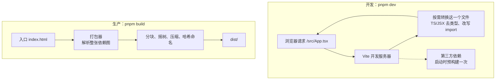

# Vite / esbuild / Rollup

`pnpm dev` 一秒起来，改一行代码浏览器立刻更新；`pnpm build` 几秒钟产出两百个文件。这背后是 Vite。很多人用了几年 Vite，对它的认识停留在「比 webpack 快」。本章讲清 Vite 在开发和构建时分别做了什么，它和 esbuild、Rollup、Rolldown 的关系，以及 hatch-counter 的 `vite.config.ts` 里每一段配置为什么存在。

本章以 **Vite 8.2**（hatch-counter 当前锁定的版本）为准。Vite 8 换了底层打包器，和 Vite 5、6、7 有明显区别，下文会指出来。

## 为什么需要打包器

浏览器原生支持 ES 模块（`<script type="module">` 和 `import`），那为什么还要打包？

| 问题 | 不打包时 |
|---|---|
| 裸模块名 | 浏览器不认识 `import React from "react"`，只认相对路径或完整 URL |
| 非 JS 资源 | `.tsx`、`.css`、图片、JSON，浏览器都不能直接 `import` |
| 请求瀑布 | 一个页面依赖几百个模块，浏览器要发几百个请求，而且是一层层发现的 |
| 体积 | 没有压缩、没有摇树（tree shaking），没用到的代码也下载 |
| 兼容性 | 新语法在老浏览器上跑不了 |

webpack 的思路是开发时也全量打包：改一个文件，重新打包受影响的部分再推给浏览器。项目一大，冷启动要几十秒，热更新也要几秒。

## Vite 的两种模式

Vite 的核心洞察是：**开发和生产的需求不同，就用不同的方式处理**。



### 开发：不打包，按需转换

开发时 Vite 不打包你的源码。浏览器请求哪个文件，它就当场转换那一个文件（去掉 TS 类型、把 JSX 编译成函数调用、把 `import "react"` 改写成预构建产物的路径）然后返回。冷启动只需要启动服务器，与项目大小几乎无关。

改了一个文件时，Vite 通过 WebSocket 通知浏览器，只替换那一个模块，React 插件配合 Fast Refresh 保留组件状态。这就是 HMR（热模块替换）。

### 依赖预构建

第三方依赖不按需转换，而是在启动时**预构建**一次，缓存在 `node_modules/.vite` 里。原因有两个：

1. **CommonJS 转 ESM**：很多 npm 包仍是 CommonJS，浏览器的 ESM 读不了
2. **合并碎文件**：像 `lodash-es` 这种包有几百个内部模块，不合并的话浏览器要发几百个请求

依赖预构建是 Vite 开发体验里最容易出问题的环节，hatch-counter 就踩过。

### 生产：完整打包

生产构建时 Vite 交给打包器做完整的打包：解析整张依赖图、摇树、代码分割、压缩、给文件名加哈希。产物是纯静态文件，扔给 nginx 就能用。

## esbuild、Rollup、Rolldown、Oxc

Vite 自己不实现转换和打包，而是组合别的工具。这几个名字的关系经常被搞混：

| 工具 | 语言 | 擅长 | 在 Vite 里的角色 |
|---|---|---|---|
| esbuild | Go | 极快的转换和打包，但插件和分块控制较弱 | Vite 2–7：开发时转换 TS/JSX、依赖预构建、默认压缩器 |
| Rollup | JS | 输出质量高、插件生态成熟、分块控制精细，但慢 | Vite 2–7：生产构建 |
| Rolldown | Rust | 兼容 Rollup 插件接口的高速打包器 | **Vite 8**：同时负责依赖预构建和生产构建 |
| Oxc | Rust | 解析、转换、压缩的工具集 | **Vite 8**：TS/JSX 转换和默认的 JS 压缩器 |
| Lightning CSS | Rust | CSS 解析、转换、压缩 | **Vite 8**：默认的 CSS 压缩器 |

Vite 7 及以前，开发用 esbuild、生产用 Rollup，两套工具行为不完全一致，偶尔出现「开发正常、构建后出错」的问题。Vite 8 改用 Rolldown 统一两边，在 hatch-counter 的 `node_modules` 里可以直接看到：vite 8.2.2 的依赖是 `rolldown`、`lightningcss`、`postcss` 等，已经没有 `esbuild`。

从 Vite 7 升级到 8 时，影响你配置的主要是改名：

| Vite 7 | Vite 8 |
|---|---|
| `build.rollupOptions` | `build.rolldownOptions`（旧名仍可用，已标记弃用） |
| `esbuild` 选项（转换） | `oxc` 选项（旧名已标记弃用） |
| `build.minify` 默认 esbuild | 默认 `oxc` |

具体的迁移细节以 Vite 官方的迁移指南为准，大版本升级前务必读一遍。esbuild 本身仍然是一个很好用的独立工具，比如给 Node 脚本打一个单文件包。

## 读懂 hatch-counter 的 vite.config.ts

下面逐段看 `apps/web/vite.config.ts`。

### 插件

```ts
export default defineConfig({
  plugins: [react(), tailwindcss(), contentSecurityPolicy(), versionFile()],
  resolve: { alias: { "@": path.resolve(__dirname, "src") } },
  // ...
});
```

- `@vitejs/plugin-react`（v6）：JSX 转换和 Fast Refresh
- `@tailwindcss/vite`（v4.3）：Tailwind 4 的官方 Vite 插件，比走 PostCSS 更快，第 6 章细讲
- 后两个是项目自己写的插件，下面讲
- `@` 别名要在 `tsconfig.json` 的 `paths` 里同步写一份，否则 Vite 认识、TypeScript 不认识

### 写一个 Vite 插件

Vite 插件就是一个带钩子的对象，兼容 Rollup 插件接口，外加几个 Vite 专属钩子。hatch-counter 的 `versionFile()` 是最小的例子：

```ts
function versionFile(): Plugin {
  return {
    name: "zgy-web-version",
    apply: "build", // 只在构建时生效
    generateBundle() {
      this.emitFile({
        type: "asset",
        fileName: "version.json",
        source: `${JSON.stringify({ version: pkg.version })}\n`,
      });
    },
  };
}
```

`generateBundle` 是打包器钩子，在产物写盘前调用；`emitFile` 往产物里加一个文件。这份 `version.json` 就是上一章「开着的页签检查新版」用的那份。

另一个插件 `contentSecurityPolicy()` 用的是 Vite 专属钩子 `transformIndexHtml`：在最终 HTML 上算出内联脚本的哈希，插入一条 CSP 的 `<meta>`。它同样是 `apply: "build"`，因为开发时 Vite 要往页面里注入自己的 HMR 脚本，挂上 CSP 会把它挡掉。第 10 章细讲 CSP。

| 常用钩子 | 时机 | 用途 |
|---|---|---|
| `config` / `configResolved` | 读配置时 | 修改或读取最终配置 |
| `resolveId` / `load` | 解析模块时 | 虚拟模块、自定义路径 |
| `transform` | 每个模块加载后 | 改写代码 |
| `transformIndexHtml` | 处理 HTML 时 | 注入标签、改 HTML |
| `generateBundle` | 产物写盘前 | 增删产物文件 |
| `configureServer` | 开发服务器启动 | 加中间件 |

### 一个 CommonJS 的 workspace 包

```ts
// @counter/core 出的是 CJS（服务端要 require 它），而 Vite 默认把 workspace 链接包
// 当源码直接送进浏览器——浏览器的 ESM 读不了 CJS 的具名导出，整个页面会崩在
// 「does not provide an export named 'XXX'」上，表现就是一片白屏。
optimizeDeps: { include: ["@counter/core"] },
```

这是依赖预构建最典型的坑。Vite 只预构建 `node_modules` 里的「真」依赖；通过 `workspace:*` 链接进来的本地包，它当作源码直接送给浏览器。而 `@counter/core` 为了让 NestJS 服务端能 `require`，编译成了 CommonJS。显式写进 `optimizeDeps.include`，Vite 才会把它转成 ESM。生产构建时打包器自己会处理 CommonJS，所以只有开发时出问题，「只验打包发现不了」。

项目文档里还记了一个更隐蔽的变体：页面第一次 import core 里一个以前没用过的导出，开发时也会白屏。预构建产物只带扫描时见过的具名导出，新的那个是 `undefined`，报错看起来和 core 毫无关系。删掉 `node_modules/.vite` 重启就好。**开发时出现与改动无关的白屏，先清预构建缓存**，这条经验适用于所有 Vite 项目。

### 开发代理

```ts
server: {
  port: PORT,
  strictPort: true,
  proxy: {
    "/v1": { target: SERVER, changeOrigin: false, ws: false },
  },
},
```

页面里的请求一律打相对路径 `/v1/...`。开发时 Vite 把它代理到本机 3000 端口的 NestJS；线上由 nginx 在同一个域名下反代。**页面和接口同源**，于是不需要 CORS，刷新令牌的 cookie 也是第一方的。第 10 章会看到这个决定省掉了多少麻烦。

`strictPort: true` 表示端口被占就直接报错退出，而不是悄悄换一个端口。文档里提到管理后台没设这一项，被占时会顺延到下一个端口，书签就打不开了。

### 构建目标

```ts
build: {
  outDir: "dist",
  emptyOutDir: true,
  target: "chrome111",
  sourcemap: false,
  chunkSizeWarningLimit: 1000,
},
```

`target` 决定输出代码用哪一版的语法：比目标浏览器新的语法会被降级。Vite 8 的默认值是 `baseline-widely-available`，按它的类型注释，对应 Chrome / Edge 111、Firefox 114、Safari 16.4 以上。

hatch-counter 显式钉死 `chrome111`，而不依赖默认值，注释里写得很直接：别抬，抬了 Chrome 112 往上那一截的店里电脑静默白屏，开发机上的新 Chrome 看不出来。默认值是一个随 Vite 版本移动的「Baseline 日期」，钉死则让这条线只在你主动决定时才变。

注意 `target` **只降级语法，不补 API**。用了 `Array.prototype.findLast` 这类新 API，在老浏览器上照样报错。需要 polyfill 要另外处理（比如 `@vitejs/plugin-legacy`），或者像 hatch-counter 那样明确兼容线、在入口探测、够不着就提示换浏览器。

### define 注入常量

```ts
define: {
  __APP_VERSION__: JSON.stringify(pkg.version),
},
```

`define` 在编译时做文本替换。值必须是 `JSON.stringify` 过的字符串，否则 `1.0.1` 会被当成代码而不是字符串。配套要在 `vite-env.d.ts` 里声明 `declare const __APP_VERSION__: string;`，TypeScript 才认识它。

环境变量则走 `import.meta.env`：只有 `VITE_` 前缀的变量会暴露给客户端代码。**任何打进前端包的东西都是公开的**，密钥绝不能用 `VITE_` 前缀，这一点在 hatch-counter 里体现为「识别服务的 key 只在服务端」。

## 代码分割

打包器根据 `import()` 动态导入自动切分代码块：

```ts
// App.tsx：每个页面一块
const ItemsPage = lazy(() => import("@/pages/items"));
const ImportPage = lazy(() => import("@/pages/import"));
```

几个页面都用到的模块（比如 `button`、`card`）会被提取成公共块，避免重复。构建后可以看 `dist/assets/` 里的文件来检查分割结果。hatch-counter 的规则是：SheetJS、ExcelJS 必须是单独的块（产物里 `excel-*`、`exceljs.min-*` 得单独存在），出现在入口块里就说明有人静态引用了它。

想看每块里有什么，可以用 `rollup-plugin-visualizer` 一类的分析插件（Rolldown 兼容 Rollup 插件接口，用前确认插件对 Vite 8 的支持情况）。

Vite 还会自动给入口块的静态依赖生成 `<link rel="modulepreload">`，让浏览器并行下载，而不是下载完入口才发现还要下载什么。

## 常见问题速查

| 现象 | 先查 |
|---|---|
| 开发时白屏，构建正常 | CJS 依赖没进预构建；删 `node_modules/.vite` 重启 |
| `does not provide an export named` | 同上，ESM 引用了 CJS 模块 |
| 构建后某些浏览器白屏 | `build.target` 是否高于用户浏览器；用了未 polyfill 的新 API |
| 首屏 JS 很大 | 大依赖被静态引用；看构建产物找入口块里的大模块 |
| 别名在编辑器里报错 | `tsconfig.json` 的 `paths` 没同步 |
| 发版后旧页签点菜单白屏 | 旧哈希资源被删，见第 3 章 |

## 本章要点

- 开发时 Vite 不打包源码，按需转换单个文件；第三方依赖预构建一次
- 生产时完整打包：摇树、分块、压缩、哈希命名
- Vite 8 用 Rolldown 统一了开发预构建和生产构建，用 Oxc 做转换和压缩；`rollupOptions` → `rolldownOptions`
- 通过 workspace 链接的 CommonJS 包要显式加进 `optimizeDeps.include`
- 页面与接口同源（开发靠代理、线上靠 nginx）能省掉 CORS
- `build.target` 只降级语法不补 API；兼容线要显式钉死，不随工具默认值漂移
- 打进前端包的一切都是公开的，`VITE_` 变量里不能放密钥

## 动手练习

在一个空目录里 `pnpm add -D vite`，放一个 `index.html`（`<button id="b">导出</button><script type="module" src="/src/main.js"></script>`），再准备一个体积较大的模块 `src/heavy.js`（可以用一行 Node 脚本生成两万个字符串的数组，导出一个 `exportAll()` 函数）。

1. **静态引用把大模块拖进入口块**：`src/main.js` 先写成静态导入：

   ```js
   import { exportAll } from "./heavy.js";
   document.getElementById("b").onclick = () => console.log(exportAll());
   ```

   运行 `pnpm vite build`，记下 `dist/assets/` 里有几个 JS 文件、各多大。然后改成只在点击时动态导入：

   ```js
   document.getElementById("b").onclick = () =>
     import("./heavy.js").then((m) => console.log(m.exportAll()));
   ```

   再构建一次。

   验证：静态导入时只有一个 `index-*.js`，体积和 `heavy.js` 相当（几百 KB）；动态导入后变成两个文件：`index-*.js` 只有几 KB，`heavy-*.js` 单独成块。浏览器打开 `pnpm vite preview`，Network 面板里 `heavy-*.js` 要点了按钮才下载。

   参考答案：打包器按 `import()` 切块。只要有一处静态引用，这个模块就会回到入口块的依赖图里，这正是本章 ExcelJS 规则的原因。

2. **哪些环境变量进了包**：在项目根建 `.env`：

   ```text
   VITE_PUBLIC_NAME=shop-demo
   SECRET_KEY=sk-should-not-leak
   ```

   在 `main.js` 里 `console.log(import.meta.env.VITE_PUBLIC_NAME, import.meta.env.SECRET_KEY)`，构建后执行 `grep -l shop-demo dist/assets/*.js` 和 `grep -c sk-should-not-leak dist/assets/*.js`。

   验证：第一条找到入口块文件；第二条计数为 `0`，页面里 `SECRET_KEY` 打印为 `undefined`。

   参考答案：只有 `VITE_` 前缀的变量会被替换进客户端代码；反过来说，凡是 `VITE_` 开头的值都等于公开发布，密钥不能这样命名。

3. **target 只降级语法**：在 `main.js` 里写 `let cfg; cfg ??= { a: 1 };`，分别用默认配置和 `pnpm vite build --target es2019` 构建，执行 `grep -c '??=' dist/assets/index-*.js`。再加一行 `[1, 2, 3].findLast((x) => x < 3)`，用 `--target es2019` 构建后搜 `findLast`。

   验证：默认目标下产物里保留 `??=`；`es2019` 目标下计数为 `0`（被改写成了等价的老语法）。`findLast` 在两种目标下都原样留在产物里。

   参考答案：`??=` 是语法，可以降级；`findLast` 是运行时 API，构建工具不会替你补上，在不支持的浏览器上会抛 `TypeError`。所以兼容线要同时管语法和 API。
