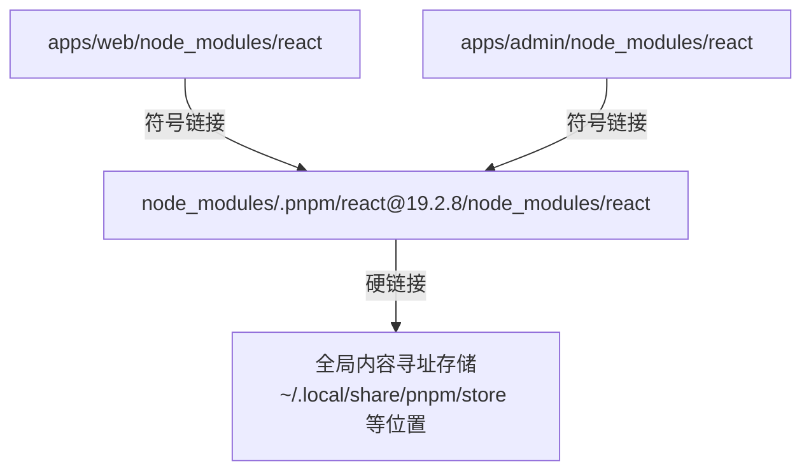

# pnpm workspace 与 monorepo

一个人做产品，很快就会有不止一个 app：网页端、管理后台、移动端、官网、服务端。它们之间有大量要共享的东西：类型定义、业务口径、UI 组件、lint 配置。放在一个仓库里，用 pnpm workspace 管理，是目前 TypeScript 全栈最顺手的方案。本章先讲 pnpm 的依赖布局为什么和 npm 不一样，再讲 workspace 包之间怎么引用，最后看 hatch-counter 这个有六个 app、两个共享包和十来个工具包的仓库是怎么组织的。

本章以 **pnpm 9**（hatch-counter 用 `packageManager: "pnpm@9.15.0"` 锁定）为准，pnpm 10 的差异会单独指出。

## pnpm 的依赖布局

### npm 平铺的问题

npm 和 Yarn Classic 把依赖尽量**平铺**在 `node_modules` 顶层。这带来了**幽灵依赖**：你的 `package.json` 里没写 `debug`，但因为某个依赖用了它，它被平铺到了顶层，你的代码 `import "debug"` 也能跑。直到某天那个依赖不再用 `debug`，你的代码就坏了，而 `package.json` 一行没变。

### 内容寻址存储 + 符号链接

pnpm 默认的 `node-linker=isolated` 布局是这样的：



- 每个包的每个版本只在全局 store 里存一份，所有项目通过硬链接共用，省磁盘
- 每个包只能看到自己 `package.json` 里声明的依赖（项目的 `node_modules` 下只有直接依赖的符号链接），**幽灵依赖直接报错**
- 真实文件都在 `node_modules/.pnpm/` 下，按 `名字@版本` 分目录

严格是好事，但不是所有工具都适应。某些工具假设依赖是平铺的，在 isolated 布局下会找不到模块。pnpm 给了几个逃生口：

| 配置（`.npmrc`） | 作用 |
|---|---|
| `node-linker=isolated` | 默认，严格的符号链接布局 |
| `node-linker=hoisted` | 完全平铺，和 npm 一样 |
| `shamefully-hoist=true` | 在 isolated 基础上，把所有依赖也提升到根 `node_modules` |
| `public-hoist-pattern` | 只提升匹配的包（默认会提升 eslint、prettier 相关的包） |

两个仓库正好选了不同的方案：

- hatch-counter：`node-linker=isolated` + `shamefully-hoist=true`。注释写着移动端的 Metro 和根上的两个 `@types` 都是在这套布局下验过的，「改它等于把每个包的依赖重排一遍」
- hatch-shelf（本书架的仓库）：`node-linker=hoisted`，注释是 React Native / Metro 在 isolated 链接下仍有兼容问题

结论是：**纯 Web 项目用默认的 isolated；带 React Native 的仓库多半要放宽**。选定之后就别再动，`.npmrc` 改一个值，整个仓库的依赖布局都会重排，出问题的地方往往和改动毫无关系。

### 一个隐蔽的类型坑

hatch-counter 根 `package.json` 里有 `@types/react` 和 `@types/react-dom`，而根本身一行 React 都不写。项目规则说「别删」，原因是：

`.pnpm/` 里的第三方库（recharts、react-day-picker、lucide-react）需要 React 的类型，它们从自己的位置往上找 `node_modules/@types/react`，只能找到仓库根。删掉之后，这些库的类型在 `skipLibCheck` 的掩护下**静默退化成 `any`**，症状是你自己的代码里冒出一堆隐式 any，看起来和 React 毫无关系。

这类问题的通用排查思路：类型莫名变成 `any` 时，在编辑器里跳转到那个库的类型定义，看它 import 的类型能不能解析到。

## workspace

### 声明哪些目录是包

```yaml
# pnpm-workspace.yaml（hatch-counter）
packages:
  - "apps/*"
  - "packages/*"
  - "tools/*"
```

每个匹配目录下有 `package.json` 的，就是一个 workspace 包。根目录本身也是一个包（通常 `private: true`，只放全仓共用的开发工具）。

### workspace 协议

包之间用 `workspace:` 协议互相依赖：

```json
{
  "name": "@counter/web",
  "dependencies": {
    "@counter/core": "workspace:*"
  }
}
```

`workspace:*` 表示「永远链接到仓库里的那份」，pnpm 会把 `apps/web/node_modules/@counter/core` 链接到 `packages/core`。如果哪天要发布到 npm，pnpm 会把 `workspace:*` 替换成实际版本号；私有仓库不发布，就一直是链接。

### 常用命令

```bash
pnpm install                          # 根目录执行，装整个 workspace
pnpm add zod --filter @counter/core   # 给某个包加依赖
pnpm add -D -w prettier               # 给根加开发依赖（-w 表示 workspace root）
pnpm -r typecheck                     # 在每个有 typecheck 脚本的包里运行
pnpm --filter @counter/web build      # 只在一个包里运行
pnpm --filter "@counter/web..." build # 这个包及它的所有依赖
pnpm -C apps/web dev                  # 切到目录执行，等价于 cd apps/web && pnpm dev
```

`-r`（recursive）会按依赖拓扑顺序执行：先跑 `packages/core`，再跑依赖它的 app。

hatch-counter 在根 `package.json` 里给六个 app 挂了短名：

```json
{
  "scripts": {
    "typecheck": "pnpm -r typecheck",
    "test": "pnpm -r test",
    "api": "pnpm -C apps/api",
    "web": "pnpm -C apps/web",
    "admin": "pnpm -C apps/admin"
  }
}
```

于是 `pnpm web dev` 就是 `pnpm -C apps/web dev`，后面的参数原样传过去。这个小技巧在 app 多的仓库里很省事。

### 脚本名别撞内置命令

项目文档里记了一次事故：移动端有个脚本叫 `publish`，`pnpm publish` 执行的是 pnpm 内置的发布命令，而不是你写的脚本。CI 里四个 job 全绿，群里播了「发布成功」，实际什么都没做。同理还有 `pack`、`deploy`、`link`、`prune` 等。另外 `prebuild`、`postinstall` 这类名字会被当成生命周期钩子自动执行。**自定义脚本取一个不会被误解的名字**，比如生成原生工程的脚本叫 `native` 而不叫 `prebuild`。

## 共享包的两种形态

workspace 里的共享包，交付给使用方的方式有两种，hatch-counter 两种都有：

| | `@counter/core`：预编译 | `@counter/web-shell`：源码直出 |
|---|---|---|
| `package.json` 入口 | `main: dist/index.js`、`types: dist/index.d.ts` | `exports` 直接指向 `./src/index.ts` |
| 产物 | `tsc` 编译成 CommonJS + 声明文件 | 不编译 |
| 使用方 | NestJS 服务端、网页端、后台、移动端 | 只有两个 Vite 前端 |
| 优点 | 谁都能用，Node 可以直接 `require` | 改了立刻生效，无需构建，无需 watch |
| 代价 | 使用方启动前 `dist/` 必须存在且是新的 | 使用方必须有能编译 TS/TSX 的打包器 |

```json
{
  "name": "@counter/web-shell",
  "type": "module",
  "exports": {
    ".": "./src/index.ts",
    "./ui/*": "./src/ui/*.tsx",
    "./theme.css": "./src/theme.css"
  },
  "peerDependencies": { "react": "^19.2.8" }
}
```

选择的依据很简单：**消费者里有没有不经过打包器的**。core 要被 NestJS 在 Node 里直接 `require`，就必须预编译；web-shell 只给 Vite 用，源码直出最省事。

### 预编译包的三个代价

core 选了预编译，就要付出几个代价，每一个在 hatch-counter 里都写进了规则：

1. **启动前 `dist/` 必须在**：网页端的 `dev` 和 `build` 脚本都先显式执行一次 `pnpm --filter @counter/core build`。规则特别说明「别改成靠 pre/post 钩子」，显式写出来一眼可见
2. **开发时要 watch**：`dev` 脚本用 `concurrently` 同时跑 core 的 `tsc --watch` 和 Vite
3. **出 CommonJS 带来的连锁反应**：浏览器端要 `optimizeDeps.include`（见第 4 章）；`exports` 之外还要写 `main` + `types`，因为网页端的测试配置用的是 `moduleResolution: node`，看不见 `exports` 字段

```json
{
  "scripts": {
    "dev": "pnpm --filter @counter/core build && concurrently -k -n core,vite \"pnpm --filter @counter/core dev\" \"vite\"",
    "build": "pnpm --filter @counter/core build && vite build"
  }
}
```

这些规则还有一个共同点：错了都是**构建不报错、启动才崩**，所以必须写下来。

### 共享包的边界

core 的 `tsconfig.json` 里 `lib` 只给 `["ES2022"]`，不给 `DOM`：它是多端共用的业务口径，一旦用到 `window` / `document`，编译当场失败。**用编译器配置来守边界**，比在文档里写「core 里不要用 DOM」可靠得多。hatch-shelf 的 `@shelf/spec` 也是同样的约束：不得依赖 Node 或 RN 专有的 API。

类似地，ESLint 配置里有一条 `no-restricted-imports` 禁止 `@counter/core/*` 这种深路径导入，因为 core 只从入口导出，深路径进不了打包（第 8 章细讲）。

## 依赖版本的一致性

monorepo 里同一个依赖在多个包里各写一份版本号，很容易漂移：网页端 `react@19.2.8`、后台 `react@19.1.0`，同一个页面里出现两份 React 就会报 hooks 错误。

| 办法 | 说明 |
|---|---|
| 人工保持一致 | hatch-counter 目前的做法，几个 app 的 React、Radix、Tailwind 版本号对齐 |
| pnpm catalog | `pnpm-workspace.yaml` 里定义 `catalog:`，各包写 `"react": "catalog:"`，版本只写一处（pnpm 9.5 起支持） |
| `peerDependencies` | 共享 UI 包把 React 声明为 peer，由使用方提供，保证只有一份 |
| `pnpm why react` | 查某个包为什么被装了、装了几份 |

```yaml
# pnpm-workspace.yaml 使用 catalog 的写法
packages:
  - "apps/*"
  - "packages/*"
catalog:
  react: ^19.2.8
  react-dom: ^19.2.8
```

`@counter/web-shell` 把 React 放在 `peerDependencies`，正是为了不在后台里装出第二份 React。

### pnpm 10 的一个变化

pnpm 10 默认**不再执行依赖的生命周期脚本**（`postinstall` 等），需要在配置里显式列出允许执行构建脚本的包。这是供应链安全的改进，但升级时如果某个依赖靠 `postinstall` 下载二进制（比如某些图像处理库），会出现装完不能用的情况。升级前读官方的变更说明。

## 什么时候需要 Turborepo、Nx

pnpm 的 `-r` 和 `--filter` 已经能按拓扑顺序跑任务。Turborepo、Nx 在此基础上加了**任务缓存**（输入没变就跳过）和远程缓存。对于一个人维护、十几个包的仓库，`pnpm -r` 通常够用；hatch-counter 就没有引入它们。当全仓 `typecheck` 和 `test` 慢到影响节奏时，再考虑。

## 本章要点

- pnpm 默认的 isolated 布局用符号链接 + 内容寻址存储，消灭幽灵依赖
- 带 React Native 的仓库常需要 `hoisted` 或 `shamefully-hoist`；选定后别动
- 第三方库的类型要能往上找到 `@types/react`，否则静默退化为 `any`
- `workspace:*` 链接本地包；`-r` 按拓扑顺序执行，`--filter` 选包，`-C` 切目录
- 脚本名别撞 pnpm 内置命令和生命周期钩子
- 共享包两种形态：有 Node 直接消费就预编译，只给打包器用就源码直出
- 用 `tsconfig` 的 `lib`、ESLint 的导入限制来守共享包的边界
- 同一依赖的版本用 catalog 或 peerDependencies 保持唯一

## 动手练习

在一个空目录里搭一个最小 workspace：根 `package.json`（`"private": true`）、`pnpm-workspace.yaml`（`packages: ["packages/*"]`），下面两个包：`packages/a`（`name: "@demo/a"`，`index.js` 里 `module.exports = "from a"`）和 `packages/b`。

1. **复现幽灵依赖**：`packages/b/package.json` 写上 `"dependencies": { "@demo/a": "workspace:*", "express": "^4" }`，在根目录 `pnpm install`，然后在 `packages/b` 里运行：

   ```bash
   node -e 'console.log(require("@demo/a")); require("debug")'
   ```

   再看 `ls -la node_modules/@demo/` 和 `ls node_modules/.pnpm | grep debug`。

   验证：第一行打印 `from a`；`require("debug")` 抛出 `MODULE_NOT_FOUND`，尽管 `.pnpm` 里确实有 `debug@...`（它是 express 的依赖）。`node_modules/@demo/a` 是指向 `../../../a` 的符号链接。用 npm 在一个独立目录里装 express，同一句 `require("debug")` 能成功。

   参考答案：isolated 布局下，`b` 的 `node_modules` 只有它声明过的依赖，express 的间接依赖藏在 `.pnpm` 里看不到；npm 平铺时 `debug` 被提升到顶层，代码碰巧能跑，这就是幽灵依赖。

2. **-r 按拓扑顺序执行**：给 `a`、`b` 各加一个 `"build": "echo build-x"` 脚本（`b` 依赖 `a`），在根目录运行 `pnpm -r build`，然后试 `pnpm --filter @demo/b build` 和 `pnpm --filter "@demo/b..." build`。

   验证：`-r` 时 `build-a` 总在 `build-b` 之前；`--filter @demo/b` 只打印 `build-b`；`--filter "@demo/b..."` 两个都打印，`a` 在前。

   参考答案：pnpm 按 workspace 依赖关系排出拓扑顺序；`...` 后缀表示「连同它的依赖一起」。这就是 hatch-counter 能用 `pnpm -r typecheck` 让 core 先于各个 app 检查的原因。

3. **脚本名撞上内置命令和钩子**：在根 `package.json` 里加三个脚本：`"prebuild": "echo PRE-HOOK"`、`"build": "echo ROOT-BUILD"`、`"pack": "echo MY-PACK-SCRIPT"`。分别运行 `pnpm build` 和 `pnpm pack`，然后试 `pnpm run pack`。

   验证：`pnpm build` 先打印 `PRE-HOOK` 再打印 `ROOT-BUILD`；`pnpm pack` 不会打印 `MY-PACK-SCRIPT`，而是执行 pnpm 内置的打包命令（根包没有版本号时报 `ERR_PNPM_PACKAGE_VERSION_NOT_FOUND`）；`pnpm run pack` 才执行你的脚本。

   参考答案：`pre*` / `post*` 会被当成生命周期钩子自动执行；和内置命令同名的脚本，不加 `run` 时被内置命令抢先。本章那次「发布成功但什么都没做」的事故就是这样来的。
