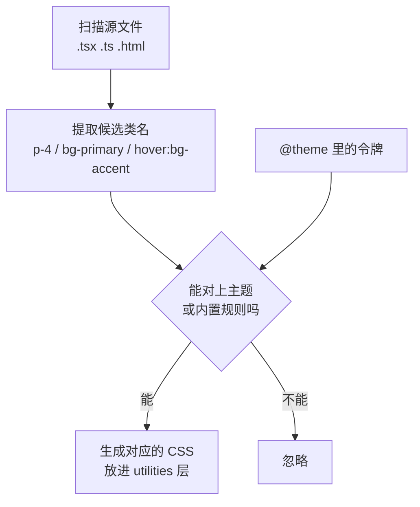

# Tailwind 4 与设计令牌

Tailwind 常被批评为「把样式写回了 HTML 里」。但它真正的价值不在省掉一个 CSS 文件，而在于**约束**：间距只能取 `p-2`、`p-4` 这些档位，颜色只能取主题里定义好的那几个名字。约束背后是一套**设计令牌**（design tokens）。本章讲 Tailwind 4 相对 v3 的变化、它怎么生成 CSS，以及如何用 CSS 变量和 `@theme` 搭一套支持深浅主题的令牌体系，hatch-counter 的 `src/index.css` 是一个非常完整的范例。

本章以 **Tailwind CSS 4.3**（hatch-counter 锁定 `tailwindcss` 和 `@tailwindcss/vite` 都是 `^4.3.3`）为准。

## v4 变了什么

| | Tailwind 3 | Tailwind 4 |
|---|---|---|
| 配置 | `tailwind.config.js`（JS） | CSS 里的 `@theme` 指令（CSS-first） |
| 入口 | `@tailwind base; @tailwind components; @tailwind utilities;` | `@import "tailwindcss";` |
| 扫描源文件 | 手写 `content: [...]` | 自动探测，忽略 `.gitignore` 里的文件；需要时用 `@source` 补充 |
| 集成方式 | PostCSS 插件 | 官方 Vite 插件 `@tailwindcss/vite`，也保留 PostCSS 插件和 CLI |
| 主题值 | 编译期常量 | 全部输出为 CSS 变量（`--color-primary` 等） |
| 自定义工具类 | `@layer utilities { }` 或 JS 插件 | `@utility` 指令 |
| 自定义变体 | JS 插件 | `@custom-variant` 指令 |
| 浏览器要求 | 较宽 | 依赖层、`@property`、`color-mix()`；官方给出 Safari 16.4+、Chrome 111+、Firefox 128+ |

最后一行就是 hatch-counter 兼容线 Chrome 111 的来源（第 2、4 章）。Tailwind 4 是一个「要现代浏览器」的版本，如果你的用户里有大量老浏览器，要么停在 v3，要么像 hatch-counter 一样明确提示换浏览器。

hatch-counter 的 `components.json`（shadcn 的配置）里 `"tailwind": { "config": "" }`，也就是没有 JS 配置文件，一切都在 CSS 里。

## Tailwind 怎么生成 CSS



关键在第一步：Tailwind **不执行你的代码**，只是把源文件当文本扫描，找出长得像类名的字符串。所以：

```tsx
// 坏：扫描器看不到完整的类名，bg-red-500 不会被生成
<div className={`bg-${color}-500`} />

// 好：完整的类名写在源码里
const bg = { red: "bg-red-500", green: "bg-green-500" } as const;
<div className={bg[color]} />
```

这也是 class-variance-authority（cva）流行的原因之一：所有变体的类名都完整地写在一个对象里，扫描器能看到。

## 设计令牌是什么

设计令牌是设计决策的命名变量。通常分两层：

| 层 | 例子 | 说明 |
|---|---|---|
| 原始令牌（primitive） | `orange-600 = #c4532b` | 调色板里有哪些颜色 |
| 语义令牌（semantic） | `primary = orange-600`、`destructive = red-600` | 这个颜色**用来干什么** |

组件只引用语义令牌。好处是换主题时只改语义令牌的映射，组件一行不动。深色模式本质上就是「同一套语义令牌，另一套取值」。

hatch-counter 的注释里有一条很有代表性的约定：状态提示「一律用 `--success` / `--warning` / `--info` / `--destructive`，别再写 `amber-700` 这种调色板色——深色底上那些颜色是另一套数」。直接用调色板色，就等于绕过了语义层，深色模式下必然出问题。

## 用 CSS 变量和 @theme 搭令牌

Tailwind 4 + shadcn 的标准做法分三步，下面全部取自 hatch-counter 的 `src/index.css`（节选）。

### 第一步：语义变量，深浅各一份

```css
@import "tailwindcss";
@import "tw-animate-css";

@custom-variant dark (&:is(.dark *));

:root,
.light {
  color-scheme: light;
  --radius: 0.5625rem;
  --background: #faf8f4;
  --foreground: #221c17;
  --card: #ffffff;
  --primary: #c4532b;
  --primary-foreground: #ffffff;
  --muted-foreground: #6f675f;
  --border: #e9e4dc;
  --success: #2f8f58;
  --warning: #a8680e;
  --info: #2e8c9a;
}

.dark {
  color-scheme: dark;
  --foreground: #f2eae0;
  --card: #211c17;
  --primary: #da6840;
  --muted-foreground: #b5aa9e;
  --border: #3a322a;
  --success: #62cc8f;
  --warning: #e7b45e;
  --info: #6cc4d0;
}
```

几个细节：

- `color-scheme` 告诉浏览器当前是深还是浅，滚动条、表单控件、空白画布会跟着变色
- `@custom-variant dark (&:is(.dark *))` 把 Tailwind 的 `dark:` 变体改成「祖先有 `.dark` 类」，而不是默认的 `prefers-color-scheme` 媒体查询。这样用户可以在设置里手动选主题，不必跟随系统
- 成对出现的 `xxx` / `xxx-foreground`：背景色和放在它上面的文字色总是一起定义，保证对比度

深色主题的取值不是简单反色。注释里解释了品牌橙为什么不照搬设计稿的两个值：`--primary` 既用于文字也用于按钮底色，亮的那个托不住按钮上的白字，暗的那个当文字在深底上太闷，最后取了中间值 `#da6840`。**一个语义令牌承担的用途越多，取值越难两全**，这时就该考虑拆令牌。

### 第二步：用 @theme 把变量接进 Tailwind

```css
@theme inline {
  --color-background: var(--background);
  --color-foreground: var(--foreground);
  --color-card: var(--card);
  --color-primary: var(--primary);
  --color-primary-foreground: var(--primary-foreground);
  --color-muted-foreground: var(--muted-foreground);
  --color-border: var(--border);
  --color-success: var(--success);
  --color-warning: var(--warning);
  --radius-md: calc(var(--radius) - 2px);
  --radius-lg: var(--radius);
  --shadow-card: 0 10px 30px var(--shade-soft);
  --font-sans: -apple-system, BlinkMacSystemFont, "PingFang SC", "Hiragino Sans GB", "Microsoft YaHei", sans-serif;
}
```

`@theme` 里的变量名有约定的**命名空间**，Tailwind 根据前缀决定生成哪些工具类：

| 命名空间 | 生成 |
|---|---|
| `--color-*` | `bg-*`、`text-*`、`border-*`、`ring-*`、`fill-*` 等 |
| `--radius-*` | `rounded-*` |
| `--shadow-*` | `shadow-*` |
| `--font-*` | `font-*` |
| `--spacing` | 所有间距的基数，`p-4` = `calc(var(--spacing) * 4)` |
| `--breakpoint-*` | 视口断点变体 `md:` 等 |
| `--container-*` | 容器查询变体 `@lg:` 等 |

定义了 `--color-success`，就自动有了 `text-success`、`bg-success/10`（带透明度，底层用 `color-mix()` 实现）。

### 为什么要 inline

`@theme` 和 `@theme inline` 的区别在于生成的工具类里写什么：

| | 生成的 `.bg-primary` |
|---|---|
| `@theme` | `background-color: var(--color-primary)` |
| `@theme inline` | `background-color: var(--primary)` |

不加 `inline` 时，`--color-primary: var(--primary)` 这个变量本身定义在 `:root` 上，它的 `var(--primary)` 在 `:root` 处就解析了，于是拿到的永远是浅色值；子树里 `.dark` 重新定义 `--primary`，`--color-primary` 也不会跟着变。加上 `inline`，工具类直接引用 `var(--primary)`，在元素自己的位置解析，就能跟随最近的 `.dark` / `.light` 作用域。**令牌引用了其他变量、又需要按作用域切换时，用 `@theme inline`**。

这正是 hatch-counter 能「在浅色页面里画一块深色预览」的前提。

### 第三步：组件只用语义类

```tsx
<div className="bg-card text-card-foreground rounded-lg border shadow-card">
  <p className="text-muted-foreground text-sm">毛利率</p>
  <p className="text-success text-2xl font-semibold">32.5%</p>
</div>
```

这段代码里没有一个具体的颜色值，也没有 `dark:` 前缀，深浅主题全部由变量处理。`dark:` 变体只留给「深色下结构真的不同」的少数情况。

## 令牌体系的几个实践

### 从设计稿同步

hatch-counter 的设计稿里有一套 `f-*` 变量，`index.css` 里的大部分令牌注释写着「照搬」「值跟稿子逐个对得上，改的话两边一起改」。设计稿 → 代码的令牌同步，在一个人的项目里手工维护就够了，关键是**两边用同一套名字**，对得上号。

### 令牌不够用时

通用的 shadcn 令牌（background、card、primary、muted、accent……）覆盖不了一个真实产品的所有需求。hatch-counter 在此之外又加了几组，每一组都有注释说明为什么不能复用已有的：

| 令牌组 | 为什么另起 |
|---|---|
| `--fill-good` / `--fill-bad` / `--fill-heat` | 热力格子的底色。状态色是给文字定的，兑进白底 10% 后彩度只剩一点点，一屏格子看着是一片灰 |
| `--cost-material` / `--cost-labor` …… | 开支五个大类的颜色，多处图表共用 |
| `--glass` / `--edge` / `--shade-soft` | 毛玻璃侧栏、卡片白边、软投影 |
| `--scrim` | 看大图时整窗压暗，深浅主题同一个值 |

这说明令牌的粒度应该**按用途**划分，而不是按颜色划分。同一个绿色用于文字和用于大面积底色，需要两个令牌。

### 用 color-mix 派生

```css
:root, .light, .dark {
  --paper: color-mix(in oklab, var(--card) 86%, oklch(0.9 0.06 85));
}
```

「纸的颜色」由卡片色兑一点米黄得出，不用深浅各写一份。注意它挂在三个选择器上：如果只挂在 `:root`，`var(--card)` 会在 `:root` 处解析，局部 `.dark` 里的纸色就不会变。这和上面 `@theme inline` 是同一个道理：**引用其他变量的派生变量，要在每个可能切换主题的作用域上重新声明**。

### 防止首帧闪白

主题类由 JavaScript 挂到 `<html>` 上，但 CSS 生效和 JS 执行之间有个空当。hatch-counter 用了两道保险：

1. `index.html` 里的阻塞内联脚本在第一帧之前读 `localStorage`，挂上 `.dark`（第 1 章）
2. CSS 兜底：两个类都还没挂上时，按系统偏好先给底色

```css
@media (prefers-color-scheme: dark) {
  :root:not(.light):not(.dark):not([data-theme="light"]) {
    color-scheme: dark;
    --background: var(--background-dark);
  }
}
```

## 和 tailwind-merge、cva 配合

Tailwind 项目里组件的样式基本靠三个小库：

| 库 | 作用 |
|---|---|
| `clsx` | 条件拼接类名：`clsx("a", ok && "b")` |
| `tailwind-merge` | 合并冲突的 Tailwind 类，后者胜出：`twMerge("p-2", "p-4")` → `"p-4"` |
| `class-variance-authority` | 声明式定义组件的变体（variant、size） |

hatch-counter 的 `cn()` 就是前两个的组合，第 7 章讲组件时会看到它的用法。`tailwind-merge` 需要知道你的自定义令牌才能正确判断冲突，比如它要知道 `shadow-card` 是一个阴影类；用了大量自定义命名空间时，查一下它的 `extendTailwindMerge` 配置。

## 本章要点

- Tailwind 4 改为 CSS-first：`@import "tailwindcss"`、`@theme`、`@utility`、`@custom-variant`；自动扫描源文件
- Tailwind 4 依赖现代 CSS 特性，浏览器线大约是 Chrome 111 / Safari 16.4
- 扫描器只看文本，类名要完整写在源码里，不能字符串拼接
- 令牌分原始和语义两层，组件只用语义令牌；深色模式 = 同一套语义令牌的另一套取值
- `@theme inline` 让工具类直接引用底层变量，从而跟随局部主题作用域
- 引用其他变量的派生令牌，要在每个主题作用域上重新声明
- 令牌按用途划分粒度：同一颜色用于文字和大面积底色要分开
