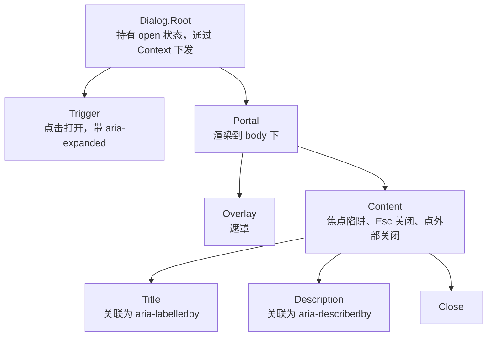

# Radix 等 headless 组件

一个下拉菜单看起来很简单：一个按钮，点一下弹出一个列表。可要做「对」，你得处理：键盘上下键移动高亮、回车选中、Esc 关闭并把焦点还给按钮、点外面关闭、屏幕阅读器能读出「菜单，3 项」、弹出层碰到窗口边缘自动翻转、在滚动容器里不被裁掉……每一项都不难，加起来是几百行容易出错的代码。**headless 组件库**把这些行为和无障碍做好，但不给任何样式，让你用自己的设计系统去画。本章以 Radix UI 为例讲 headless 组件的设计思路，再看 shadcn/ui 这种「把组件代码复制进你的仓库」的模式，以及 hatch-counter 在上面做的几处调整。

hatch-counter 网页端用的是按组件拆分的 Radix 包（`@radix-ui/react-dialog` 1.1、`@radix-ui/react-select` 2.3、`@radix-ui/react-dropdown-menu` 2.1 等），通过 shadcn 生成组件代码。

## 三种组件库

| 类型 | 例子 | 给你什么 | 代价 |
|---|---|---|---|
| 全样式组件库 | Ant Design、MUI | 行为 + 样式，开箱即用 | 改样式要和库的 CSS 斗争，长得都像 |
| headless 组件库 | Radix UI、React Aria、Headless UI、Base UI | 行为 + 无障碍，零样式 | 样式全部自己写 |
| 复制式组件集 | shadcn/ui | 基于 headless 库 + Tailwind 写好的组件**源码**，复制进你的仓库 | 代码归你维护，没有「升级」一说 |

对于有自己设计稿的产品，headless + 自己的样式是最舒服的组合：行为不用操心，长相完全自主。shadcn 则进一步省掉了「从零写样式」这一步，给一个合理的起点。

## Radix 的设计

### 复合组件

Radix 的每个组件都拆成若干部件，你按需组合：

```tsx
import * as Dialog from "@radix-ui/react-dialog";

<Dialog.Root open={open} onOpenChange={setOpen}>
  <Dialog.Trigger>新建规则</Dialog.Trigger>
  <Dialog.Portal>
    <Dialog.Overlay className="fixed inset-0 bg-black/40" />
    <Dialog.Content className="fixed top-1/2 left-1/2 -translate-x-1/2 -translate-y-1/2 rounded-2xl bg-card p-6">
      <Dialog.Title>新建周期开支</Dialog.Title>
      <Dialog.Description>每月自动记一笔</Dialog.Description>
      {/* 表单 */}
      <Dialog.Close>取消</Dialog.Close>
    </Dialog.Content>
  </Dialog.Portal>
</Dialog.Root>
```



Root 通过 React Context 把状态和 ID 分发给各部件。这种设计的好处是**结构由你决定**：标题放哪、按钮几个、要不要遮罩，都是你组合出来的，而不是组件的几十个 props。

### Dialog 替你做了什么

| 行为 | 说明 |
|---|---|
| 焦点陷阱 | 打开后 Tab 只在弹窗内循环，不会跑到背后的页面 |
| 初始焦点 | 打开时聚焦到第一个可聚焦元素 |
| 焦点归还 | 关闭后焦点回到触发按钮，键盘用户不会「迷路」 |
| Esc 关闭 | 可以通过 `onEscapeKeyDown` 阻止 |
| 点外部关闭 | 可以通过 `onPointerDownOutside` 阻止 |
| 背景滚动锁定 | 弹窗打开时页面不滚动 |
| 背景不可访问 | 背后的内容对屏幕阅读器隐藏 |
| ARIA 关联 | `role="dialog"`、`aria-modal`、`aria-labelledby` 指向 Title |

缺少 `Title` 时 Radix 会在控制台警告，因为屏幕阅读器无法朗读这个弹窗是什么。如果设计上确实不要可见标题，用视觉隐藏的方式保留它。

### 受控与非受控

每个有状态的 Radix 组件都同时支持两种用法：

```tsx
// 非受控：组件自己管状态
<Dialog.Root defaultOpen={false}>...</Dialog.Root>

// 受控：状态由你持有
const [open, setOpen] = useState(false);
<Dialog.Root open={open} onOpenChange={setOpen}>...</Dialog.Root>
```

需要在提交成功后程序化关闭弹窗、或者从别处打开它时，用受控模式。

### 用 data 属性暴露状态

Radix 不给样式，但会把组件当前状态写在 DOM 的 `data-*` 属性上：

| 属性 | 出现在 |
|---|---|
| `data-state="open"` / `"closed"` | Dialog、Popover、Collapsible 等 |
| `data-state="active"` / `"inactive"` | Tabs 的 Trigger 和 Content |
| `data-state="checked"` / `"unchecked"` | Switch、Checkbox |
| `data-highlighted` | 菜单项被键盘或鼠标高亮 |
| `data-disabled` | 禁用状态 |
| `data-side="top"` 等 | 浮层实际弹出的方向（翻转后） |

配合 Tailwind 的 data 变体，样式可以完全声明式地写：

```tsx
// hatch-counter 的 tabs.tsx（节选）
className="data-[state=active]:bg-background data-[state=active]:text-foreground data-[state=active]:shadow-sm text-muted-foreground ..."
```

动画也是这样做的，`tw-animate-css` 提供了 `animate-in`、`fade-in-0`、`zoom-in-95` 等类：

```tsx
className="data-[state=open]:animate-in data-[state=closed]:animate-out data-[state=closed]:fade-out-0 data-[state=open]:fade-in-0"
```

Radix 会等关闭动画播完才真正卸载内容（它通过监听动画结束事件实现），所以退出动画能完整播放。

### asChild 和 Slot

默认情况下 `Dialog.Trigger` 渲染一个 `<button>`。但你已经有一个样式好的 `Button` 组件了，不想要按钮套按钮。`asChild` 让 Radix 不渲染自己的元素，而是把行为（事件处理、ARIA 属性、ref）**合并到唯一的子元素上**：

```tsx
<Tooltip>
  <TooltipTrigger asChild>
    <Button variant="ghost" size="icon">
      <RefreshCw />
    </Button>
  </TooltipTrigger>
  <TooltipContent>立即同步</TooltipContent>
</Tooltip>
```

实现它的是 `@radix-ui/react-slot` 的 `Slot` 组件，它可以单独用在你自己的组件里。hatch-counter 的 `Button` 就支持 `asChild`：

```tsx
function Button({ className, variant, size, asChild = false, ...props }: ButtonProps) {
  const Comp = asChild ? Slot : "button";
  return <Comp data-slot="button" className={cn(buttonVariants({ variant, size, className }))} {...props} />;
}

// 一个长得像按钮的链接
<Button asChild>
  <a href="/export">导出</a>
</Button>
```

使用 `asChild` 时子元素必须能接收 ref 并把 props 透传到 DOM 上。React 19 起函数组件可以直接把 `ref` 当普通 prop 接收，不再需要 `forwardRef`，hatch-counter 的组件就是这样写的（`React.ComponentProps<"button">` 里已包含 `ref`）。

### Portal 与浮层定位

Dialog、Popover、Select、DropdownMenu、Tooltip 的内容默认通过 Portal 渲染到 `body` 下，跳出所有祖先的 `overflow: hidden` 和层叠上下文（第 2 章）。Popover、Tooltip 等还内置了基于 Floating UI 的定位：碰到视口边缘自动翻转到另一侧，`data-side` 告诉你最终翻到了哪边。

Portal 也有副作用：浮层不在原来的 DOM 位置上，**容器查询够不到它**。hatch-counter 的 `DialogContent` 因此自己挂了 `@container`，弹窗内部的排版才能用 `@sm:` 这类断点。

## shadcn/ui：组件代码归你

shadcn/ui 不是一个 npm 包，而是一个 CLI 加一套组件源码模板。`npx shadcn add dialog` 会把 `dialog.tsx` 写进你的 `src/components/ui/` 目录，并装上它依赖的 Radix 包。

```json
// hatch-counter apps/web/components.json
{
  "style": "new-york",
  "tailwind": { "config": "", "css": "src/index.css", "baseColor": "neutral", "cssVariables": true },
  "aliases": { "components": "@/components", "utils": "@/lib/utils", "ui": "@/components/ui" },
  "iconLibrary": "lucide"
}
```

这个模式的含义：

- **好处**：组件就是你的代码，想怎么改就怎么改，没有「这个库不支持这个 prop」的问题
- **代价**：没有升级。上游修了 bug，你得自己对比合并
- **配套约定**：hatch-counter 把 `src/components/ui/` 排除在 ESLint 和 Prettier 之外，「跟着生成器的格式走」，这样重新生成或对比上游时 diff 干净

hatch-counter 改过的地方，每一处都有注释说明原因，值得一看：

| 组件 | 改动 | 原因 |
|---|---|---|
| `DialogContent` 关闭按钮 | 图标外加 28px 浅底方块 | 原来点击区就是 16px 的图标本身，在弹窗角落很容易点空 |
| `DialogHeader` | 标题与描述间距 6px → 10px | 中文字形占满 em 框，标题和正文几乎贴在一起 |
| `DialogTitle` | `leading-none` → `leading-tight` | 行高等于字号时，中文长标题换行会两行叠在一起 |
| `DialogBody` | 新增，只有中间这块滚动 | 整个弹窗一起滚，填到底部字段时标题和保存按钮都看不见了 |

最后两条是 shadcn 默认样式在中文环境下的通病，几乎所有用 shadcn 做中文界面的项目都会遇到。

### cn() 与变体

```ts
// src/lib/utils.ts
import { clsx, type ClassValue } from "clsx";
import { twMerge } from "tailwind-merge";

export function cn(...inputs: ClassValue[]) {
  return twMerge(clsx(inputs));
}
```

每个 shadcn 组件都把外部传入的 `className` 放在最后交给 `cn()`，于是调用方可以覆盖默认样式：`<Button className="h-11">` 里的 `h-11` 会替换掉默认的 `h-9`，而不是两个都在、看 CSS 顺序碰运气（第 2 章讲过为什么会碰运气）。

变体用 cva 声明：

```ts
const buttonVariants = cva("inline-flex items-center justify-center gap-2 rounded-md text-sm font-medium ...", {
  variants: {
    variant: {
      default: "bg-primary text-primary-foreground hover:bg-primary/90",
      destructive: "bg-destructive text-white hover:bg-destructive/90",
      outline: "border bg-card hover:bg-accent",
      ghost: "hover:bg-accent hover:text-accent-foreground",
    },
    size: { default: "h-9 px-4 py-2", sm: "h-8 px-3 text-xs", icon: "size-9" },
  },
  defaultVariants: { variant: "default", size: "default" },
});
```

`VariantProps<typeof buttonVariants>` 自动推导出 `variant` 和 `size` 的联合类型，传错了编译报错。

## 和动画、状态相处

headless 组件的「打开 / 关闭」与你的数据状态之间有一个常见的时序问题。hatch-counter 的 `useFrozenWhenClosed` 就是为它写的：

```ts
/**
 * 关弹窗时父组件通常顺手把选中的对象置空，可 Radix 还要放 200ms 的淡出动画——
 * 内容跟着一起消失，弹窗就先塌成一条标题、再淡出。冻住这段动画期间的取值即可。
 */
export function useFrozenWhenClosed<T>(open: boolean, value: T): T {
  const last = useRef(value);
  if (open) last.current = value;
  return open ? value : last.current;
}
```

```tsx
const shown = useFrozenWhenClosed(open, selectedRule);
// 弹窗内容用 shown 而不是 selectedRule 渲染
```

这个 hook 在渲染期读写 ref，违反了 `react-hooks/refs` 规则，所以文件头上用 `eslint-disable` 注明了原因，项目也规定这类写法只能收在这一个 hook 里，不能在别处再写一遍（第 8 章）。

## 选型参考

| 需要 | 看 |
|---|---|
| Tailwind 项目，想快速起步 | shadcn/ui（底座以 Radix 为主，新版本也提供其他 headless 底座，以官方文档为准） |
| 无障碍要求很高、需要国际化细节（日期、数字输入） | React Aria |
| 只要几个简单组件 | Headless UI |
| 表格 | TanStack Table（同样是 headless） |
| 复杂表单 | React Hook Form 或 TanStack Form，配合 zod |

Radix 团队也发布了一个统一的 `radix-ui` 包，一次安装所有组件，新项目可以考虑；已经按组件拆包安装的项目没必要迁移。具体以 Radix 官方文档为准。

## 本章要点

- headless 组件提供行为和无障碍，不提供样式；适合有自己设计系统的产品
- Radix 用复合组件 + Context 组织部件，结构由你组合
- Dialog 替你处理焦点陷阱、焦点归还、Esc、滚动锁定、ARIA 关联；别省略 Title
- 状态通过 `data-state` 等属性暴露，用 Tailwind 的 `data-[...]:` 变体写样式和动画
- `asChild` / `Slot` 把行为合并到你自己的元素上，避免按钮套按钮
- 浮层走 Portal：逃出裁剪和层叠上下文，但也够不到外层的容器查询
- shadcn 的组件代码归你维护；外部 `className` 交给 `cn()` 合并以便覆盖
- 关闭动画期间数据被清空会导致内容塌陷，冻结关闭时的取值

## 动手练习

1. **cn() 合并了什么，没合并什么**：在任意目录 `pnpm add clsx tailwind-merge`，运行：

   ```js
   // cn.mjs
   import { clsx } from "clsx";
   import { twMerge } from "tailwind-merge";
   console.log(clsx("h-9 px-4 bg-primary", "h-11"));
   console.log(twMerge(clsx("h-9 px-4 bg-primary", "h-11")));
   console.log(twMerge("shadow-sm shadow-card"));
   ```

   先写下三行预测，再 `node cn.mjs`。

   验证：第一行是 `h-9 px-4 bg-primary h-11`（两个高度都在）；第二行是 `px-4 bg-primary h-11`；第三行原样输出 `shadow-sm shadow-card`，两个都保留。

   参考答案：`clsx` 只负责拼接，冲突要靠 `twMerge` 按 Tailwind 的分组去重，后者胜出。`shadow-card` 是项目自定义的令牌，`tailwind-merge` 默认不知道它属于阴影组，就不会把它和 `shadow-sm` 当成冲突。这时要用 `extendTailwindMerge` 告诉它自定义的阴影名，否则两个类同时生效，又回到看 CSS 生成顺序的老问题。

2. **检查 Dialog 替你做的事**：在一个装了 shadcn Dialog 的 Vite 项目里（`npx shadcn add dialog button input`），做一个带两个输入框的弹窗。只用键盘操作：Tab 到触发按钮、回车打开、连按 Tab、按 Esc。然后删掉 `DialogTitle` 再打开一次，看控制台。

   验证：打开后焦点落在弹窗内，连按 Tab 只在弹窗内的输入框和按钮之间循环；按 Esc 关闭后焦点回到触发按钮（按钮有焦点框）。DevTools Elements 面板里能看到 `role="dialog"`、`aria-labelledby` 指向标题的 id，以及触发按钮上 `aria-expanded` 随开关变化。删掉标题后，控制台出现 Radix 提示缺少 `DialogTitle` 的错误信息。

   参考答案：焦点陷阱、焦点归还和 ARIA 关联都由 Radix 处理；标题是屏幕阅读器朗读这个弹窗的依据，设计上不要可见标题时应视觉隐藏而不是删掉。

3. **去掉 Portal 看裁剪**：在一个 `overflow: hidden`、高 80px 的卡片里放一个 Radix Popover（`npx shadcn add popover`），弹出内容高 200px。先正常使用，再把 `popover.tsx` 里包住 `PopoverPrimitive.Content` 的 `PopoverPrimitive.Portal` 去掉（只是实验，改完记得还原）。

   验证：有 Portal 时弹层完整显示，Elements 面板里它挂在 `<body>` 末尾；去掉后弹层被卡片裁掉一大半，DOM 位置也回到了卡片内部。给卡片加上 `opacity: 0.99` 后，再在旁边放一个 `relative z-10` 的元素，无 Portal 版本的弹层还会被它盖住。

   参考答案：Portal 让浮层脱离祖先的 `overflow` 裁剪和层叠上下文，这是第 2 章两个问题的通用解法；代价是它也脱离了外层的容器查询。
