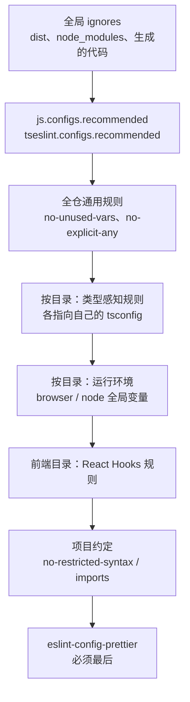

# ESLint / Prettier 的分工

代码检查工具最常见的失败方式不是「没装」，而是「装了没人看」：ESLint 输出几百条 warning，Prettier 和 ESLint 为同一行的分号来回改，每次提交 diff 里混着大片的格式变动。久而久之，大家学会了无视这些输出。本章讲清两个工具各管什么、怎么让它们不打架，以及怎么配置才能让 lint 一直保持「有输出就是真问题」的状态。hatch-counter 全仓一份 ESLint 配置，零 error 零 warning，它的 `eslint.config.mjs` 几乎每一块都写了原因，是很好的范本。

本章以 **ESLint 10**、**typescript-eslint 8.70**、**Prettier 3.9**、**eslint-plugin-react-hooks 7** 为准（hatch-counter 锁定的版本）。

## 一句话分工

hatch-counter 的规矩是：**排版归 Prettier，对错归 ESLint**。

| | Prettier | ESLint |
|---|---|---|
| 管什么 | 代码长什么样：缩进、换行、引号、分号、行宽 | 代码对不对：未使用的变量、漏了 await、hooks 依赖、危险写法 |
| 怎么管 | 把代码解析成 AST 再整个重新打印，**没有可选项** | 按规则逐条检查，报告或自动修复 |
| 可配置性 | 极少，故意的 | 极多 |
| 跑错了的代价 | 只是不好看 | 可能是 bug |

Prettier 的哲学是「不讨论风格」。它只给极少的选项，就是为了终结团队里关于分号和引号的争论。hatch-counter 的 `.prettierrc.json` 只改了一个值：

```json
{
  "printWidth": 120
}
```

文档里说这不是随便挑的，是照着现有代码量出来的：80 会把一半的函数签名折断，120 基本贴着作者原本的写法。而且「别改，改一次全仓重排一遍」。

## 让两者不打架

ESLint 早年有大量格式类规则（`indent`、`quotes`、`semi`），和 Prettier 的输出冲突。解决办法是在 ESLint 配置的**最后**挂上 `eslint-config-prettier`，它只做一件事：关掉所有和 Prettier 冲突的规则。

```js
// eslint.config.mjs 末尾
import prettier from "eslint-config-prettier";

export default tseslint.config(
  // ……其他配置
  // 关掉所有跟 Prettier 打架的风格规则，必须排在最后
  prettier,
);
```

必须在最后，因为扁平配置里后面的对象覆盖前面的。

不推荐的做法是 `eslint-plugin-prettier`，它把 Prettier 当成一条 ESLint 规则来跑，格式问题以 lint 错误的形式报出来。结果是 lint 输出里混满了「少个空格」的噪音，而且更慢。**两个工具分开跑**：

```json
{
  "scripts": {
    "lint": "eslint .",
    "lint:fix": "eslint . --fix",
    "format": "prettier --write .",
    "format:check": "prettier --check ."
  }
}
```

ESLint 自己也已经把格式类规则弃用，转交给社区的 ESLint Stylistic 项目维护。用 Prettier 的项目不需要它。

## 扁平配置

> [!WARNING]
> 「ESLint 10 移除 eslintrc」按 ESLint 官方博客《ESLint v10.0.0 released》（2026 年 2 月 6 日，原文说 eslintrc 配置系统已完全移除）整理。ESLint 小版本迭代很快（2026 年 11 月已到 10.14），配置细节以 eslint.org 最新文档为准。

ESLint 9 起扁平配置（`eslint.config.js` / `.mjs`）成为默认，旧的 `.eslintrc` 格式在 ESLint 10 中已经移除。扁平配置就是一个**配置对象的数组**，每个对象可以用 `files` / `ignores` 限定作用范围，后面的覆盖前面的：



hatch-counter 用 typescript-eslint 提供的 `tseslint.config()` 包装这个数组，它主要是提供类型提示和 `extends` 语法。较新的 ESLint 自带了 `defineConfig()` 做同样的事，typescript-eslint 也推荐迁移过去，新项目可以直接用后者（以两者官方文档为准）。

### 只有一个忽略对象时才是全局忽略

```js
{
  ignores: [
    "**/node_modules/**",
    "**/dist/**",
    // 钉到 apps/*：gradle 的产物落在 apps/<app>/release/。
    // 写成 **/release/** 的话会把 tools/release/ 整个吞掉，而且一声不响
    "apps/*/release/**",
    // shadcn 生成的：别手改，那也就没法照 lint 的意见改
    "apps/*/src/components/ui/**",
  ],
},
```

一个对象里**只有** `ignores` 时，它是全局忽略；如果同时有 `rules` 等字段，`ignores` 只是把这个对象自己的作用范围排除掉一部分。这是扁平配置最常见的误解之一。

`release/` 那条注释记录了一个三处都踩过的坑：`.gitignore`、ESLint、`.prettierignore` 里写裸的 `release/` 会匹配任意层级的同名目录，把 `tools/release/` 这个包整个吞掉。而结果是**无声的**：lint 照样绿（只是什么都没看）、`prettier --check` 照样说全部符合格式。**忽略规则要钉到具体路径**。

## 规则怎么选

### 没有 warning 这一档

hatch-counter 最值得借鉴的一条原则：

> 一条规则要么是闸门（error），要么在配置里明说不要并写清为什么。留成 warn 等于养一堆没人看的欠账。

warning 的问题是它不阻止任何事。CI 不会因为它失败，提交钩子不会拦它，于是它只会越积越多，直到 lint 输出成为背景噪音，真正的 error 也被淹没。

```js
{
  rules: {
    // 下划线开头表示「知道它没用上」：解构丢字段、占位参数都靠这个
    "@typescript-eslint/no-unused-vars": ["error", {
      argsIgnorePattern: "^_",
      varsIgnorePattern: "^_",
      caughtErrorsIgnorePattern: "^_",
      ignoreRestSiblings: true,
    }],
    // 这一档没有 warn：业务代码里一个 any 都没有，真要逃生就在那一行写 eslint-disable 并说为什么
    "@typescript-eslint/no-explicit-any": "error",
    // TS 自己就认标识符，no-undef 在 .ts 里只会误报
    "no-undef": "off",
  },
},
```

### 类型感知规则：挑真能抓 bug 的

typescript-eslint 有两套规则：普通规则只看语法树；**类型感知规则**会调用 TypeScript 编译器拿到类型信息，能发现更深的问题，但更慢，而且要能找到 `tsconfig`。

全量开启 `recommendedTypeChecked` 往往会因为大量 `any` 而刷屏。hatch-counter 只挑了四条：

```js
const TYPE_AWARE_RULES = {
  // 忘了 await 的 Promise：漏一个就是静默的时序错
  "@typescript-eslint/no-floating-promises": ["error", {
    allowForKnownSafeCalls: [
      { from: "package", package: "node:test", name: ["describe", "it", "test", "before", "after"] },
    ],
  }],
  // 把 async 函数传给只认同步返回值的地方（数组 filter、Express 中间件）
  "@typescript-eslint/no-misused-promises": ["error", { checksVoidReturn: { attributes: false } }],
  "@typescript-eslint/await-thenable": "error",
  "@typescript-eslint/no-unnecessary-type-assertion": "error",
};
```

| 规则 | 抓什么 |
|---|---|
| `no-floating-promises` | 调了返回 Promise 的函数却既不 await 也不处理错误 |
| `no-misused-promises` | 把 async 函数传给期望同步回调的地方，比如 `if (asyncFn())` 永远为真 |
| `await-thenable` | await 一个不是 Promise 的值，通常说明理解错了 API |
| `no-unnecessary-type-assertion` | 多余的 `as`，类型已经是那样了 |

两个配置细节：

- `checksVoidReturn: { attributes: false }`：允许 `onClick={async () => {...}}` 这种 JSX 写法，否则 React 里到处报错
- `node:test` 的 `describe` / `it` 确实返回 Promise，由测试运行器接管，所以用 `allowForKnownSafeCalls` 放行，而不是在测试里满地写 `void`

类型感知规则需要知道每个文件属于哪个 `tsconfig`。一个 app 常常有几套 tsconfig（网页端就有页面和测试两套），所以配置里按目录**显式指定**：

```js
{
  files: ["apps/web/tests/**/*.ts", "apps/web/src/types/**/*.ts"],
  languageOptions: {
    parserOptions: { project: "apps/web/tsconfig.test.json", tsconfigRootDir: import.meta.dirname },
  },
  rules: TYPE_AWARE_RULES,
},
{
  files: ["apps/web/src/**/*.{ts,tsx}", "apps/web/vite.config.ts"],
  ignores: ["apps/web/src/types/**"],
  languageOptions: {
    parserOptions: { project: "apps/web/tsconfig.json", tsconfigRootDir: import.meta.dirname },
  },
  rules: TYPE_AWARE_RULES,
},
```

新目录漏了配置不会报错，只是那块的类型感知规则**静默不跑**。hatch-counter 因此把 `tools/` 下的子包列表改成从文件系统读：

```js
// 名单照 tools/ 底下带 tsconfig.json 的目录现读，不手写：原来是一份数组，
// icons、docs 两个包加进来时都漏了，漏了的包只挨通用规则、类型感知那批静默不跑
const TOOL_PACKAGES = readdirSync(new URL("tools/", import.meta.url), { withFileTypes: true })
  .filter((d) => d.isDirectory() && existsSync(new URL(`tools/${d.name}/tsconfig.json`, import.meta.url)))
  .map((d) => d.name);
```

扁平配置就是 JavaScript，可以读文件、做循环，这是它比旧格式强的地方。typescript-eslint 较新的版本还提供了 `projectService` 选项，能自动为每个文件找到对应的 tsconfig，可以省掉这些手工映射，值得评估。

### React Hooks 规则

`eslint-plugin-react-hooks` 7 版本把一批原本服务于 React Compiler 的检查并入了推荐配置。hatch-counter 全部设为 error，只关了一条，并写了一大段理由：

```js
rules: {
  "react-hooks/exhaustive-deps": "error",
  /**
   * 唯一关掉的一条。它要求副作用里不能同步 setState，而本仓 30 处命中全是两类正经写法：
   * 订阅外部源之后把当前值写回 state，以及进页面取数。
   * 按规则改要换成 useSyncExternalStore 和 Suspense——那是架构决定，不是 lint 能推着走的，
   * 而它的收益（React Compiler 的自动 memo）本仓还拿不到。
   * 哪天真上了 compiler，先删这一行，再把那 30 处一起改。
   */
  "react-hooks/set-state-in-effect": "off",
},
```

这段注释示范了「关掉一条规则」应该怎么写：**为什么关、影响多大、什么条件下应该重新打开**。同一批里的 `purity`（渲染期调 `Date.now()`）、`static-components`（在组件里定义组件，每次渲染子树重挂、状态全丢）、`refs`（渲染期读写 ref）则保留，因为它们抓的问题不上 Compiler 也算 bug。

## 把项目约定写成规则

文档里写的约定会被遗忘，lint 规则不会。hatch-counter 用 ESLint 内置的两条通用规则实现了两个项目约定：

```js
{
  files: ["apps/*/src/**/*.tsx"],
  rules: {
    "no-restricted-syntax": ["error", {
      selector: 'JSXOpeningElement[name.name="input"] > JSXAttribute[name.name="type"][value.value="date"]',
      message: '日期选择用 shadcn 的 Calendar / shared/date-picker.tsx，别用 <input type="date">。',
    }],
  },
},
{
  files: ["apps/**/*.{ts,tsx}", "packages/**/*.ts"],
  rules: {
    "no-restricted-imports": ["error", {
      patterns: [{
        group: ["@counter/core/*", "**/packages/core/src/*"],
        message: 'core 只从包名根上导入（import { x } from "@counter/core"），深路径进不了打包。',
      }],
    }],
  },
},
```

`no-restricted-syntax` 接受 AST 选择器（语法类似 CSS 选择器），几乎任何「不许这样写」的约定都能表达。写选择器时可以借助 AST Explorer 这类在线工具查看节点结构。`message` 要写清**该用什么替代**，而不只是「不许」。

## 落地细节

### 编辑器

编辑器里装 ESLint 和 Prettier 扩展，保存时用 Prettier 格式化。但 hatch-counter 特意**没有**在保存时自动执行 `eslint --fix`，原因是 `--fix` 不是无脑安全的：`no-unnecessary-type-assertion` 会删掉「用来撑宽推断」的断言，比如 `key: g.group as string` 删掉之后，后面往同一个数组 push 别的字面量就类型不过。**自动修复后一定看 diff、跑一遍 typecheck**。

### Prettier 不收敛

罕见但存在：某些写法让 Prettier 在两种排法之间来回跳，跑一次变一次，`format:check` 永远失败。hatch-counter 撞上的是 `(await foo()).slice(0, 10).map(...)` 这种 await 挂在链头上的写法。对策是改写代码（把 await 拆成单独一句），而不是去调配置。

### 不进格式化的文件

`.prettierignore` 里除了产物和生成代码，hatch-counter 还排除了 `*.md`：Prettier 会把 `*斜体*` 换成 `_斜体_`，还按显示宽度把表格补齐成一大片，改一个格子整张表重排，diff 全是噪音。中文 Markdown 文档不进格式化是很常见的选择。

### 大面积格式化的提交

第一次引入 Prettier 时全仓重排，`git blame` 会全部停在那次提交上。把这类提交的 hash 写进 `.git-blame-ignore-revs`，再执行一次：

```bash
git config blame.ignoreRevsFile .git-blame-ignore-revs
```

GitHub 网页上的 blame 会自动识别这个文件。

### 在哪里跑

hatch-counter 没有 CI，规定提交前在本地跑四条：`pnpm format`、`pnpm lint`、`pnpm typecheck`、`pnpm test`；发版流水线里 `format:check` 和 `lint` 是硬闸门。用编码 agent 的话，把这四条写进 `CLAUDE.md`，agent 声明完成前必须跑通，效果和 CI 类似。

## Oxlint、Biome 与 Oxfmt

> [!WARNING]
> 本节按 2026 年 11 月的以下来源整理：oxc.rs 上 Oxlint、类型感知、JS 插件和 Oxfmt 的文档，Oxc 博客《Oxlint v1.0 Stable》（2025 年 6 月）和《Oxfmt Beta》（2026 年 2 月），Biome 官方博客 v2.5（2026 年 6 月）、v2.6（2026 年 10 月）和迁移指南，以及 npm 上的最新版本号（Oxlint 1.91、Oxfmt 0.76、Biome 2.6.4）。这几个工具几乎每周发版，规则覆盖和能力边界变得很快，以各自官方文档为准。

ESLint 和 Prettier 都是用 JavaScript 写的，仓库大了以后，lint 一次几十秒到几分钟很常见。近两年出现了两条用 Rust 重写的路线：

- **Oxc 项目**（和 Vite、Rolldown 同属 VoidZero，[第 4 章](04-vite-bundling.md#esbuildrolluprolldownoxc)提过它的解析器）拆成两个工具：**Oxlint** 对标 ESLint，**Oxfmt** 对标 Prettier。分工和本章前面讲的完全一致，可以只换其中一个
- **Biome**：一个工具同时做 lint 和格式化，一份 `biome.json`，走的是「一体化」路线

| 工具 | 替代谁 | 2026 年 11 月的成熟度 |
|---|---|---|
| Oxlint | ESLint | 1.x 稳定版，2025 年 6 月发布 1.0 |
| Oxfmt | Prettier | 0.x，2026 年 2 月进入 beta |
| Biome | 两者都替 | 2.x 稳定版 |

### Oxlint：先并跑，再决定替不替

Oxlint 内置 870 多条规则，覆盖 ESLint 核心规则和最常用的几个插件：typescript-eslint、React、import、unicorn、jsx-a11y、Jest、Vitest。官方给的数据是比 ESLint 快 50 到 100 倍。几个能力边界：

- **类型感知规则**：要另装 `oxlint-tsgolint`，加 `--type-aware` 打开，底层用的是 Go 重写的 TypeScript 7。官方文档写的是 typescript-eslint 的 61 条类型感知规则已支持 59 条（tsgolint 仓库 README 的计数口径略有不同），本章那四条（`no-floating-promises` 等）都在其中；代价是项目得先能跑在 TypeScript 7 上（`baseUrl` 这类旧选项要迁走），monorepo 里被依赖的包要先构建出 `.d.ts`
- **JS 插件**：能直接加载按 ESLint 9 以后的 API 写的插件，但官方仍标为 alpha；插件里的类型感知规则、Vue / Svelte 这类自定义解析器还不支持
- 迁移工具 `@oxlint/migrate` 能把现有的 `eslint.config.mjs` 转成 Oxlint 配置

官方推荐的渐进路线是**两个一起跑**：先跑 Oxlint，再跑 ESLint，ESLint 配置里挂上 `eslint-plugin-oxlint` 关掉两边重叠的规则。这样大部分检查走快的那条路，Oxlint 还没有的规则（项目约定、某些插件规则）留在 ESLint 里，哪天 Oxlint 都覆盖了，再把 ESLint 拿掉。

### Oxfmt：换掉 Prettier 的成本最低

Oxfmt 以 Prettier 的输出为基准，用 Prettier 自己的测试集来测；官方称已通过 Prettier JavaScript / TypeScript 一致性测试的全部用例，在 Prettier 本身有 bug 或前后不一致的地方会故意不同。它支持 JS、TS、JSON、YAML、CSS、Markdown、Vue 等二十来种格式，并内置了通常要靠 Prettier 插件才有的功能：import 排序、Tailwind 类名排序。迁移是一条命令：

```bash
pnpm add -D oxfmt && pnpm oxfmt --migrate prettier && pnpm oxfmt
```

边界在于：它还是 0.x 的 beta，**不支持 Prettier 插件**。官方的说法是，依赖某个插件的确切行为、而 Oxfmt 还没覆盖的话，就先留在 Prettier。另外，「和 Prettier 一致」指的是测试集，换过去后仍可能有少量 diff，按上面[大面积格式化的提交](#大面积格式化的提交)的办法处理。

### Biome：一个工具两件事

Biome 的卖点是一个二进制、一份配置，lint 和格式化一起跑。到 2.6 版，它有 500 多条规则；类型感知规则用自己的类型推断实现，**不依赖 TypeScript 编译器**，所以不用配 tsconfig 映射，但推断能力不如编译器完整；自定义规则用 GritQL 写插件，JavaScript 插件在 2.6 刚以「开发者预览」推出。2.6 还加了 Markdown、YAML、SCSS 的支持，其中 Markdown 格式化和 Prettier 的一致度约 92%。

迁移命令是 `biome migrate eslint --write` 和 `biome migrate prettier --write`。默认只迁移和 ESLint 规则**行为相同**的那些，插件规则要自己在 `biome.json` 里重新配；格式化的默认值和 Prettier 不同，迁移命令会把选项全部显式写出来。

### 什么时候换

| 情况 | 建议 |
|---|---|
| lint 不慢，靠类型感知规则和插件守质量 | 留在 ESLint，没有换的必要 |
| lint 慢到影响提交节奏 | 先加 Oxlint 并跑，关掉 ESLint 里重叠的规则 |
| 格式化慢，或想省掉几个 Prettier 插件 | 试 Oxfmt，先在一个分支里看全仓 diff |
| 依赖特定 Prettier 插件 | 留在 Prettier |
| 新项目，想要一个工具一份配置 | 可以直接用 Biome |

hatch-counter 留在 ESLint + Prettier，原因落在第一行：仓库规模下 lint 不是瓶颈，而它最看重的几块（指向各自 tsconfig 的类型感知规则、`eslint-plugin-react-hooks` 7 的那批检查、`no-restricted-syntax` 写的项目约定）都是 ESLint 生态里最成熟的部分。换工具前，先把这些规则逐条在新工具里找到对应项，找不到的就是并跑期间要留在 ESLint 里的部分。不管换哪个，本章的原则不变：排版和对错分开管，没有 warning 这一档，忽略规则钉到具体路径。

## 本章要点

- 排版归 Prettier，对错归 ESLint；`eslint-config-prettier` 放在配置最后
- 不要用 `eslint-plugin-prettier` 把格式问题混进 lint 输出
- ESLint 10 只有扁平配置；只含 `ignores` 的对象才是全局忽略；忽略规则钉到具体路径
- 没有 warning：规则要么是 error，要么关掉并写清原因和重新打开的条件
- 类型感知规则挑几条真能抓 bug 的；每个目录要指向正确的 tsconfig，漏了会静默失效
- 用 `no-restricted-syntax`、`no-restricted-imports` 把项目约定变成机器检查
- `--fix` 不是绝对安全，修完看 diff、跑 typecheck
- Oxlint、Oxfmt 分别对标 ESLint、Prettier，Biome 两者合一；lint 真慢了再换，先并跑、逐条对齐规则

## 动手练习

在空目录里 `pnpm add -D eslint typescript-eslint typescript`，写一个 `tsconfig.json`（`strict`、`jsx: "preserve"`、`include: ["src"]`）和下面这份配置：

```js
// eslint.config.mjs
import tseslint from "typescript-eslint";
export default tseslint.config(
  { files: ["**/*.js"], rules: { "no-debugger": "error" } },
  { files: ["**/*.js"], ignores: ["gen/**"], rules: { "no-console": "error" } },
  {
    files: ["src/**/*.{ts,tsx}"],
    extends: [tseslint.configs.base],
    languageOptions: { parserOptions: { project: "./tsconfig.json", tsconfigRootDir: import.meta.dirname } },
    rules: { "@typescript-eslint/no-floating-promises": "error" },
  },
);
```

1. **漏掉的 await**：`src/a.ts`：

   ```ts
   async function save(): Promise<void> {}
   export function onClick() {
     save();
     void save();
   }
   ```

   运行 `pnpm eslint .`，预测报几条、在哪一行。

   验证：只在第 3 行报 `@typescript-eslint/no-floating-promises`，提示 Promise 必须 await、加 `.catch` 或用 `void` 显式标记；第 4 行的 `void save()` 不报。把 `project` 那一行删掉再跑，ESLint 直接报错说这条规则需要类型信息。

   参考答案：这条规则要靠编译器知道 `save()` 返回 Promise，所以必须给出 tsconfig。`void` 是「我知道它是 Promise，也确实不想等」的显式声明，和 hatch-shelf 的 CLAUDE.md 要求一致。

2. **哪个 ignores 是全局的**：建 `gen/out.js`，内容只有一行 `debugger;`，运行 `pnpm eslint .`。然后把第二个对象整个换成 `{ ignores: ["gen/**"] }`（只剩 `ignores` 一个键），再运行。

   验证：第一次 `gen/out.js` 报 `no-debugger`；第二次 `gen/out.js` 不再出现在输出里。

   参考答案：和 `rules` 写在同一个对象里的 `ignores` 只把这个对象自己的作用范围排除掉，第一个对象仍然检查 `gen/`；只有「只含 `ignores`」的对象才是全局忽略。

3. **把约定写成规则**：在第三个对象的 `rules` 里加上本章的 `no-restricted-syntax`（禁止 `<input type="date">`，`message` 写成你自己的替代建议），建 `src/form.tsx`：`export const F = () => <input type="date" />;`，再运行 `pnpm eslint .`；然后把 `type="date"` 改成 `type="text"` 再跑。

   验证：第一次在 `form.tsx` 第 1 行报 `no-restricted-syntax`，错误信息就是你写的 `message`；改成 `text` 后不再报。

   参考答案：AST 选择器只匹配「`input` 元素上 `type` 属性的值为 `date`」这一种结构。`message` 写清该用什么替代，比只写「不许」有用得多。
