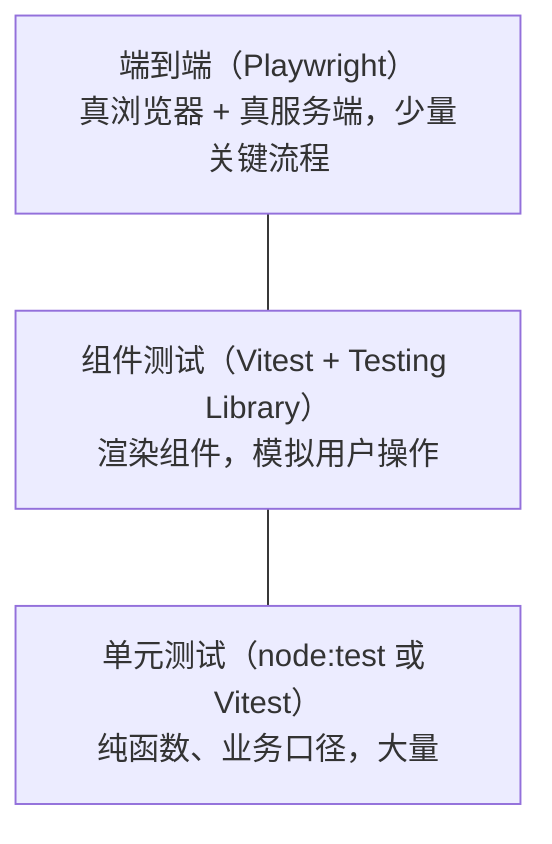

# Vitest 与 Playwright

前端测试的难处不在工具，而在「测什么」。测得太细，每次改样式都要改一堆快照；测得太粗，跑一次要几分钟，还时不时因为网络抖动失败。本章先讲清前端测试的分层和每层该测什么，再讲 Vitest（单元和组件测试）和 Playwright（端到端测试）怎么用。

一个诚实的前提：hatch-counter 的网页端**目前两样都没用**。它的测试全部用 Node 自带的 `node:test`，通过 `tsx` 直接跑 TypeScript，不起浏览器。这个选择本身就很有参考价值，所以本章从它讲起，再讲什么时候该引入 Vitest 和 Playwright、引入后怎么配。

## 测试分层



| 层 | 测什么 | 速度 | 稳定性 | 数量 |
|---|---|---|---|---|
| 单元 | 纯函数：计算、解析、格式化、状态转换 | 毫秒级 | 高 | 多 |
| 组件 | 一个组件或一小组组件的交互行为 | 几十毫秒 | 较高 | 中 |
| 端到端 | 用户在真浏览器里走完一条完整流程 | 秒级 | 受网络、时序影响 | 少 |

这个分层的核心原则是：**能在下层测的就别放到上层**。一个「毛利率计算」的边界情况，在单元测试里一行断言就能覆盖，放到端到端测试里要登录、建数据、点开页面、读 DOM，慢一百倍还更脆。

## hatch-counter 的做法：把逻辑挪出界面

hatch-counter 的测试大头在服务端（起真 Postgres、用 HTTP 打真进程）和 `packages/core`（纯业务口径）。网页端只剩不碰服务端的几样：读报表文件、表格照模板认列、业务日期的合法范围、周期开支落在哪几格、货架怎么分列……

```json
{
  "scripts": {
    "typecheck": "tsc --noEmit -p tsconfig.json && tsc --noEmit -p tsconfig.test.json",
    "test": "node --import tsx --test --test-reporter=spec \"tests/**/*.test.ts\""
  }
}
```

能这样做的前提是架构：

1. **业务口径在 `@counter/core`**：网页端、服务端、移动端调同一份代码，在 core 里测一次，几端都覆盖了
2. **界面和数据层分开**：页面只调 `window.api` 这张通道表，背后的 HTTP、缓存、令牌在 `src/host/` 里。`src/host/` 里不碰 DOM 的部分可以在 Node 里直接测
3. **布局算法写成纯函数**：「菜品好坏那面墙怎么排」「货架怎么分列」这类排版决策被提取成输入数据、输出排列的函数，不需要浏览器就能测

测试专用的 `tsconfig.test.json` 只给 `lib: ["ES2022"]` 和 Node 类型，不给 DOM：测试代码里一旦用到 `window` 就编译不过。又是用编译器守边界。

一个有意思的例子是 `stale-browser.test.ts`：`index.html` 里那段检测浏览器版本的内联脚本不经过打包，别的测试碰不到它。测试把两个注释标记之间的函数源码**原样抠出来**，用 `new Function` 执行，再喂一个假的 `window` 对象，验证检测逻辑和上报行为：

```ts
const html = readFileSync(resolve(__dirname, "../index.html"), "utf8");

function load() {
  const start = html.indexOf("// zgy:probe-start");
  const end = html.indexOf("// zgy:probe-end");
  assert.ok(start >= 0 && end > start, "index.html 里没找到 zgy:probe 那两个记号");
  const src = html.slice(start, end);
  return new Function(`${src}\nreturn { ok: zgyBrowserOk, report: zgyReportStale };`)();
}
```

**`node:test` 的适用面**：被测代码是纯 TS、不依赖 DOM 和打包器特性（`import.meta.env`、CSS 导入、路径别名）时，它零依赖、启动快、和 Node 版本同步升级，足够用了。

## 什么时候引入 Vitest

当你开始需要下面这些，`node:test` 就不够顺手了：

| 需要 | 原因 |
|---|---|
| 测 React 组件 | 需要 DOM 环境（jsdom / happy-dom）或真浏览器 |
| 被测代码用了 Vite 特性 | 路径别名、`import.meta.env`、导入 CSS 和图片，Vitest 复用 Vite 的转换管线 |
| 模块 mock | `vi.mock()` 替换整个模块，`node:test` 的 mock 能力较弱 |
| 监听模式、按改动只跑相关测试 | Vitest 的 watch 模式基于模块依赖图 |
| 快照、覆盖率开箱即用 | 内置 |

Vitest 和 Jest 的 API 基本兼容（`describe`、`it`、`expect`），最大的优势是**直接读 `vite.config.ts`**：别名、插件、`define` 全部共用，不用为测试再配一套转换。

### 配置

```bash
pnpm add -D vitest jsdom @testing-library/react @testing-library/user-event @testing-library/jest-dom
```

```ts
// vitest.config.ts
import { defineConfig, mergeConfig } from "vitest/config";
import viteConfig from "./vite.config";

export default mergeConfig(
  viteConfig,
  defineConfig({
    test: {
      environment: "jsdom",
      include: ["src/**/*.test.{ts,tsx}"],
      setupFiles: ["./src/test-setup.ts"],
    },
  }),
);
```

```ts
// src/test-setup.ts
import "@testing-library/jest-dom/vitest";
```

如果 `vite.config.ts` 里有只在构建时生效的插件（比如 hatch-counter 的 CSP 插件，`apply: "build"`），测试时不会触发，不用担心。

### 组件测试：按用户的方式查找元素

```tsx
import { render, screen } from "@testing-library/react";
import userEvent from "@testing-library/user-event";
import { describe, expect, it, vi } from "vitest";
import { RuleFormDialog } from "./rule-form-dialog";

describe("RuleFormDialog", () => {
  it("名称为空时不能保存", async () => {
    const user = userEvent.setup();
    const onSave = vi.fn();
    render(<RuleFormDialog open onOpenChange={() => {}} onSave={onSave} />);

    await user.click(screen.getByRole("button", { name: "保存" }));

    expect(onSave).not.toHaveBeenCalled();
    expect(screen.getByText("名称不能为空")).toBeInTheDocument();
  });
});
```

Testing Library 的原则是**按用户感知的方式查找元素**：优先 `getByRole`（角色 + 可访问名称），其次 `getByLabelText`、`getByText`，最后才是 `getByTestId`。好处有两个：测试不依赖 DOM 结构和类名，改样式不会挂；而且如果 `getByRole("button", { name: "保存" })` 找不到，往往说明这个按钮对屏幕阅读器也不可见，测试顺带检查了无障碍。上一章讲的 Radix 组件都带正确的 ARIA 角色，用这种方式查询很自然。

### 浏览器模式

jsdom 是用 JavaScript 模拟的 DOM，没有布局引擎：`getBoundingClientRect()` 永远返回 0，CSS 不生效，`ResizeObserver` 要自己补。像 hatch-counter 的 `ScrollBox` 这种依赖真实尺寸的组件，在 jsdom 里测不了。Vitest 提供了**浏览器模式**，在真浏览器里跑组件测试（底层可以用 Playwright 驱动），Vitest 4 起这一模式已转为稳定。需要测真实布局时考虑它，具体配置以 Vitest 官方文档为准。

## Playwright：端到端测试

端到端测试启动真浏览器，像用户一样操作完整的应用。它最适合覆盖**少数几条一旦坏了就是事故的关键流程**：登录、导入报表、拍单入库、导出。

### 安装和配置

```bash
pnpm add -D @playwright/test
pnpm exec playwright install chromium
```

```ts
// playwright.config.ts
import { defineConfig, devices } from "@playwright/test";

export default defineConfig({
  testDir: "./e2e",
  retries: process.env.CI ? 2 : 0,
  use: {
    baseURL: "http://localhost:5178",
    trace: "on-first-retry", // 失败重试时录制完整轨迹
  },
  projects: [{ name: "chromium", use: { ...devices["Desktop Chrome"] } }],
  webServer: {
    command: "pnpm dev",
    url: "http://localhost:5178",
    reuseExistingServer: !process.env.CI,
  },
});
```

`webServer` 让 Playwright 在测试前自动启动开发服务器。对 hatch-counter 这种薄客户端，还要同时起服务端和测试数据库，可以在 `webServer` 里配多个服务，或在全局 setup 里准备。

### 写一条测试

```ts
// e2e/expense.spec.ts
import { expect, test } from "@playwright/test";

test("记一笔开支后出现在流水里", async ({ page }) => {
  await page.goto("/#/expenses");
  await page.getByRole("button", { name: "记一笔" }).click();

  const dialog = page.getByRole("dialog");
  await dialog.getByLabel("金额").fill("128");
  await dialog.getByLabel("用途").fill("燃气费");
  await dialog.getByRole("button", { name: "保存" }).click();

  await expect(dialog).toBeHidden();
  await expect(page.getByRole("row", { name: /燃气费/ })).toBeVisible();
});
```

（页面元素名称为示意，非 hatch-counter 的真实界面。）

Playwright 稳定性好的关键在两点：

- **自动等待**：`click()` 会等元素可见、可点、不再动画；`expect(...).toBeVisible()` 会重试直到满足或超时。**永远不要写 `waitForTimeout(1000)`**，固定等待既慢又脆
- **定位器是惰性的**：`page.getByRole(...)` 不立刻查找，每次操作时重新查，元素重渲染也没关系

### 登录态复用

每条测试都走一遍登录很慢。Playwright 的做法是在一个 setup 项目里登录一次，把 cookie 和 localStorage 存成文件，其他测试直接加载：

```ts
// e2e/auth.setup.ts
import { test as setup } from "@playwright/test";

setup("登录", async ({ page }) => {
  await page.goto("/");
  // 用测试库里种子数据的账号登录（凭据从环境变量读，不写死在代码里）
  // ……填写并提交登录表单
  await page.context().storageState({ path: "e2e/.auth/owner.json" });
});
```

在配置里让其他项目依赖这个 setup 项目，并设置 `use: { storageState: "e2e/.auth/owner.json" }`。`.auth/` 目录要加进 `.gitignore`。

### 排查失败

| 工具 | 用法 |
|---|---|
| UI 模式 | `pnpm exec playwright test --ui`，逐步执行、看每一步的 DOM 快照 |
| Trace Viewer | `pnpm exec playwright show-trace trace.zip`，失败时的完整录像、网络、控制台 |
| Codegen | `pnpm exec playwright codegen localhost:5178`，操作页面自动生成定位代码 |

## 测试与编码 agent

用 Claude Code 这类 agent 写代码时，测试的角色变了：它是 agent **判断自己做没做对的唯一客观信号**。几个实践：

- 把 `pnpm typecheck` 和 `pnpm test` 写进 `CLAUDE.md` 作为完成的硬条件（hatch-counter 和 hatch-shelf 都这么做）
- 测试要快。agent 一次任务里可能跑十几遍，单元测试几秒跑完才不会拖慢节奏
- 让 agent 先写一个会失败的测试再改代码，能防止它「改了测试让测试通过」。hatch-counter 文档里有一条：分析类测试的断言是钉死的对照值，**别为了让测试过顺手改**
- 端到端测试适合在发版前跑，而不是每次小改动都跑

## 常见陷阱

| 陷阱 | 说明 |
|---|---|
| 测实现细节 | 断言组件内部 state、调用了哪个子组件。重构就挂，应该断言用户看得到的结果 |
| 大快照 | 整个页面的 DOM 快照，任何改动都要更新，最后大家无脑 `-u` |
| mock 过度 | 把被测逻辑依赖的东西全 mock 掉，测的只是 mock 本身。hatch-counter 服务端测试坚持用真 Postgres，理由是「RLS、触发器全是数据库自己的行为，mock 掉等于什么都没验」 |
| 测试间共享状态 | 一条测试的数据影响另一条；每条测试自己准备数据 |
| 并发与资源 | hatch-counter 服务端测试把并发钉在 4：每个文件最多占 19 条数据库连接，开到 8 份就会撞上 Postgres 默认连接上限，表现为偶发的连接拒绝 |

## 本章要点

- 测试分层：单元多、组件中、端到端少；能在下层测的不放上层
- 把逻辑从界面里挪出来（共享包、纯函数、数据层），大部分测试就不需要浏览器
- 纯 TS 逻辑用 `node:test` + `tsx` 足够；需要 DOM、Vite 特性或模块 mock 时用 Vitest
- Vitest 复用 `vite.config.ts`；组件测试用 Testing Library，优先 `getByRole`
- jsdom 没有布局，测真实尺寸用 Vitest 浏览器模式或 Playwright
- Playwright 覆盖少数关键流程；依赖自动等待，不写固定延时；登录态用 storageState 复用
- 对编码 agent 来说，快速可靠的测试是它判断对错的唯一客观信号
